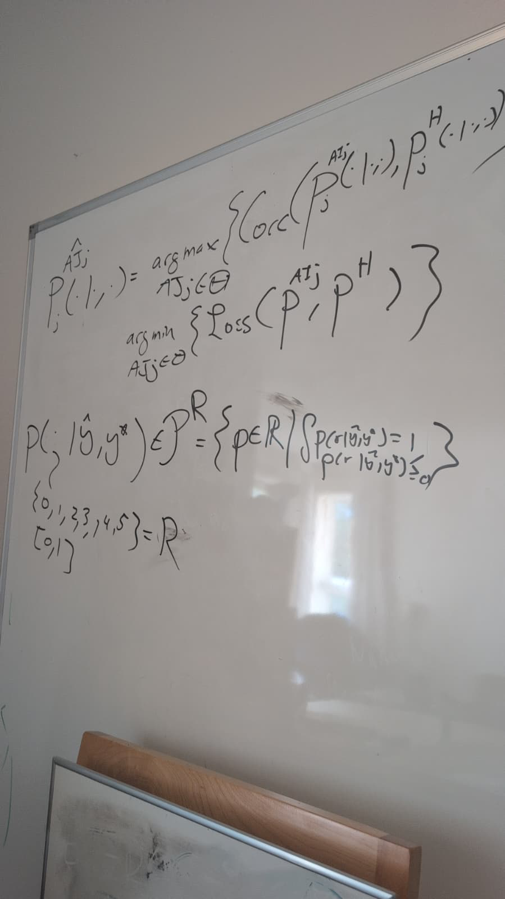

# judges-dont-need-psychometrics-or-corr

**Thesis.** To check whether an LLM (or agent) judge "works", stop computing Pearson/Spearman correlation with human scores and stop borrowing psychometric validity machinery. A judge is a probability distribution over scores. So treat judge evaluation and judge fitting the way ML treats everything else: **match the human score distribution, i.e. minimize a KL divergence.**

> "If humans have some taste, just match the taste distribution. That's it."

Status: **early, position-paper stage.** No empirical results yet. The toy script in `experiments/01_synthetic_pearson_vs_kl_squashed_judge_0to5/` is the only number-producing code so far.

---

## Whiteboard formulation (2026-11-07, with Sam B.)



A judge outputs a distribution over a score set $R$, conditioned on a candidate $\hat{y}$ and a gold reference $y^{\star}$:

```math
p(\cdot \mid \hat{y}, y^{\star}) \in \mathcal{P}^{R} = \left\lbrace p : R \to \mathbb{R} \;\middle|\; \sum_{r \in R} p(r \mid \hat{y}, y^{\star}) = 1,\ \ p(r \mid \hat{y}, y^{\star}) \ge 0 \right\rbrace,
\qquad R = \lbrace 0,1,2,3,4,5 \rbrace \ \text{or} \ [0,1].
```

**What the field does now:** pick the AI judge $\mathrm{AJ}_j$ that maximizes correlation with the human judge distribution $p^{H}_j$:

```math
\hat{p}^{\mathrm{AJ}}_j(\cdot \mid \cdot, \cdot) = \arg\max_{\mathrm{AJ}_j \in \Theta} \ \mathrm{Corr}\left( p^{\mathrm{AJ}_j}_j(\cdot \mid \cdot, \cdot),\ p^{H}_j(\cdot \mid \cdot, \cdot) \right)
```

**What we propose:** pick the judge that minimizes a distributional loss to the human judge (e.g. KL divergence):

```math
\hat{p}^{\mathrm{AJ}}_j(\cdot \mid \cdot, \cdot) = \arg\min_{\mathrm{AJ}_j \in \Theta} \ \mathcal{L}\left( p^{\mathrm{AJ}_j},\ p^{H} \right),
\qquad \text{e.g. } \mathcal{L} = D_{\mathrm{KL}}\left( p^{H} \,\Vert\, p^{\mathrm{AJ}_j} \right).
```

## 1. The problem

The usual way to validate a judge: collect human scores and judge scores on the same items, make a scatter plot, and report a correlation.

- **Pearson** only measures *linear* association. If the relationship isn't linear in the features you happened to plot, it tells you something misleading.
- **Spearman / Kendall** only measure *rank order*. They tell you whether the ordering is right, not whether the scores are.
- Together they still capture only **some** distributional properties of human judgment, not all of it. A judge can be highly correlated with humans while assigning a completely different score distribution (for example, giving everything a 4 or a 5). Correlation is also easy to over-read and invites spurious conclusions.
- **Psychometrics.** A common response is to import validity and reliability metrics from psychometrics. The argument here is that we don't need them. Fitting and evaluating a conditional distribution is a standard ML problem with mature tools.

Analogy from the call: means and variances are the first two "features" of a distribution. Keep adding moments and you pin down the whole PMF/PDF. Correlation fixates on one summary. KL compares the whole distribution.

## 2. Proposal: a judge is a distribution, so fit it with KL

**Judge.** Given an agent output $y$ and a gold reference $y^{\star}$, a judge is a distribution over a score $r$:

$$p_\theta(r \mid y, y^{\star}), \qquad r \in \lbrace 0,\dots,5 \rbrace \text{ (or } [0,1]).$$

Here $\theta$ is anything you can search over: prompt, rubric, temperature, weights, or calibration parameters.

**What people do now:**

$$\theta^{\star} = \arg\max_\theta \ \mathrm{corr}\big(r_{\text{judge}}(\theta),\ r_{\text{human}}\big)$$

**What we argue for:**

$$\theta^{\star} = \arg\min_\theta \ \mathbb{E}_{(y,y^{\star})}\Big[ D_{\mathrm{KL}}\big(p_{\text{human}}(\cdot \mid y,y^{\star})\ \Vert\ p_\theta(\cdot \mid y,y^{\star})\big) \Big]$$

Practical variants we plan to support:

- **Per-item KL** when several humans rate the same $(y, y^{\star})$, so $p_{\text{human}}$ is the empirical histogram for that item.
- **Pooled KL** between the marginal score histograms when there is only one rating per item. This is weaker, since it ignores the pairing, but it is cheap.
- **Smoothing** (additive/Laplace) so that KL stays finite when a judge never uses some score.
- **Optimization.** Reuse the standard toolbox built for KL objectives (cross-entropy, SGD/Adam) instead of inventing a new metric.

**Reporting.** KL is the right *objective*, but it isn't intuitive for people to read. For bounded scores we plan to also report **MSE on normalized scores** (for example, divide a 0–5 score by 5). Unlike classification accuracy, MSE penalizes judge=0 vs human=5 much more than judge=4 vs human=5. Exactly which metric to report is still an open question from the call.

## 3. Planned experiments

1. **Toy counterexamples** (`experiments/01_synthetic_pearson_vs_kl_squashed_judge_0to5/`): a judge with Pearson ≈ 0.88 whose score distribution is far from the human one (large KL), next to a judge with similar correlation and near-zero KL. Run `python experiments/01_synthetic_pearson_vs_kl_squashed_judge_0to5/kl_vs_corr.py`.
2. **Theorem-proving agent judges**: apply KL-based judge fitting and evaluation to the human judgments being collected on whether Brando's theorem-proving agents write good theorems/formalizations. Human data still needs to be collected. An open sub-question is how many human-rated $(y, y^{\star})$ pairs are needed.

See [`experiments/README.md`](experiments/README.md).

## 4. Repo layout

The repo follows the [agents-config](https://github.com/brando90/agents-config) research layout (Rule 49): an `experiments/` bucket, a `paper_latex_and_notes/` bucket, and later `src/`.

```
.
├── README.md
├── AGENTS.md / CLAUDE.md                       # identical agent entry points (route to ~/agents-config)
├── experiments/
│   ├── README.md                               # experiment index
│   └── 01_synthetic_pearson_vs_kl_squashed_judge_0to5/   # kl_vs_corr.py
└── paper_latex_and_notes/
    ├── AAAI_2027_EvalAIScientists_JudgesKL/    # position-paper draft: 00_main_aaai_2027.tex (+ PDF)
    └── notes/
        ├── fathom_call_11-07-2026/             # notes + quotes from the originating call
        └── handwritten_corr_vs_loss_splits_received_11-08-2026/  # pages received 11-08-2026
```

## 5. Source

The ideas come from a discussion on 2026-11-07. Notes are in [`paper_latex_and_notes/notes/fathom_call_11-07-2026/notes.md`](paper_latex_and_notes/notes/fathom_call_11-07-2026/notes.md).

Pages received 11-08-2026 (date written not recorded): [`paper_latex_and_notes/notes/handwritten_corr_vs_loss_splits_received_11-08-2026/transcription.md`](paper_latex_and_notes/notes/handwritten_corr_vs_loss_splits_received_11-08-2026/transcription.md). The author clarification stored there, separate from the handwriting, says the comparison is method 2 versus method 4: correlation or a distributional loss on the training set, hyperparameters on the validation set, test set untouched. Methods 1 and 3 are contextual alternatives. No winner is assumed.

Target venue: [Effective and Efficient Evaluation for AI Scientists, AAAI-27 workshop](https://eval-ai-scientists.github.io/aaai27/) (position paper, 2–4 pages).

## Sister repo

[trustworthy-theorem-judges](https://github.com/brando90/trustworthy-theorem-judges) is the concrete application of this position: AI/agent/LLM judges for formal specification coverage of Lean formalizations (VeriBench), evaluated by predicting the human-rating distribution rather than by correlation.

Origin: this position came out of the trustworthy-theorem-judges study, where we realized the standard practice is odd: we fit and select judges by their correlation with humans, even though correlation (Pearson: linearity only; Spearman: rank only) has severe drawbacks as a target for matching human judgment.

---

_Drafted with AI assistance (Grok Bot)._
