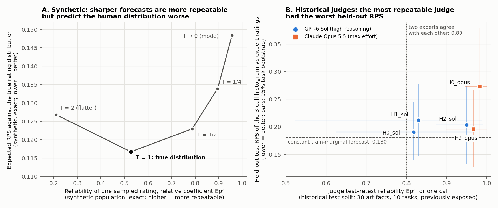

# 04: Results — reliability versus human-rating distribution accuracy

**Doc link:** <https://github.com/brando90/judges-dont-need-psychometrics-or-corr/blob/main/experiments/04_g_theory_reliability_vs_distribution_accuracy_start_13Nov2026/RESULTS_reliability_vs_accuracy.md>

**TLDR:** Reliability coefficients and matched means/variances do not identify the human-rating distribution: exact counterexamples tie on every moment and coefficient while proper losses separate them, and in the historical judges the most repeatable judge had the worst held-out ranked probability score (RPS). Variance decomposition did its own job well: decision-study allocation chose the best design in every simulated replication and failed only where its stated assumptions were broken. Complementary tools, not substitutes.

**Status:** COMPLETE — Phases A, B and C ran on 11-13-2026 (Claude Code, `claude-opus-5-5`, desktop app; local CPU; zero model calls, zero new human ratings, $0). 20/23 frozen predictions matched; the 3 mismatches are explained below (two Monte Carlo chance events, one construction tie). Formula checks 945/945; independent recomputation 134/134.

Read [HOW_TO_READ_RESULTS.md](HOW_TO_READ_RESULTS.md) first for which data, metric and comparison each number uses. Plan: [PLAN.md](PLAN.md). Frozen configuration and predictions: [protocol.json](protocol.json), hashed in [FREEZE.json](FREEZE.json) before measurement (commit `579915a`).

## Verdicts

| Claim tested (PLAN.md §1) | Verdict | Decisive evidence |
| --- | --- | --- |
| Matching the human mean and variance (and every reliability coefficient) identifies the human-rating distribution | **Rejected** (exact counterexample) | A1_max: same mean, variance, components and coefficients for all 11 artifacts, yet mean population TVD 0.446 and expected RPS excess 0.0167 |
| High reliability coefficients certify accurate human scores | **Rejected** | A2: a judge wrong on 3 of 11 artifacts has Eρ² = Φ = 1, identical to the oracle; its expected RPS is 0.228 vs 0.117. Phase C: most repeatable judge H0_opus had the worst test RPS |
| Maximizing sampled-score reliability optimizes distribution accuracy | **Rejected** | A3: sharpening the true distribution raises one-rating Eρ² from 0.527 to 0.957 while expected RPS rises from 0.1167 to 0.1484 |
| An aggregate coefficient certifies each task | **Rejected** (as a misuse) | V2: one pooled Φ hides groups whose absolute error differs by 0.095 [0.090, 0.101] |
| Variance components guide allocation of rating effort (the paper's claim) | **Supported in-model** | REML-based choice matched the oracle design in 256/256 (C1) and 256/256 (C2) replications; paired held-out absolute error vs equal allocation -0.107 [-0.149, -0.065] (C1) |
| Proper losses make psychometric tools unnecessary | **Not supported** | A single-rating variance (identical, 3.0, in both A4 configurations) cannot choose a design; component estimates can. RPS answers a different question |



*Figure.* **A (synthetic, exact):** forecasts q_T ∝ p^(1/T) of the 11-artifact population; x = relative coefficient Eρ² of one rating sampled from q_T (higher = more repeatable), y = expected RPS against the true distribution p (range 0–1, lower is better; the true distribution scores 0.1167, not 0, because humans disagree). **B (historical, retrospective):** five cached judges on the historical test split (30 artifacts, 10 tasks, 78 expert ratings, all previously exposed); x = one-call test–retest Eρ² over 3 repeat calls, y = held-out RPS of each judge's smoothed 3-call histogram against individual expert ratings (lower is better); bars are 95% percentile intervals over 10,000 task bootstrap draws. Dashed line: a constant forecast equal to the train-split expert histogram (RPS 0.180). Dotted line: single-rating agreement between the two experts who rated every artifact (Eρ² 0.80).

## Phase A — exact counterexamples and controls (synthetic, no sampling unless stated)

Human population: 11 artifacts, p_x = (9/10) Binomial(5, θ_x) + (1/10) Uniform{0..5}, θ_x = j/12. All values are exact rational arithmetic except CE/KL and the tempered family (float64). Every metric is an expectation over the true distribution, equally averaged over artifacts; there is no train/test split because nothing is fitted.

### A1 / A1_max: same mean and variance, different distribution

| Quantity (mean over 11 artifacts) | True distribution p | A1: p + ε·(−1,3,−3,1,0,0), ε = min p/6 | A1_max: largest RPS gap, floor 1/100 |
| --- | --- | --- | --- |
| Mean and variance equal to p | — | exactly, 11/11 | exactly, 11/11 |
| Population v_u, v_e; Eρ² and Φ (1 and 3 raters) | v_u 45/32, v_e 121/96; Eρ²(1) 135/256 = 0.527 | identical (exact) | identical (exact) |
| Pearson / Spearman / Kendall of forecast means with true means | 1 / 1 / 1 | 1 / 1 / 1 (tie) | 1 / 1 / 1 (tie) |
| Expected RPS (lower better) | 0.1167 | excess +1.86e-05 (= (6/5)ε², exact) | excess +0.0167 (per artifact 0.0039–0.0287) |
| Expected CE excess = KL(p‖q), nats | 0 (CE 1.404) | 1.63e-03 | 0.994 |
| Population TVD (0–1) | 0 | 0.0148 (= 4ε) | 0.446 |

A1 follows PLAN.md exactly and is a valid but tiny counterexample (ε between 0.0028 and 0.0075). A1_max (declared before measurement as an addition) shows the gap need not be small: with every probability at least 0.01, a forecast can match all first and second moments while differing from the human distribution by TVD up to 0.611. Trace artifact j = 6 (θ = 1/2): p = 43/960, 151/960, 143/480, 143/480, 151/960, 43/960; A1_max q = 1/60, 1/100, 176/225, 1/100, 1/100, 77/450; exact JSON round trip True.

**Finite samples** (4000 replications; 50 objects drawn from the 11 artifacts × 3 raters; raw two-way ANOVA). Population components are equal, so expected estimates are equal; estimator spread can differ because higher moments differ:

| Estimate | p-panel mean | A1 q-panel minus p-panel [95% CI] | A1_max q minus p [95% CI] | SD ratio A1_max/p [95% CI] |
| --- | --- | --- | --- | --- |
| v_u | 1.4160 | -0.0107 [-0.0211, -0.0004] | -0.0027 [-0.0128, +0.0075] | 0.981 [0.952, 1.010] |
| v_e | 1.2548 | +0.0074 [-0.0018, +0.0167] | +0.0029 [-0.0068, +0.0126] | 1.124 [1.089, 1.162] |
| v_rater | 0.0003 | -0.0004 [-0.0015, +0.0008] | +0.0001 [-0.0010, +0.0012] | 1.006 [0.943, 1.075] |
| Eρ² (3 raters) | 0.7648 | -0.0027 [-0.0052, -0.0002] | -0.0003 [-0.0028, +0.0022] | 1.029 [0.992, 1.068] |

The frozen A1 v_u interval excludes 0 narrowly (prediction mismatch). A post-hoc rerun with 20,000 new replications (seed 4099) gives -0.0015 [-0.0061, +0.0031], and the sampler reproduces the pmf; the frozen miss is a Monte Carlo chance event (6 simultaneous 95% intervals miss at least once about 26% of the time). The A1_max v_e estimate is about 12% more variable than under p: equal coefficients do not mean equally precise estimates.

### A2: repeatable but wrong; constant judge; shared offset

| Judge (vector forecast) | Eρ² = Φ, deterministic output (1 and 3 calls) | Eρ² for 1 / 3 sampled ratings | Expected RPS | TVD | MAE of means (0–5) | Bias (judge − human) | Pearson of means |
| --- | --- | --- | --- | --- | --- | --- | --- |
| Oracle (returns p) | 1.000 | 0.527 / 0.770 | 0.1167 | 0.000 | 0.000 | 0.000 | 1.000 |
| Repeatable-but-wrong (mirrored on j = 9–11) | 1.000 | 0.369 / 0.637 | 0.2280 | 0.222 | 0.818 | -0.818 | 0.126 |
| Constant marginal | undefined | 0.000 / 0.000 | 0.1858 | 0.364 | 1.023 | 0.000 | undefined |

Shared +1 offset (human support {1,2,3}, judge {2,3,4}, 5 artifacts): separately analyzed panels have identical components (v_u 9/50, v_e 27/50) and coefficients (Eρ² = Φ = 1/4 for one rating), Pearson of means 1.000, but bias +1 exactly, expected RPS 0.1608 vs 0.0736, CE ∞ (smoothed variant 2.493 vs 0.950 nats). Pooling judge and human ratings as raters (half each) exposes the offset in the absolute coefficient only: Φ for one rating 18/97 = 0.186 vs Eρ² 1/4.

### A3: the true distribution versus sampled-score reliability

| Forecast q_T ∝ p^(1/T) | Expected RPS | Expected CE (nats) | TVD | Mean conditional variance (human 1.260) | Eρ², 1 / 3 sampled ratings | Expected RPS of a 3-call histogram |
| --- | --- | --- | --- | --- | --- | --- |
| T = 2 | 0.1268 | 1.481 | 0.154 | 2.128 | 0.209 / 0.443 | 0.1801 |
| T = 1 (true p) | 0.1167 | 1.404 | 0.000 | 1.260 | 0.527 / 0.770 | 0.1556 |
| T = 1/2 | 0.1230 | 1.557 | 0.165 | 0.572 | 0.787 / 0.917 | 0.1479 |
| T = 1/4 | 0.1339 | 2.200 | 0.317 | 0.279 | 0.896 / 0.963 | 0.1497 |
| T → 0 (mode; ties split) | 0.1484 | ∞ | 0.458 | 0.114 | 0.957 / 0.985 | 0.1560 |

Reported as a distribution, the true p minimizes expected RPS and CE. Scored only through a 3-call histogram, it does not: T = 1/2 scores 0.1479 vs 0.1556, because sampling noise penalizes spread. A 3-call histogram is a noisy estimate of a judge's distribution, and scoring it rewards over-sharpened samplers. Population dependence: two populations whose artifacts all share the same shape (1/4, 1/2, 1/4) have identical oracle accuracy (RPS 3/40, MAE 0) but one-rating Eρ² 1/3 (centers 2–3) vs 5/7 (centers 1–4).

### A4: equal total variance, different design recommendations

| Configuration (u, a, b, ua, ub, ab, e) | Single-rating variance | v_Δ / Φ at 8×2 | 4×4 | 2×8 | Best at 16 ratings |
| --- | --- | --- | --- | --- | --- |
| C1: (1, 3/5, 1/10, 3/5, 1/10, 1/10, 1/2) | 3 | 0.2875 / 0.777 | 0.3875 / 0.721 | 0.6625 / 0.602 | 8x2 |
| C2: (1, 1/10, 3/5, 1/10, 3/5, 1/10, 1/2) | 3 | 0.6625 / 0.602 | 0.3875 / 0.721 | 0.2875 / 0.777 | 2x8 |

a = raters, b = occasions; n_a × n_b ratings per object. Matching the single-rating variance (3 in both) cannot choose between 8×2 and 2×8; the component decomposition can.

## Phase B — decision-study (D-study) allocation, a fair positive control

Continuous Gaussian crossed model, known components; 256 replications, each running calibration G study (64 objects × 8 raters × 8 occasions) → constrained REML → design choice → evaluation of every design on 256 fresh objects with fresh raters, occasions and residuals. Absolute error = mean squared deviation of an object's observed mean from its universe score (expectation v_Δ; lower is better); relative error is its object-centered analogue (v_δ).

**Formula check:** 35/36 observed mean errors within 3.5 Monte Carlo standard errors of the population formula. The miss (C1, 4×8, absolute: observed 0.3046 vs 0.3438) is a skewed-error chance event: post hoc, 8,192 new replications give 0.3432 (z = -0.20); absolute error has skewness 2.8, and the frozen 256-run sample SD (0.173) underestimated the true SD (0.237). REML converged 256/256 and 256/256; no raw ANOVA estimate was negative, so REML equalled ANOVA.

| Config | Oracle design (16 ratings) | REML chose it | Held-out absolute error: chosen minus equal 4×4 [95% CI] | Chosen minus worst fixed design | Predicted minus true error of chosen |
| --- | --- | --- | --- | --- | --- |
| C1 | 8x2 | 256/256 (Wilson 95% [0.985, 1]) | -0.107 [-0.149, -0.065] (true −0.100) | -0.320 [-0.378, -0.261] | -0.0055 [-0.0115, 0.0005] |
| C2 | 2x8 | 256/256 (Wilson 95% [0.985, 1]) | -0.072 [-0.108, -0.035] (true −0.100) | -0.346 [-0.404, -0.287] | 0.0009 [-0.0058, 0.0075] |

The same perfect choice held at 8 and 32 ratings and for the relative target. The positive control is easy by construction: the configurations differ strongly, so this shows the method works when its assumptions hold, not how often it works with weak signals.

**Assumption violations** (C1 unless noted; same nominal budget of 16 ratings per object):

| Violation | Calibration prediction | Analytic truth | Observed held-out | Consequence |
| --- | --- | --- | --- | --- |
| V1 rater pairs correlated ρ = 0.5 (8 nominal raters = 4 pairs) | error 0.2875, Φ 0.777 | error 0.3656, Φ 0.732 | error 0.357 [0.329, 0.384] | precision overstated |
| V1 rater pairs correlated ρ = 1.0 (8 nominal raters = 4 pairs) | error 0.2875, Φ 0.777 | error 0.4437, Φ 0.693 | error 0.475 [0.432, 0.518] | precision overstated |
| V2 two task groups, interaction variance 0.2 vs 1.0 | pooled error 0.288 [0.281, 0.295] | L 0.2375, H 0.3375 | H − L 0.095 [0.090, 0.101] | one Φ (0.777) hides Φ_L 0.808, Φ_H 0.748 |
| V3-S1 deployment objects less spread (v_u 1 → 0.25) | error 0.282 [0.276, 0.288], Φ 0.775 [0.769, 0.781] | error 0.2875, Φ 0.465 | error 0.292 [0.265, 0.318] | error still right, coefficient badly overstated |
| V3-S2 occasion instability (v_ub 0.1 → 1.2) | chose 8×2 in 256/256 | best is 4x4: 0.6625 vs 0.8375 | best minus chosen -0.147 [-0.198, -0.097] | recommendation reverses |
| V4 (C2, 2×8) calibration occasions dependent, ρ = 0.8 | Φ 0.866 [0.861, 0.870] | Φ 0.777 | predicted minus realized 0.089 [0.085, 0.093] | coefficient inflated, as the paper warns |

## Phase C — retrospective check on existing human ratings

Data: historical VeriBench judge study (upstream commit `be287d9bb2`), imported privately by experiment 02. **Primary set: historical test split, 30 artifacts, 10 tasks, 78 expert ratings; all ratings previously exposed in earlier work, so this is retrospective, not fresh held-out evidence.** Judges: five cached prompts × models with 3 repeat calls each (no new calls). Judge forecast = smoothed 3-call histogram (ε = 1e-6, the experiment 02 rule). Intervals: 95% percentile, 10,000 task-bootstrap draws (raters and calls fixed).

| Judge (model) | Test–retest Eρ², 1 call | Repeat SD (0–5) | **Test RPS** (lower better) | Test CE (nats) | Test TVD | MAE (0–5) | Bias judge − expert | Pearson | Spearman | Kendall τ-b | ICC(A,1) | ICC(C,1) |
| --- | --- | --- | --- | --- | --- | --- | --- | --- | --- | --- | --- | --- |
| H0_sol (openai/gpt-6-sol-high) | 0.818 [0.626, 0.965] | 0.73 | **0.191 [0.140, 0.244]** | 9.13 | 0.672 | 0.95 [0.69, 1.23] | 0.07 [-0.52, 0.63] | 0.66 | 0.59 | 0.47 | 0.67 | 0.66 |
| H1_sol (openai/gpt-6-sol-high) | 0.830 [0.523, 0.988] | 0.71 | **0.212 [0.148, 0.277]** | 9.12 | 0.667 | 1.09 [0.80, 1.38] | 0.88 [0.41, 1.31] | 0.80 | 0.77 | 0.63 | 0.68 | 0.79 |
| H2_sol (openai/gpt-6-sol-high) | 0.950 [0.874, 0.990] | 0.38 | **0.203 [0.131, 0.277]** | 8.45 | 0.628 | 1.03 [0.67, 1.38] | 0.92 [0.48, 1.33] | 0.84 | 0.81 | 0.67 | 0.71 | 0.83 |
| H0_opus (anthropic/claude-opus-5-5 compute_effort max) | 0.983 [0.947, 1.000] | 0.21 | **0.273 [0.179, 0.380]** | 10.37 | 0.750 | 1.36 [0.89, 1.92] | 0.94 [0.16, 1.71] | 0.58 | 0.66 | 0.53 | 0.49 | 0.58 |
| H2_opus (anthropic/claude-opus-5-5 compute_effort max) | 0.967 [0.899, 1.000] | 0.30 | **0.196 [0.127, 0.266]** | 8.71 | 0.639 | 0.97 [0.63, 1.33] | 0.88 [0.49, 1.28] | 0.86 | 0.84 | 0.72 | 0.74 | 0.86 |
| Reference: two experts (p1, p2) | inter-rater 0.800 [0.542, 0.880]; Φ 0.790 | — | — | — | — | — | — | — | — | — | Φ 0.79 | Eρ² 0.80 |
| Reference: constant train-marginal forecast | undefined (constant) | 0 | 0.180 [0.139, 0.223] | 1.80 | 0.662 | — | — | — | — | — | — | — |

Order by repeatability: H0_opus > H2_opus > H2_sol > H1_sol > H0_sol. Order by test RPS (best first): H0_sol > H2_opus > H2_sol > H1_sol > H0_opus. Kendall τ-b between the two orders = -0.40 (5 judges; descriptive, p-val=n/a). Paired task bootstrap, H0_opus minus H0_sol: RPS 0.082 [0.004, 0.168] (positive = the more repeatable judge is worse), Eρ² 0.164 [0.016, 0.349], MAE 0.41 [-0.01, 0.84].

Every judge's one-call repeatability exceeded the experts' agreement with each other (point estimates, 5/5; the interval excludes 0 for 3/5), yet no judge beat the constant train-marginal forecast on test RPS (point estimates). Test CE of 8.4–10.4 nats (vs 1.80 for the constant forecast) shows the 3-call histograms put almost no probability on ratings the experts gave. Excluding the 12 reference-flagged artifacts (18 left): repeatability order H0_opus > H2_opus > H2_sol > H1_sol > H0_sol; RPS order H2_opus > H2_sol > H1_sol > H0_sol > H0_opus — the most repeatable judge is still last. Secondary all-75 set (train is in-sample for H1/H2 prompt development): H2_opus is both most repeatable and lowest RPS (τ = -0.20), so the inversion is not universal — repeatability simply does not determine accuracy.

## Frozen predictions versus observations

| ID | Matched? | Observed | Explanation if not |
| --- | --- | --- | --- |
| A1.validity | yes | `"11/11 artifacts valid"` |  |
| A1.moments | yes | `"exact Fraction equality of mean and variance; third raw moment differs by 6 epsilon"` |  |
| A1.rps_excess | yes | `"RPS excess == (6/5) epsilon^2 > 0 for all 11"` |  |
| A1.brier_tvd | yes | `"Brier excess == 20 epsilon^2 and TVD == 4 epsilon for all 11"` |  |
| A1.ce_excess | yes | `"KL range 3.193e-04..4.159e-03 nats"` |  |
| A1.correlations | yes | `{"oracle": {"pearson": 0.9999999999999998, "spearman": 1.0, "kendall": 1.0}, "perturbed": {"pearson": 0.9999999999999998, "spearman": 1.0, "kendall": 1.0}}` |  |
| A1.components | yes | `{"v_u": {"exact": "45/32", "float": 1.40625}, "v_e": {"exact": "121/96", "float": 1.2604166666666667}}` |  |
| A1_max.moments_and_gap | yes | `"exact moments True; larger RPS gap than A1 in 11/11"` |  |
| A1.finite_sample | **no** | `"5/6 component-difference intervals cover 0"` | Monte Carlo chance at 6 simultaneous intervals; post-hoc 20,000-replication rerun covers 0 |
| A2.repeatable_wrong | yes | `{"coefficients_all_1": true, "errors_exactly_on_subset": true, "mae": {"exact": "9/11", "float": 0.8181818181818182}}` |  |
| A2.constant | yes | `{"deterministic_undefined": true, "sampled_zero": true}` |  |
| A2.offset | yes | `{"bias": "+1 each", "ce_shifted": Infinity, "ce_smoothed": 2.492795490943334}` |  |
| A3.oracle | yes | `{"rps_argmin": "1", "ce_argmin": "1", "oracle_rps": 0.11670795387394607}` |  |
| A3.sampled_reliability | **no** | `{"2": 0.2093950455997736, "1": 0.5273437499999999, "1/2": 0.7869283394193289, "1/4": 0.8956397148381391, "mode": 0.9565217391304347}` | Monotone increase holds; "mode Eρ² = 1" was wrong because Binomial(5, θ) has two modes when 6θ is an integer (5 of 11 artifacts) and the declared T → 0 limit splits them |
| A3.population_dependence | yes | `{"narrow": {"exact": "1/3", "float": 0.3333333333333333}, "wide": {"exact": "5/7", "float": 0.7142857142857143}}` |  |
| A4.design | yes | `{"C1": {"budget8_absolute": "8x1", "budget8_relative": "8x1", "budget16_absolute": "8x2", "budget16_relative": "8x2"}, "C2": {"budget8_absolute": "1x8", "bud...` |  |
| B.formula | **no** | `"35/36 within 3.5 Monte Carlo SE"` | Skewed absolute error; post-hoc 8,192-replication rerun z = −0.20 |
| B.selection | yes | `{"C1": {"chose_oracle": 1.0, "paired_diff_vs_equal": -0.10690233878461364, "ci95": [-0.1491446809759433, -0.06465999659328397]}, "C2": {"chose_oracle": 1.0, ...` |  |
| B.V1 | yes | `{"0.5": [0.35681238870623205, 0.365625], "1.0": [0.4749393259648439, 0.44375]}` |  |
| B.V2 | yes | `{"pooled_pred": 0.28802050580764094, "H_minus_L": {"mean": 0.095332419197385, "ci95": [0.08958131588624679, 0.1010835225085232], "se": 0.0029203638060900793,...` |  |
| B.V3 | yes | `{"S1_pred_Phi": 0.7753020248304071, "S1_real_Phi": 0.46511627906976744, "S2_best": "4x4", "S2_chosen": {"8x2": 256}}` |  |
| B.V4 | yes | `{"pred_Phi": 0.8655673848258945, "realized_Phi": 0.7766990291262136}` |  |
| C.reliability_vs_accuracy | yes | `{"judges_more_repeatable_than_expert_agreement": "5/5", "tau": -0.39999999999999997}` |  |

## Amendments, deviations and limits

- Amendment 2026-11-13T20:01:11Z: Phase A crashed before writing any output: theta=1/2 has two equal modes. 'mode' is declared as the T->0 limit, which splits mass equally over tied modes; implemented exactly that. No configuration or contract expectation changed.
- Amendment 2026-11-13T20:02:49Z: Phase C stopped at its input check before computing anything: the protocol's upstream_source_commit field carries a descriptive suffix; compare the commit hash token only. No analysis choice changed.
- Added beyond PLAN.md, declared before measurement: A1_max (largest same-moment RPS gap) and the 3-call-histogram RPS column.
- Post hoc and labeled: the two diagnostic reruns above; they do not replace frozen results.
- Phase A/B are constructed examples: they reject sufficiency claims and show in-model design value; they say nothing about how often these failures occur in deployed judges.
- Phase C has 5 judges from one solver population, 10 test tasks and previously exposed ratings; judge-to-judge differences other than the paired comparison have overlapping intervals. Raters and calls are held fixed in the task bootstrap.
- No claim about any unpublished study or contemporary implementation of generalizability theory is made.

## Reproduce

```bash
cd experiments/04_g_theory_reliability_vs_distribution_accuracy_start_13Nov2026
python scripts/test_metrics.py
python scripts/check_counterexamples.py
python scripts/run_d_study.py
python scripts/run_historical.py
python scripts/verify_results.py
python scripts/make_figure.py
python scripts/make_report.py
```

Phase C needs the private, git-ignored experiment 02 dataset; Phases A and B need only numpy/scipy. Output hashes (SHA-256):

- `results/phase_a.json`: `1c41d2cd571f92ce980c5a5ed7f6b58046bfe1cb9f683418b0a48a2396d06e0e`
- `results/phase_b.json`: `051269aa972b2e419d735161de09ec97d62b777a0bd7baa0b67b980785cc5644`
- `results/phase_c.json`: `b17ef8e8cb3dc121d04127672952551f720f1805004f7e142b4b6592c62ceca1`
- `results/verification.json`: `7260397f3a5e4f38b8790f08a5537f7adb5081eed9bdb45678e3f381b37dc431`
- `results/test_metrics.json`: `76d54b25fd6c641956dd967dc7ba791ee8509b0cafcc535df491d616c212d688`
- Software: Python 3.11.6, numpy 2.2.6, scipy 1.16.3. Runtimes: A 1.57 s, B 1.18 s, C 27.84 s.

**TLDR-end:** [judge objectives: 04_g_theory_reliability_vs_distribution_accuracy_start_13Nov2026] Reliability and moment matching are insufficient for human-rating distribution accuracy (exact counterexamples; the most repeatable historical judge had the worst test RPS), while variance-component design allocation works when its assumptions hold. Use proper losses to choose judges and G/D studies to plan rating effort.
