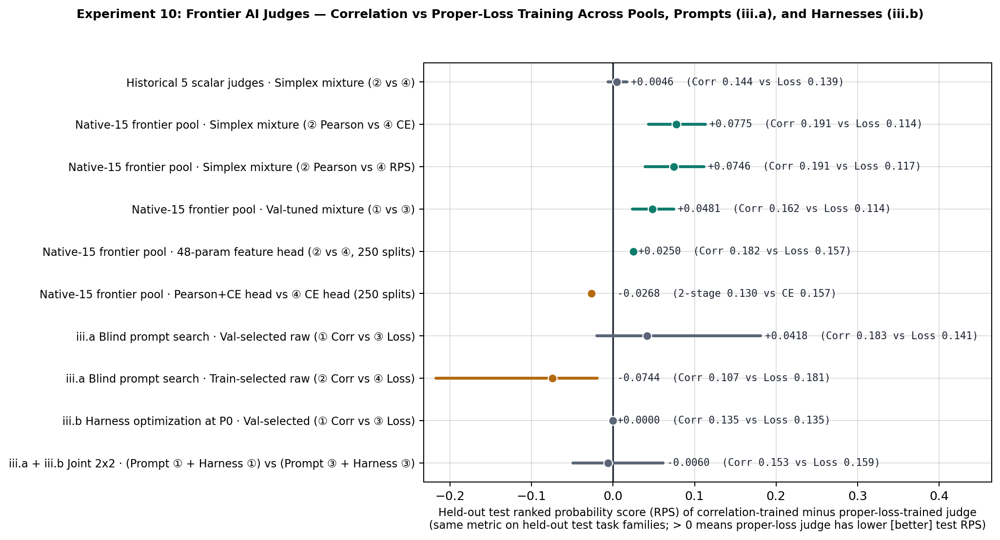
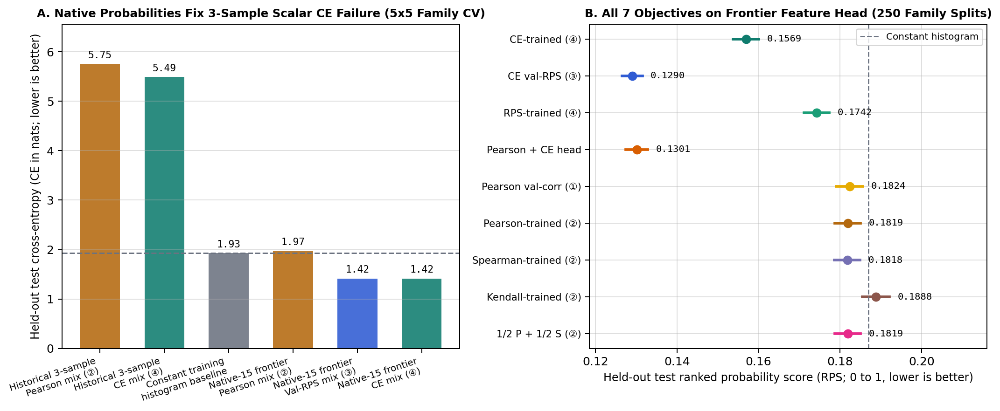
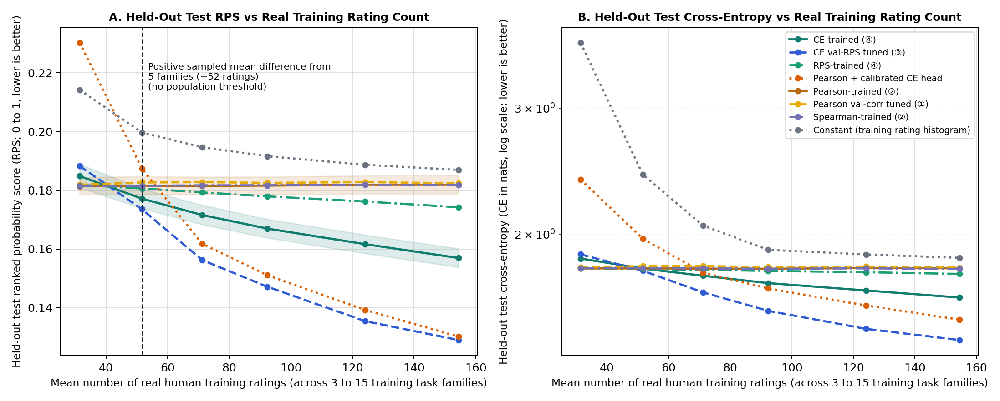
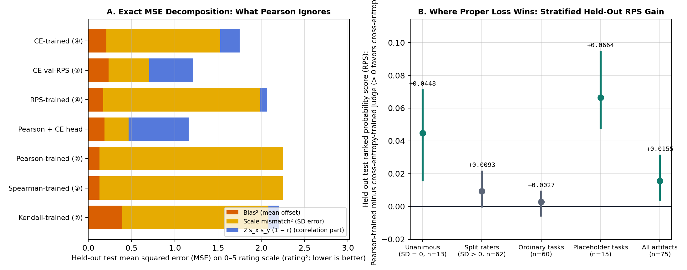
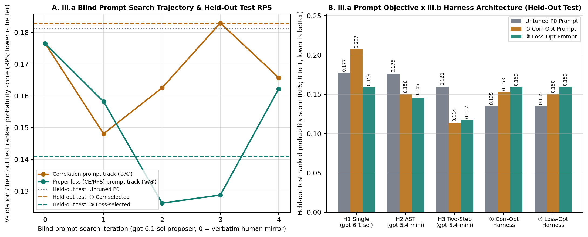

# Experiment 10 Results — Frontier Artificial Intelligence (AI) Judges: Native Probabilities, Prompt Optimization (`iii.a`), and Harness Optimization (`iii.b`) — QA corrections 11-26-2026

**QA correction (11-26-2026):** Read the [dated correction and evidence limits](QA_CORRECTIONS_11-26-2026.md) before the historical text below; original scored tables remain unchanged.

**Doc link:** <https://github.com/brando90/judges-dont-need-psychometrics-or-corr/blob/main/experiments/10_frontier_ai_judges_native_prob_and_prompt_search_ce_vs_corr_start_16Nov2026/RESULTS_frontier_ce_vs_corr.md>

**TLDR:** Across 7 real frontier large language models (LLMs) in 2 families (OpenAI GPT-6 Astra, GPT-6.1 Sol, GPT-6.1 Terra, GPT-5.6 Sol, GPT-5.6 Terra, GPT-5.4 mini; Mistral Codestral 25.08; `$17.85` total spend of `$18.00` cap; no differential testing (no DT)) evaluated on held-out VeriBench task families (75 artifacts, 19 task families, 195 expert ratings), **the native 6-category pool has lower cross-entropy (CE) than the historical scalar pool (`5.49` nats), at `1.416` nats** (beating the `1.928`-nat constant baseline), and **the fitted proper-loss judges have lower held-out losses than the fitted correlation judges on continuous probability mixtures and feature heads** (`Native-15` simplex mixture `test ranked probability score (RPS) of Pearson-trained minus CE-trained = +0.0775 [+0.0437, +0.1135] bootstrap-tail=0; p-val=n/a`; 48-parameter head `+0.0250 [+0.0238, +0.0262] p-val=n/a`, with positive sampled mean differences from **5 training task families (~51.7 human ratings)**; these feature-head intervals describe conditional split Monte Carlo variability, not population uncertainty), whereas **discrete single-prompt (`iii.a`) and single-harness (`iii.b`) selection on a 5-family held-out split are uncertain**: validation-selected `iii.a` prompt search favors proper loss directionally (`+0.0418 [-0.0200, +0.1813] bootstrap-tail=0.2526; p-val=n/a`, while the train-selected correlation prompt has lower test RPS than the train-selected CE prompt: `-0.0744 [-0.2173, -0.0192] bootstrap-tail=0.0004; p-val=n/a`), on matched `gpt-5.4-mini` `H3` two-step obligation auditing lowers held-out RPS relative to `H1` (`0.181 -> 0.160` at `P0`, `0.183 -> 0.114` at `①`, and `0.141 -> 0.117` at `③`), and the `2x2` discrete pipeline contrast has an interval including zero (`-0.0060 [-0.0493, +0.0613] bootstrap-tail=0.8738; p-val=n/a`).

**Interpretation:** Historical scalar and native-probability pools differ in models and prompts as well as probability representation; their comparison does not isolate representation. **Uncertainty:** Feature-head learning-curve bands resample 250 overlapping split averages on fixed data and measure conditional Monte Carlo variability only; their population p-values are not available. Other intervals resample task families. Reported bootstrap sign-tail fractions are descriptive, not calibrated null-test p-values. No multiplicity correction was applied. The actual feature-head tuning used three inner folds and c in {0.1, 1, 10}, differing from the pre-run five-fold/five-value grid.

**Reference provenance:** Only 15/75 on-disk reference files match the hashes recorded in annotation metadata; all candidate and Python files match. The saved evidence does not distinguish stale reference metadata from changed reference bytes, so byte identity with the human-delivered reference files is unverified.

**Failure handling:** Saved losses include uniform forecasts substituted after unsuccessful parsing. `ce_iter2_c1`: 11/75 overall, including 7/30 held-out test artifacts. Harness results also include uniform or upstream scaffold fallbacks. These measure the complete pipeline with fallback behavior, not successful model responses alone. Status metadata was recovered from exact local cached requests without new calls; the failure table below retains every scheduled entry.

## 1. Taxonomy across the three-experiment program & data scope

- **`i. Synthetic / toy / simulated`** (`00_synthetic_pearson_vs_kl_squashed_judge_0to5_start_07Nov2026`, `01_conditional_binomial_distribution_identification_start_08Nov2026`, `06_toy_rank_and_mixed_correlation_objectives_vs_ce_start_13Nov2026`, `07_toy_optimizer_restarts_and_budget_for_nonconvex_objectives_start_13Nov2026`, `08_toy_target_complexity_and_tuned_regularization_vs_ratings_needed_start_14Nov2026`, and `archive/13_toy_pearson_vs_ce_nonlinear_ratings_start_10Nov2026_end_10Nov2026`): Fixed candidate distributions or 78 linear-basis softmax weights on beta-binomial synthetic targets; **zero prompt or harness changes**.
- **`ii. Real judges — open weights`** (`09_...`): Evaluates `ii.a` prompt optimization, `ii.b` harness optimization, and `ii.c` low-rank adaptation (LoRA) weight updates.
- **`iii. Real judges — frontier AI judges`** (this folder, `10_frontier_ai_judges_native_prob_and_prompt_search_ce_vs_corr_start_16Nov2026`): Evaluates **native 6-category probability elicitation** (plus truncated top-five token-logprob estimates: unavailable digits receive zero probability before flooring), **`iii.a` blind agentic prompt optimization**, **`iii.b` judge harness optimization (`H1`–`H4`)**, and their **`2x2` interaction**.
- **Data & exposure disclosure:** 75 Lean 4 candidate artifacts across 25 Python tasks grouped into **19 task families** with **195 expert human ratings** (`62/75` artifacts have positive inter-rater standard deviation (SD) `> 0`; `60` ordinary artifacts and `15` `True`-placeholder security artifacts). All splits hold out **entire task families**. The 15 new frontier pool judges and blind searches never inspect held-out test families during proposal or fitting, but the 75-artifact rating dataset was used in earlier repository studies (`02`, `11`, `12`, `14`), so human-rating conclusions remain **retrospective at the dataset level**. Read [HOW_TO_READ_RESULTS.md](HOW_TO_READ_RESULTS.md) for full metric and subtraction definitions.



*Figure 1 caption (how chosen):* Every row plots held-out test ranked probability score (RPS; range `0` to `1`, lower is better) of the correlation-trained/selected judge minus held-out test RPS of the proper-loss-trained/selected judge on identical held-out task families (`> 0` favors proper loss; bars = `95%` task-family cluster-bootstrap intervals over `10,000` draws, except the two 250-split feature-head rows, whose `10,000`-draw intervals resample overlapping split averages and measure only conditional split Monte Carlo variability). Simplex `CE` and `RPS` mixtures use certified convex sequential least-squares programming (SLSQP) + Newton polishing (`Frank-Wolfe gap <= 1e-8`); simplex `Pearson` uses exact cone/non-negative least squares (NNLS); 48-parameter softmax feature heads use the limited-memory Broyden–Fletcher–Goldfarb–Shanno algorithm with bounds (L-BFGS-B) (`400` iterations from a log training-marginal intercept plus 0.01 Gaussian noise, checked against best-of-5 starts x `2,000` iterations); `iii.a` uses 4-iteration x 2-candidate `gpt-6.1-sol` blind prompt search; `iii.b` searches harnesses `H1`–`H4` plus 2-parameter convex calibration.

## 2. Phase 1: Expect-then-verify measurement contract & Karpathy sanity checks

Table notation: ranked probability score (RPS; cumulative-probability squared error, 0–1), cross-entropy (CE; negative log-probability, nats), total variation distance (TVD; half the histogram L1 distance, 0–1), and mean squared error (MSE; rating squared) are lower-is-better. CI denotes a confidence interval, CV cross-validation, ICC intraclass correlation, SD standard deviation, and AST abstract syntax tree. Bias is judge minus human mean on 0–5; correlations range from −1 to 1. Each difference compares the same held-out metric, correlation-trained/selected minus proper-loss-trained/selected, unless explicitly stated otherwise.

| Check / baseline (`gpt-6.1-sol` smoke & offline pool) | Predicted before run (`PROTOCOL.md`) | Observed | Match? |
|---|---|---|---|
| Byte-level input hash check (`candidate` / `python`) | `75/75` exact SHA-256 match | `75/75` candidate, `75/75` python (`15/75` ref match `items.jsonl`; all 75 on-disk refs hashed) | **Yes** |
| Leave-one-rater-out (LORO) human ceiling (75 items) | Spearman `0.75–0.83`, `ICC(A,1)` `0.72–0.82`, RPS floor `0.048–0.058` | Spearman `0.7642`, `ICC(A,1)` `0.7589`, RPS floor `0.0455` (`0.0550` on `SD>0`) | **Partial** (all-artifact RPS floor is below the predicted range) |
| Theorem-count ratio dumb baseline (all 75 / 60 ordinary) | Spearman `~0.50–0.58` | All 75: `0.6014`; Ordinary 60: `0.3024` | **No** (observed values are outside the stated prediction range) |
| Label-in-prompt reproduction (15 smoke artifacts) | Pearson `>= 0.98`, TVD `<= 0.05` | Pearson `1.0000`, Spearman `1.0000`, TVD `0.0000` | **Yes** |
| Positive control: `oracle` (4 ordinary smoke tasks) | `E[R]/5 >= 0.80` (`>= 4.0/5`) | `E[R]/5 = 1.0000` (`5.00/5`) | **Yes** |
| Negative controls: `blank` / `vacuous` / `shuffled` (ordinary) | `<= 0.15` / `<= 0.20` / `<= 0.25` | `blank = 0.0000`, `vacuous = 0.0000`, `shuffled = 0.0000` | **Yes** |
| Repeat stability (`k=3` independent calls, 15 items) | Low repeat SD, high test-retest `ICC(1,1)` | Expected-score SD `0.0178` (`0.089` on `0–5`), per-bin SD `0.0237`, `ICC(1,1) = 0.9957` | **Yes** |

## 3. Native-probability frontier pool vs historical 3-sample scalar judges (All Formulations ①–④)



*Figure 2 caption (how chosen):* Panel A evaluates `02_exp06_ce_vs_pearson_matched_budget_start_09Nov2026`'s exact 5-partition x 5-fold grouped task-family cross-validation (`25` outer folds; certified convex `CE` and exact cone/NNLS `Pearson` simplex solvers). Panel B evaluates all 7 training objectives on the 48-parameter softmax feature head over the 15-judge native-probability frontier pool across `250` grouped task-family splits (`15` train / `4` held-out test families; L-BFGS-B `400` iterations, ridge `(c/n)||W||^2`; log training-marginal intercept plus 0.01 Gaussian initialization). Panel B bars are 95% conditional split Monte Carlo intervals (10,000 resamples of overlapping split averages), not task-family population intervals.

### Table 1: Grouped 5x5 task-family cross-validation — Historical 5 scalar judges vs Native-15 frontier pool

Table notation: ranked probability score (RPS; cumulative-probability squared error, 0–1), cross-entropy (CE; negative log-probability, nats), total variation distance (TVD; half the histogram L1 distance, 0–1), and mean squared error (MSE; rating squared) are lower-is-better. CI denotes a confidence interval, CV cross-validation, ICC intraclass correlation, SD standard deviation, and AST abstract syntax tree. Bias is judge minus human mean on 0–5; correlations range from −1 to 1. Each difference compares the same held-out metric, correlation-trained/selected minus proper-loss-trained/selected, unless explicitly stated otherwise.

```text
Pool & Method (how trained/selected)              | Held-out RPS [95% CI]      | Held-out CE (nats) [95% CI] | TVD    | Pearson | Spearman | Bias(0-5)
--------------------------------------------------+----------------------------+-----------------------------+--------+---------+----------+----------
Hist-5 Scalar: Constant marginal baseline         | 0.1872 [0.1549,0.2320]     | 1.9280 [1.8334,2.0558]      | 0.6968 | -0.4042 | -0.3473 | +0.029
Hist-5 Scalar: Equally weighted mixture           | 0.1496 [0.1127,0.1845]     | 5.4311 [3.9575,6.8701]      | 0.5311 | +0.7543 | +0.6731 | +0.434
Hist-5 Scalar: ④ CE-trained mixture               | 0.1391 [0.1075,0.1674]     | 5.4914 [4.0913,6.8610]      | 0.5124 | +0.7664 | +0.6704 | +0.330
Hist-5 Scalar: ④ RPS-trained mixture              | 0.1350 [0.1052,0.1602]     | 5.7566 [4.5138,6.9449]      | 0.5007 | +0.7687 | +0.6815 | +0.257
Hist-5 Scalar: ③ Val-RPS-tuned CE mixture         | 0.1392 [0.1076,0.1676]     | 5.4919 [4.0914,6.8615]      | 0.5128 | +0.7661 | +0.6702 | +0.331
Hist-5 Scalar: ② Pearson-trained mixture          | 0.1436 [0.1076,0.1761]     | 5.7518 [4.4911,6.9566]      | 0.5181 | +0.7539 | +0.6873 | +0.317
Hist-5 Scalar: ① Val-Pearson-tuned mixture        | 0.1481 [0.1113,0.1820]     | 5.4890 [4.0592,6.8661]      | 0.5223 | +0.7437 | +0.6703 | +0.370
Hist-5 Scalar: ② Spearman-trained mixture         | 0.1729 [0.1241,0.2179]     | 7.6426 [5.9815,9.1562]      | 0.5810 | +0.7667 | +0.7437 | +0.498
Hist-5 Scalar: ④ Best single judge (train CE)     | 0.2032 [0.1579,0.2427]     | 8.8675 [7.2073,10.2980]     | 0.6511 | +0.6781 | +0.6697 | +0.408
Hist-5 Scalar: ④ Best single judge (train RPS)    | 0.2154 [0.1674,0.2524]     | 8.7488 [7.1174,10.1361]     | 0.6427 | +0.6007 | +0.5893 | +0.252
Hist-5 Scalar: ② Best single judge (train r)      | 0.1793 [0.1264,0.2283]     | 8.0979 [6.2280,9.7186]      | 0.6000 | +0.7774 | +0.7689 | +0.560
Native-15 Pool: Constant marginal baseline        | 0.1872 [0.1549,0.2320]     | 1.9280 [1.8334,2.0558]      | 0.6968 | -0.4042 | -0.3473 | +0.029
Native-15 Pool: Equally weighted mixture          | 0.1369 [0.1090,0.1706]     | 1.6599 [1.4151,1.9077]      | 0.5400 | +0.7335 | +0.6309 | +0.561
Native-15 Pool: ④ CE-trained mixture              | 0.1137 [0.0895,0.1411]     | 1.4156 [1.1936,1.6430]      | 0.4471 | +0.7667 | +0.6757 | +0.172
Native-15 Pool: ④ RPS-trained mixture             | 0.1166 [0.0910,0.1455]     | 1.4450 [1.2096,1.6913]      | 0.4505 | +0.7483 | +0.6515 | +0.151
Native-15 Pool: ③ Val-RPS-tuned CE mixture        | 0.1136 [0.0895,0.1409]     | 1.4160 [1.1951,1.6422]      | 0.4479 | +0.7670 | +0.6747 | +0.181
Native-15 Pool: ② Pearson-trained mixture         | 0.1912 [0.1476,0.2400]     | 1.9710 [1.6521,2.2971]      | 0.6178 | +0.7649 | +0.6668 | +1.129
Native-15 Pool: ① Val-Pearson-tuned mixture       | 0.1617 [0.1265,0.2038]     | 1.8015 [1.5238,2.0939]      | 0.5776 | +0.7372 | +0.6362 | +0.864
Native-15 Pool: ② Spearman-trained mixture        | 0.1855 [0.1428,0.2368]     | 1.9172 [1.5951,2.2600]      | 0.5948 | +0.6730 | +0.6347 | +1.054
Native-15 Pool: ④ Best single judge (train CE)    | 0.1252 [0.0972,0.1600]     | 1.6843 [1.3118,2.1954]      | 0.4687 | +0.7507 | +0.7377 | +0.342
Native-15 Pool: ④ Best single judge (train RPS)   | 0.1360 [0.1035,0.1750]     | 1.8761 [1.4506,2.3937]      | 0.4754 | +0.7069 | +0.6639 | +0.280
Native-15 Pool: ② Best single judge (train r)     | 0.1426 [0.1049,0.1914]     | 2.0374 [1.5327,2.7245]      | 0.4865 | +0.6760 | +0.6178 | +0.368
Combined-20 Pool: ④ CE-trained mixture            | 0.1092 [0.0883,0.1309]     | 1.3888 [1.1809,1.5899]      | 0.4453 | +0.8021 | +0.7068 | +0.231
Combined-20 Pool: ④ RPS-trained mixture           | 0.1093 [0.0892,0.1274]     | 1.4368 [1.2076,1.6529]      | 0.4497 | +0.8069 | +0.6958 | +0.229
Combined-20 Pool: ③ Val-RPS-tuned CE mixture      | 0.1091 [0.0882,0.1308]     | 1.3885 [1.1807,1.5894]      | 0.4452 | +0.8023 | +0.7068 | +0.231
Combined-20 Pool: ② Pearson-trained mixture       | 0.1671 [0.1332,0.2000]     | 1.8491 [1.5701,2.0999]      | 0.5794 | +0.7958 | +0.7092 | +0.997
Combined-20 Pool: ① Val-Pearson-tuned mixture     | 0.1493 [0.1201,0.1797]     | 1.7356 [1.4778,1.9801]      | 0.5522 | +0.7885 | +0.6840 | +0.821
Combined-20 Pool: ② Spearman-trained mixture      | 0.1856 [0.1466,0.2233]     | 1.9463 [1.6492,2.2069]      | 0.6019 | +0.7215 | +0.6777 | +1.071
Combined-20 Pool: ④ Best single judge (train CE)  | 0.1252 [0.0972,0.1600]     | 1.6843 [1.3118,2.1954]      | 0.4687 | +0.7507 | +0.7377 | +0.342
Combined-20 Pool: ④ Best single judge (train RPS) | 0.1360 [0.1035,0.1750]     | 1.8761 [1.4506,2.3937]      | 0.4754 | +0.7069 | +0.6639 | +0.280
Combined-20 Pool: ② Best single judge (train r)   | 0.1848 [0.1397,0.2263]     | 5.7423 [4.1491,7.3452]      | 0.5786 | +0.6561 | +0.6476 | +0.532
```

**Key takeaways on the multi-family pool:**
1. **Why historical CE failed (`5.49` nats vs `1.416` nats):** Reproducing `02_exp06_ce_vs_pearson_matched_budget_start_09Nov2026` on the 5 historical 3-sample scalar judges gives held-out `CE = 5.491441` nats (`Pearson`-trained `5.751842` nats), losing badly to the `1.9280`-nat constant baseline because 3 integer votes leave at least 3 of 6 bins at exact `0` (`1e-6` floor penalty `13.8` nats per miss). Switching to native 6-category probability vectors across our 15 OpenAI + Mistral judges drops held-out test `CE` to **`1.4156` nats** (`③ Val-RPS-tuned CE mixture`: **`1.4160` nats**; Combined-20 pool: **`1.3885` nats** and **`0.1091` RPS**), beating the constant baseline (`1.9280` nats) and cutting held-out test `CE` vs the `Pearson`-trained mixture by `+0.5555 [+0.4152, +0.6963] bootstrap-tail=0; p-val=n/a` nats!
2. **Measured simplex-mixture and feature-head comparisons on this retrospective pool:** Because our 15-judge pool includes overconfident base judges (`codestral-2508` with `+2.0` rating bias and sharp probability mass) alongside calibrated OpenAI models, `Pearson` simplex fitting assigns positive weight to overconfident judges whose means correlate on training tasks, suffering `bias = +1.129` rating points and losing on held-out test `RPS` (`test RPS of ② Pearson mixture minus ④ CE mixture = +0.0775 [+0.0437, +0.1135] bootstrap-tail=0; p-val=n/a`). On the 48-parameter softmax feature head (`M3`, `250` grouped splits), `Pearson`, `Spearman`, `Kendall`, and `1/2 Pearson + 1/2 Spearman` fits have small expected-score spread under this optimizer and ridge regularization and have higher sampled mean test RPS (`② Pearson minus ④ CE = +0.0250 [+0.0238, +0.0262] p-val=n/a`; `① Val-Pearson minus ③ Val-RPS CE = +0.0534 [+0.0500, +0.0568] p-val=n/a`).
3. **Validation tuning versus fixed regularization (`Open Item 3`):** On the 15-judge simplex mixture (`5x5` CV), `test RPS of ④ train-CE minus ③ val-RPS-shrunk CE` is `+0.0001 [-0.0003, +0.0005] bootstrap-tail=0.5636; p-val=n/a` (an interval including zero; the mechanism is not identified), whereas on the 48-parameter feature head (`250` splits, `n_fam=15`), tuning ridge `c in {0.1, 1, 10}` by three-fold inner cross-validation RPS (`③`) improves held-out test `RPS` from `0.1569` (`④`, `c=1`) down to **`0.1290`** (`④ minus ③ = +0.0280 [+0.0254, +0.0304] p-val=n/a`). This is a conditional comparison on the fixed dataset and sampled splits; it does not establish population superiority of formulation ③.

### Table 2: Optimizer sensitivity check (`Exp 07` on real frontier covariates — 50 grouped splits)

Table notation: ranked probability score (RPS; cumulative-probability squared error, 0–1), cross-entropy (CE; negative log-probability, nats), total variation distance (TVD; half the histogram L1 distance, 0–1), and mean squared error (MSE; rating squared) are lower-is-better. CI denotes a confidence interval, CV cross-validation, ICC intraclass correlation, SD standard deviation, and AST abstract syntax tree. Bias is judge minus human mean on 0–5; correlations range from −1 to 1. Each difference compares the same held-out metric, correlation-trained/selected minus proper-loss-trained/selected, unless explicitly stated otherwise.

```text
Objective            | Conv% (1x400) | Conv% (5x2000) | Test RPS (1x400) | Test RPS (5x2000) | Test CE (1x400) | Test CE (5x2000)
---------------------+---------------+----------------+------------------+-------------------+-----------------+-----------------
CE (④, convex)       |        100.0% |         100.0% |           0.1533 |            0.1533 |          1.6131 |           1.6131
RPS (④)              |        100.0% |         100.0% |           0.1717 |            0.1717 |          1.7544 |           1.7544
Pearson (②)          |          0.0% |          14.0% |           0.1806 |            0.1800 |          1.7961 |           1.7890
Spearman (②)         |          0.0% |           8.0% |           0.1799 |            0.1802 |          1.7857 |           1.7934
Kendall (②)          |        100.0% |         100.0% |           0.1854 |            0.1850 |          1.8984 |           1.8940
1/2 P + 1/2 S (②)    |          0.0% |           8.0% |           0.1801 |            0.1797 |          1.7889 |           1.7891
```

## 4. When does proper loss beat correlation? Real-data learning curves & disagreement strata



*Figure 3 caption (how chosen):* Across `250` stratified grouped splits of the 19 task families (`4` held-out test families fixed per split; nested subsets of `3, 5, 7, 9, 12, 15` training families), 48-parameter softmax feature heads (`W in R^{8x6}`) are fitted by L-BFGS-B (`<= 400` iterations, ridge `(c/n)||W||^2`). Cross-entropy (CE) and the calibration head are convex; ranked probability score (RPS), Pearson, and Spearman are non-convex. Fits start from a log training-marginal intercept plus 0.01 Gaussian noise; four additional restart candidates use 0.35 Gaussian noise about that intercept. The restart check in Table 2 does not certify non-convex global optima. The 95% bands resample the 250 overlapping split averages (10,000 draws), measuring conditional split Monte Carlo variability, not uncertainty over new task families. Actual inner selection uses three folds and ridge c in {0.1, 1, 10}, a deviation from the frozen five-fold/five-value grid.

Table notation: ranked probability score (RPS; cumulative-probability squared error, 0–1), cross-entropy (CE; negative log-probability, nats), total variation distance (TVD; half the histogram L1 distance, 0–1), and mean squared error (MSE; rating squared) are lower-is-better. CI denotes a confidence interval, CV cross-validation, ICC intraclass correlation, SD standard deviation, and AST abstract syntax tree. Bias is judge minus human mean on 0–5; correlations range from −1 to 1. Each difference compares the same held-out metric, correlation-trained/selected minus proper-loss-trained/selected, unless explicitly stated otherwise.

```text
Train Families (Mean Ratings) | ④ CE RPS  | ③ Val-CE RPS | ② Pearson RPS | Pearson+Head RPS | ② Pearson minus ④ CE RPS [95% CI] p-val
------------------------------+-----------+--------------+---------------+------------------+------------------------------------------
 3 families (~ 31.4 ratings)  |    0.1848 |       0.1883 |        0.1814 |           0.2303 | -0.0034 [-0.0058, -0.0012] p-val=n/a
 5 families (~ 51.7 ratings)  |    0.1771 |       0.1735 |        0.1815 |           0.1873 | +0.0044 [+0.0026, +0.0062] p-val=n/a
 7 families (~ 71.2 ratings)  |    0.1716 |       0.1562 |        0.1815 |           0.1618 | +0.0099 [+0.0083, +0.0115] p-val=n/a
 9 families (~ 92.3 ratings)  |    0.1669 |       0.1471 |        0.1816 |           0.1511 | +0.0146 [+0.0132, +0.0161] p-val=n/a
12 families (~124.1 ratings)  |    0.1616 |       0.1354 |        0.1819 |           0.1392 | +0.0202 [+0.0189, +0.0216] p-val=n/a
15 families (~154.4 ratings)  |    0.1569 |       0.1290 |        0.1819 |           0.1301 | +0.0250 [+0.0238, +0.0262] p-val=n/a
```



*Figure 5 caption (how chosen):* 48-weight feature heads initialized from a log training-marginal intercept plus 0.01 Gaussian noise use training-objective L-BFGS-B (400 iterations), with no global guarantee for non-convex objectives. Panel B uses train-only cross-entropy (CE) versus Pearson heads over the same grouped cross-validation folds. Panel A decomposes held-out test mean squared error (`MSE` on the `0–5` scale, `250` splits at `15` training families) into `bias^2 + scale_mismatch^2 + 2 s_x s_y (1 - r)` (verified to `< 1e-12`). Panel B stratifies out-of-fold held-out `RPS` differences (`Pearson-trained minus CE-trained`, `5x5` grouped family CV) by empirical human rater disagreement (`SD = 0` vs `SD > 0`) and task type (`ordinary` vs `True`-placeholder), with `95%` task-family bootstrap intervals (`10,000` draws; ranked probability score, RPS, ranges from 0 to 1; positive differences favor CE).

- **Exact MSE decomposition (`n_fam = 15`, per-split components averaged over 250 splits):** `Pearson`-trained (`②`) has `MSE = 2.2520` (mean signed `bias = -0.009` [judge `2.527` vs human `2.536`], mean per-split `bias^2 = 0.1303`, `scale_mismatch^2 = 2.1216`, correlation term `0.0001`), versus `CE`-trained (`④`) `MSE = 1.7505` (mean signed `bias = +0.138`, mean per-split `bias^2 = 0.2088`, `scale_mismatch^2 = 1.3162`, correlation term `0.2255`).

The diagnostic is `D_i = (1/5) sum_{k=0..4} F_tilde_i(k)(1-F_tilde_i(k))`, where `F_tilde_i(k) = sum_{r<=k} p_tilde_i(r)`, `p_tilde_i(r) = (count_i(r)+0.5)/(n_i+3)`, and `n_i` is the artifact's rating count. It lies in `[0, 0.25]` and measures smoothed ordinal spread; larger values mean more spread, not better judge performance. This is not the same-mean Kullback–Leibler information gap `G_i` in Experiments 05/09 and does not test that hypothesis. Legacy JSON keys containing `info_gap_G` or `mean_G` store `D_i`; their values are preserved.

- **Rater disagreement and smoothed RPS disagreement floor `D_i`:** On the `62` artifacts with positive human rater disagreement (`SD > 0`), `test RPS of Pearson-trained minus CE-trained` is `+0.0093 [-0.0001, +0.0213] bootstrap-tail=0.0526; p-val=n/a`, versus `+0.0448 [+0.0160, +0.0710] bootstrap-tail=0.002; p-val=n/a` on unanimous (`SD = 0`, `n=13`) artifacts. Across all 75 artifacts, correlation between Jeffreys-smoothed RPS disagreement floor `D_i` and `(RPS_Pearson - RPS_CE)` is Pearson `r = +0.5425 [+0.2634, +0.7176] bootstrap-tail=0.0022; p-val=n/a` and Spearman `rho = +0.4687 [+0.0518, +0.7878] bootstrap-tail=0.0302; p-val=n/a`.

## 5. Axis `iii.a` Blind Prompt Search, Axis `iii.b` Harness Search, and `2x2` Interaction (Sanmi's Question)



*Figure 4 caption (how chosen):* Locked grouped 3-way split of the 19 task families (`9` train = 27 artifacts, 69 ratings; `5` validation = 18 artifacts, 45 ratings; `5` held-out test = 30 artifacts, 81 ratings). Panel A runs two blind 4-iteration x 2-candidate prompt-search loops with `gpt-6.1-sol` proposing and `gpt-5.4-mini` judging (`<= 420` words, zero validation/test exposure during proposal). Panel B crosses the selected prompts (`P0_untuned`, `① Corr-selected`, `③ Loss-selected`) with `H1` (`gpt-6.1-sol`), `H2_ast_obligation_harness` (`gpt-5.4-mini`), `H3_two_step_decompose_aggregate` (`gpt-5.4-mini`), and validation-selected harnesses across `H1`–`H4` (comparing `H1` to `H2`/`H3` in Panel B changes both harness and model; Table 4 below shows matched `H1(mini)` alongside `H1(6.1Sol)`).

### Table 3: Axis `iii.a` — Prompts vs Post-Hoc Calibration Weights on Held-Out Test Families (`n=30` items, `5` families)

Table notation: ranked probability score (RPS; cumulative-probability squared error, 0–1), cross-entropy (CE; negative log-probability, nats), total variation distance (TVD; half the histogram L1 distance, 0–1), and mean squared error (MSE; rating squared) are lower-is-better. CI denotes a confidence interval, CV cross-validation, ICC intraclass correlation, SD standard deviation, and AST abstract syntax tree. Bias is judge minus human mean on 0–5; correlations range from −1 to 1. Each difference compares the same held-out metric, correlation-trained/selected minus proper-loss-trained/selected, unless explicitly stated otherwise.

```text
Prompt Track & Selection            | Raw Test RPS | +Corr Calib RPS | +CE Calib RPS | Raw Test CE | +CE Calib CE | Raw Spearman | Raw Bias(0-5)
------------------------------------+--------------+-----------------+---------------+-------------+--------------+--------------+--------------
Untuned P0 (human mirror)           |       0.1812 |          0.2518 |        0.1576 |      2.2562 |       1.7203 |      +0.1164 |       -0.187
① Corr Track (val Pearson)          |       0.1828 |          0.1906 |        0.1755 |      2.4958 |       1.7944 |      +0.1301 |       +0.771
② Corr Track (train Pearson)        |       0.1068 |          0.1322 |        0.1353 |      1.6156 |       1.5844 |      +0.5580 |       +0.231
③ Loss Track (val RPS)              |       0.1410 |          0.1704 |        0.1550 |      1.7273 |       1.6778 |      +0.4621 |       +0.327
④ Loss Track (train CE)             |       0.1812 |          0.2518 |        0.1576 |      2.2562 |       1.7203 |      +0.1164 |       -0.187
```

### Table 4: Axis `iii.b` & `2x2` Interaction (`Prompt Search Objective x Harness Optimization Objective`, Held-Out Test)

Table notation: ranked probability score (RPS; cumulative-probability squared error, 0–1), cross-entropy (CE; negative log-probability, nats), total variation distance (TVD; half the histogram L1 distance, 0–1), and mean squared error (MSE; rating squared) are lower-is-better. CI denotes a confidence interval, CV cross-validation, ICC intraclass correlation, SD standard deviation, and AST abstract syntax tree. Bias is judge minus human mean on 0–5; correlations range from −1 to 1. Each difference compares the same held-out metric, correlation-trained/selected minus proper-loss-trained/selected, unless explicitly stated otherwise.

```text
Prompt Axis (iii.a) \ Harness Axis (iii.b) | H1(mini) | H1(6.1Sol) | H2 AST(mini) | H3 2Step(mini) | H4 Equal | ① Corr-Opt Harness      | ③ Loss-Opt Harness
-------------------------------------------+----------+------------+--------------+----------------+----------+-------------------------+------------------------
Untuned P0_human_mirror                    |   0.1812 |     0.1771 |       0.1764 |         0.1600 |   0.1351 | 0.1351 (H4_equal      ) | 0.1351 (H4_equal      )
① Correlation-Searched Prompt              |   0.1828 |     0.2071 |       0.1500 |         0.1136 |   0.1529 | 0.1529 (H4_equal      ) | 0.1500 (H2_ast(mini)  )
③ Proper-Loss-Searched Prompt              |   0.1410 |     0.1590 |       0.1454 |         0.1174 |   0.1284 | 0.1590 (H1(6.1Sol)    ) | 0.1590 (H1(6.1Sol)    )
```

**Headline `2x2` contrasts on the 30 held-out test artifacts (`5` held-out task families, `10,000` family bootstrap draws):**
- **Prompt objective effect at fixed single-call harness `H1` (`① Corr prompt minus ③ Loss prompt`):** on `H1(gpt-5.4-mini)` RPS `+0.0418 [-0.0200, +0.1813] bootstrap-tail=0.2526; p-val=n/a` (train-selected `② minus ④`: `-0.0744 [-0.2173, -0.0192] bootstrap-tail=0.0004; p-val=n/a`); on `H1(gpt-6.1-sol)` RPS `+0.0481 [+0.0297, +0.0909] bootstrap-tail=0; p-val=n/a`.
- **Harness objective effect at fixed untuned prompt `P0` (`① Corr harness minus ③ Loss harness`):** RPS `+0.0000 [+0.0000, +0.0000] bootstrap-tail=1; p-val=n/a`.
- **Joint `2x2` end-to-end pipeline (`[Prompt ① + Harness ①] minus [Prompt ③ + Harness ③]`):** RPS `-0.0060 [-0.0493, +0.0613] bootstrap-tail=0.8738; p-val=n/a`, CE `-0.0630 [-0.2889, +0.5170] bootstrap-tail=0.7742; p-val=n/a` nats.
- **Unmatched ensemble comparison (`H4_discrete_3vote_scalar` vs `H4_crossfamily_equal` at `P0`):** The five-forecast probability average (Sol, mini, Codestral, plus the H2 and H3 harness forecasts) has held-out test `CE` of `1.671` nats, versus `6.591` nats for three argmax votes from Sol, mini, and Codestral only. Different ensemble membership and aggregation both change, so this descriptive comparison does not isolate the effect of discrete votes.

## 6. Per-judge pool reference table (`in-sample` across all 75 artifacts — descriptive only)

Table notation: ranked probability score (RPS; cumulative-probability squared error, 0–1), cross-entropy (CE; negative log-probability, nats), total variation distance (TVD; half the histogram L1 distance, 0–1), and mean squared error (MSE; rating squared) are lower-is-better. CI denotes a confidence interval, CV cross-validation, ICC intraclass correlation, SD standard deviation, and AST abstract syntax tree. Bias is judge minus human mean on 0–5; correlations range from −1 to 1. Each difference compares the same held-out metric, correlation-trained/selected minus proper-loss-trained/selected, unless explicitly stated otherwise.

```text
Judge ID                 | Family   | Mode     | Clean | In-Sample RPS | In-Sample CE | Spearman | ICC(A,1) | Bias(0-5)
-------------------------+----------+----------+-------+---------------+--------------+----------+----------+----------
gpt6_astra__P0           | OpenAI   | json_pro | 75/75 |        0.1675 |       3.4754 |  +0.5685 |  +0.6415 |   +0.232
gpt61_sol__P0            | OpenAI   | json_pro | 75/75 |        0.1693 |       2.9533 |  +0.5900 |  +0.6259 |   +0.254
gpt61_sol__P1            | OpenAI   | json_pro | 75/75 |        0.1519 |       2.9739 |  +0.6088 |  +0.6960 |   +0.409
gpt61_sol__P2            | OpenAI   | json_pro | 75/75 |        0.1492 |       2.1323 |  +0.5616 |  +0.6689 |   +0.299
gpt56_sol__P0            | OpenAI   | json_pro | 75/75 |        0.1691 |       2.1569 |  +0.5232 |  +0.5552 |   +0.469
gpt54_mini__P0           | OpenAI   | json_pro | 75/75 |        0.1813 |       2.1056 |  +0.3353 |  +0.4234 |   -0.199
gpt54_mini__P1           | OpenAI   | json_pro | 75/75 |        0.1217 |       1.7221 |  +0.7303 |  +0.7466 |   +0.247
gpt54_mini__P2           | OpenAI   | json_pro | 75/75 |        0.1244 |       1.6653 |  +0.7466 |  +0.7086 |   +0.342
gpt54_mini__L0_logprobs  | OpenAI   | logprobs | 48/75 |        0.1902 |       4.0813 |  +0.0912 |  +0.1218 |   +0.057
gpt61_terra__P0          | OpenAI   | json_pro | 75/75 |        0.2243 |       4.9143 |  +0.4107 |  +0.4061 |   +0.099
gpt61_terra__P2          | OpenAI   | json_pro | 75/75 |        0.2103 |       2.4471 |  +0.2948 |  +0.3316 |   +0.119
gpt56_terra__P0          | OpenAI   | json_pro | 75/75 |        0.1491 |       2.4169 |  +0.5249 |  +0.5967 |   -0.255
codestral_2508__P0       | Mistral  | json_pro | 75/75 |        0.4107 |      11.7278 |  +0.2639 |  +0.0582 |   +2.000
codestral_2508__P1       | Mistral  | json_pro | 75/75 |        0.4320 |      11.5436 |  +0.2627 |  +0.0475 |   +2.133
codestral_2508__P2       | Mistral  | json_pro | 75/75 |        0.4433 |      11.3301 |  +0.2503 |  +0.0299 |   +2.208
H0_opus                  | Historic | scalar_3 | 75/75 |        0.2169 |       8.6503 |  +0.5621 |  +0.5803 |   +0.484
H0_sol                   | Historic | scalar_3 | 75/75 |        0.1855 |       8.2761 |  +0.5481 |  +0.6183 |   -0.084
H1_sol                   | Historic | scalar_3 | 75/75 |        0.1944 |       8.4920 |  +0.6804 |  +0.6650 |   +0.596
H2_opus                  | Historic | scalar_3 | 75/75 |        0.1793 |       8.0979 |  +0.7692 |  +0.7262 |   +0.560
H2_sol                   | Historic | scalar_3 | 75/75 |        0.1997 |       8.4323 |  +0.6648 |  +0.6401 |   +0.613
```

## 7. Forecast failures retained in evaluation

**Failure handling:** Saved losses include uniform forecasts substituted after unsuccessful parsing. `ce_iter2_c1`: 11/75 overall, including 7/30 held-out test artifacts. Harness results also include uniform or upstream scaffold fallbacks. These measure the complete pipeline with fallback behavior, not successful model responses alone. Status metadata was recovered from exact local cached requests without new calls; the failure table below retains every scheduled entry.

Counts refer to 30 held-out artifacts in five task families. Component counts overlap with direct fallbacks and are not additional observations. Legacy harness keys `H2_ast_gpt61__*` and `H3_twostep_gpt61__*` executed `gpt-5.4-mini`, and `*_mistral35__*` executed `codestral-2508`.

| Configuration | Uniform fallbacks / scheduled test artifacts | Scaffold fallbacks | Upstream/component fallbacks | Unresolved provenance |
|---|---:|---:|---:|---:|
| Prompt `iter0_P0` | 0/30 | 0 | 0 | 0 |
| Prompt `corr_iter1_c1` | 0/30 | 0 | 0 | 0 |
| Prompt `corr_iter2_c1` | 0/30 | 0 | 0 | 0 |
| Prompt `ce_iter2_c1` | 7/30 | 0 | 0 | 0 |
| Harness `H1_single_gpt54mini__P0_untuned` | 0/30 | 0 | 0 | 0 |
| Harness `H1_single_gpt54mini__P_corr_val` | 0/30 | 0 | 0 | 0 |
| Harness `H1_single_gpt54mini__P_corr_tr` | 0/30 | 0 | 0 | 0 |
| Harness `H1_single_gpt54mini__P_ce_val` | 7/30 | 0 | 0 | 0 |
| Harness `H1_single_gpt54mini__P_ce_tr` | 0/30 | 0 | 0 | 0 |
| Harness `H1_single_gpt61__P0_untuned` | 0/30 | 0 | 0 | 0 |
| Harness `H1_single_gpt61__P_corr_val` | 2/30 | 0 | 0 | 0 |
| Harness `H1_single_gpt61__P_ce_val` | 6/30 | 0 | 0 | 0 |
| Harness `H1_single_mistral35__P0_untuned` | 0/30 | 0 | 0 | 0 |
| Harness `H1_single_mistral35__P_corr_val` | 0/30 | 0 | 0 | 0 |
| Harness `H1_single_mistral35__P_ce_val` | 0/30 | 0 | 0 | 0 |
| Harness `H2_ast_gpt61__P0_untuned` | 0/30 | 0 | 0 | 0 |
| Harness `H2_ast_gpt61__P_corr_val` | 0/30 | 0 | 0 | 0 |
| Harness `H2_ast_gpt61__P_ce_val` | 2/30 | 0 | 0 | 0 |
| Harness `H2_ast_mistral35__P0_untuned` | 0/30 | 0 | 0 | 0 |
| Harness `H3_twostep_gpt61__P0_untuned` | 0/30 | 0 | 2 | 0 |
| Harness `H3_twostep_gpt61__P_corr_val` | 2/30 | 0 | 2 | 0 |
| Harness `H3_twostep_gpt61__P_ce_val` | 2/30 | 0 | 2 | 0 |
| Harness `H3_step1_audits` | 0/30 | 2 | 0 | 0 |
| Harness `H4_crossfamily_equal__P0_untuned` | 0/30 | 0 | 2 | 0 |
| Harness `H4_discrete_3vote_scalar__P0_untuned` | 0/30 | 0 | 0 | 0 |
| Harness `H4_crossfamily_equal__P_corr_val` | 0/30 | 0 | 5 | 0 |
| Harness `H4_discrete_3vote_scalar__P_corr_val` | 0/30 | 0 | 2 | 0 |
| Harness `H4_crossfamily_equal__P_ce_val` | 0/30 | 0 | 14 | 0 |
| Harness `H4_discrete_3vote_scalar__P_ce_val` | 0/30 | 0 | 11 | 0 |

## 8. Exact API spend & deviations check

- **Total settled API spend:** **`$17.8511`** (`<= $18.00` hard cap; `4389` settled API calls across `koyejolab-openai-bm` and `mistral` ONLY).
- **Documented wire/quota & harness-key deviations ([PROTOCOL_AMENDMENT_01.md](PROTOCOL_AMENDMENT_01.md)):** Recorded during Phase 2 at `$0.00` wasted spend before any held-out analysis: (1) OpenAI `/v1/chat/completions` requires `top_logprobs <= 5` on `gpt-5.4-mini` (adjusted from `20` to `5`); (2) the Mistral key is a Codestral-scoped key whose `api.mistral.ai` route sets `x-ratelimit-limit-req-minute: 0` on `mistral-medium-3.5` and `magistral-medium-latest`, whereas `https://codestral.mistral.ai/v1/chat/completions` serves `codestral-2508` at full concurrency (`75/75` across `P0/P1/P2` and `H1/H2`); the three zero-RPM slots were filled with already-approved `gpt-6.1-terra` (`P0`, `P2`) and `gpt-5.6-terra` (`P0`), preserving 15 zero-exposure frontier judges across 7 models in 2 families; (3) in Phase 4 (`phase4_arm_c_harnesses.json`), `H2` and `H3` ran on `gpt-5.4-mini` (retaining legacy JSON keys `H2_ast_gpt61__*` and `H3_twostep_gpt61__*`, and omitting the optional `gpt-6.1-sol` Step-2 aggregator run to stay within the `$18.00` cap), while `codestral-2508` ran under legacy keys `H1_single_mistral35__*` and `H2_ast_mistral35__P0_untuned`.

**TLDR-end:** [judges-corr: experiment 10 report] The native 6-category frontier pool has lower CE than the historical 3-sample scalar pool (`5.49` -> `1.416` nats), proper-loss-trained (`CE`/`RPS`, Formulations ③/④) mixtures and feature heads have lower measured losses than the corresponding correlation-trained (`①`/`②`) fits; the feature-head intervals quantify split Monte Carlo variability and establish no population rating threshold, while discrete 5-family prompt/harness search remains uncertain and on matched `gpt-5.4-mini` the tested `H3` two-step harness has lower observed losses than `H1` (`$17.85` total spend).
