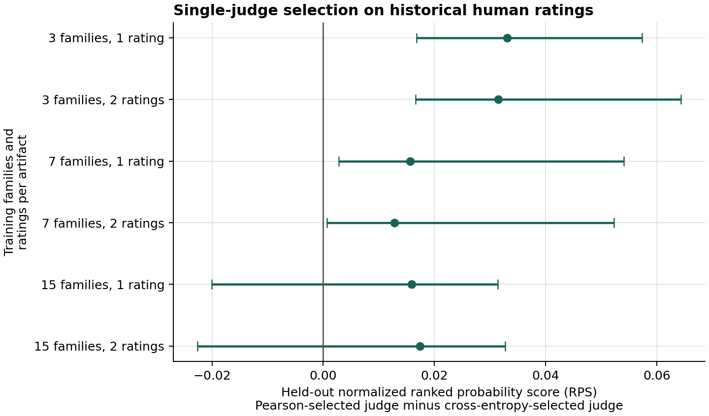

# When did cross-entropy selection win on historical human ratings? | 11-21-2026

**Doc link:** <https://github.com/brando90/judges-dont-need-psychometrics-or-corr/blob/main/experiments/18_when_does_ce_beat_correlation_notebook_page_math_and_sweep_start_21Nov2026/conditional_shape_and_rating_budget/historical_rating_budget/RESULTS_11-21-2026.md>

Date: 11-21-2026

**TLDR:** Among 15 fixed judge candidates, selection by training cross-entropy (CE) gave lower held-out ranked probability score (RPS) than selection by training Pearson at all six historical annotation budgets. The estimated CE advantage was largest at three training families. With 15 families, the family-reweighting interval included gains for either selector. These ratings have prior exposure, and they establish no threshold for new human-rating data.

## Held-out rating distributions

Each split holds out four whole task families and all their artifacts. The 250 splits reuse the same 75 VeriBench artifacts, 25 tasks, 19 families and 195 historical expert ratings. Each test split contains 12–30 artifacts with 24–87 ratings. Train selectors choose one candidate by exhaustive search. CE uses the probabilities assigned to individually observed ratings. Pearson uses the association of predicted and observed mean ratings. The RPS selector minimizes the individual-rating RPS on training artifacts. All examine the same 15 candidates, with no hyperparameters, initialization or validation fitting.

For held-out cross-entropy and ranked probability score, first average the individual-rating losses **within each test artifact**, then average equally over test artifacts within that split, then average the 250 split means equally. Thus an artifact with three ratings carries the same within-split weight as one with two. Total variation distance uses each artifact’s full empirical histogram before these artifact and split averages. Pearson and Spearman are computed across artifact means within each split and averaged over defined splits.

Normalized RPS is the mean squared error of the five predicted cumulative probabilities against the threshold indicators for an individual rating. It ranges from 0 to 1, lower is better. The paired difference subtracts **test RPS of the CE-selected judge from test RPS of the Pearson-selected judge** on the same test artifacts. Positive favors CE selection. The constant baseline predicts the smoothed training histogram for every artifact.

| Training families | Training ratings per artifact | Mean total training ratings (range) | CE-selected test RPS | Pearson-selected test RPS | RPS-selected test RPS | Constant test RPS | Pearson-selected minus CE-selected test RPS [95% interval] |
| ---: | ---: | ---: | ---: | ---: | ---: | ---: | ---: |
| 3 | 1 | 12.1 (9–24) | 0.15005 | 0.18313 | 0.15080 | 0.20497 | +0.03308 [+0.01677, +0.05730] |
| 3 | 2 | 24.2 (18–48) | 0.14716 | 0.17866 | 0.14725 | 0.20729 | +0.03150 [+0.01661, +0.06436] |
| 7 | 1 | 27.5 (21–39) | 0.14242 | 0.15802 | 0.14513 | 0.19430 | +0.01560 [+0.00277, +0.05403] |
| 7 | 2 | 55.0 (42–78) | 0.13961 | 0.15239 | 0.14252 | 0.19392 | +0.01278 [+0.00066, +0.05231] |
| 15 | 1 | 59.4 (45–63) | 0.13202 | 0.14792 | 0.13896 | 0.18754 | +0.01590 [−0.02001, +0.03140] |
| 15 | 2 | 118.7 (90–126) | 0.13193 | 0.14930 | 0.13817 | 0.18696 | +0.01738 [−0.02263, +0.03274] |

Intervals are pointwise 95% empirical-support Bayesian bootstrap credible intervals, from 1,000 shared task-family weight draws with full candidate reselection. They condition on the observed families, raters, split schedule, subsampled labels and candidate pool. The overlapping split averages receive no independent resampling. No hypothesis test or practical margin was specified (p-val=n/a). [All paired RPS contrasts](paired_rps.csv)

*Each point compares exhaustive selection among the same 15 candidates by training Pearson or training cross-entropy, with no optimization start or hyperparameters. Positive indicates lower held-out normalized ranked probability score (RPS, 0–1) for CE selection. The bars use the family reweighting and reselection described above on the same four held-out families per split.*

## Comparison with selection by ranked probability score and with the constant forecast

As of 11-21-2026 13:17 PST, both prespecified controls use the same 250 matched splits and the same held-out individual-rating normalized ranked probability score (RPS, 0–1, lower is better). The Pearson-selected judge had higher average test RPS than the RPS-selected judge at all six budgets. The 95% Bayesian family-reweighting interval includes zero at 15 training families for either rating budget. The Pearson-selected judge had lower average test RPS than the constant training histogram at every budget. This last comparison is descriptive, with no interval or hypothesis test (p-val=n/a).

Both columns start with the Pearson-selected judge's held-out test RPS. A positive difference favors the other method. The RPS-selection intervals use 1,000 paired family-weight draws with reselection on each draw. The constant column averages the 250 equal-weight, within-split differences, using zero reweighting draws.

| Training families | Ratings per training artifact | Test RPS of Pearson-selected minus RPS-selected judge [95% interval] | Test RPS of Pearson-selected judge minus constant (descriptive) |
|---:|---:|---:|---:|
| 3 | 1 | +0.03233 [+0.01836, +0.05543] | −0.02184 |
| 3 | 2 | +0.03141 [+0.01764, +0.06134] | −0.02863 |
| 7 | 1 | +0.01289 [+0.00294, +0.05272] | −0.03629 |
| 7 | 2 | +0.00987 [+0.00249, +0.05107] | −0.04153 |
| 15 | 1 | +0.00896 [−0.00413, +0.02735] | −0.03962 |
| 15 | 2 | +0.01113 [−0.00731, +0.03184] | −0.03765 |

## Does the amount of training data change the advantage?

CE selection improved its own held-out RPS as the number of training families increased at both ratings-per-artifact budgets. Its advantage over Pearson selection stayed positive in the six point estimates and became smaller at 15 families than at three.

**Exploratory comparison, added after the primary results.** At one training rating per artifact, the change in the test RPS advantage from three to 15 families was −0.01718 [−0.06219, −0.00237]. At two ratings per artifact it was −0.01412 [−0.07236, +0.00166]. Each value is the Pearson-selected minus CE-selected test RPS gap at 15 families minus that same gap at three. Negative means a smaller CE advantage at 15. For adding a second rating per artifact, all three within-family-count intervals included zero. All five comparisons use the same 1,000 paired family reweightings, with no adjustment for these post hoc comparisons (p-val=n/a). [Five paired changes in the selection advantage](exploratory_budget_interactions.csv)

## Did selection by Pearson win on held-out Pearson or Spearman?

At 15 training families and two ratings per artifact, **the CE-selected judge also had higher mean held-out Pearson and Spearman correlations**. The estimates below average the within-split scores across 250 splits. These are descriptive secondary comparisons, with no interval or test. Across all six budgets the CE selector had higher point estimates of both held-out correlations than the Pearson selector. Optimizing train correlation does not guarantee maximizing test correlation.

| Selector / baseline | Test ranked probability score (RPS) ↓ | Test cross-entropy (nats) ↓ | Test total variation distance ↓ | Test Pearson ↑ | Test Spearman ↑ | Mean judge rating | Mean human rating | Signed bias | Mean absolute error ↓ |
| --- | ---: | ---: | ---: | ---: | ---: | ---: | ---: | ---: | ---: |
| Cross-entropy | 0.132 | 1.785 | 0.479 | 0.745 | 0.691 | 2.901 | 2.536 | +0.365 | 0.792 |
| Pearson | 0.149 | 2.164 | 0.499 | 0.692 | 0.634 | 2.916 | 2.536 | +0.380 | 0.873 |
| Ranked probability score | 0.138 | 1.912 | 0.482 | 0.718 | 0.668 | 2.846 | 2.536 | +0.310 | 0.816 |
| Training histogram | 0.187 | 1.856 | 0.691 | Undefined | Undefined | 2.638 | 2.536 | +0.102 | 1.302 |

Cross-entropy is mean negative natural log probability of the observed rating, range zero to infinity. Total variation distance is half the sum of the six absolute probability differences from the artifact's empirical rating histogram, range 0–1. For both, lower is better. Pearson measures linear association of artifact means, Spearman their rank association. Both range from −1 to 1, higher is better for association. Signed bias is mean predicted minus mean human rating, so positive means higher predicted ratings. Mean absolute error compares predicted and empirical artifact means in 0–5 rating units. A constant forecast has undefined within-split correlations. [Complete panel and denominators for every selector and budget](scores.csv)

## What was tested and verified

This study chooses among already-generated judgments from seven model variants and 15 model/prompt configurations. It makes no updates to model weights, prompts or harnesses. The historical 27 uniform substitutions after parse failures remain among the 1,125 candidate forecasts. All test losses and all nonconstant selected-judge test correlations were available in every split. With three training families, 55 of 3,750 candidate correlations per training-rating budget were undefined over the 250 splits. Each split still had an eligible candidate. At seven and 15 families all training candidate correlations were defined. Test artifacts had two or three historical expert ratings. Raters could occur in train and test. The original study verified 15/75 reference-file hashes against the annotation records. The other 60 hashes leave unresolved whether judges saw the exact historical reference text. Further limitations include sparse rating histograms, a single candidate pool, prior dataset exposure and a small set of task families. [Original experiment 10 provenance](../../../10_frontier_ai_judges_native_prob_and_prompt_search_ce_vs_corr_start_16Nov2026/README.md)

The dated design was committed at 9b73d39 before computation. Replaying the original split generator matched all 250 family assignments and training orders. Independent scoring from individual ratings reproduced the 18 selected-judge RPS means (three selectors × six budgets) and checked selector choices under 54 nonuniform weighting settings. The source forecasts contain probabilities rounded to eight decimals. The first input check detected a maximum row-sum error of 2 × 10⁻⁸. The revised check allows the rounding error from six components while preserving all stored values and the original smoothing. [Design](PROTOCOL_11-21-2026.md) · [Independent verifier](verify.py) · [Selection frequencies](selection_counts.csv)

## Independent reconciliation and rank check

As of 11-21-2026 13:08 PST, Brando's other assistant independently reproduced the six native-probability pool contrasts above. The largest absolute difference across their six ranked probability score (RPS) differences and twelve interval endpoints was 6.4 × 10⁻¹². Applying the same family splits to a different pool of 44 historical judges with three-vote forecasts favored Pearson in the point estimates. Drawing three votes from each native-probability forecast still favored CE in those point estimates. Candidate composition matters in these retrospective comparisons. The two pools also differ in model identity and prompts. [Reconciliation, tables, and limits](../../reconcile_single_judge_selection_21Nov2026/RECONCILE_11-21-2026.md)

The published Spearman diagnostics preserve exact ties. Each rating mean is an exact integer sum divided by the number of raw ratings. Each predicted mean has an exact ordering from the archive's eight-decimal probabilities and common positive affine smoothing. Binary floating-point means split some ties. Using exact rank keys changed the 18 selected-judge Spearman means by at most 0.00145. The verifier independently recomputes them from decimal candidate probabilities and rational human means. All other panel entries, the primary contrasts and intervals, selection frequencies, exploratory budget interactions and the primary figure reproduced identically.
