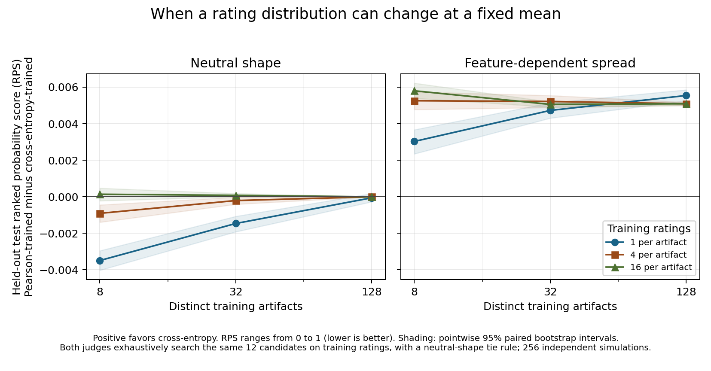

# When does cross-entropy win as rating budgets change? | 11-21-2026

**Doc link:** <https://github.com/brando90/judges-dont-need-psychometrics-or-corr/blob/main/experiments/18_when_does_ce_beat_correlation_notebook_page_math_and_sweep_start_21Nov2026/conditional_shape_and_rating_budget/results.md>

Date: 11-21-2026

**TLDR:** With eight training ratings, changing only the true shape flipped which objective had lower held-out ranked probability score (RPS). At the largest budget both methods recovered a neutral-shape truth, but only the cross-entropy (CE) fit recovered a feature-dependent shape under the default Pearson tie rule. Independent distributional validation could recover it for the Pearson fit as well.

## Primary comparison

A simulated judge predicts probabilities for integer ratings 0–5. Normalized individual-rating RPS is the mean squared error of five cumulative rating thresholds, ranges from 0 to 1 and is lower-is-better. The oracle knows the generating probabilities. Constant predicts the smoothed training histogram for every artifact. Within each replication, CE and Pearson exhaustively search the same 12 forecasts on the same individual training ratings, with the neutral shape first in a tie. Both achieve a global optimum over that finite set up to the declared tie tolerance. Every cell averages 256 independent simulations, each scoring the same held-out 384 synthetic artifacts × three fresh ratings across methods. The grid reuses held-out artifacts across budgets within a simulation. There are no human ratings or previously exposed ratings in this sweep.

The difference subtracts test RPS of the CE-trained judge from test RPS of the Pearson-trained judge. Positive favors CE. Brackets show pointwise 95% paired percentile bootstrap intervals over complete simulations, 2,000 resamples; p-val=n/a. The neutral and varying conditions have exactly the same population mean curve in each simulation. Only the latter uses the independent feature z to change rating dispersion.

| True shape | Train artifacts | Ratings per artifact | Oracle | Constant | CE-trained | Pearson-trained | Test RPS difference [95% interval] |
|---|---:|---:|---:|---:|---:|---:|---:|
| neutral | 8 | 1 | 0.19097 | 0.20627 | 0.19883 | 0.19535 | -0.00349 [-0.00402, -0.00295] |
| neutral | 8 | 4 | 0.19097 | 0.19987 | 0.19578 | 0.19487 | -0.00091 [-0.00139, -0.00044] |
| neutral | 8 | 16 | 0.19097 | 0.19646 | 0.19275 | 0.19289 | +0.00014 [-0.00022, +0.00047] |
| neutral | 32 | 1 | 0.19097 | 0.20023 | 0.19573 | 0.19427 | -0.00146 [-0.00191, -0.00107] |
| neutral | 32 | 4 | 0.19097 | 0.19626 | 0.19233 | 0.19212 | -0.00021 [-0.00041, -0.00002] |
| neutral | 32 | 16 | 0.19097 | 0.19514 | 0.19104 | 0.19112 | +0.00008 [+0.00000, +0.00019] |
| neutral | 128 | 1 | 0.19097 | 0.19625 | 0.19257 | 0.19251 | -0.00006 [-0.00027, +0.00018] |
| neutral | 128 | 4 | 0.19097 | 0.19503 | 0.19100 | 0.19100 | +0.00000 [+0.00000, +0.00000] |
| neutral | 128 | 16 | 0.19097 | 0.19474 | 0.19097 | 0.19097 | +0.00000 [+0.00000, +0.00000] |
| varying | 8 | 1 | 0.18595 | 0.20659 | 0.19224 | 0.19527 | +0.00303 [+0.00235, +0.00367] |
| varying | 8 | 4 | 0.18595 | 0.20041 | 0.18947 | 0.19472 | +0.00526 [+0.00478, +0.00574] |
| varying | 8 | 16 | 0.18595 | 0.19707 | 0.18724 | 0.19304 | +0.00580 [+0.00540, +0.00623] |
| varying | 32 | 1 | 0.18595 | 0.20024 | 0.18958 | 0.19431 | +0.00473 [+0.00431, +0.00515] |
| varying | 32 | 4 | 0.18595 | 0.19641 | 0.18697 | 0.19219 | +0.00522 [+0.00489, +0.00555] |
| varying | 32 | 16 | 0.18595 | 0.19536 | 0.18601 | 0.19107 | +0.00506 [+0.00491, +0.00520] |
| varying | 128 | 1 | 0.18595 | 0.19628 | 0.18708 | 0.19263 | +0.00554 [+0.00525, +0.00586] |
| varying | 128 | 4 | 0.18595 | 0.19512 | 0.18595 | 0.19104 | +0.00509 [+0.00500, +0.00518] |
| varying | 128 | 16 | 0.18595 | 0.19486 | 0.18595 | 0.19104 | +0.00509 [+0.00500, +0.00518] |

## What the tie rule contributes

Every trained mean curve has three candidate distributions with exactly the same mean at every input. A Pearson fit selecting the correct curve receives exactly the same correlation for all three candidates, even with unlimited ratings. Here a preregistered neutral-first rule resolves the ambiguity. A separate fit uses the true shape to break each Pearson tie (an oracle sensitivity). A practical alternative chooses among equally optimal training fits by normalized RPS on independent validation artifacts, n/4 artifacts × k ratings per artifact, identically available to each objective. Validation data thus augment the training budget only for these explicitly named procedures.

| True shape | Train budget | Extra validation ratings for validation tie rule | Default Pearson minus CE test RPS | Oracle-shape Pearson minus ordinary CE test RPS | Validation-tied Pearson minus validation-tied CE test RPS |
|---|---:|---:|---:|---:|---:|
| neutral | 8 × 1 | 2 | -0.00349 [-0.00402, -0.00295] | -0.00349 [-0.00402, -0.00295] | -0.00026 [-0.00084, +0.00035] |
| neutral | 8 × 4 | 8 | -0.00091 [-0.00139, -0.00044] | -0.00091 [-0.00139, -0.00044] | +0.00170 [+0.00109, +0.00226] |
| neutral | 8 × 16 | 32 | +0.00014 [-0.00022, +0.00047] | +0.00014 [-0.00022, +0.00047] | +0.00141 [+0.00094, +0.00189] |
| neutral | 32 × 1 | 8 | -0.00146 [-0.00191, -0.00107] | -0.00146 [-0.00191, -0.00107] | +0.00135 [+0.00079, +0.00184] |
| neutral | 32 × 4 | 32 | -0.00021 [-0.00041, -0.00002] | -0.00021 [-0.00041, -0.00002] | +0.00078 [+0.00045, +0.00112] |
| neutral | 32 × 16 | 128 | +0.00008 [+0.00000, +0.00019] | +0.00008 [+0.00000, +0.00019] | +0.00013 [+0.00004, +0.00026] |
| neutral | 128 × 1 | 32 | -0.00006 [-0.00027, +0.00018] | -0.00006 [-0.00027, +0.00018] | +0.00113 [+0.00080, +0.00150] |
| neutral | 128 × 4 | 128 | +0.00000 [+0.00000, +0.00000] | +0.00000 [+0.00000, +0.00000] | +0.00018 [+0.00007, +0.00030] |
| neutral | 128 × 16 | 512 | +0.00000 [+0.00000, +0.00000] | +0.00000 [+0.00000, +0.00000] | +0.00000 [+0.00000, +0.00000] |
| varying | 8 × 1 | 2 | +0.00303 [+0.00235, +0.00367] | -0.00206 [-0.00272, -0.00143] | +0.00177 [+0.00069, +0.00281] |
| varying | 8 × 4 | 8 | +0.00526 [+0.00478, +0.00574] | +0.00017 [-0.00030, +0.00064] | +0.00171 [+0.00110, +0.00229] |
| varying | 8 × 16 | 32 | +0.00580 [+0.00540, +0.00623] | +0.00071 [+0.00033, +0.00111] | +0.00132 [+0.00086, +0.00178] |
| varying | 32 × 1 | 8 | +0.00473 [+0.00431, +0.00515] | -0.00036 [-0.00080, +0.00004] | +0.00211 [+0.00142, +0.00283] |
| varying | 32 × 4 | 32 | +0.00522 [+0.00489, +0.00555] | +0.00013 [-0.00019, +0.00045] | +0.00077 [+0.00039, +0.00117] |
| varying | 32 × 16 | 128 | +0.00506 [+0.00491, +0.00520] | -0.00003 [-0.00014, +0.00006] | +0.00003 [-0.00010, +0.00015] |
| varying | 128 × 1 | 32 | +0.00554 [+0.00525, +0.00586] | +0.00045 [+0.00017, +0.00074] | +0.00123 [+0.00088, +0.00161] |
| varying | 128 × 4 | 128 | +0.00509 [+0.00500, +0.00518] | +0.00000 [+0.00000, +0.00000] | +0.00008 [+0.00002, +0.00016] |
| varying | 128 × 16 | 512 | +0.00509 [+0.00500, +0.00518] | +0.00000 [+0.00000, +0.00000] | +0.00000 [+0.00000, +0.00000] |

## At a fixed total of 128 training ratings

For each method, the entry is its held-out test RPS at 128 artifacts × one rating minus its test RPS at eight artifacts × 16 ratings. Negative favors spreading the same 128 ratings across more artifacts. The 95% intervals use the paired replicate bootstrap above.

| True shape | CE-trained | Pearson-trained |
|---|---:|---:|
| neutral | -0.00018 [-0.00070, +0.00032] | -0.00038 [-0.00092, +0.00015] |
| varying | -0.00016 [-0.00063, +0.00029] | -0.00042 [-0.00098, +0.00012] |

## Secondary held-out metrics at the largest budget

All entries use 128 training artifacts × 16 ratings. CE is the average negative natural log probability per individual test rating in nats (lower is better). Total variation distance (TVD) is half the summed absolute probability difference ([0,1], lower is better). Empirical TVD uses the three-rating test histogram; population TVD uses the generator probabilities. Pearson and midrank Spearman measure linear and rank association between forecast and observed artifact means (−1 to 1, higher is better). Across every budget, [summary.csv](results/summary.csv) provides absolute estimates, paired contrasts, uncertainty and valid counts for these metrics, Kendall tau-b, numeric agreement and the true-mean diagnostics.

| True shape | Method | CE (nats) | Empirical TVD | Population TVD | Pearson | Spearman |
|---|---|---:|---:|---:|---:|---:|
| neutral | CE-trained | 1.77673 | 0.57047 | 0.00000 | 0.28949 | 0.28503 |
| neutral | Pearson-trained | 1.77673 | 0.57047 | 0.00000 | 0.28949 | 0.28503 |
| neutral | Pearson, validation RPS tie | 1.77673 | 0.57047 | 0.00000 | 0.28949 | 0.28503 |
| neutral | Oracle | 1.77673 | 0.57047 | 0.00000 | 0.28949 | 0.28503 |
| neutral | Constant | 1.79313 | 0.58094 | 0.07190 | undefined | undefined |
| varying | CE-trained | 1.69296 | 0.52800 | 0.00000 | 0.28914 | 0.28936 |
| varying | Pearson-trained | 1.77674 | 0.58116 | 0.16000 | 0.28914 | 0.28936 |
| varying | Pearson, validation RPS tie | 1.69296 | 0.52800 | 0.00000 | 0.28914 | 0.28936 |
| varying | Oracle | 1.69296 | 0.52800 | 0.00000 | 0.28914 | 0.28936 |
| varying | Constant | 1.79367 | 0.59166 | 0.18363 | undefined | undefined |

## Checks, applicability and reproduction

All 32,256 records were retained. Undefined training-target fallback occurred in 0 of 4,608 Pearson training instances. The constant comparator has 4,608 undefined held-out Pearson values. Across the six nonconstant procedures, 0 held-out Pearson values were undefined.

When the predicted curve is correct and the true shape varies, the population RPS penalty for fixing the shape to neutral is exactly 0.00512. This follows by averaging squared cumulative-probability differences across the five thresholds. It is a consequence of the chosen shape amplitude. Population TVD is zero for the oracle; its empirical TVD is positive because three ratings give a noisy target. This is why empirical TVD alone should not decide which distribution forecasts best.

The generator deliberately contains a shape feature orthogonal to the mean. All candidate distributions have known form, no separate rater identities or severity, and include the true conditional distribution. A judge can predict a nonlinear mean under Pearson training. Observed finite-budget crossovers and ranking performance depend on the family, strength of the shape effect, tie convention and use of validation labels. The human evidence needs its own comparison, including the strong constant baseline. See [how to read these results](HOW_TO_READ_RESULTS.md) for the metric dictionary, budgets, and reproduction commands.
