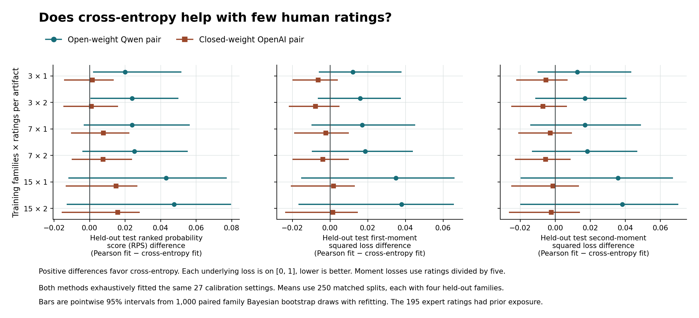

# Can cross-entropy recover more than the mean with few human ratings? (11-21-2026)

Date: 11-21-2026

**Doc link:** <https://docs.google.com/document/d/1qA1MyA0qch1ZA8cb869dNf7iaznoN3iO1lkp6RWFZTk/edit>

**Cross-entropy improved held-out distributional accuracy over Pearson with about 12 training ratings for the open-weight Qwen pair.** The same comparison was unresolved for the closed-weight OpenAI pair. The original OpenAI forecasts already predicted several rating moments well. At this budget, fitting made those forecasts worse. These results support a small-data advantage in a specified setting. They do not establish how frequently it occurs across judges or datasets.

## What the proof identifies

For each artifact, mean-based Pearson reads the predicted first conditional moment, the mean rating. A judge can use nonlinear input features to predict that mean. Pearson gives identical values to any two forecasts with the same means, even when one systematically misses human disagreement. The other four shape directions per artifact on a six-category scale remain unidentified unless model assumptions supply them.

Expected cross-entropy (CE) is uniquely minimized by the entire true conditional law when it is available. A bound also applies before that optimum is reached. For any integer $j\geq 1$, let $m_j(q,x)=\mathbb{E}_q[(R/5)^j\mid x]$. Then

$$
\mathbb E_X[(m_j(q,X)-m_j(p,X))^2]\leq \tfrac12\bigl(\mathrm{CE}(q)-\mathrm{CE}(p)\bigr).
$$

Here CE is **population** expected loss in nats on individual ratings. Sampling error can separate training CE from population CE. The bound controls moment error relative to the truth and supplies no ordering among arbitrary fitted judges. [Derivation in the updated PDF](https://drive.google.com/file/d/1Y778i2z1ZOrYypCqkfWNkiQLrB0lab6F/view) · [Proof of the moment bound](theory_simulation/THEORY_11-21-2026.md)

## What a single observed rating teaches this calibration model

The probability head used below has $\log q(r)=t\log p_{\rm base}(r)+b\,u(r)+c\,u(r)^2-\log Z$, with $u(r)=(r-2.5)/2.5$. For one rating $y$, differentiating the CE loss gives

$$
\frac{\partial[-\log q(y)]}{\partial b}=\mathbb E_q[u(R)]-u(y),\qquad
\frac{\partial[-\log q(y)]}{\partial c}=\mathbb E_q[u(R)^2]-u(y)^2.
$$

The same label supplies a first-moment residual and a second-moment residual. With finitely many noisy ratings, those residuals can point toward worse test predictions. The experiment exhaustively searched a discrete grid and makes no claim of exact empirical moment matching. Pearson can also select a particular spread within this restricted head when changing the spread changes the predicted mean. The identification limit concerns forecasts whose means agree. [Fitting code](human_judges/analyze.py) · [Numerical gradient check](human_judges/verify.py)

## Human ratings at the smallest training budget

Each split trained on three task families, with one rating on each training artifact (mean 12.108 ratings, range 9–24). The two open-weight judges were Qwen3-4B-Instruct-2507 and Qwen2.5-Coder-14B-Instruct. The two closed-weight judges were GPT-5.4 mini and GPT-6.1 Sol. Within each pair we averaged their archived six-category probabilities, then exhaustively fitted the same 27 settings for confidence, mean level and spread under each objective. The four original language models stayed fixed. Training used existing forecasts and human ratings. [Model provenance](human_judges/models.json) · [Training and data protocol](human_judges/PROTOCOL_11-21-2026.md)

The primary metric is normalized individual-rating **ranked probability score (RPS)**, the average squared error of predicted cumulative probabilities at the five thresholds. It ranges from 0 to 1, lower is better. In the last column, positive differences favor the CE fit.

| Judge pair | Training constant test RPS | Original judge test RPS | CE-fitted test RPS | Pearson-fitted test RPS | Test RPS of Pearson fit minus CE fit [95% interval] |
| --- | ---: | ---: | ---: | ---: | --- |
| Open-weight Qwen | 0.2050 | 0.2538 | 0.2116 | 0.2316 | +0.01998 [+0.00195, +0.05178] |
| Closed-weight OpenAI | 0.2050 | 0.1398 | 0.1565 | 0.1580 | +0.00149 [−0.01442, +0.01363] |

The constant estimates one training rating distribution for every artifact. The archive has 195 previously studied expert ratings on 75 artifacts in 25 tasks and 19 families. Each of 250 matched splits held out four entire families. We averaged ratings within each artifact, artifacts within each test split, then splits equally. Intervals are pointwise 95% Bayesian bootstrap intervals from 1,000 paired reweightings of families, refitting both heads. They condition on these families, raters, model choices and historical split schedule. Across the two pairs and six overlapping training budgets, all 12 average test RPS differences favored CE, and two pointwise intervals excluded zero (the open-weight pair at three families with one or two ratings). These dependent cells do not estimate how often CE wins in the wild. [All human results and controls](human_judges/RESULTS_11-21-2026.md)

**Did the few labels teach the judge the mean and spread?** At the smallest budget the closed-weight CE fit beat the constant on all five raw-moment losses. The original closed-weight forecasts beat the CE fit on every one of those losses. Their predictive information was already present before fitting. For the open-weight pair, CE improved overall RPS over the original forecast, but its first- and second-moment comparisons with the original forecast were unresolved. A second raw moment combines rating level and dispersion. When we measured dispersion separately using squared error against each artifact's two- or three-rating sample variance, the Pearson fit scored better than the CE fit in both pairs at the smallest budget. That diagnostic depends on the sparse rater sample. [Moment and variance comparisons](human_judges/RESULTS_11-21-2026.md)

*Both objectives exhaustively fit the same 27 transforms to the same training artifacts. The differences compare losses on the same held-out artifacts. First- and second-moment losses compare the predicted moment with the corresponding power of an individual rating divided by five, then square the difference. The intervals and RPS scale are defined above.* [Absolute losses](human_judges/scores.csv) · [Paired intervals](human_judges/contrasts.csv)

## Exact calculation with three training ratings

Even with identical mean information, a few ratings can reveal disagreement. We gave each learner the true conditional mean curve and one rating at each of three input types. Both procedures exhaustively searched the same two possible spreads. The Pearson scores tie because the forecast means match. Both procedures break ties in favor of low spread. We averaged over every possible training sample and both true mean curves, then evaluated on fresh ratings at these three types.

| True spread | CE-fitted conditional-variance squared error | Pearson-fitted conditional-variance squared error |
| --- | ---: | ---: |
| High | 0.02464 | 0.16000 |
| Low | 0.04768 | 0 |

Errors are in rating points to the fourth, zero is ideal. The known true mean makes both mean errors zero. In the joint search, where both mean and spread must be learned, each method could win on mean error at the same six-rating budget, depending on the true mean curve. The enumerated selection probabilities are exact, so no sampling interval is needed. The example demonstrates both a small-data CE win and a small-data Pearson win under the same model family and tie rule. [Exact risks, alternative tie rules and complete metric panel](theory_simulation/RESULTS_11-21-2026.md)

## Scope and reproduction

Both protocols were [published before measurement](https://github.com/brando90/judges-dont-need-psychometrics-or-corr/commit/8b2c3dd). This is output calibration on selected frozen judges, with prior exposure to the historical tasks and unresolved reference provenance for 60 of 75 artifacts. The two model pairs differ in provider, model family and initial forecast quality. The comparison cannot isolate the effect of publishing model weights. The full results include test CE, total variation distance, Pearson and Spearman as well as the RPS and moment losses. [How to reproduce and read the results](HOW_TO_READ_RESULTS.md)
