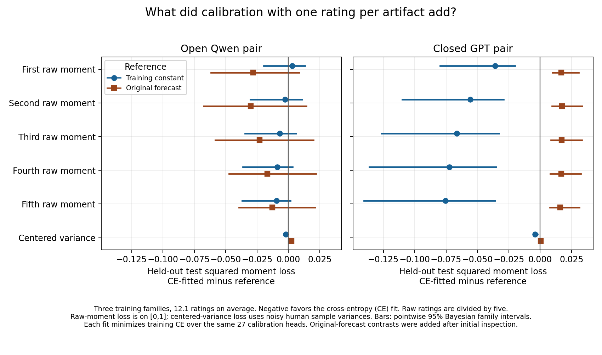

# Which moments do four calibrated language-model judges predict? | 11-21-2026

**Doc link:** <https://github.com/brando90/judges-dont-need-psychometrics-or-corr/blob/main/experiments/19_small_data_moment_recovery_open_and_closed_judges_start_21Nov2026/human_judges/RESULTS_11-21-2026.md>

Date: 11-21-2026. As of 11-21-2026, the fixed-uniform, bootstrap and smoothing diagnostics below are post hoc.

**TLDR:** With roughly 12 training ratings, the cross-entropy (CE) fit on the two closed-weight GPT forecasts beat a training constant on all five raw-moment losses and centered variance. The untreated GPT forecasts performed better than the CE fit on every raw moment. The open-weight Qwen pair improved on its original distribution score, while its first- and second-moment comparisons with the constant were inconclusive. Neither pair established that the small training set taught the judge only the mean.

## What the smallest training budget actually changed

The 75 previously studied artifacts have 195 human ratings from 25 tasks in 19 families. Each of 250 matched splits holds out all artifacts of four families. The primary example fits on three families and one retained rating per training artifact (9–24 ratings, mean 12.108). It scores every available rating on 12–30 test artifacts per split (24–87 ratings). Neither raters nor models were held out. Each named pair averages the original six-category probabilities of its two backbones before calibration. Both objectives search the same 27 three-parameter calibration heads, without an optimization start or hyperparameter search. Fitting updates the output distribution while keeping the underlying language model fixed.

Normalize an individual rating to z = rating/5. Raw-moment loss is the squared difference between the predicted moment and the realized power of z, range 0–1, lower is better. The first measures mean accuracy relative to a noisy future rating. The second and higher powers depend on level as well as shape. Centered-variance loss compares forecast variance with the unbiased within-artifact sample variance of the two or three test ratings. Unbiasedness for a population variance assumes independently sampled exchangeable raters. With two ratings the sample variance can reach 0.5 on this scale, so squared centered-variance loss ranges from 0 to 0.25. All differences subtract the same test metric for two procedures. Intervals use 1,000 shared Bayesian bootstrap reweightings of 19 task families with refitting, including the constant. The original pointwise 95% intervals use draw percentiles. A separate post hoc table explicitly labels reflected intervals. Positive Pearson-fitted minus CE-fitted favors CE. Negative fitted minus reference favors fitting. There is no practical margin or hypothesis test (p-val=n/a).

| Held-out test loss, 3 families × 1 rating | Open pair: CE-fitted minus training constant | Closed pair: CE-fitted minus training constant | Open pair: CE-fitted minus original | Closed pair: CE-fitted minus original |
|---|---|---|---|---|
| First raw moment | +0.0031 [-0.0195, +0.0130] | -0.0360 [-0.0796, -0.0200] | -0.0281 [-0.0616, +0.0085] | +0.0169 [+0.0098, +0.0306] |
| Second raw moment | -0.0027 [-0.0303, +0.0109] | -0.0557 [-0.1098, -0.0292] | -0.0300 [-0.0675, +0.0143] | +0.0174 [+0.0096, +0.0334] |
| Third raw moment | -0.0069 [-0.0346, +0.0061] | -0.0665 [-0.1264, -0.0328] | -0.0230 [-0.0583, +0.0199] | +0.0172 [+0.0088, +0.0331] |
| Fourth raw moment | -0.0090 [-0.0362, +0.0032] | -0.0724 [-0.1362, -0.0351] | -0.0168 [-0.0474, +0.0220] | +0.0167 [+0.0081, +0.0322] |
| Fifth raw moment | -0.0096 [-0.0368, +0.0017] | -0.0756 [-0.1404, -0.0358] | -0.0128 [-0.0395, +0.0212] | +0.0161 [+0.0077, +0.0313] |
| Centered variance | -0.0022 [-0.0029, -0.0004] | -0.0041 [-0.0043, -0.0020] | +0.0023 [+0.0007, +0.0027] | +0.0004 [-0.0007, +0.0009] |

The identity and constant baselines were prespecified. The intervals comparing fitted with original probabilities are exploratory additions made to distinguish incremental learning from information already present in the base forecast. Improvement over the constant alone cannot establish what the few human labels taught the head. The empirical human rating law per artifact is too sparsely observed to certify recovery of its population probability vector.

## Distribution scores across the training budgets

The primary metric is normalized individual-rating ranked probability score (RPS), average squared cumulative error across five rating thresholds, range 0–1, lower is better. Each reported estimate averages over individual ratings within artifact, equally over held-out artifacts within split, and equally over the 250 overlapping splits. Correlation is computed across predicted and observed means within split, then averaged across defined splits.

| Input | Training families | Ratings per training artifact | Constant test RPS | Original test RPS | CE-fitted test RPS | Pearson-fitted test RPS | Pearson-fitted minus CE-fitted test RPS [95% interval] |
|---|---|---|---|---|---|---|---|
| Open Qwen pair | 3 | 1 | 0.2050 | 0.2538 | 0.2116 | 0.2316 | +0.0200 [+0.0019, +0.0518] |
| Open Qwen pair | 3 | 2 | 0.2073 | 0.2538 | 0.2101 | 0.2340 | +0.0240 [+0.0005, +0.0500] |
| Open Qwen pair | 7 | 1 | 0.1943 | 0.2538 | 0.2041 | 0.2280 | +0.0239 [-0.0033, +0.0563] |
| Open Qwen pair | 7 | 2 | 0.1939 | 0.2538 | 0.2034 | 0.2285 | +0.0252 [-0.0041, +0.0552] |
| Open Qwen pair | 15 | 1 | 0.1875 | 0.2538 | 0.1963 | 0.2394 | +0.0431 [-0.0120, +0.0772] |
| Open Qwen pair | 15 | 2 | 0.1870 | 0.2538 | 0.1945 | 0.2421 | +0.0475 [-0.0129, +0.0796] |
| Closed GPT pair | 3 | 1 | 0.2050 | 0.1398 | 0.1565 | 0.1580 | +0.0015 [-0.0144, +0.0136] |
| Closed GPT pair | 3 | 2 | 0.2073 | 0.1398 | 0.1565 | 0.1574 | +0.0009 [-0.0147, +0.0161] |
| Closed GPT pair | 7 | 1 | 0.1943 | 0.1398 | 0.1479 | 0.1557 | +0.0078 [-0.0105, +0.0223] |
| Closed GPT pair | 7 | 2 | 0.1939 | 0.1398 | 0.1472 | 0.1549 | +0.0076 [-0.0100, +0.0240] |
| Closed GPT pair | 15 | 1 | 0.1875 | 0.1398 | 0.1377 | 0.1526 | +0.0149 [-0.0135, +0.0270] |
| Closed GPT pair | 15 | 2 | 0.1870 | 0.1398 | 0.1360 | 0.1518 | +0.0158 [-0.0158, +0.0283] |

At three training families × one rating, the CE fit improved on original open-pair test RPS by 0.0422, while the original closed pair had lower test RPS than its CE fit by 0.0166. The two corresponding fitted-minus-original intervals are -0.0422 [-0.0795, -0.0008] and +0.0166 [+0.0083, +0.0316].

### What does a uniform forecast achieve?

The post hoc fixed uniform forecast assigns 1/6 to each rating without estimating parameters. Its test RPS and CE use the same held-out artifacts, ratings and split weights. Its predicted mean is constant, so its Pearson and Spearman correlations are undefined. The matched comparisons below use each method’s test RPS minus uniform test RPS. Negative favors the method. Positive favors uniform.

| Forecast, 3 families × 1 rating | Test RPS | Test CE (nats) | Test RPS minus uniform [pointwise 95% family percentile interval] |
|---|---|---|---|
| Fixed uniform | 0.1814 | 1.7918 | 0 (reference) |
| Open Qwen pair, Original forecast | 0.2538 | 3.6970 | +0.0724 [+0.0205, +0.1207] |
| Open Qwen pair, CE-fitted | 0.2116 | 2.5043 | +0.0303 [+0.0156, +0.0590] |
| Open Qwen pair, Pearson-fitted | 0.2316 | 3.2998 | +0.0502 [+0.0224, +0.0936] |
| Closed GPT pair, Original forecast | 0.1398 | 1.7723 | -0.0415 [-0.0745, -0.0142] |
| Closed GPT pair, CE-fitted | 0.1565 | 1.7134 | -0.0249 [-0.0518, +0.0007] |
| Closed GPT pair, Pearson-fitted | 0.1580 | 2.2270 | -0.0234 [-0.0572, +0.0062] |
| Training constant | 0.2050 | 2.0939 | +0.0236 [+0.0219, +0.0548] |

Both fitted forecasts for the Qwen pair scored worse than fixed uniform at the smallest budget. For the GPT pair, the original forecast’s interval favors it over uniform, while the two fitted-versus-uniform intervals include zero. The training constant estimates the rating histogram from a small sample. Its positive difference from uniform here shows why the choice of reference matters.

### How sensitive is the fitted-judge comparison?

The original brackets are the 2.5th and 97.5th percentiles of the 1,000 family-weighted, refitted draws. Post hoc reflected intervals reflect those endpoints around the unweighted estimate. With few families and discrete head selection the two conventions can give different signs at their endpoints. The draw counts below describe this reweighting distribution. They are neither independent datasets nor hypothesis-test p-values.

| Input | Families × ratings | Held-out test RPS difference | Unweighted | Draw mean | Draws ≤ 0 | Percentile 95% | Reflected 95% |
|---|---|---|---|---|---|---|---|
| Open Qwen pair | 3 × 1 | Pearson-fitted minus CE-fitted | +0.0200 | +0.0224 | 15/1000 | [+0.0019, +0.0518] | [-0.0118, +0.0380] |
| Open Qwen pair | 3 × 2 | Pearson-fitted minus CE-fitted | +0.0240 | +0.0211 | 22/1000 | [+0.0005, +0.0500] | [-0.0020, +0.0475] |
| Closed GPT pair | 15 × 1 | Pearson-fitted minus CE-fitted | +0.0149 | +0.0076 | 264/1000 | [-0.0135, +0.0270] | [+0.0028, +0.0433] |
| Closed GPT pair | 15 × 1 | CE-fitted minus Original forecast | -0.0022 | +0.0084 | 94/1000 | [-0.0028, +0.0231] | [-0.0275, -0.0016] |

For the Qwen pair at both three-family budgets, the original percentile interval favors CE fitting and the reflected interval includes zero. For the GPT pair at 15 families × one rating, the Pearson-minus-CE percentile interval includes zero and the reflected interval favors CE. The CE-minus-original unweighted point and draw mean even have opposite signs. The two interval constructions have no established coverage guarantee for this retrospective panel.

The shared input transformation is pε(r) = (1−6ε)p(r) + ε after normalizing each six-bin forecast. Its uniform mixture weight is 6ε. The calibration head then transforms the result. In post hoc replays at three families, the Qwen test RPS difference stays positive at each ε, but both percentile intervals include zero at ε=0.01. All corresponding GPT percentile intervals include zero. The test CE differences for these pairs, controls and intervals are included in the [smoothing table](smoothing_sensitivity.csv).

| Input | Ratings per training artifact | Input ε | Pearson-fitted minus CE-fitted test RPS [pointwise 95% family percentile interval] |
|---|---|---|---|
| Open Qwen pair | 1 | 1e-06 | +0.0200 [+0.0019, +0.0518] |
| Closed GPT pair | 1 | 1e-06 | +0.0015 [-0.0144, +0.0136] |
| Open Qwen pair | 2 | 1e-06 | +0.0240 [+0.0005, +0.0500] |
| Closed GPT pair | 2 | 1e-06 | +0.0009 [-0.0147, +0.0161] |
| Open Qwen pair | 1 | 0.0001 | +0.0211 [+0.0019, +0.0530] |
| Closed GPT pair | 1 | 0.0001 | +0.0021 [-0.0144, +0.0137] |
| Open Qwen pair | 2 | 0.0001 | +0.0254 [+0.0012, +0.0522] |
| Closed GPT pair | 2 | 0.0001 | +0.0014 [-0.0148, +0.0161] |
| Open Qwen pair | 1 | 0.001 | +0.0235 [+0.0020, +0.0547] |
| Closed GPT pair | 1 | 0.001 | +0.0014 [-0.0144, +0.0128] |
| Open Qwen pair | 2 | 0.001 | +0.0262 [+0.0014, +0.0536] |
| Closed GPT pair | 2 | 0.001 | +0.0006 [-0.0158, +0.0145] |
| Open Qwen pair | 1 | 0.01 | +0.0201 [-0.0009, +0.0517] |
| Closed GPT pair | 1 | 0.01 | +0.0011 [-0.0171, +0.0117] |
| Open Qwen pair | 2 | 0.01 | +0.0237 [-0.0010, +0.0505] |
| Closed GPT pair | 2 | 0.01 | +0.0010 [-0.0199, +0.0140] |

The original Qwen2.5-Coder-14B array had 345/450 exactly zero probabilities (76.7%). Its original held-out test RPS after the primary smoothing was 0.3688. At three families × one rating, CE selected the smallest exponent t=0.5 (the flattest available native-probability term) in 247/250 Qwen-pair fits and 214/250 GPT-pair fits. Correcting overconfident input probabilities is a plausible contributor to CE’s gain over the original Qwen forecasts. These counts do not isolate its causal contribution, because the other two head coefficients vary as well.

### Does Pearson fitting improve the mean or spread relative to CE?

Both fits use the same training labels and head. At the smallest budget, neither pair resolves a first- or second-raw-moment loss advantage between fits. The centered-variance diagnostic favors the Pearson fit on both pairs. Because that diagnostic uses only two or three raters per artifact, the result concerns agreement with observed panel spread. It does not identify rater severity or population disagreement.

| Held-out loss, 3 families × 1 rating | Open pair: Pearson-fitted minus CE-fitted [95% interval] | Closed pair: Pearson-fitted minus CE-fitted [95% interval] |
|---|---|---|
| First raw moment | +0.0120 [-0.0059, +0.0380] | -0.0062 [-0.0199, +0.0041] |
| Second raw moment | +0.0126 [-0.0100, +0.0433] | -0.0053 [-0.0221, +0.0070] |
| Third raw moment | +0.0095 [-0.0121, +0.0368] | -0.0048 [-0.0207, +0.0070] |
| Fourth raw moment | +0.0070 [-0.0129, +0.0316] | -0.0043 [-0.0193, +0.0066] |
| Fifth raw moment | +0.0056 [-0.0126, +0.0274] | -0.0037 [-0.0175, +0.0067] |
| Centered variance | -0.0023 [-0.0026, -0.0010] | -0.0009 [-0.0012, -0.0001] |

On the original unweighted training fits, neither pooled input had a Pearson tie in any split or budget. Thus the training-RPS tie-break left their point estimates unchanged. Individual-backbone fit outcomes and all weighted contrasts are retained.

## Individual backbones and the ranking diagnostics

The two Qwen models received the human rubric in the system message and were asked to give a checklist, a two- to three-sentence rationale, six probabilities over ratings, and a final integer score, in that order. The two GPT models received the rubric after the three files in the user message. They were asked to give six probabilities explicitly for an expert human’s rating, followed by one rationale of at most 25 words. The four selected inputs are the model-written probabilities. Different instructions, output order and parsing procedures confound comparisons across model classes. Each CE-versus-Pearson comparison uses the same cached probability vectors within its input. [Prompt contracts and original sources](HOW_TO_READ_RESULTS.md#which-p0-prompt-produced-each-vector)

The archived file fingerprints agree across both studies on all 75 Python–reference–candidate triples. The P0 model messages contain the task files and rating instructions. Individual human labels enter downstream supervised calibration and held-out scoring. All 150 GPT forecasts were reconstructed offline from rendered request fingerprints and cached responses. Fifteen of 75 supplied reference files match the annotation-era reference hashes. Earlier studies used these ratings, and the other 60 reference versions remain unresolved. [Offline provenance checks](verify_prompt_provenance.py) · [Model manifest](models.json)

The following compares each backbone at the smallest budget, then gives the absolute metric panel on both paired inputs. Total variation distance (TVD) is half the absolute probability difference summed against the empirical rating histogram, 0–1, lower is closer to that histogram. Test CE is negative log probability of individual ratings in nats, lower is better. Pearson measures linear association of artifact means and midrank Spearman measures rank association, both between −1 and 1, higher is better.

| Input, 3 families × 1 rating | Original test RPS | CE-fitted test RPS | Pearson-fitted test RPS | Pearson-fitted minus CE-fitted RPS [95% interval] | CE-fitted minus constant first-moment loss [95% interval] | CE-fitted minus constant second-moment loss [95% interval] |
|---|---|---|---|---|---|---|
| Qwen3-4B-Instruct-2507 | 0.2136 | 0.2129 | 0.2210 | +0.0081 [-0.0031, +0.0200] | +0.0034 [-0.0217, +0.0113] | -0.0046 [-0.0355, +0.0053] |
| Qwen2.5-Coder-14B-Instruct | 0.3688 | 0.3607 | 0.3732 | +0.0125 [+0.0075, +0.0161] | +0.0975 [+0.0242, +0.1563] | +0.1185 [+0.0224, +0.1957] |
| GPT-5.4 mini | 0.1873 | 0.1770 | 0.1828 | +0.0058 [-0.0034, +0.0148] | -0.0194 [-0.0611, -0.0066] | -0.0309 [-0.0852, -0.0121] |
| GPT-6.1 Sol | 0.1721 | 0.1531 | 0.1577 | +0.0046 [-0.0006, +0.0194] | -0.0433 [-0.1019, -0.0177] | -0.0714 [-0.1407, -0.0329] |

| Input, 3 families × 1 rating | Method | Test CE (nats) | Test TVD | Test Pearson | Test Spearman | Mean judge rating | Mean human rating | Signed bias (judge minus human) | Mean absolute error (points) |
|---|---|---|---|---|---|---|---|---|---|
| Open Qwen pair | CE-fitted | 2.5043 | 0.6879 | 0.2257 | 0.2432 | 2.8840 | 2.5357 | 0.3483 | 1.3696 |
| Open Qwen pair | Pearson-fitted | 3.2998 | 0.6989 | 0.1852 | 0.2000 | 3.2434 | 2.5357 | 0.7077 | 1.4384 |
| Open Qwen pair | Original forecast | 3.6970 | 0.7205 | 0.1410 | 0.1626 | 3.5974 | 2.5357 | 1.0617 | 1.5519 |
| Open Qwen pair | Training constant | 2.0939 | 0.6966 | undefined | undefined | 2.6463 | 2.5357 | 0.1106 | 1.3694 |
| Closed GPT pair | CE-fitted | 1.7134 | 0.5603 | 0.5932 | 0.5049 | 2.5592 | 2.5357 | 0.0235 | 1.0405 |
| Closed GPT pair | Pearson-fitted | 2.2270 | 0.5512 | 0.6411 | 0.5515 | 2.7905 | 2.5357 | 0.2548 | 0.9708 |
| Closed GPT pair | Original forecast | 1.7723 | 0.5050 | 0.6551 | 0.5773 | 2.6003 | 2.5357 | 0.0646 | 0.8949 |
| Closed GPT pair | Training constant | 2.0939 | 0.6966 | undefined | undefined | 2.6463 | 2.5357 | 0.1106 | 1.3694 |

## Prespecified predictions and limits

1. **CE improves the first moment relative to the constant for at least one pair at the smallest budget.** The closed GPT pair meets the interval criterion. The open Qwen pair does not.
2. **At least one higher moment or centered variance remains unresolved in such a pair.** This failed for the closed GPT pair. All five raw-moment loss intervals and its centered-variance loss interval favor the CE-fitted forecast over the constant. This is skill versus a constant, not evidence that tiny samples recover all moments from scratch.
3. **Train Pearson need not lead on held-out mean accuracy or correlation.** At three families × one rating, the open pair had higher held-out Pearson after CE fitting, 0.2257 versus 0.1852. The closed pair had higher held-out Pearson after Pearson fitting, 0.6411 versus 0.5932. These are descriptive correlations, without intervals. Within one class, different backbones and different baselines can support different conclusions. Pointwise intervals do not correct for the many budgets and metrics.

Weight access, company, model size, prompting implementation, metadata, and original forecast quality are confounded. These four handpicked backbones cannot identify an effect of opening model weights. The human labels have prior exposure, raters may overlap across splits and final family weighting cannot create new raters. See the [post hoc bootstrap, reference and sign summaries](bootstrap_sensitivity.csv), [dated protocol](PROTOCOL_11-21-2026.md), [absolute scores and valid counts](scores.csv), [paired contrasts](contrasts.csv), [budget and fallback counts](accounting.csv), and [fit parameter selection counts](choices.csv).
