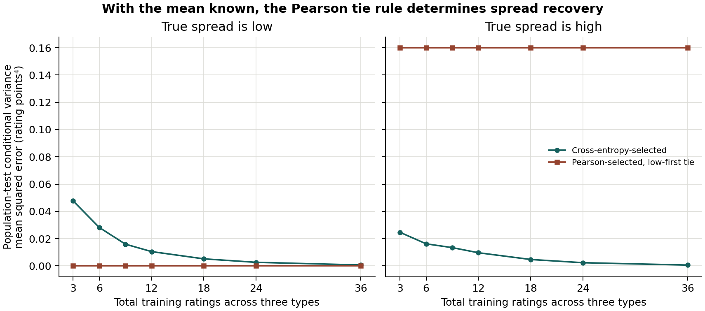

# With few ratings, who recovers the conditional mean and variance? | 11-21-2026

**Doc link:** <https://github.com/brando90/judges-dont-need-psychometrics-or-corr/blob/main/experiments/19_small_data_moment_recovery_open_and_closed_judges_start_21Nov2026/theory_simulation/RESULTS_11-21-2026.md>

Date: 11-21-2026

**TLDR:** Three individual training ratings can favor either selector on conditional variance. With the true mean supplied and a low-spread tie default, Pearson had zero variance error when the default was right. When the true spread was high, its variance error was 0.16000 versus 0.02464 for cross-entropy. Six ratings also suffice for either selector to have lower conditional **mean** error, depending on the true mean curve.

## Which procedure recovers the spread?

Three equally likely input types can have either of two mean curves and either low or high spread. For the first comparison the learner is given the true conditional mean curve. Each procedure exhaustively selects one of the two allowed distributions using the same observations. Cross-entropy (CE) maximizes their exact training likelihood. The two candidates have identical mean predictions, so they tie on training Pearson whenever it is defined. Both procedures break ties in favor of low spread. The opposite and randomized defaults are reported below.

Each table entry averages over every possible training sample, fresh population-test inputs and equally likely true mean curves. The test distribution uses the same three input types and newly drawn ratings. No human ratings, optimization starts, validation search, random seeds or simulation intervals enter these numbers. The outcome is **mean squared error in conditional variance**, measured in rating points to the fourth, with zero ideal. A wrong spread costs exactly 0.16 when the mean is known. Positive differences subtract CE-selected test error from Pearson-selected test error and favor CE.

| Total train ratings | True spread | CE-selected variance error | Pearson-selected variance error | Pearson minus CE test variance error |
| ---: | --- | ---: | ---: | ---: |
| 3 | Low | 0.047680 | 0 | −0.047680 |
| 3 | High | 0.024640 | 0.160000 | +0.135360 |
| 6 | Low | 0.028205 | 0 | −0.028205 |
| 6 | High | 0.016221 | 0.160000 | +0.143779 |
| 36 | Low | 0.000707 | 0 | −0.000707 |
| 36 | High | 0.000648 | 0.160000 | +0.159352 |

*On three input types the learner receives equal numbers of training ratings and knows the true mean curve. Both selectors exhaustively search the same two distributions. CE maximizes training likelihood; Pearson maximizes training correlation of means with a low-spread tie default. Lower population-test conditional variance error is better. All training sequences are included exactly. No confidence interval or p-value applies.*

At three training ratings, switching both selectors to a high-first tie policy gives Pearson error 0.16 under low spread and zero under high spread; CE's two risks remain 0.04768 and 0.02464. A fair coin for the default gives Pearson risk 0.08 under each truth. Under that rule CE has lower variance risk for both truths. The true-mean control rules out estimation error in the mean as an explanation.

**How frequent must the high-spread truth be for CE to win on average?** Under a low-first tie rule and equal weights on the two known mean curves, the crossover high-spread prevalence is 26.05% with three training ratings, 16.40% with six, and 0.4414% with 36. Above this prevalence CE has lower squared variance error. Below it the fixed low default has lower expected risk. For example, in a population of worlds with 10% high spread, Pearson has lower risk at six ratings (0.016000 versus 0.027007 for CE), and CE has lower risk at nine (0.015716 versus 0.016000 for Pearson; crossover 9.83%). This is an explicit data-dependent reversal within the specified model. [Derivation](THEORY_11-21-2026.md) · [All eight thresholds](known_mean_prior_threshold.csv)

## Can either selector estimate the mean more accurately?

Yes. Now the learner is given neither the mean curve nor the spread and exhaustively selects among all four candidates. The table fixes low-spread truth and six training ratings (two per type). Its metric is the population-test conditional **mean** squared error in rating points squared, lower is better. The oracle that knows the true mean curve scores zero, and always selecting the wrong curve costs 0.08. The same low-first rule prioritizes curve A over curve B for both selectors when their objective ties.

| True mean curve | CE-selected mean error | Pearson-selected mean error | Pearson minus CE test mean error |
| --- | ---: | ---: | ---: |
| A | 0.017666 | 0.016526 | −0.001140 |
| B | 0.028036 | 0.029557 | +0.001521 |

At **three** training ratings the selectors even agree on conditional-mean error for each of the four possible true laws. Averaging the two true mean curves, they both score 0.02816 under low spread and 0.03104 under high spread. Giving the learner the correct spread yields the same two average mean errors at this budget. Giving it the correct mean makes both mean errors zero by definition. Thus mean estimation and spread estimation can behave differently on identical training samples. In this controlled family, the two possible means have known absolute scale and offset. An unrestricted mean-based Pearson optimizer also has a positive affine ambiguity. [What the objectives identify](THEORY_11-21-2026.md)

## Do the distribution scores agree with the moment comparison?

With three total ratings, the following are population-test expectations over the four-candidate search with both parameters unknown, low-first ties, and an equal prior on the two true mean curves. The raw second moment is E[R² | x]. Its squared error also includes differences in mean level, while squared variance error measures the centered second moment. Both have units of rating points to the fourth. Pearson and tied-rank Spearman compare forecasts to the **true conditional means** across the three input types (range −1 to 1, higher for stronger association). Here the two admissible mean curves are permutations of three equally spaced numbers, so their Pearson and Spearman correlations coincide.

| True spread | Selected by | Raw second-moment squared error ↓ | Conditional variance squared error ↓ | Ranked probability score ↓ | Cross-entropy (nats) ↓ | Total variation distance ↓ | Pearson / Spearman ↑ |
| --- | --- | ---: | ---: | ---: | ---: | ---: | ---: |
| Low | CE | 0.496320 | 0.046135 | 0.068725 | 1.060810 | 0.149600 | 0.472 / 0.472 |
| Low | Pearson | 0.450560 | 0.000375 | 0.064149 | 0.954058 | 0.046933 | 0.472 / 0.472 |
| High | CE | 0.525120 | 0.028894 | 0.099285 | 1.125103 | 0.113867 | 0.418 / 0.418 |
| High | Pearson | 0.656640 | 0.160414 | 0.112437 | 1.435816 | 0.400000 | 0.418 / 0.418 |

Normalized individual-rating ranked probability score is the average squared error on the five cumulative thresholds of the 0–5 rating scale. Its range is 0–1. CE is minus the natural logarithm of the probability assigned to the fresh rating (zero to infinity). Total variation distance is half the summed absolute probability difference from the known conditional truth, range 0–1. All three are lower-is-better here. The true forecast's oracle ranked probability score is 0.061333 under low spread and 0.093333 under high spread; its total variation distance is zero.

## Limits and verification

The one-rating-total boundary has undefined sample Pearson with probability one. At three balanced training ratings, Pearson is undefined when all three observed ratings coincide, probability 0.228 under low spread and 0.128 under high spread. These samples are included with the declared fallback. At 36 ratings the corresponding probabilities remain positive, approximately 0.00539 and 0.00506. The conditional rating distribution here occupies only 1, 2 and 3 on the 0–5 scale. All tests concern future ratings at these same three input types. The construction holds input coverage fixed while varying rating replication; extrapolation to unseen input types and judging accuracy on an actual human population require separate evidence.

The [dated protocol](PROTOCOL_11-21-2026.md) was committed at 8b2c3dd before measurement. The largest budget sums all 753,571 different triples of training histograms. Integer likelihoods and multinomial counts handle ties and training probabilities exactly, with common denominator 10³⁶. The [independent check](verify.py) enumerated all 27 and 729 ordered samples for three and six balanced training ratings using direct Pearson and log loss. Every selector probability matched. Across all eight budgets, all 384 exact probability rows normalized and all 576 population-risk rows passed the reported invariance checks. The verifier also checked the moment inequalities for degrees one through five on all 48 truth/forecast/input combinations and independently recovered the one-label threshold of 1/3. Numerical risk summaries use floating-point arithmetic after exact sample counting. [Exact counts](exact_selection_mass.csv) · [Complete metric panel](population_risk.csv)
