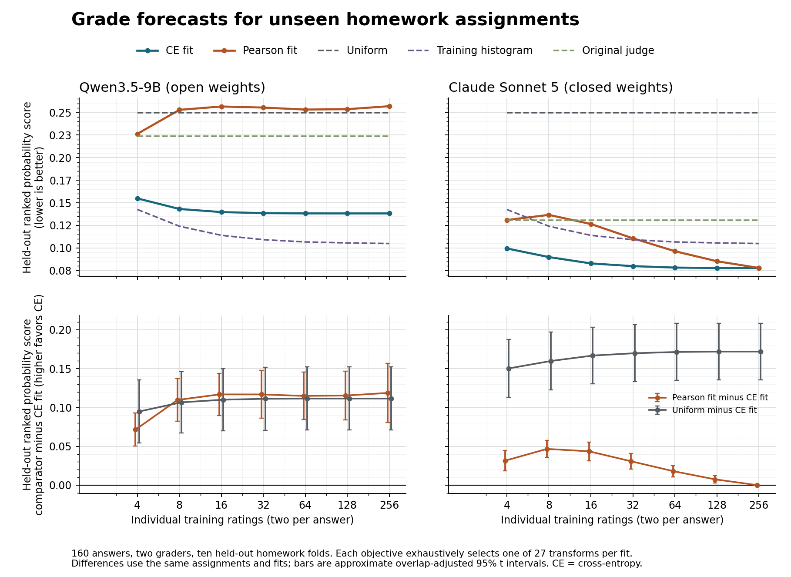

# When does cross-entropy calibration beat Pearson and uniform on new assignments? | 11-21-2026 — QA corrections 11-26-2026

**QA correction (11-26-2026):** Read the [dated correction and evidence limits](../QA_CORRECTIONS_11-26-2026.md) before the historical text below; original scored tables remain unchanged.

As of 11-21-2026. External human-rating study on University of North Texas computer-science short answers.

Ten homework assignments contributed 160 answers to 67 questions and 320 individual correctness grades. Both judges received the same question, instructor answer, student answer and probability instructions. Each test fold held out an entire homework assignment. The primary condition used two human grades per training answer. For each fit, cross-entropy (CE) and Pearson searched the same 27 calibration transforms of a frozen judge. Each fold's estimate averages 200 seeded nested draws of training answers; every draw used identical labels for the two objectives. [Protocol and prompt](../PROTOCOL_11-21-2026.md) · [Corpus and graders](https://aclanthology.org/P11-1076/)

## Which budgets cleared both comparisons?

**Qwen3.5-9B.** Budgets passing the descending confirmatory sequence: 4, 8, 16, 32, 64, 128, 256. Budgets with both local bounds above zero: 4, 8, 16, 32, 64, 128, 256. Budgets with both observed differences above zero: 4, 8, 16, 32, 64, 128, 256. Among budgets passing the sequence, the CE fit also cleared the training-histogram comparison at: none. Descriptively, all three local lower bounds exceeded zero at these budgets: none.

**Claude Sonnet 5.** Budgets passing the descending confirmatory sequence: none. Budgets with both local bounds above zero: 4, 8, 16, 32, 64, 128. Budgets with both observed differences above zero: 4, 8, 16, 32, 64, 128, 256. Among budgets passing the sequence, the CE fit also cleared the training-histogram comparison at: none. Descriptively, all three local lower bounds exceeded zero at these budgets: 4, 8, 16, 32.

Each comparison subtracts test ranked probability score (RPS) of the CE fit from the same test RPS of the named comparator. Positive favors CE. Brackets below are nominal 95% two-sided overlap-adjusted t intervals over ten held-out homework assignments. The same lower endpoint is the one-sided 97.5% bound used for each judge. Testing starts at 256 ratings and stops on the first budget where either comparator’s lower bound fails to exceed zero. This fixed sequence limits searching across budgets, and each judge has one-sided alpha 0.025. The t approximation with nine degrees of freedom can misestimate uncertainty with ten dependent folds. The 200 training draws measure label-sampling variability. [One-sided p-values, all 1,024 fold-sign sensitivity permutations, and fold win counts](results/contrasts.csv) · [Overlap correction source](https://doi.org/10.1023/A:1024068626366)

*Each fold withholds one homework. Both objectives exhaustively search 27 fixed transforms from the same smallest-distance-to-identity tie rule. Normalized RPS ranges from zero to one, lower is better. Error bars concern paired differences on the same test answers.*

## Qwen3.5-9B, open weights

| Training ratings | CE fit RPS | Pearson fit RPS | Uniform RPS | Histogram RPS | Original RPS | Pearson minus CE fit [95%] | Uniform minus CE fit [95%] |
| --- | --- | --- | --- | --- | --- | --- | --- |
| 4 | 0.1548 | 0.2263 | 0.2497 | 0.1426 | 0.2239 | +0.0715 [+0.0502, +0.0927] | +0.0949 [+0.0541, +0.1356] |
| 8 | 0.1431 | 0.2528 | 0.2497 | 0.1241 | 0.2239 | +0.1097 [+0.0824, +0.1369] | +0.1066 [+0.0669, +0.1462] |
| 16 | 0.1397 | 0.2565 | 0.2497 | 0.1140 | 0.2239 | +0.1168 [+0.0894, +0.1442] | +0.1100 [+0.0700, +0.1500] |
| 32 | 0.1386 | 0.2553 | 0.2497 | 0.1092 | 0.2239 | +0.1168 [+0.0860, +0.1476] | +0.1112 [+0.0707, +0.1516] |
| 64 | 0.1382 | 0.2531 | 0.2497 | 0.1067 | 0.2239 | +0.1149 [+0.0844, +0.1454] | +0.1115 [+0.0709, +0.1521] |
| 128 | 0.1382 | 0.2536 | 0.2497 | 0.1056 | 0.2239 | +0.1154 [+0.0837, +0.1470] | +0.1115 [+0.0709, +0.1521] |
| 256 | 0.1382 | 0.2569 | 0.2497 | 0.1049 | 0.2239 | +0.1187 [+0.0807, +0.1566] | +0.1115 [+0.0709, +0.1521] |

Test CE is the negative natural log probability of an individual grade, in nats. Test total variation distance (TVD) is half the absolute probability differences summed across grades against each answer's two-grader histogram. Both are lower-is-better. TVD is noisy with two ratings per answer. The histogram uses training ratings only, with a half-count per grade.

| Training ratings | CE fit test CE | Pearson fit test CE | Uniform test CE | Histogram test CE | Original test CE | CE fit test TVD | Pearson fit test TVD | Uniform test TVD | Histogram test TVD | Original test TVD |
| --- | --- | --- | --- | --- | --- | --- | --- | --- | --- | --- |
| 4 | 2.5284 | 3.9309 | 1.7918 | 1.3882 | 3.9173 | 0.6057 | 0.7395 | 0.7667 | 0.5886 | 0.7374 |
| 8 | 2.0738 | 4.3975 | 1.7918 | 1.2960 | 3.9173 | 0.5845 | 0.7476 | 0.7667 | 0.5425 | 0.7374 |
| 16 | 1.9644 | 4.2403 | 1.7918 | 1.2366 | 3.9173 | 0.5755 | 0.7519 | 0.7667 | 0.5113 | 0.7374 |
| 32 | 1.9369 | 4.1946 | 1.7918 | 1.2016 | 3.9173 | 0.5713 | 0.7548 | 0.7667 | 0.4922 | 0.7374 |
| 64 | 1.9324 | 4.2674 | 1.7918 | 1.1741 | 3.9173 | 0.5701 | 0.7625 | 0.7667 | 0.4820 | 0.7374 |
| 128 | 1.9321 | 4.3386 | 1.7918 | 1.1579 | 3.9173 | 0.5700 | 0.7718 | 0.7667 | 0.4778 | 0.7374 |
| 256 | 1.9321 | 4.4459 | 1.7918 | 1.1465 | 3.9173 | 0.5700 | 0.7811 | 0.7667 | 0.4752 | 0.7374 |

## Claude Sonnet 5, closed weights

| Training ratings | CE fit RPS | Pearson fit RPS | Uniform RPS | Histogram RPS | Original RPS | Pearson minus CE fit [95%] | Uniform minus CE fit [95%] |
| --- | --- | --- | --- | --- | --- | --- | --- |
| 4 | 0.0995 | 0.1309 | 0.2497 | 0.1426 | 0.1306 | +0.0315 [+0.0184, +0.0445] | +0.1503 [+0.1129, +0.1877] |
| 8 | 0.0899 | 0.1366 | 0.2497 | 0.1241 | 0.1306 | +0.0467 [+0.0358, +0.0576] | +0.1598 [+0.1224, +0.1972] |
| 16 | 0.0829 | 0.1265 | 0.2497 | 0.1140 | 0.1306 | +0.0436 [+0.0315, +0.0557] | +0.1668 [+0.1302, +0.2034] |
| 32 | 0.0799 | 0.1107 | 0.2497 | 0.1092 | 0.1306 | +0.0308 [+0.0209, +0.0407] | +0.1698 [+0.1330, +0.2066] |
| 64 | 0.0783 | 0.0964 | 0.2497 | 0.1067 | 0.1306 | +0.0181 [+0.0108, +0.0254] | +0.1714 [+0.1348, +0.2080] |
| 128 | 0.0778 | 0.0853 | 0.2497 | 0.1056 | 0.1306 | +0.0075 [+0.0029, +0.0122] | +0.1719 [+0.1357, +0.2082] |
| 256 | 0.0778 | 0.0779 | 0.2497 | 0.1049 | 0.1306 | +0.0001 [-0.0001, +0.0004] | +0.1719 [+0.1357, +0.2082] |

Test CE is the negative natural log probability of an individual grade, in nats. Test total variation distance (TVD) is half the absolute probability differences summed across grades against each answer's two-grader histogram. Both are lower-is-better. TVD is noisy with two ratings per answer. The histogram uses training ratings only, with a half-count per grade.

| Training ratings | CE fit test CE | Pearson fit test CE | Uniform test CE | Histogram test CE | Original test CE | CE fit test TVD | Pearson fit test TVD | Uniform test TVD | Histogram test TVD | Original test TVD |
| --- | --- | --- | --- | --- | --- | --- | --- | --- | --- | --- |
| 4 | 1.3108 | 1.5387 | 1.7918 | 1.3882 | 1.5343 | 0.4316 | 0.5217 | 0.7667 | 0.5886 | 0.5211 |
| 8 | 1.1633 | 1.6232 | 1.7918 | 1.2960 | 1.5343 | 0.4146 | 0.4957 | 0.7667 | 0.5425 | 0.5211 |
| 16 | 1.0506 | 1.5066 | 1.7918 | 1.2366 | 1.5343 | 0.4015 | 0.4738 | 0.7667 | 0.5113 | 0.5211 |
| 32 | 1.0087 | 1.3813 | 1.7918 | 1.2016 | 1.5343 | 0.3959 | 0.4461 | 0.7667 | 0.4922 | 0.5211 |
| 64 | 0.9867 | 1.2395 | 1.7918 | 1.1741 | 1.5343 | 0.3928 | 0.4221 | 0.7667 | 0.4820 | 0.5211 |
| 128 | 0.9779 | 1.0851 | 1.7918 | 1.1579 | 1.5343 | 0.3923 | 0.4028 | 0.7667 | 0.4778 | 0.5211 |
| 256 | 0.9776 | 0.9793 | 1.7918 | 1.1465 | 1.5343 | 0.3923 | 0.3923 | 0.7667 | 0.4752 | 0.5211 |

## What happens with one rating per training answer?

This secondary condition uses twice as many distinct answers as the primary condition at a matched total rating budget. It uses the same held-out answers with both graders' outcomes. The table shows descriptive paired RPS differences.

| Training ratings | Qwen Pearson minus CE fit | Qwen uniform minus CE fit | Claude Pearson minus CE fit | Claude uniform minus CE fit |
| --- | --- | --- | --- | --- |
| 4 | +0.0995 [+0.0770, +0.1219] | +0.1034 [+0.0638, +0.1430] | +0.0426 [+0.0318, +0.0535] | +0.1548 [+0.1177, +0.1919] |
| 8 | +0.1128 [+0.0850, +0.1405] | +0.1095 [+0.0698, +0.1493] | +0.0445 [+0.0330, +0.0561] | +0.1634 [+0.1265, +0.2003] |
| 16 | +0.1119 [+0.0834, +0.1405] | +0.1111 [+0.0707, +0.1515] | +0.0378 [+0.0268, +0.0489] | +0.1680 [+0.1310, +0.2050] |
| 32 | +0.1122 [+0.0849, +0.1396] | +0.1114 [+0.0709, +0.1520] | +0.0251 [+0.0173, +0.0328] | +0.1706 [+0.1337, +0.2075] |
| 64 | +0.1156 [+0.0840, +0.1471] | +0.1115 [+0.0709, +0.1521] | +0.0139 [+0.0078, +0.0199] | +0.1717 [+0.1352, +0.2082] |
| 128 | +0.1162 [+0.0846, +0.1479] | +0.1115 [+0.0709, +0.1521] | +0.0049 [+0.0010, +0.0088] | +0.1719 [+0.1356, +0.2082] |

## Coverage and interpretation

| Judge | Requests | Valid | Invalid output → uniform | Failed call → uniform |
| --- | --- | --- | --- | --- |
| qwen | 160 | 141 | 19 | 0 |
| claude | 160 | 160 | 0 | 0 |

The prespecified fallback retains all 160 test answers per judge. A calibrated fallback can use a training-set rating prior. Openness, provider, model architecture and decoding differ together. The two fixed graders and one course limit generalization. Student identities are absent from the released data, so the same students may contribute to training and test homework. The corpus was public before these models were released; model pretraining exposure is unknown. No new VeriBench human outcome enters these estimates. [Absolute metrics and within-fold training-draw variation](results/scores.csv) · [Per-family losses](results/families.csv) · [Held-out Pearson, Spearman, and absolute agreement](results/diagnostics.csv) · [Paired calibration settings and the reason for convergence](HEAD_AGREEMENT_11-21-2026.md) · [Selection counts](results/selections.csv) · [Undefined training correlations](results/undefined_pearson.csv)
