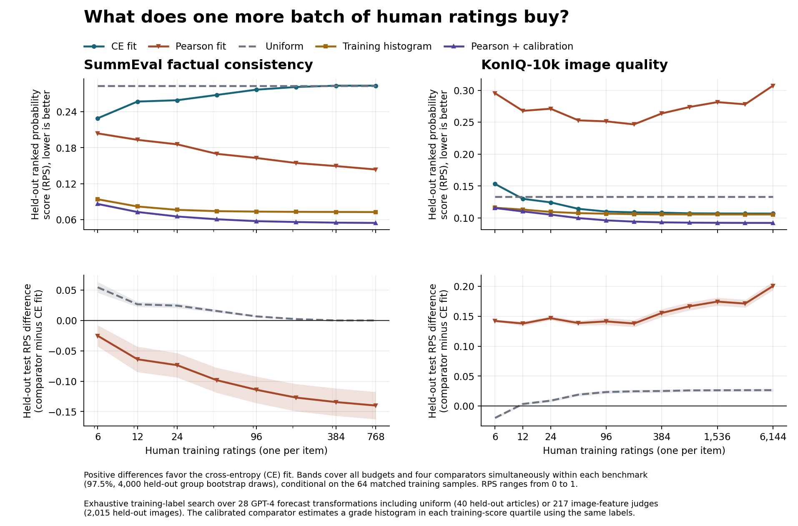

# When does cross-entropy beat correlation on public human ratings? | 11-21-2026

As of 11-21-2026. **Twelve human ratings were sufficient for one image-quality judge to beat raw Pearson and uniform on held-out ranked probability score (RPS). No tested budget did this for the original GPT-4 factual-consistency forecasts on SummEval. Neither primary cross-entropy (CE) fit cleared a Pearson score calibrated into grade probabilities and the training grade histogram as well.** The result concerns the fitted judge, including its available probability forecasts, calibration and intended use. There is no common switch point in these two benchmarks. [Budget-by-budget tables, simultaneous intervals and one-batch win counts](BUDGET_TABLES_11-21-2026.md) · [Protocol committed before fitting](https://github.com/brando90/judges-dont-need-psychometrics-or-corr/commit/cc54572) · [Public benchmark inventory](PUBLIC_RATING_EVIDENCE_11-21-2026.md)

## What the training ratings bought

| Real prediction task | Held-out evidence | First sustained win over both raw Pearson and uniform | Result against stronger controls |
|---|---|---|---|
| Predict an expert’s 1–5 factual-consistency grade from archived GPT-4 judge outputs on a machine summary | 40 articles, 16 systems each, 640 summaries and 1,920 expert grades | None from 6 to 768 training ratings, with either one or three grades per item | A forecast of the pooled training grade frequencies and a calibrated Pearson score both beat the CE fit at every one-grade budget. |
| Predict a human’s 1–5 image-quality grade from seven image indicators | 2,015 held-out photographs and 215,415 crowd votes | 12 at one grade per image, 48 at three per image for the same total cost. Resampling training draws as well as test images moves the one-grade result to 24. | No tested budget from 6 to 6,144 cleared all four controls. A calibrated Pearson score improved RPS at the largest budget. |

“First sustained” requires both simultaneous lower bounds for comparator-minus-CE test RPS to exceed zero there and at every larger **tested** budget. The initial bands condition on 64 matched acquisitions of existing training labels. They resample 40 articles or 2,015 images 4,000 times, covering four comparisons and all budgets at 97.5% within each benchmark (approximately 95% jointly across the two). Each cell is an average over the training draws. At 12 image grades, CE beat both controls on 38/64 individual draws. The lower bound against uniform was +0.0012 RPS given these draws and −0.0058 after resampling training draws as well. At 24 image grades 44/64 draws won, at 48 it was 56/64, and at 384 it was 64/64. The training-draw sensitivity still conditions on the available development population. [Rating draws and uncertainty](results/image_quality/crossed_sensitivity.csv)

### Absolute test scores at the largest training budgets

The primary metric is normalized individual-rating RPS. At each of four ordered grade thresholds it compares the forecast probability of falling at or below that threshold with the human outcome and averages the squared errors (range 0–1). Test CE is negative log probability per human rating in nats. Total variation distance (TVD) is half the sum of absolute differences from the empirical grade probabilities for an item (range 0–1). All three are lower when better. Test scoring gives items equal weight. The three-expert histogram is a noisy measure of a population distribution.

| Training procedure | SummEval, 768 grades: RPS / CE / TVD | KonIQ, 6,144 grades: RPS / CE / TVD |
|---|---:|---:|
| Cross-entropy fit | 0.2837 / 1.6094 / 0.7672 | 0.1068 / 1.2788 / 0.3737 |
| Pearson fit | 0.1436 / 1.9335 / 0.4940 | 0.3072 / 4.3456 / 0.7881 |
| Uniform | 0.2837 / 1.6094 / 0.7672 | 0.1332 / 1.6094 / 0.5302 |
| Training grade histogram | 0.0724 / 0.5472 / 0.2296 | 0.1054 / 1.1792 / 0.2970 |
| Pearson fit, then train-only distribution calibration | **0.0543 / 0.4214 / 0.1710** | **0.0922 / 1.0717 / 0.2337** |
| Ranked-probability-score fit | 0.1420 / 1.8800 / 0.4875 | 0.1066 / 1.2783 / 0.3759 |

The CE, Pearson and RPS objectives searched the same discrete family exhaustively, with deterministic ties and identical ratings. For summaries the search included 27 transformations of the archived GPT-4 grade forecasts plus uniform. For images it included 216 ordinal distributions from the seven technical indicators and two derived components, plus uniform. The calibrated Pearson comparator took its selected expected grade, divided training scores into quartiles and learned grade frequencies within each quartile. It spent the same training labels. The discrete fits selected a probability forecast. The foundation model's weights stayed fixed. [Full scoring and selection details](PROTOCOL_11-21-2026.md)

## Why conclusions changed

**On the expert summaries, a grade unobserved in 20 GPT-4 samples was often a grade a human actually gave.** Of 1,920 held-out human consistency grades, 534 (27.8%) never appeared in the valid GPT-4 responses for that item. With the original small uniform floor, CE paid a large penalty for predicting these grades with near-zero probability. At 768 ratings it selected uniform on 64/64 draws. Of the 1,920 expert grades, 1,681 (87.6%) were 5, so the pooled human grade histogram was useful. Raw Pearson beat the CE fit on mean test RPS at every tested budget and at 768 grades their paired difference was −0.1401 [−0.1626, −0.1176]. The same Pearson fit scored *worse* on test CE. This documents how the choice of reported metric can reverse the comparison. [Factual-consistency audit](summeval/DATA_11-21-2026.md) · [Scores](results/gpt4_consistency/scores.csv) · [Native grade coverage](results/jeffreys_consistency/previously_unseen_grades.csv)

In an **exploratory** rerun, we added half a model count to every grade before applying the same search. CE then beat raw Pearson and uniform on RPS at every tested budget from 6 to 768 on both expert consistency and expert relevance. At 768 consistency grades the CE fit achieved RPS 0.0900, CE 0.7590 and TVD 0.4343. The calibrated Pearson fit still achieved 0.0552, 0.4308 and 0.1742. This reversal used the same articles, raters, GPT-4 outputs and training draws. The half-count was chosen after seeing the primary results. It needs fresh validation before becoming a deployment rule. [Follow-up design](SENSITIVITIES_11-21-2026.md) · [Consistency](results/jeffreys_consistency/scores.csv) · [Relevance](results/jeffreys_relevance/scores.csv)

**When both objectives get the same distribution calibration, much of the gap disappears.** In a separate exploratory comparison, every score received the same four-bin smoother with the same training labels. We could then select the score directly by leave-one-training-rating-out CE of the calibrated forecast. At 768 expert grades this obtained RPS 0.05425 versus 0.05429 for selecting the score with Pearson; the paired difference of 0.00004 had a pointwise 95% article interval of −0.00020 to +0.00024. Simply calibrating the original GPT-4 expected score obtained 0.05469. On KonIQ the three supervised choices (raw CE, raw Pearson, and leave-one-out calibrated CE) produced the same three reported test losses at 768, 1,536, 3,072 and 6,144 ratings. At 6,144 each achieved RPS 0.09215. A useful ranking and a good probability estimate can come from different stages of the same judge. [Matched-calibration protocol](matched_calibration/PROTOCOL_11-21-2026.md) · [Results](matched_calibration/RESULTS_11-21-2026.md)

**Learning the probabilities directly also worked with a more flexible judge.** With the prespecified linear softmax using all four summary metrics or seven image features, the CE fit had lower mean RPS than the directly Pearson-trained fit in six of seven dataset–budget cells at the registered optimizer cap. At 768 summary grades it scored 0.06610 versus 0.07710, and at 6,144 image grades 0.08798 versus 0.10403. At 12 grades a ridge mean-score model followed by calibration outperformed both direct fits on both tasks. After increasing the iteration limit tenfold, 71 of 112 selected Pearson fits still hit the limit, and two constant training targets returned the prior. These are optimizer-specific comparisons. The discrete searches above give a separate exact comparison. [All continuous results, intervals and optimization receipts](continuous/RESULTS_11-21-2026.md)

## What to evaluate in practice

The application determines the primary endpoint. For an ordered grade or its probabilities, declare held-out individual-rating RPS in advance, include test CE and empirical TVD, and measure ranking and mean calibration separately. In our KonIQ test at 6,144 training grades, the raw Pearson fit had **higher** held-out Pearson correlation (0.685 vs 0.645) and **identical** Spearman correlation to the CE fit (both 0.646). Its predicted grade was high by 1.385 points on average; the CE fit was low by 0.159 points. Test RPS favored CE by 0.2005 [0.1935, 0.2074]. Both evaluation outcomes describe real generalization, to different targets. Pearson correlation between item means sees one scalar per item and is invariant to positive affine transformations. It can learn a nonlinear function of the input. Its value leaves the conditional spread and shape unidentified. [Test diagnostics](results/image_quality/diagnostics.csv) · [Mathematical derivation](../18_when_does_ce_beat_correlation_notebook_page_math_and_sweep_start_21Nov2026/MATH_11-21-2026.pdf)

If the decision is which system ranks highest, report ranking of systems on new sources, with ties and task-family uncertainty. For SummEval at 768 expert grades the raw Pearson fit had mean system-level Spearman correlation 0.877 versus 0.835 after distribution calibration across the same 16 systems. The latter predicted individual grades more accurately by all three distribution measures. For a nominal label, use a proper score such as per-vote CE or multiclass Brier. For pairwise choice, predict the observed choice including ties when the interface allows them. These targets require different data structures. Exact-grade accuracy, modal agreement, calibration error and mean absolute error are in the diagnostic tables. A forecast of one rater from the remaining raters is a reference with different information available at test time. [SummEval diagnostics](results/gpt4_consistency/diagnostics.csv) · [Human reference](results/gpt4_consistency/human_reference.csv) · [Literature and schema audit](PUBLIC_RATING_EVIDENCE_11-21-2026.md)

## Cost, transfer and next evidence

At an illustrative $1 per retained grade, the 24-rating KonIQ crossed-bootstrap threshold costs $24 in training labels. At $0.10 or $5 it costs $2.40 or $120. That budget clears raw Pearson and uniform on average and leaves substantial acquisition risk (44/64 individual batches won). Neither primary study identified a price at which restricted CE also beat both strong controls. Independent evaluation was much more label-intensive here: 1,920 expert grades per summary criterion or 215,415 votes on the image test set. These are the available evaluation counts, not estimated minimum certification costs. The archives cost $0 in new labels. SummEval reported $12/hour for its crowd panel; the expert grading time and price and KonIQ price per vote were unavailable in the checked sources. [Cost scenarios and all budgets](BUDGET_TABLES_11-21-2026.md) · [Primary collection cost sources](PUBLIC_RATING_EVIDENCE_11-21-2026.md)

The human panels and original benchmarks have prior exposure. The summaries reuse the same 16 systems across held-out articles. Experts revisited disagreements, and item-level histograms cannot separate stable rater severity from disagreements about an item. KonIQ's original collection used a correlation-based worker screen and lacks individual rater IDs in the release used here. The image inputs are technical descriptors, and the archive-based language judge is GPT-4. These observations support generalization to new items within the two benchmark populations. Unseen judges, raters, populations and actual organizational annotation prices require other evidence. [Expert data](summeval/DATA_11-21-2026.md) · [Image data](koniq/DATA_11-21-2026.md)

The earlier matched open-/closed-weight study on real computer-science grading supplies a third setting. Qwen3.5-9B cleared raw Pearson and uniform from four ratings, but the training histogram had lower RPS at every tested budget. Claude Sonnet 5 gave a near-tie at the largest budget. Historical VeriBench formal-specification coverage (FSC) has human grades for 75 artifacts, and the fitted/selected comparison changes across judge pools. For fresh Set N, open- and closed-weight forecasts are registered on 100 artifacts; at the latest verified check, 0/3,400 final score slots had been filled. The frozen scorer waits for released human outcomes. Experiment 22 owns complementary benchmark follow-ups. [Public homework grades](../21_fresh_task_families_matched_open_closed_judges_start_21Nov2026/README.md) · [Historical VeriBench human ratings](../20_trained_judge_ce_vs_pearson_limited_data_synthetic_and_59_judge_pools_start_21Nov2026/RESULTS_11-21-2026.md) · [Fresh VeriBench registration](../21_fresh_task_families_matched_open_closed_judges_start_21Nov2026/veribench/STATUS_11-21-2026.md) · [Coworker scope](../22_non_circular_evaluation_protocol_and_public_rating_sets_start_21Nov2026/README.md)
