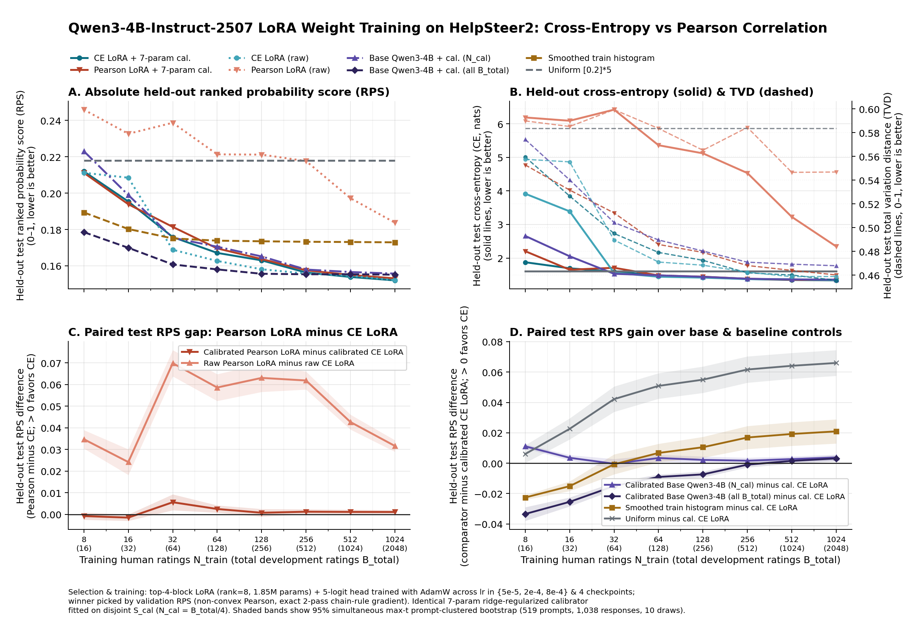
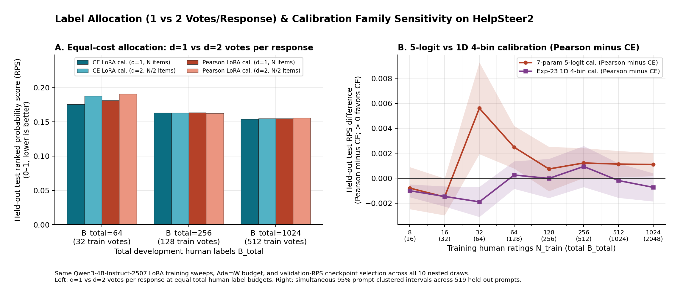

# When Does Training Open-Weight LLM Judge Weights with Cross-Entropy Beat Pearson Correlation? (11-21-2026)

**Doc link:** <https://github.com/brando90/judges-dont-need-psychometrics-or-corr/blob/main/experiments/24_trained_open_weight_judge_helpsteer2_ce_vs_pearson_start_21Nov2026/RESULTS_11-21-2026.md>

Date: 11-21-2026

## Executive Answer

In experiment `24_trained_open_weight_judge_helpsteer2_ce_vs_pearson_start_21Nov2026`, we fine-tuned real transformer low-rank adaptation (LoRA) weights (`1,847,813` trainable parameters across the top 4 blocks plus the 5-digit rating head) of `Qwen/Qwen3-4B-Instruct-2507` on prompt-disjoint human helpfulness ratings (`0–4`) from `nvidia/HelpSteer2`, matching the model, prompt, optimizer (`AdamW`), learning-rate grid, mini-batch schedule, validation ranked probability score (RPS) checkpoint selection, and post-hoc 7-parameter calibrator across both training objectives.

- **Calibrated cross-entropy (CE) LoRA vs calibrated Pearson LoRA (primary sustained-win threshold on held-out RPS):** Conditional on the 10 matched draws, calibrated CE LoRA first clears calibrated Pearson LoRA across a simultaneous 95% prompt-clustered band and remains ahead at all larger tested budgets from **B_total=512 (N_train=256)** (two-way crossed `draw × prompt` simultaneous threshold: **None within tested budgets**). At the largest budget (`B_total = 2,048`, `N_train = 1,024`, `N_val = 512`, `N_cal = 512`), test RPS is **0.15200** for calibrated CE LoRA vs **0.15309** for calibrated Pearson LoRA (paired difference = **+0.00110** `[+0.00017, +0.00203]`, `p-val=0.0177`, crossed 95% CI `[-0.00031, +0.00250]`, CE wins **9/10** matched draws).
- **When calibrated CE LoRA beats baselines and the unmodified base judge:** Sustained threshold vs `uniform` (`RPS = 0.21800`): **B_total=16 (N_train=8)**; vs `training_histogram`: **B_total=128 (N_train=64)**; vs `base_calibrated_matched` (unmodified Qwen3-4B calibrated on the same `N_cal` labels): **B_total=1024 (N_train=512)**; vs `base_calibrated_all_dev` (unmodified Qwen3-4B calibrated on all `B_total` development labels): **B_total=2048 (N_train=1024)**.
- **Where Pearson wins or ties:** Without calibration, raw Pearson LoRA has much worse RPS (`0.18376` vs `0.15213` at `B_total=2,048`) because Pearson is invariant to shift and positive rescaling (`mean_bias = +0.126` vs `-0.035`). After identical 7-parameter post-hoc calibration on `S_cal`, budgets where calibrated Pearson LoRA had lower point-estimate RPS than calibrated CE LoRA: `[16, 32]` (raw uncalibrated budgets favoring Pearson: `none`).

## Full Budget Summary (`d = 1` Rating per Response; `1,038` Held-Out Responses / `519` Prompts)

Normalized individual-rating RPS (0–1, lower is better) is primary; CE is negative log-probability in nats (floor `6e-6`, lower is better); total variation distance (TVD, 0–1, lower is better) is measured against each item's empirical `2–5` vote histogram (noisy sparse-histogram diagnostic). Leave-one-vote-out human reference on the test set: RPS = `0.14567`, CE = `1.3585` nats.

| B_total (N_train / N_val / N_cal) | CE LoRA cal. RPS / CE / TVD | Pearson LoRA cal. RPS / CE / TVD | Base cal. (N_cal) RPS | Base cal. (all B_total) RPS | Train hist. RPS | Pearson cal. minus CE cal. RPS [sim. 95% CI] (wins/10) |
|---:|---:|---:|---:|---:|---:|---:|
| 16 (8/4/4) | 0.21197 / 1.8736 / 0.5596 | 0.21117 / 2.2036 / 0.5529 | 0.22309 | 0.17853 | 0.18938 | -0.00080 [-0.00248, +0.00089] (5/10) |
| 32 (16/8/8) | 0.19539 / 1.6932 / 0.5267 | 0.19389 / 1.6511 / 0.5317 | 0.19896 | 0.16993 | 0.18027 | -0.00150 [-0.00298, -0.00002] (4/10) |
| 64 (32/16/16) | 0.17583 / 1.5910 / 0.4951 | 0.18143 / 1.7087 / 0.5124 | 0.17546 | 0.16077 | 0.17510 | +0.00560 [+0.00193, +0.00927] (6/10) |
| 128 (64/32/32) | 0.16712 / 1.4796 / 0.4792 | 0.16960 / 1.4813 / 0.4859 | 0.17052 | 0.15804 | 0.17386 | +0.00248 [+0.00077, +0.00419] (7/10) |
| 256 (128/64/64) | 0.16301 / 1.4277 / 0.4725 | 0.16375 / 1.4427 / 0.4792 | 0.16518 | 0.15564 | 0.17352 | +0.00074 [-0.00104, +0.00252] (7/10) |
| 512 (256/128/128) | 0.15632 / 1.3736 / 0.4620 | 0.15754 / 1.3812 / 0.4681 | 0.15797 | 0.15537 | 0.17324 | +0.00122 [+0.00002, +0.00241] (6/10) |
| 1024 (512/256/256) | 0.15388 / 1.3456 / 0.4601 | 0.15501 / 1.3517 / 0.4640 | 0.15661 | 0.15538 | 0.17312 | +0.00113 [+0.00007, +0.00218] (7/10) |
| 2048 (1024/512/512) | 0.15200 / 1.3326 / 0.4556 | 0.15309 / 1.3417 / 0.4602 | 0.15573 | 0.15514 | 0.17294 | +0.00110 [+0.00017, +0.00203] (9/10) |

## Why Weight Updates and Representation Matter (`B_total = 2,048` Diagnostics)

| Method (`B_total = 2,048`, `N_train = 1,024`) | Test RPS | Test CE (6e-6) | Test CE (1e-2) | Test TVD | Pearson r | Spearman rho | Mean Bias | Within-Prompt Pair Acc |
|---|---:|---:|---:|---:|---:|---:|---:|---:|
| ce_calibrated | 0.15200 | 1.3326 | 1.3324 | 0.4556 | +0.5325 | +0.4421 | -0.0462 | 0.7163 |
| pearson_calibrated | 0.15309 | 1.3417 | 1.3414 | 0.4602 | +0.5236 | +0.4293 | -0.0514 | 0.6888 |
| ce_raw | 0.15213 | 1.3379 | 1.3379 | 0.4589 | +0.5333 | +0.4424 | -0.0349 | 0.7155 |
| pearson_raw | 0.18376 | 2.3432 | 2.1129 | 0.5469 | +0.5210 | +0.4247 | +0.1265 | 0.6908 |
| base_calibrated_matched | 0.15573 | 1.3559 | 1.3557 | 0.4679 | +0.4914 | +0.4197 | -0.0661 | 0.7000 |
| base_calibrated_all_dev | 0.15514 | 1.3512 | 1.3511 | 0.4660 | +0.4921 | +0.4290 | -0.0327 | 0.7185 |
| base_raw | 0.22354 | 5.4220 | 3.1640 | 0.5759 | +0.4876 | +0.4285 | +0.3787 | 0.7183 |
| training_histogram | 0.17294 | 1.4311 | 1.4310 | 0.5015 | +nan | +nan | +0.0319 | 0.5000 |
| uniform | 0.21800 | 1.6094 | 1.6094 | 0.5838 | +nan | +nan | -0.8207 | 0.5000 |
| ce_exp23_4bin | 0.16063 | 1.3796 | 1.3787 | 0.4754 | +0.4386 | +0.4063 | -0.0780 | 0.6413 |
| pearson_exp23_4bin | 0.15989 | 1.3780 | 1.3772 | 0.4746 | +0.4445 | +0.3977 | -0.0645 | 0.6329 |

- **Secondary proper and distributional metrics at `B_total = 2,048` (`N_train = 1,024`):** Calibrated CE LoRA beats calibrated Pearson LoRA in **`10/10`** draws on test CE (paired difference = `+0.00905` nats, sim. 95% CI `[+0.00304, +0.01507]`, `p-val=0.0012`; two-way crossed sim. 95% CI `[+0.00101, +0.01710]`, `p-val=0.0232`) and **`10/10`** draws on sparse-histogram test TVD (`+0.00460`, crossed sim. 95% CI `[+0.00176, +0.00744]`, `p-val=0.0015`). On additional diagnostics at `B_total = 2,048` (`ce_calibrated` vs `pearson_calibrated`): multiclass Brier score `0.68702` vs `0.69021`, Lin's concordance correlation coefficient (CCC) `0.4684` vs `0.4605`, mean absolute error (MAE) `0.6995` vs `0.7037`, cumulative expected calibration error (ECE) `0.0292` vs `0.0308`, and modal agreement `0.5001` vs `0.4988`.
- **Rater disagreement strata at `B_total = 2,048` (`1,038` test responses):** On low-disagreement items ($k_i \le 3$ votes, `742` responses), calibrated CE LoRA RPS = `0.13680` vs `0.13794` (calibrated Pearson LoRA) and `0.14055` (`base_calibrated_all_dev`); on high-disagreement items ($k_i \ge 4$ votes, `296` responses), `0.19008` vs `0.19108` and `0.19171`.
- **Calibration mechanism (5-logit vs 1D 4-bin):** Under the secondary Experiment 23 1D 4-bin expected-score calibrator at `B_total = 2,048`, `pearson_exp23_4bin minus ce_exp23_4bin` RPS is `-0.00074` `[-0.00186, +0.00039]`. The 7-parameter 5-logit calibrator preserves all 5 logit shape features learned during LoRA fine-tuning.
- **Equal-cost multi-rating depth (`d = 1` vs `d = 2` votes per response):** For `ce_calibrated`, paying for `d=2` votes on half as many items hurts at `B_total = 64` (`ce_calibrated d=2 minus d=1 = +0.01192`, prompt 95% CI `[+0.00994, +0.01390]`), essentially ties at `B_total = 256` (`+0.00009` `[-0.00037, +0.00056]`), and slightly favors `d = 1` at `B_total = 1,024` (`+0.00099`, where calibrated CE still beats calibrated Pearson under `d=2` by `+0.00082` `[+0.00008, +0.00159]`, `p-val=0.0340`, `8/10` draws). See [BUDGET_TABLES_11-21-2026.md](BUDGET_TABLES_11-21-2026.md) §3 and `figures/helpsteer2_calibration_and_depth.png`.

## Provenance, Sanity Verification, and Compute Cost

- **Model & trainable modules:** `/dfs/scratch0/brando9/at1025_hf/hub/models--Qwen--Qwen3-4B-Instruct-2507/snapshots/cdbee75f17c01a7cc42f958dc650907174af0554`, top `4` transformer blocks (`layers 32..35`) with LoRA (`rank = 8`, `alpha = 16.0`) on `q_proj, k_proj, v_proj, o_proj, gate_proj, up_proj, down_proj` plus `5`-logit rating head initialized from `lm_head` digit tokens (`1,847,813` trainable parameters).
- **Equivalence & sanity checks (`results/sanity_checks.json`):** Full-36-layer vs cached-`H^(32)` Epoch-0 max probability diff = `0.00e+00`; 2-step `AdamW` equivalence max prob diff = `0.00e+00` (CE) and `0.00e+00` (Pearson); two-pass Pearson chain-rule relative gradient error = `5.49e-16`; `label_in_prompt` hits = `5/5`; blank-response mean = `0.160`.
- **Weight-update & reload verification (`results/training_provenance.json`):** `220/220` selected runs changed LoRA weights (`||Delta_LoRA||_F > 0`) and `220/220` changed the rating head; `22/22` disk-saved `draw_id = 0` checkpoints reloaded into fresh instances within `< 1e-7` validation RPS difference; undefined Pearson mini-batches = `250/4800` at `B_total = 2,048` (`639` across all candidate runs).
- **Compute cost:** `$0.00` on group-owned `mercury2` NVIDIA RTX A4000 GPUs (10 GPUs in parallel; slowest draw wall-clock `9633.5s`, aggregate GPU time `92978.5s`); `$0.00` in new human annotation fees.

See [HOW_TO_READ_RESULTS.md](HOW_TO_READ_RESULTS.md) · [BUDGET_TABLES_11-21-2026.md](BUDGET_TABLES_11-21-2026.md) · [PROTOCOL_11-21-2026.md](PROTOCOL_11-21-2026.md)
