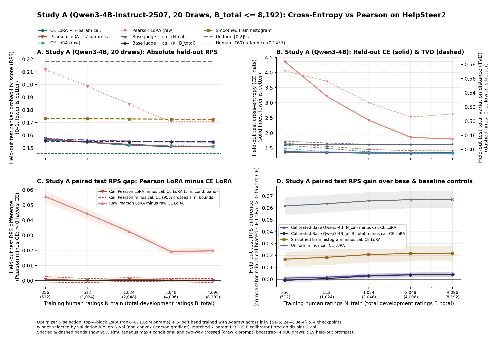
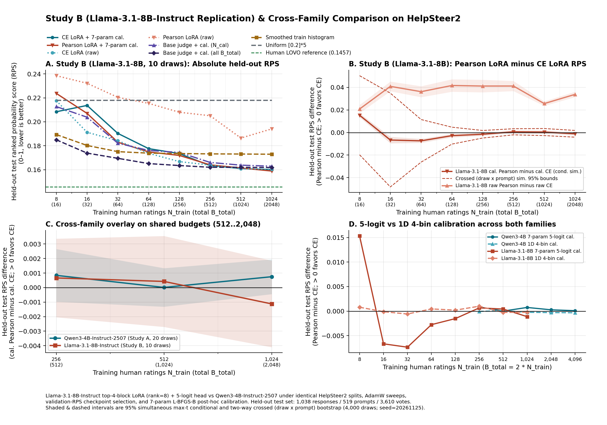

# Experiment 25 Results: HelpSteer2 Scale (`B_total <= 8,192`, `20` Draws) and Second-Family (`Llama-3.1-8B-Instruct`) Replication (11-21-2026)

**Doc link:** <https://github.com/brando90/judges-dont-need-psychometrics-or-corr/blob/main/experiments/25_helpsteer2_lora_scale_and_second_family_ce_vs_pearson_start_21Nov2026/RESULTS_11-21-2026.md>

Date: 11-21-2026

## Executive Answer

- **Study A (`Qwen/Qwen3-4B-Instruct-2507`, `20` nested draws, `B_total` `512..8,192`, `1,847,813` trainable parameters):** Across all tested budgets up to `B_total = 8,192` (`N_train = 4,096`), conditional simultaneous max-`t` 95% threshold for `calibrated Pearson-trained LoRA RPS minus calibrated CE-trained LoRA RPS` is **None within tested budgets**, and strict two-way crossed (`draw × prompt`) simultaneous 95% threshold is **None within tested budgets** (pointwise crossed threshold: **None within tested budgets**). At `B_total = 8,192`, calibrated cross-entropy (CE) low-rank adaptation (LoRA) reaches held-out test ranked probability score (RPS) = **0.15080** vs **0.15089** for calibrated Pearson LoRA (paired RPS difference = **+0.00009**, cond. sim. 95% CI `[-0.00076, +0.00095]`, `p-val=0.9975`; crossed sim. 95% CI `[-0.00117, +0.00136]`, `p-val=1.0000`, winning **11/20** draws), relative to the leave-one-vote-out human reference (`0.14567`). Budgets favoring Pearson point-estimate RPS: `none`.
- **Study A baselines & secondary metrics at `B_total = 8,192`:** Calibrated CE LoRA beats `base_calibrated_matched` (`N_cal = 2,048`) by **+0.00390** and `base_calibrated_all_dev` (unmodified base judge calibrated on all `8,192` labels, RPS = **0.15481**) by **+0.00401** (`[+0.00194, +0.00608]`, `p-val=0.0002`). On test CE (`6e-6` floor): **1.3231** vs **1.3285** nats (`16/20` draws, diff = **+0.00537**, crossed sim. `p-val=0.2119`); on sparse-histogram total variation distance (TVD): **0.4558** vs **0.4580** (`16/20` draws, crossed sim. `p-val=0.1777`); under 1D 4-bin calibration: `-0.00033` (`[-0.00145, +0.00078]`).
- **Study B (`unsloth/Llama-3.1-8B-Instruct`, `10` nested draws, `B_total` `16..2,048`, `2,641,925` trainable parameters across top 4 blocks with grouped-query attention + 5-logit head):** Sustained threshold vs calibrated Pearson LoRA is **None within tested budgets** (conditional sim. 95%) and **None within tested budgets** (crossed sim. 95%). At `B_total = 2,048` (`N_train = 1,024`), calibrated CE LoRA achieves test RPS = **0.16005** vs **0.15893** for calibrated Pearson LoRA (paired diff = **-0.00112**, cond. sim. 95% CI `[-0.00233, +0.00008]`, `p-val=0.0815`; crossed sim. 95% CI `[-0.00410, +0.00185]`, `p-val=0.8533`, winning **4/10** draws), beats `base_calibrated_all_dev` (`0.16186`) by **+0.00181** (`p-val=0.3819`), wins CE in **6/10** draws (mean **1.3669** vs **1.3663** nats) and TVD in **6/10** draws (mean **0.4684** vs **0.4699**). Budgets favoring Pearson point-estimate RPS: `[32, 64, 128, 256, 2048]`.

## Study A Summary Table (`Qwen/Qwen3-4B-Instruct-2507`, 20 Draws)

| B_total (N_train / N_val / N_cal) | CE cal. RPS / CE / TVD | Pearson cal. RPS / CE / TVD | Base cal. (all B_total) RPS | Pearson cal. minus CE cal. RPS [crossed sim. 95% CI] (wins/20) |
|---:|---:|---:|---:|---:|
| 512 (256/128/128) | 0.15641 / 1.3671 / 0.4659 | 0.15725 / 1.3757 / 0.4688 | 0.15541 | +0.00084 [-0.00097, +0.00265] (12/20) |
| 1,024 (512/256/256) | 0.15451 / 1.3501 / 0.4616 | 0.15452 / 1.3536 / 0.4644 | 0.15504 | +0.00001 [-0.00132, +0.00134] (11/20) |
| 2,048 (1,024/512/512) | 0.15210 / 1.3332 / 0.4565 | 0.15284 / 1.3414 / 0.4600 | 0.15482 | +0.00075 [-0.00045, +0.00194] (13/20) |
| 4,096 (2,048/1,024/1,024) | 0.15113 / 1.3263 / 0.4559 | 0.15140 / 1.3315 / 0.4583 | 0.15479 | +0.00027 [-0.00088, +0.00142] (10/20) |
| 8,192 (4,096/2,048/2,048) | 0.15080 / 1.3231 / 0.4558 | 0.15089 / 1.3285 / 0.4580 | 0.15481 | +0.00009 [-0.00117, +0.00136] (11/20) |

## Study B Summary Table (`unsloth/Llama-3.1-8B-Instruct`, 10 Draws)

| B_total (N_train / N_val / N_cal) | CE cal. RPS / CE / TVD | Pearson cal. RPS / CE / TVD | Base cal. (all B_total) RPS | Pearson cal. minus CE cal. RPS [crossed sim. 95% CI] (wins/10) |
|---:|---:|---:|---:|---:|
| 16 (8/4/4) | 0.20840 / 1.9392 / 0.5421 | 0.22372 / 2.3613 / 0.5656 | 0.18499 | +0.01532 [-0.01973, +0.05037] (6/10) |
| 32 (16/8/8) | 0.21367 / 1.9127 / 0.5395 | 0.20701 / 1.8165 / 0.5302 | 0.17389 | -0.00666 [-0.04819, +0.03486] (6/10) |
| 64 (32/16/16) | 0.19034 / 1.7022 / 0.5101 | 0.18299 / 1.5938 / 0.5029 | 0.16954 | -0.00735 [-0.02621, +0.01151] (4/10) |
| 128 (64/32/32) | 0.17762 / 1.5556 / 0.4910 | 0.17487 / 1.5236 / 0.4909 | 0.16514 | -0.00276 [-0.01026, +0.00474] (5/10) |
| 256 (128/64/64) | 0.17346 / 1.4903 / 0.4837 | 0.17194 / 1.4662 / 0.4838 | 0.16350 | -0.00152 [-0.00487, +0.00182] (4/10) |
| 512 (256/128/128) | 0.16341 / 1.4014 / 0.4748 | 0.16407 / 1.4043 / 0.4750 | 0.16206 | +0.00066 [-0.00204, +0.00337] (6/10) |
| 1,024 (512/256/256) | 0.16104 / 1.3771 / 0.4709 | 0.16147 / 1.3815 / 0.4739 | 0.16203 | +0.00042 [-0.00271, +0.00355] (5/10) |
| 2,048 (1,024/512/512) | 0.16005 / 1.3669 / 0.4684 | 0.15893 / 1.3663 / 0.4699 | 0.16186 | -0.00112 [-0.00410, +0.00185] (4/10) |

## Sanity Checks, Weight-Update Provenance, and Note on Non-Convex Pearson Saturation

- **Exact equivalence verified (`results/qwen3_4b_sanity.json`, `results/llama31_8b_sanity.json`):** Live full-model prefix vs cached `H^(split)` 2-step batched (`m=4`, `SDPBackend.MATH`) `AdamW` probabilities matched to `0.00` max diff on both CE and Pearson for both architectures (Epoch-0 unbatched HF wrapper vs cached `H^(split)` max diff = `0.00`; same-batch left-pad mask invariance `<= 4.47e-04`; `bfloat16` GEMV-vs-GEMM batching drift = `0.0073` for Qwen3-4B, `0.0045` for Llama-3.1-8B; `pearson_two_pass_rel_error = 3.80e-16` for Qwen3-4B, `3.80e-16` for Llama-3.1-8B). Epoch-0 `label_in_prompt` compliance passed `5/5` on Qwen3-4B and `5/5` on Llama-3.1-8B (`matched_20_pearson` `0.369 > 0.212` on Qwen3-4B; `0.400 > 0.229` on Llama-3.1-8B).
- **Non-convex Pearson overfit diagnostic on Llama-3.1-8B (`overfit_1batch_16items_40steps`):** Under `lr = 8e-4` alone, Pearson correlation on the 16-item sanity batch saturated softmax probabilities into corners `{0, 4}` (`ce_after = 6.7634`, `pearson_after = 0.5494`) where the softmax-mean Jacobian `q_r(r - mu)` vanishes; sweeping the pre-registered `lr in {5e-5, 2e-4, 8e-4}` lifted Llama-3.1-8B overfit Pearson to `0.6246` at `lr = 2e-4` (whereas CE reached `ce_after = 1.09e-06`, `r = 1.0000`).
- **Selected checkpoint provenance:** Qwen3-4B logged `200/200` non-zero LoRA/head updates (`6165` undefined Pearson batches); Llama-3.1-8B logged `160/160` non-zero LoRA/head updates (`2108` undefined Pearson batches). Both studies preserved `< 1e-7` reload precision on all saved `draw_id = 0` disk checkpoints and incurred `$0.00` compute/label fees.

See [HOW_TO_READ_RESULTS.md](HOW_TO_READ_RESULTS.md) · [BUDGET_TABLES_11-21-2026.md](BUDGET_TABLES_11-21-2026.md) · [PROTOCOL_11-21-2026.md](PROTOCOL_11-21-2026.md)
