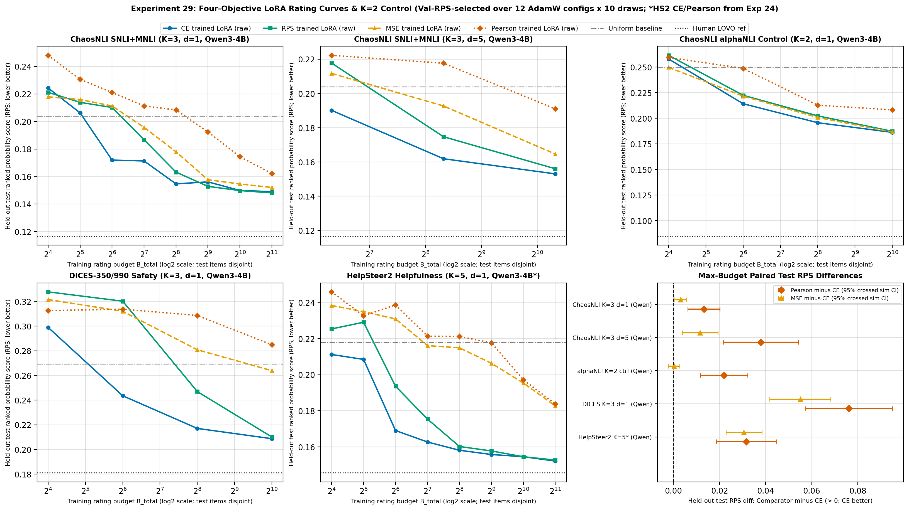
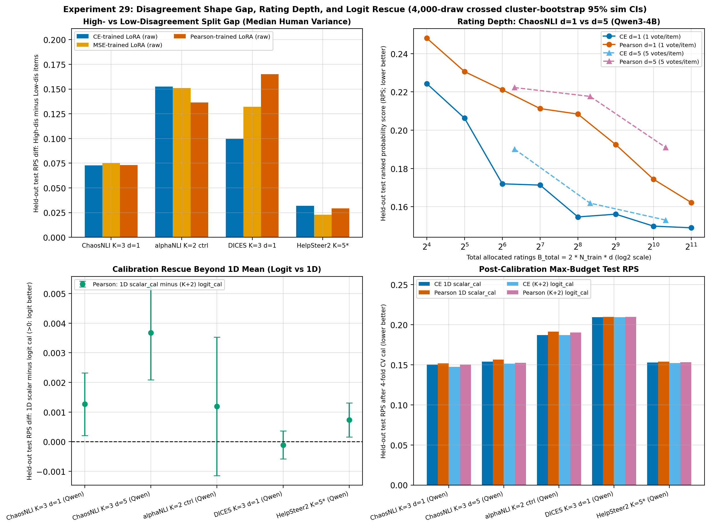

# Experiment 29 Results: Four-Objective LoRA Training & Shape Control (11-23-2026)

**Status & Prior Exposure:** Phase A snapshot covering all **4 Qwen3-4B-Instruct-2507 studies** (`921/921` GPU runs complete; Llama-3.1-8B-Instruct `chaos3_llama` [`320` runs per Amendment 1] + `dices3_llama` [`160` runs] active on `mercury2`). Disjoint Exp 29 splits include prior Exp 28 frontier-scored test items (`265/713` chaos3, `110/412` alpha2, `172/300` dices3; LoRA never saw them).

Metric definitions, splits, uncertainty, and model-selection rules are in [HOW_TO_READ_RESULTS.md](HOW_TO_READ_RESULTS.md) and [AMENDMENT_1_11-23-2026.md](AMENDMENT_1_11-23-2026.md).

## 0. Pre-Registered Hypothesis Verdicts (`H1–H4`)

| Pre-Registered Hypothesis | Verdict (Phase A Qwen3-4B) | Exact Contrast Evidence (Crossed 95% Sim CI unless labeled cond) |
|---|---|---|
| **H1:** Raw CE & RPS beat raw Pearson at max budget | **Confirmed** | All 5 setups strictly $>0$ on crossed CI (`+0.01321` to `+0.07609` RPS; sustained crossed wins from `B=16–64` CE, `B=64–256` RPS) |
| **H2 ($K=2$ control):** Raw MSE matches CE; `(K+2)` cal adds zero gain; `1D scalar_cal` matches CE | **Partial (2/3 hold; `1D cal` fails)** | Raw MSE vs CE `+0.00034` (`[-0.00209, +0.00278]`) & logit vs 1D `+0.00119` (`[-0.00114, +0.00353]`), **but CE `1D cal` still beats Pearson `1D cal` by `+0.00429` (`[+0.00058, +0.00800]`, 10/10 draws)** |
| **H3 ($K\ge 3$ shape):** Cal CE/RPS beat cal Pearson/MSE; `(K+2) logit_cal` beats `1D scalar_cal` | **Partial (mixed by suite)** | `(K+2) logit_cal` beats `1D` on Pearson for ChaosNLI `d=1` (`+0.00127 [+0.00021,+0.00232]`), `d=5` (`+0.00368 [+0.00209,+0.00526]`), HS2 (`+0.00073 [+0.00016,+0.00131]`), not DICES (`-0.00011`). Under `1D cal`, CE clears Pearson crossed only at ChaosNLI `d=5` (`+0.00231 [+0.00065,+0.00398]`); **fails on DICES** where `mse_scalar_cal` beats `ce_scalar_cal` (`-0.00191` cond `[-0.00309,-0.00072]`) |
| **H4:** For $K\ge 3$, raw CE/RPS beat raw MSE; raw MSE improves over raw Pearson | **Partial** | Raw CE beats raw MSE on all 4 $K\ge 3$ panels; raw RPS vs MSE crossed CI excludes 0 on 3/4 (ChaosNLI `d=5` crossed `[-0.00094,+0.01816]`). Raw MSE beats raw Pearson crossed on ChaosNLI `d=1/5`, ties crossed on DICES (`[-0.00092,+0.04295]`) & HS2 (`+0.00104 [-0.01293,+0.01501]`) |

## 1. Max-Budget Uncalibrated Test Ranked Probability Score (RPS)

Subtraction order in the final column: **test RPS of Pearson-trained judge minus test RPS of CE-trained judge** (`> 0` favors CE-trained), with crossed simultaneous (`max-t`) 95% cluster-bootstrap bands (`4,000` draws). \*`hs2_qwen` reuses Exp 24 CE/Pearson predictions while training new Exp 29 RPS/MSE runs (`parity RPS 0.17098 vs 0.16886`, `+0.00212`; max base-prob diff `0.2928`).

| Study | $K$ | $d$ | $B_{\text{max}}$ ($N_{\text{train}}$) | Uniform RPS | Human LOVO RPS | CE LoRA (raw) | RPS LoRA (raw) | MSE LoRA (raw) | Pearson LoRA (raw) | Pearson $-$ CE raw RPS [crossed sim 95%] |
|---|---:|---:|---:|---:|---:|---:|---:|---:|---:|---|
| `chaos3_qwen` | 3 | 1 | 2048 (1024) | 0.20388 | 0.11668 | 0.14902 | 0.14812 | 0.15207 | 0.16223 | +0.01321 [+0.00626, +0.02015] |
| `chaos3_qwen` | 3 | 5 | 1280 (128) | 0.20388 | 0.11668 | 0.15305 | 0.15604 | 0.16465 | 0.19099 | +0.03794 [+0.02160, +0.05429] |
| `alpha2_qwen` | 2 | 1 | 1024 (512) | 0.25000 | 0.08485 | 0.18624 | 0.18727 | 0.18659 | 0.20820 | +0.02195 [+0.01168, +0.03223] |
| `dices3_qwen` | 3 | 1 | 1024 (512) | 0.26936 | 0.18118 | 0.20876 | 0.21013 | 0.26384 | 0.28486 | +0.07609 [+0.05717, +0.09502] |
| `hs2_qwen`* | 5 | 1 | 2048 (1024) | 0.21800 | 0.14567 | 0.15213 | 0.15267 | 0.18271 | 0.18376 | +0.03162 [+0.01871, +0.04453] |

## 2. Max-Budget Calibrated Comparison: 1D Scalar Calibration vs (K+2) Logit Calibration

| Study | $d$ | $B_{\text{max}}$ ($N_{\text{cal}}$) | CE 1D cal | MSE 1D cal | Pearson 1D cal | CE $(K+2)$ logit cal | Pearson $(K+2)$ logit cal | Pearson 1D $-$ logit cal RPS (`>0` favors logit) [crossed sim 95%] |
|---|---:|---:|---:|---:|---:|---:|---:|---|
| `chaos3_qwen` | 1 | 2048 (512) | 0.15034 | 0.15112 | 0.15166 | 0.14747 | 0.15039 | +0.00127 [+0.00021, +0.00232] |
| `chaos3_qwen` | 5 | 1280 (64) | 0.15395 | 0.15524 | 0.15626 | 0.15155 | 0.15259 | +0.00368 [+0.00209, +0.00526] |
| `alpha2_qwen` | 1 | 1024 (256) | 0.18710 | 0.18753 | 0.19139 | 0.18688 | 0.19020 | +0.00119 [-0.00114, +0.00353] |
| `dices3_qwen` | 1 | 1024 (256) | 0.20951 | 0.20761 | 0.20971 | 0.20941 | 0.20982 | -0.00011 [-0.00058, +0.00036] |
| `hs2_qwen` | 1 | 2048 (512) | 0.15285 | 0.15451 | 0.15383 | 0.15200 | 0.15310 | +0.00073 [+0.00016, +0.00131] |

## 3. Sustained Win Thresholds ($N^\star$, 95% Simultaneous Bootstrap)

| Study / Contrast | `cond_sim_95` sustained $B_{\text{total}}$ ($N_{\text{train}}$) | `cross_sim_95` sustained $B_{\text{total}}$ ($N_{\text{train}}$) |
|---|---|---|
| `alpha2_qwen|d1|ce_logit_cal_vs_pearson_logit_cal` | 256 (128) | Not reached |
| `alpha2_qwen|d1|ce_raw_vs_mse_raw` | Not reached | Not reached |
| `alpha2_qwen|d1|ce_raw_vs_pearson_raw` | 64 (32) | 64 (32) |
| `alpha2_qwen|d1|ce_scalar_cal_vs_mse_scalar_cal` | Not reached | Not reached |
| `alpha2_qwen|d1|ce_scalar_cal_vs_pearson_scalar_cal` | 16 (8) | 1024 (512) |
| `alpha2_qwen|d1|pearson_logit_cal_vs_pearson_scalar_cal` | Not reached | Not reached |
| `alpha2_qwen|d1|rps_raw_vs_mse_raw` | Not reached | Not reached |
| `alpha2_qwen|d1|rps_raw_vs_pearson_raw` | 64 (32) | 1024 (512) |
| `alpha2_qwen|d1|rps_scalar_cal_vs_pearson_scalar_cal` | 64 (32) | Not reached |
| `chaos3_qwen|d1|ce_logit_cal_vs_pearson_logit_cal` | 512 (256) | 1024 (512) |
| `chaos3_qwen|d1|ce_raw_vs_mse_raw` | 1024 (512) | 1024 (512) |
| `chaos3_qwen|d1|ce_raw_vs_pearson_raw` | 16 (8) | 32 (16) |
| `chaos3_qwen|d1|ce_scalar_cal_vs_mse_scalar_cal` | 2048 (1024) | Not reached |
| `chaos3_qwen|d1|ce_scalar_cal_vs_pearson_scalar_cal` | 32 (16) | Not reached |
| `chaos3_qwen|d1|pearson_logit_cal_vs_pearson_scalar_cal` | 64 (32) | 256 (128) |
| `chaos3_qwen|d1|rps_raw_vs_mse_raw` | 128 (64) | 1024 (512) |
| `chaos3_qwen|d1|rps_raw_vs_pearson_raw` | 16 (8) | 128 (64) |
| `chaos3_qwen|d1|rps_scalar_cal_vs_pearson_scalar_cal` | 128 (64) | 256 (128) |
| `chaos3_qwen|d5|ce_logit_cal_vs_pearson_logit_cal` | 1280 (128) | Not reached |
| `chaos3_qwen|d5|ce_raw_vs_mse_raw` | 80 (8) | 80 (8) |
| `chaos3_qwen|d5|ce_raw_vs_pearson_raw` | 80 (8) | 80 (8) |
| `chaos3_qwen|d5|ce_scalar_cal_vs_mse_scalar_cal` | 80 (8) | Not reached |
| `chaos3_qwen|d5|ce_scalar_cal_vs_pearson_scalar_cal` | 320 (32) | 1280 (128) |
| `chaos3_qwen|d5|pearson_logit_cal_vs_pearson_scalar_cal` | 80 (8) | 320 (32) |
| `chaos3_qwen|d5|rps_raw_vs_mse_raw` | 320 (32) | Not reached |
| `chaos3_qwen|d5|rps_raw_vs_pearson_raw` | 80 (8) | 320 (32) |
| `chaos3_qwen|d5|rps_scalar_cal_vs_pearson_scalar_cal` | 320 (32) | 1280 (128) |
| `dices3_qwen|d1|ce_logit_cal_vs_pearson_logit_cal` | Not reached | Not reached |
| `dices3_qwen|d1|ce_raw_vs_mse_raw` | 16 (8) | 64 (32) |
| `dices3_qwen|d1|ce_raw_vs_pearson_raw` | 16 (8) | 64 (32) |
| `dices3_qwen|d1|ce_scalar_cal_vs_mse_scalar_cal` | Not reached | Not reached |
| `dices3_qwen|d1|ce_scalar_cal_vs_pearson_scalar_cal` | Not reached | Not reached |
| `dices3_qwen|d1|pearson_logit_cal_vs_pearson_scalar_cal` | Not reached | Not reached |
| `dices3_qwen|d1|rps_raw_vs_mse_raw` | 256 (128) | 1024 (512) |
| `dices3_qwen|d1|rps_raw_vs_pearson_raw` | 256 (128) | 256 (128) |
| `dices3_qwen|d1|rps_scalar_cal_vs_pearson_scalar_cal` | Not reached | Not reached |
| `hs2_qwen|d1|ce_logit_cal_vs_pearson_logit_cal` | 1024 (512) | Not reached |
| `hs2_qwen|d1|ce_raw_vs_mse_raw` | 16 (8) | 16 (8) |
| `hs2_qwen|d1|ce_raw_vs_pearson_raw` | 16 (8) | 16 (8) |
| `hs2_qwen|d1|ce_scalar_cal_vs_mse_scalar_cal` | 1024 (512) | Not reached |
| `hs2_qwen|d1|ce_scalar_cal_vs_pearson_scalar_cal` | 2048 (1024) | Not reached |
| `hs2_qwen|d1|pearson_logit_cal_vs_pearson_scalar_cal` | 256 (128) | 2048 (1024) |
| `hs2_qwen|d1|rps_raw_vs_mse_raw` | 16 (8) | 64 (32) |
| `hs2_qwen|d1|rps_raw_vs_pearson_raw` | 64 (32) | 64 (32) |
| `hs2_qwen|d1|rps_scalar_cal_vs_pearson_scalar_cal` | Not reached | Not reached |

## 4. Verification, Calibrator Gradient Checks, & Exp 24 HelpSteer2 Parity

- **Finite-difference calibrator checks (max grad error across $K \in \{2,3,5\}$):** `1.254e-09`.
- **HelpSteer2 parity (`hs2_qwen` draw-0 `B=64` CE RPS vs Exp 24):** new `0.17098` vs Exp 24 `0.16886` (`+0.00212`; identical token lengths `max_abs_seq_len_diff = 0`, median `base_probs` diff `0.0`, max `0.2928`). Do not treat cross-codebase HS2 gaps `< 0.003` as meaningful.

