# Corr vs CE: current results (11-25-2026)

**Related (11-25-2026):** opinion piece [The Bitter Judges Lesson: Learn AI Judges the Way You Learn Any Other ML Task](https://cs.stanford.edu/people/brando9/2026/11/25/bitter-judges-lesson.html) (the argument; this repo is the evidence).

Repo `main` at commit [143ba39](https://github.com/brando90/judges-dont-need-psychometrics-or-corr/commit/143ba39) (Nov 24) when this was written. No experiment was run; every number and figure is computed from the saved results files of Experiments 26, 28 and 29 by the two scripts in this folder (`make_summary_figures.py`, `make_summary_tables.py`, built into this file by `build_results_md.py`). Every plot has grid lines on. Lower is better for RPS, CE and TVD.

## Bottom line

**CE-fit beats Pearson-fit, meaning lower held-out RPS, CE and TVD against the full human rating distribution (never higher held-out correlation).** In Exp 26 it is clean on RPS only: lower RPS in 35 of 35 judge-by-budget cells (point estimates), but lower CE in 32 of 35 and lower TVD in 32 of 35. In Exp 28 it wins on RPS in 25 of 25 set-by-judge cells from only 4 to 8 human ratings (one per item; significant), and CE and TVD agree on every set at 256 ratings. For CE-trained against Pearson-trained LoRA judges it wins in 7 of 7 panels at the largest budget in Exp 29 (RPS, CE and TVD; significant on RPS). The weaker comparisons are the raw judge with no fitting (CE-fit wins sustained only from 8 to 256 ratings, and never within 256 for 11 of 25 set-by-judge cells), Pearson-then-calibrate on DICES from 64 ratings, and the formal test in Exp 26, which passes for only 2 of 5 judges at 256 ratings. Nothing numerically new since Nov 23; Exp 29 (the Antigravity runs) is complete.

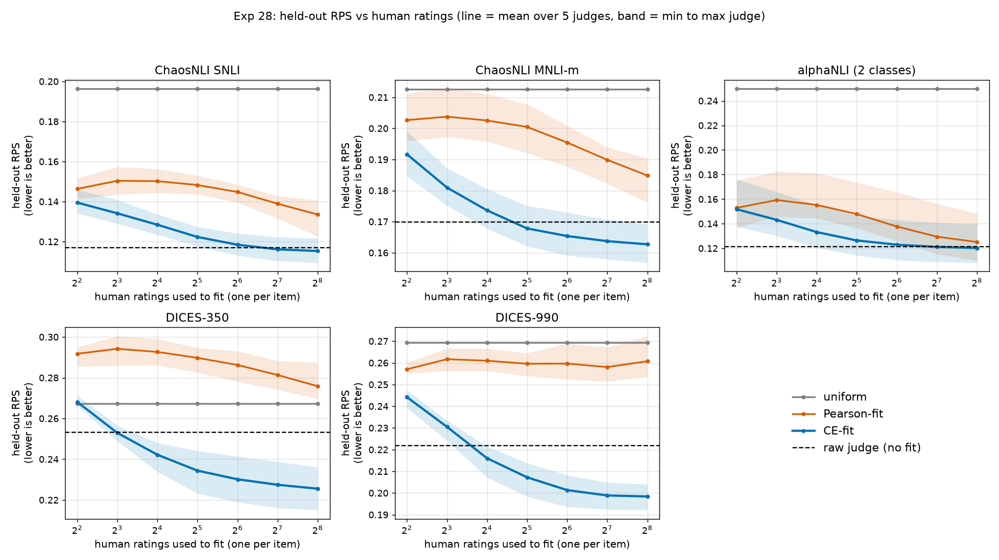

*Figure 1. Overview grid of the five single-panel plots below (Exp 28, held-out RPS, lower is better) against human ratings used to fit, per rating set. Line = mean over 5 judges, band = min to max judge, dashed = raw judge with no fit. Harness (Exp 28): judges GPT-6 Astra, Claude Opus 5.5, Kimi K3, GLM 5.3 and DeepSeek V4.1 Flash through the Stanford AI API Gateway; orchestration and analysis by Claude Sonnet 5.5 in Claude Code.*

## What "beat" means, exactly

- **Metric.** A beats B on a metric when A has the lower mean held-out value of that metric. The metrics are RPS (primary), CE in nats and TVD, each computed against the full empirical human rating distribution of every held-out item. Higher held-out correlation never decides a win; Spearman and Pearson r appear only as secondary columns.
- **What is compared.** A judge fit or trained with a CE objective (CE-fit, CE-LoRA) against the same judge fit or trained to maximize Pearson correlation (Pearson-fit, Pearson-LoRA), on the same data and the same budget.
- **Two strengths of "beat".** Point estimate: the mean metric is lower (this is what "35 of 35" on RPS in Exp 26 means; on CE and TVD the Exp 26 count is 32 of 35 each). Significant: the lower bound of (Pearson-fit minus CE-fit) is above 0. Exp 28 break-even: 97.5% simultaneous bootstrap bound above 0 at every tested budget from N up, against Pearson-fit and uniform. Exp 26 formal test: descending from 256 ratings, one-sided bound at alpha 0.01 per judge, stopping at the first failure. Exp 29: crossed simultaneous 95% cluster-bootstrap band above 0.
- **Unit of ratings.** The budget counts individual human ratings used to fit or train, not items. d = 1 is one rating per item, d = 5 is five per item.

## What is new since Nov 23 and what is unchanged

| Item | Status |
|---|---|
| Exp 26 and Exp 28 | Unchanged since Nov 23 (commits [570d3a9](https://github.com/brando90/judges-dont-need-psychometrics-or-corr/commit/570d3a9), [5b7257f](https://github.com/brando90/judges-dont-need-psychometrics-or-corr/commit/5b7257f)). |
| Exp 29 (LoRA, four objectives, Qwen3-4B and Llama-3.1-8B on mercury2) | Complete Nov 23 evening: [d6930ed](https://github.com/brando90/judges-dont-need-psychometrics-or-corr/commit/d6930ed) (Qwen, 921 runs), [721edb3](https://github.com/brando90/judges-dont-need-psychometrics-or-corr/commit/721edb3) (Llama, 480 runs; 1,401 total). Includes chaos3_llama, dices3_llama and hs2_qwen. |
| Exp 27 (identification preprint) | Unchanged; Stanford archive bh388th6008. |
| Newest earlier commit | [143ba39](https://github.com/brando90/judges-dont-need-psychometrics-or-corr/commit/143ba39), Nov 24: README title and intro only. |
| This folder (Exp 30) | New Nov 25: readable figures, tables computed from the saved results, this file. No new experiment. |

## Table 1. Exp 28: five public rating sets, five frontier judges (mean over judges, one rating per item)

Harness (Exp 28): judges GPT-6 Astra, Claude Opus 5.5, Kimi K3, GLM 5.3 and DeepSeek V4.1 Flash through the Stanford AI API Gateway; orchestration and analysis by Claude Sonnet 5.5 in Claude Code. Fit = 27-transform head chosen by CE or by Pearson. Commit [5b7257f](https://github.com/brando90/judges-dont-need-psychometrics-or-corr/commit/5b7257f).

At 256 ratings:

| Set | RPS CE-fit | RPS Pearson-fit | RPS uniform | CE CE-fit | CE Pearson-fit | TVD CE-fit | TVD Pearson-fit | Pearson r CE-fit / Pearson-fit | Spearman CE-fit / Pearson-fit |
|---|---|---|---|---|---|---|---|---|---|
| ChaosNLI SNLI | 0.115 | 0.134 | 0.196 | 0.713 | 0.824 | 0.169 | 0.235 | 0.918 / 0.913 | 0.915 / 0.913 |
| ChaosNLI MNLI-m | 0.163 | 0.185 | 0.213 | 0.911 | 1.037 | 0.208 | 0.261 | 0.823 / 0.831 | 0.823 / 0.827 |
| alphaNLI (2 classes) | 0.120 | 0.125 | 0.250 | 0.396 | 0.454 | 0.125 | 0.131 | 0.902 / 0.899 | 0.868 / 0.868 |
| DICES-350 | 0.226 | 0.276 | 0.267 | 0.851 | 1.272 | 0.163 | 0.314 | 0.567 / 0.551 | 0.526 / 0.526 |
| DICES-990 | 0.198 | 0.261 | 0.269 | 0.757 | 1.047 | 0.138 | 0.315 | 0.707 / 0.745 | 0.762 / 0.761 |

At 16 ratings:

| Set | RPS CE-fit | RPS Pearson-fit | RPS uniform | CE CE-fit | CE Pearson-fit | TVD CE-fit | TVD Pearson-fit | Pearson r CE-fit / Pearson-fit | Spearman CE-fit / Pearson-fit |
|---|---|---|---|---|---|---|---|---|---|
| ChaosNLI SNLI | 0.128 | 0.150 | 0.196 | 0.830 | 0.970 | 0.208 | 0.264 | 0.903 / 0.892 | 0.910 / 0.906 |
| ChaosNLI MNLI-m | 0.174 | 0.203 | 0.213 | 1.004 | 1.221 | 0.239 | 0.305 | 0.820 / 0.798 | 0.821 / 0.809 |
| alphaNLI (2 classes) | 0.133 | 0.155 | 0.250 | 0.488 | 0.603 | 0.144 | 0.170 | 0.890 / 0.879 | 0.868 / 0.868 |
| DICES-350 | 0.242 | 0.293 | 0.267 | 0.930 | 1.532 | 0.207 | 0.325 | 0.561 / 0.527 | 0.526 / 0.526 |
| DICES-990 | 0.216 | 0.261 | 0.269 | 0.859 | 1.263 | 0.180 | 0.296 | 0.710 / 0.681 | 0.761 / 0.759 |

At 4 ratings:

| Set | RPS CE-fit | RPS Pearson-fit | RPS uniform | CE CE-fit | CE Pearson-fit | TVD CE-fit | TVD Pearson-fit | Pearson r CE-fit / Pearson-fit | Spearman CE-fit / Pearson-fit |
|---|---|---|---|---|---|---|---|---|---|
| ChaosNLI SNLI | 0.139 | 0.146 | 0.196 | 0.971 | 0.998 | 0.238 | 0.251 | 0.891 / 0.886 | 0.906 / 0.905 |
| ChaosNLI MNLI-m | 0.192 | 0.203 | 0.213 | 1.187 | 1.303 | 0.288 | 0.314 | 0.802 / 0.783 | 0.812 / 0.802 |
| alphaNLI (2 classes) | 0.152 | 0.153 | 0.250 | 0.610 | 0.630 | 0.164 | 0.160 | 0.878 / 0.875 | 0.868 / 0.868 |
| DICES-350 | 0.268 | 0.292 | 0.267 | 1.218 | 1.556 | 0.268 | 0.327 | 0.544 / 0.528 | 0.526 / 0.525 |
| DICES-990 | 0.244 | 0.257 | 0.269 | 1.189 | 1.365 | 0.245 | 0.284 | 0.670 / 0.644 | 0.760 / 0.758 |

Win counts over all budgets and judge-set cells (point estimates):

- d=1 (point estimates, all budgets, all judge-set cells): CE-fit lower than Pearson-fit on RPS 172/175, CE 175/175, TVD 168/175
- d=5 (point estimates, all budgets, all judge-set cells): CE-fit lower than Pearson-fit on RPS 128/150, CE 129/150, TVD 129/150

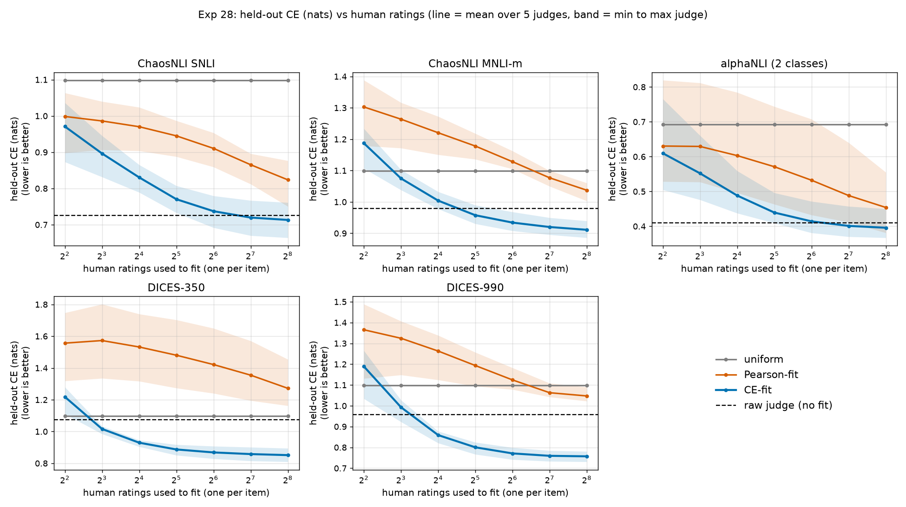

*Figure 2. Exp 28, held-out CE in nats (lower is better), per rating set. Line = mean over 5 judges, band = min to max judge. Harness (Exp 28): judges GPT-6 Astra, Claude Opus 5.5, Kimi K3, GLM 5.3 and DeepSeek V4.1 Flash through the Stanford AI API Gateway; orchestration and analysis by Claude Sonnet 5.5 in Claude Code.*

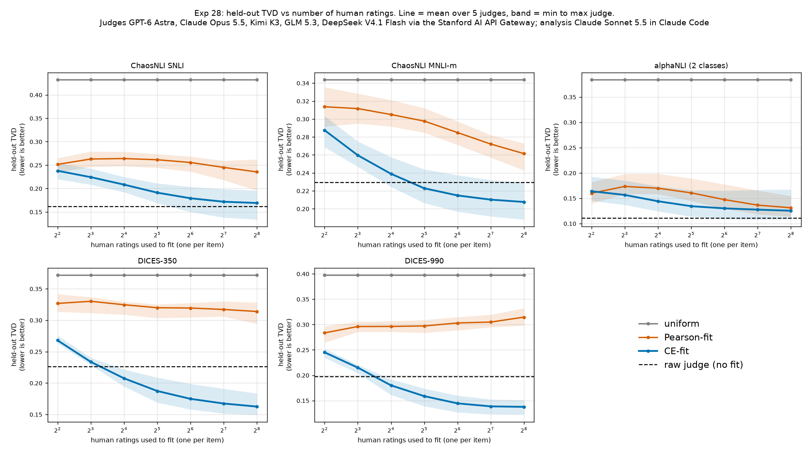

*Figure 3. Exp 28, held-out TVD (lower is better), per rating set. Harness (Exp 28): judges GPT-6 Astra, Claude Opus 5.5, Kimi K3, GLM 5.3 and DeepSeek V4.1 Flash through the Stanford AI API Gateway; orchestration and analysis by Claude Sonnet 5.5 in Claude Code.*

**Single-panel plots, Exp 28, one pair per rating set** (left held-out RPS, right held-out CE; lower is better; click for full size; TVD single-panel files: [ChaosNLI SNLI](figures/single_exp28_tvd_chaosnli_snli.png), [ChaosNLI MNLI-m](figures/single_exp28_tvd_chaosnli_mnli.png), [alphaNLI (2 classes)](figures/single_exp28_tvd_chaosnli_alphanli.png), [DICES-350](figures/single_exp28_tvd_dices350.png), [DICES-990](figures/single_exp28_tvd_dices990.png)). Harness (Exp 28): judges GPT-6 Astra, Claude Opus 5.5, Kimi K3, GLM 5.3 and DeepSeek V4.1 Flash through the Stanford AI API Gateway; orchestration and analysis by Claude Sonnet 5.5 in Claude Code.

**ChaosNLI SNLI**

<a href="figures/single_exp28_rps_chaosnli_snli.png">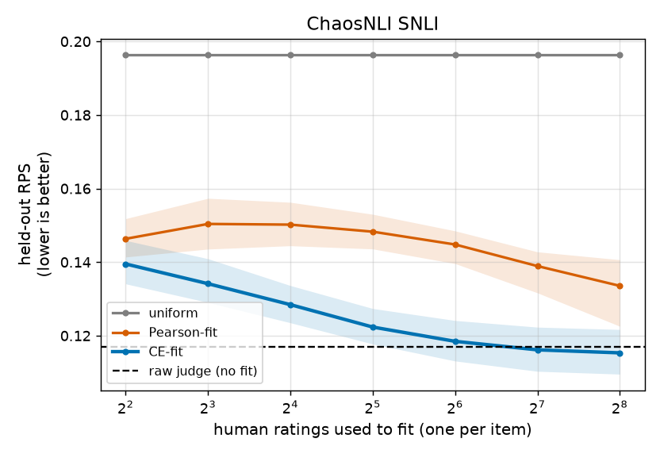</a> <a href="figures/single_exp28_ce_chaosnli_snli.png">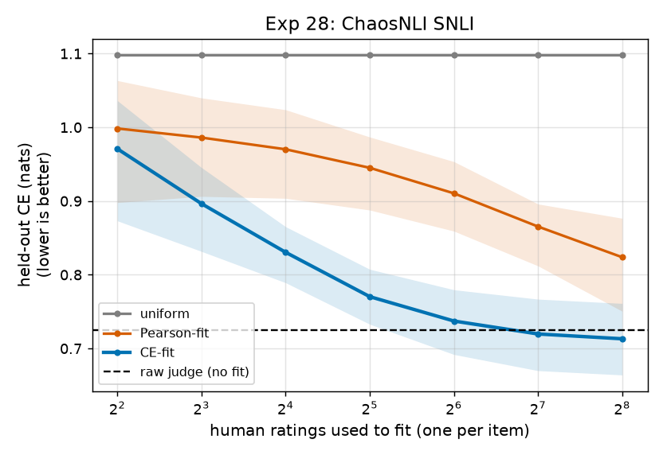</a>

**ChaosNLI MNLI-m**

<a href="figures/single_exp28_rps_chaosnli_mnli.png">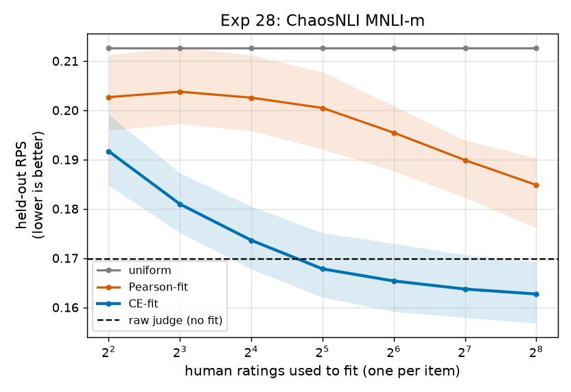</a> <a href="figures/single_exp28_ce_chaosnli_mnli.png">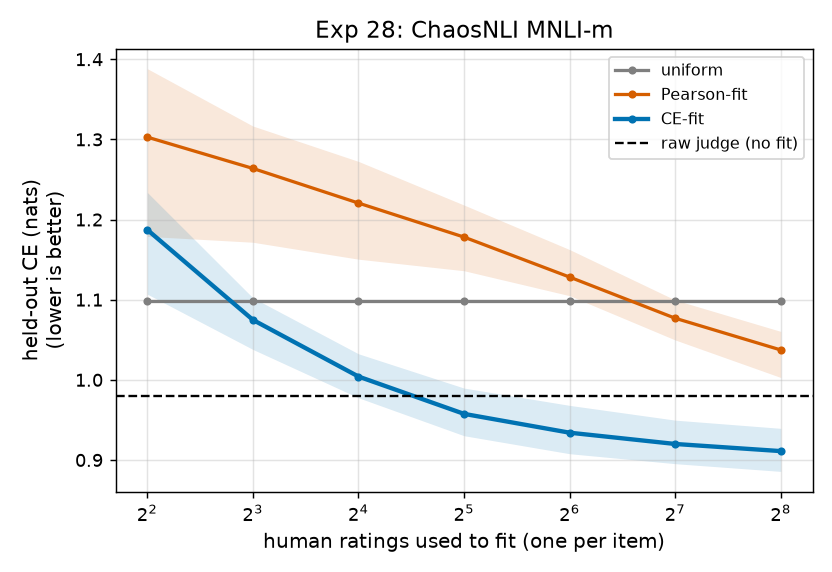</a>

**alphaNLI (2 classes)**

<a href="figures/single_exp28_rps_chaosnli_alphanli.png">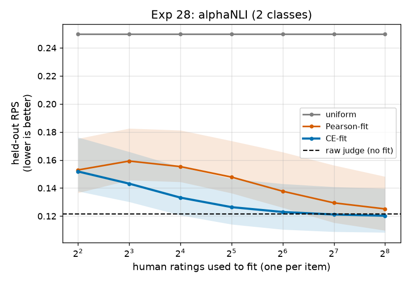</a> <a href="figures/single_exp28_ce_chaosnli_alphanli.png">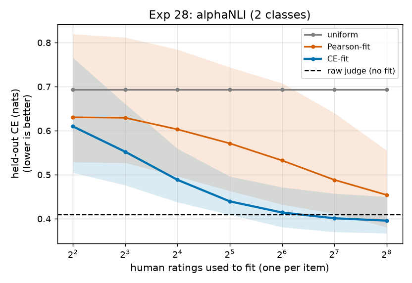</a>

**DICES-350**

<a href="figures/single_exp28_rps_dices350.png">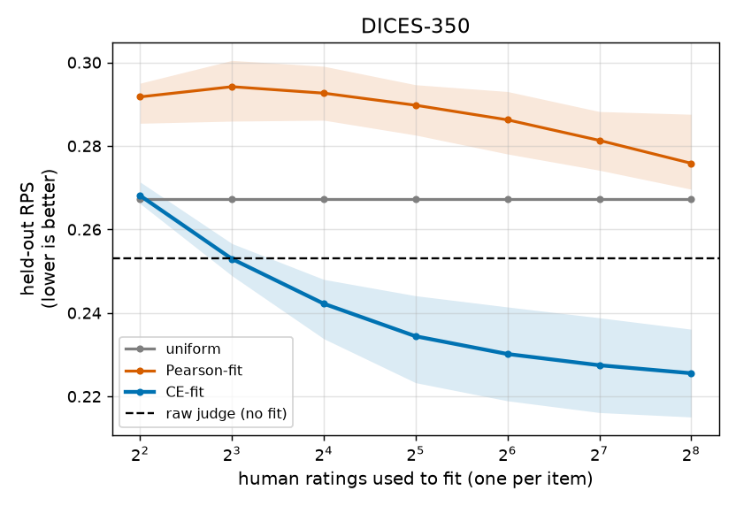</a> <a href="figures/single_exp28_ce_dices350.png">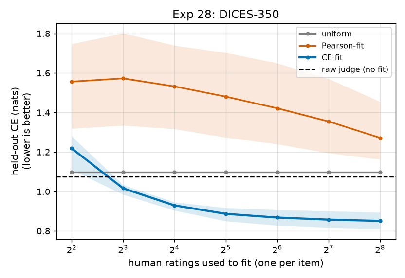</a>

**DICES-990**

<a href="figures/single_exp28_rps_dices990.png">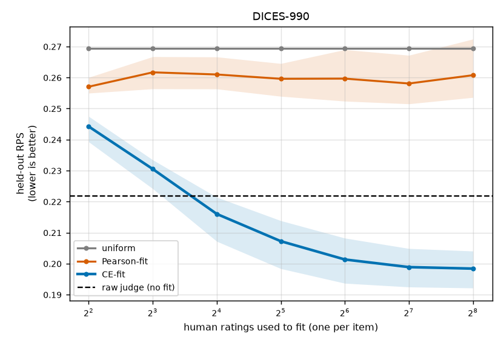</a> <a href="figures/single_exp28_ce_dices990.png">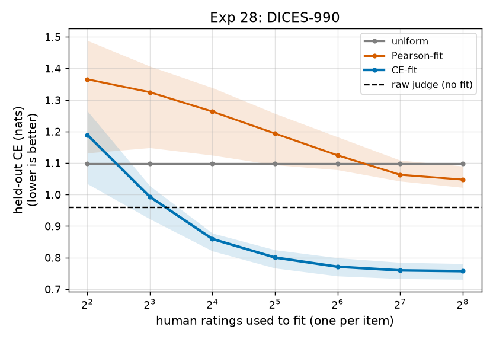</a>

## Break-even and cost (Exp 28)

- d=1, CE-fit vs Pearson-fit: reached in 25 of 25 set-judge cells; fewest 4, median 4, most 8
- d=1, CE-fit vs uniform: reached in 25 of 25 set-judge cells; fewest 4, median 4, most 8
- d=1, CE-fit vs raw judge: reached in 14 of 25 set-judge cells; fewest 8, median 16, most 256
- d=5, CE-fit vs Pearson-fit: reached in 25 of 25 set-judge cells; fewest 10, median 20, most 20
- d=5, CE-fit vs uniform: reached in 25 of 25 set-judge cells; fewest 10, median 10, most 20
- d=5, CE-fit vs raw judge: reached in 14 of 25 set-judge cells; fewest 10, median 30, most 320

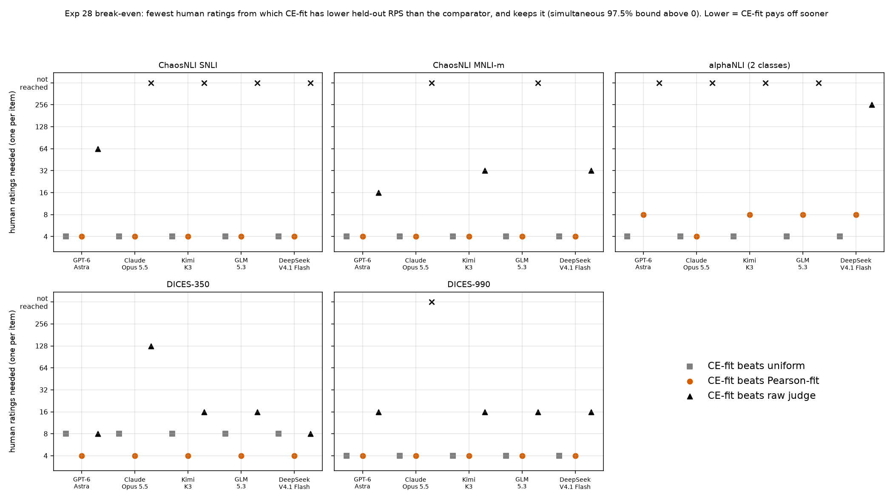

*Figure 4. Exp 28 break-even: fewest human ratings (one per item) from which CE-fit has lower held-out RPS than the comparator and keeps it (simultaneous 97.5% bound above 0). Each marker is one judge; x = not reached within 256. Harness (Exp 28): judges GPT-6 Astra, Claude Opus 5.5, Kimi K3, GLM 5.3 and DeepSeek V4.1 Flash through the Stanford AI API Gateway; orchestration and analysis by Claude Sonnet 5.5 in Claude Code.*

**Single-panel break-even plots, one per rating set** (Harness (Exp 28): judges GPT-6 Astra, Claude Opus 5.5, Kimi K3, GLM 5.3 and DeepSeek V4.1 Flash through the Stanford AI API Gateway; orchestration and analysis by Claude Sonnet 5.5 in Claude Code.)

<a href="figures/single_exp28_breakeven_chaosnli_snli.png">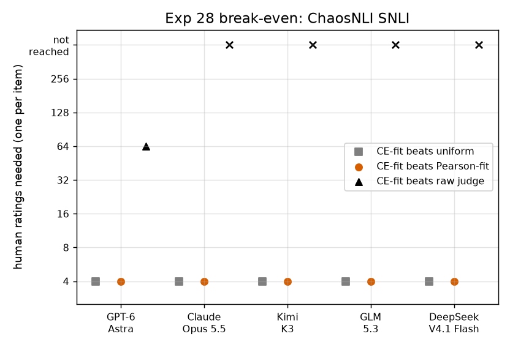</a> <a href="figures/single_exp28_breakeven_chaosnli_mnli.png">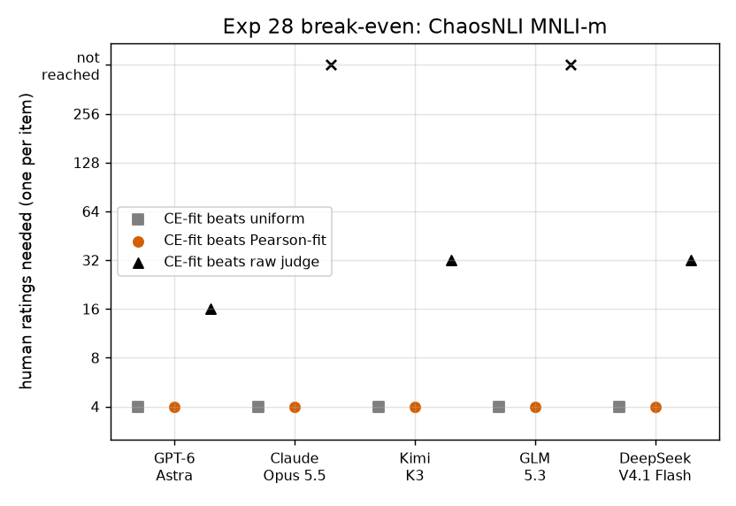</a>

<a href="figures/single_exp28_breakeven_chaosnli_alphanli.png">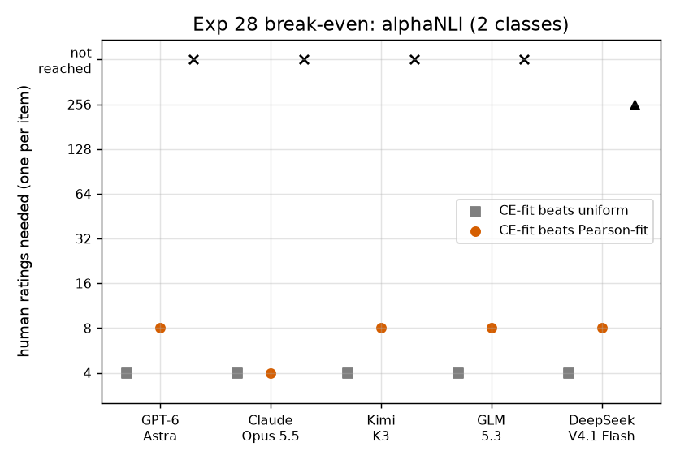</a> <a href="figures/single_exp28_breakeven_dices350.png">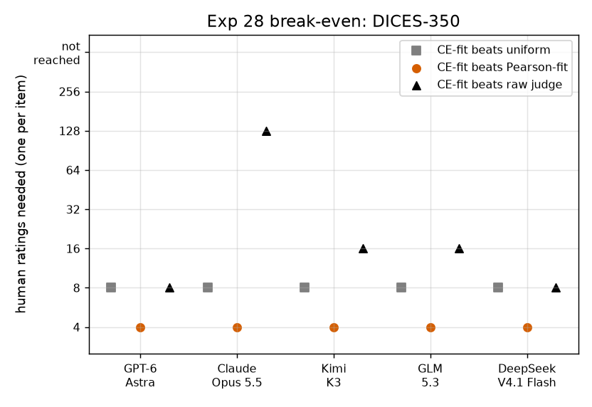</a>

<a href="figures/single_exp28_breakeven_dices990.png">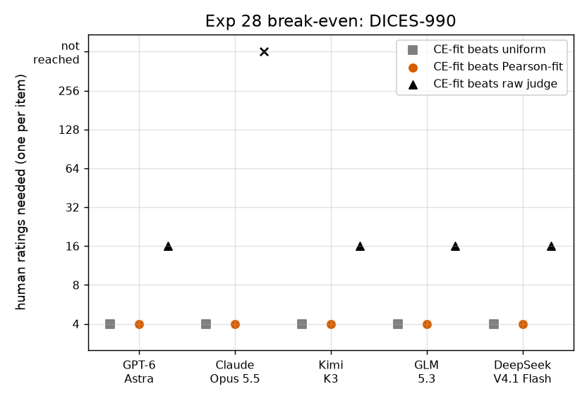</a>

Cost, from the experiments' own cost files (estimated at the gateway list rate, Kimi K3 is listed at 0 there): Exp 28 used 11,750 judge calls for an estimated 19.69 USD (22.55 USD if priced at the 1.4 and 4.4 USD per million token reference); Exp 26 used 800 calls for an estimated 1.34 USD (1.20 USD at the reference). The human side is the cost that matters: CE-fit needs 4 to 8 human ratings per rating set to beat Pearson-fit and uniform.

## Table 2. Exp 26: fresh homework answers, 160 answers, five frontier judges (256 ratings, two per answer, mean of ten folds)

Harness (Exp 26): the same five judges through the Stanford AI API Gateway chat completions; analysis by ub9sc in Python (numpy, scipy). Commit [570d3a9](https://github.com/brando90/judges-dont-need-psychometrics-or-corr/commit/570d3a9). Uniform: RPS 0.2497, CE 1.792, TVD 0.767.

| Judge | RPS CE-fit | RPS Pearson-fit | CE CE-fit | CE Pearson-fit | TVD CE-fit | TVD Pearson-fit | Formal test at 256 ratings (vs Pearson-fit, lower bound) |
|---|---|---|---|---|---|---|---|
| GPT-6 Astra | 0.0660 | 0.0843 | 0.834 | 0.969 | 0.332 | 0.356 | pass (+0.0025) |
| Claude Opus 5.5 | 0.0639 | 0.0675 | 0.828 | 0.877 | 0.334 | 0.309 | fail (-0.0040) |
| Kimi K3 | 0.0712 | 0.0996 | 0.966 | 1.879 | 0.352 | 0.378 | pass (+0.0071) |
| GLM 5.3 | 0.0757 | 0.0952 | 1.027 | 1.337 | 0.355 | 0.421 | fail (-0.0021) |
| DeepSeek V4.1 Flash | 0.0827 | 0.0867 | 1.028 | 1.109 | 0.337 | 0.360 | fail (-0.0064) |

CE-fit has lower held-out RPS than Pearson-fit in 35 of 35 judge-by-budget cells, lower CE in 32 of 35 and lower TVD in 32 of 35. Cells where Pearson-fit is lower: CE at 4 ratings for GPT-6 Astra; CE at 4 ratings for Kimi K3; CE at 4 ratings for GLM 5.3; TVD at 4 ratings for GPT-6 Astra; TVD at 128 ratings for Claude Opus 5.5; TVD at 256 ratings for Claude Opus 5.5.

Formal status by judge and budget (the test stops at the first failure; later budgets are then not tested):

| Judge | 256 | 128 | 64 | 32 | 16 | 8 | 4 |
|---|---|---|---|---|---|---|---|
| GPT-6 Astra | pass | pass | pass | pass | pass | pass | fail |
| Claude Opus 5.5 | fail | not_tested_after_failure | not_tested_after_failure | not_tested_after_failure | not_tested_after_failure | not_tested_after_failure | not_tested_after_failure |
| Kimi K3 | pass | pass | pass | pass | pass | pass | fail |
| GLM 5.3 | fail | not_tested_after_failure | not_tested_after_failure | not_tested_after_failure | not_tested_after_failure | not_tested_after_failure | not_tested_after_failure |
| DeepSeek V4.1 Flash | fail | not_tested_after_failure | not_tested_after_failure | not_tested_after_failure | not_tested_after_failure | not_tested_after_failure | not_tested_after_failure |

Under the definition of "beat" above, Exp 26 is a clean win on RPS only. Claude Opus 5.5 at 256 ratings has TVD 0.334 for CE-fit against 0.309 for Pearson-fit (Pearson-fit lower). Spearman and Pearson r are not in this experiment's tables.

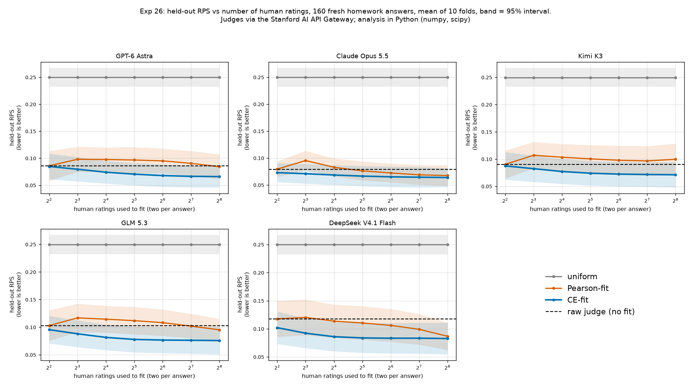

*Figure 5. Overview grid (single-panel plots below). Exp 26, held-out RPS (lower is better) against human ratings used to fit (two per answer), per judge; mean of 10 folds, band = 95% interval, dashed = raw judge with no fit. Harness (Exp 26): the same five judges through the Stanford AI API Gateway chat completions; analysis by ub9sc in Python (numpy, scipy).*

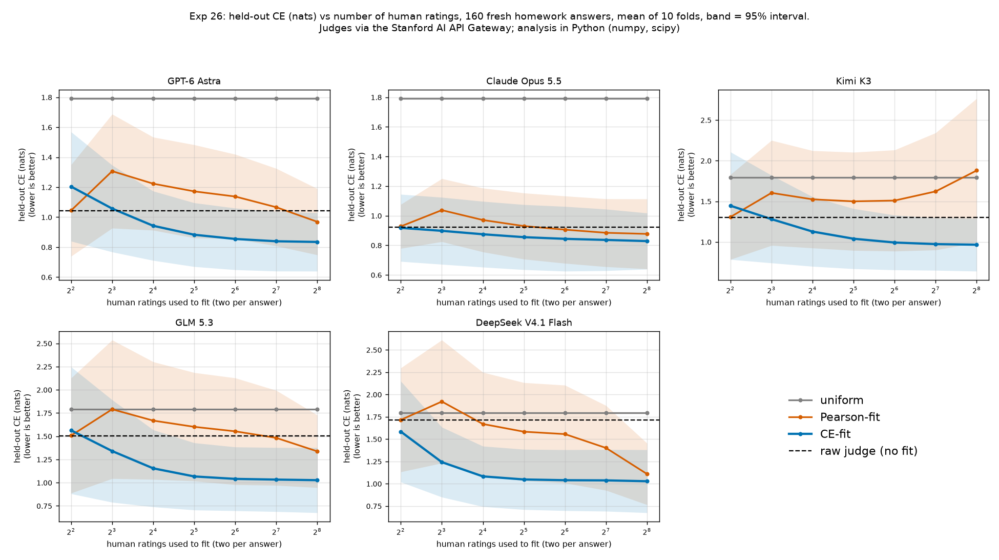

*Figure 6. Exp 26, held-out CE in nats. Harness (Exp 26): the same five judges through the Stanford AI API Gateway chat completions; analysis by ub9sc in Python (numpy, scipy).*

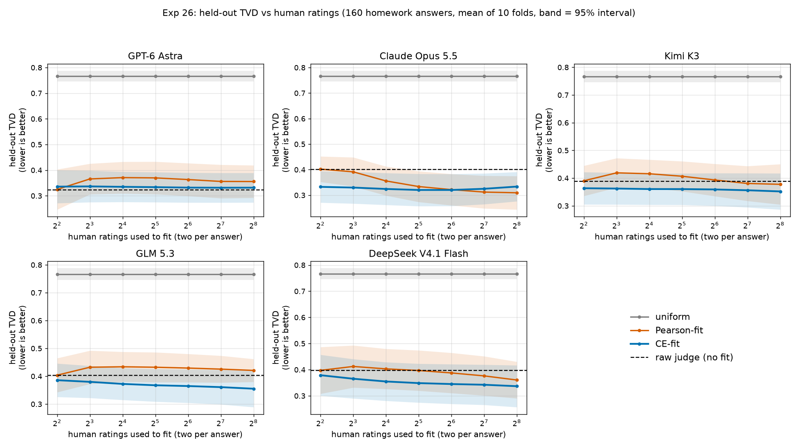

*Figure 7. Exp 26, held-out TVD. Harness (Exp 26): the same five judges through the Stanford AI API Gateway chat completions; analysis by ub9sc in Python (numpy, scipy).*

**Single-panel plots, Exp 26, one pair per judge** (left held-out RPS, right held-out CE; lower is better; TVD single-panel files: [GPT-6 Astra](figures/single_exp26_tvd_gpt-6-astra.png), [Claude Opus 5.5](figures/single_exp26_tvd_claude-opus-5-5.png), [Kimi K3](figures/single_exp26_tvd_kimi-k3.png), [GLM 5.3](figures/single_exp26_tvd_glm-5.3.png), [DeepSeek V4.1 Flash](figures/single_exp26_tvd_deepseek-v4.1-flash.png)). Harness (Exp 26): the same five judges through the Stanford AI API Gateway chat completions; analysis by ub9sc in Python (numpy, scipy).

**GPT-6 Astra**

<a href="figures/single_exp26_rps_gpt-6-astra.png">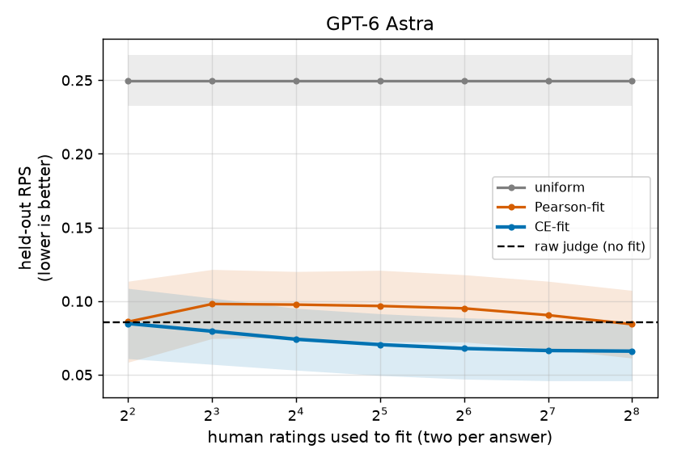</a> <a href="figures/single_exp26_ce_gpt-6-astra.png">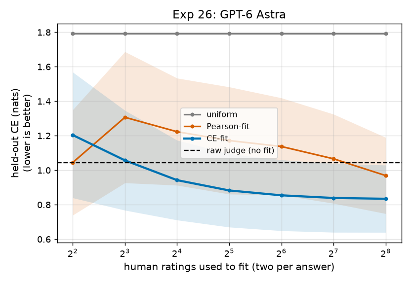</a>

**Claude Opus 5.5**

<a href="figures/single_exp26_rps_claude-opus-5-5.png">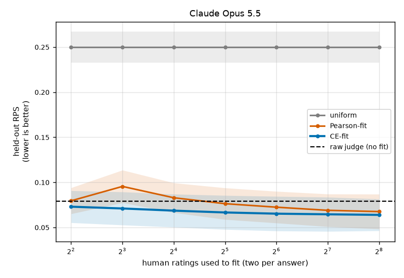</a> <a href="figures/single_exp26_ce_claude-opus-5-5.png">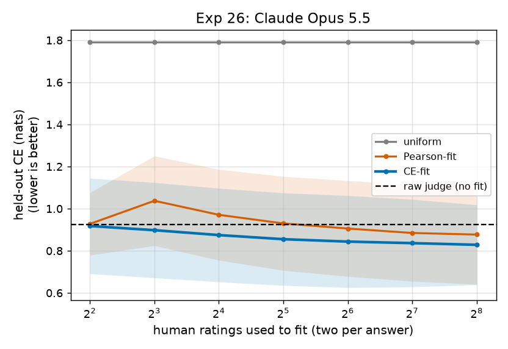</a>

**Kimi K3**

<a href="figures/single_exp26_rps_kimi-k3.png">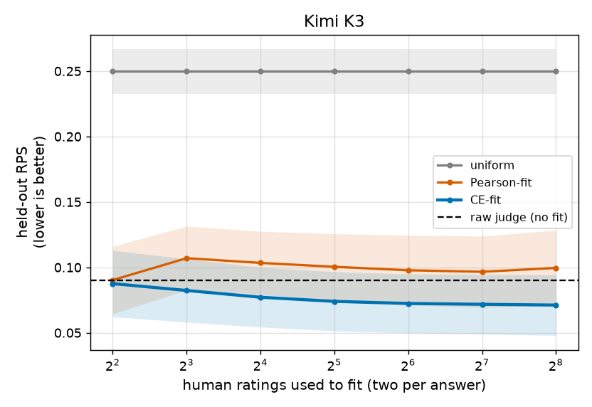</a> <a href="figures/single_exp26_ce_kimi-k3.png">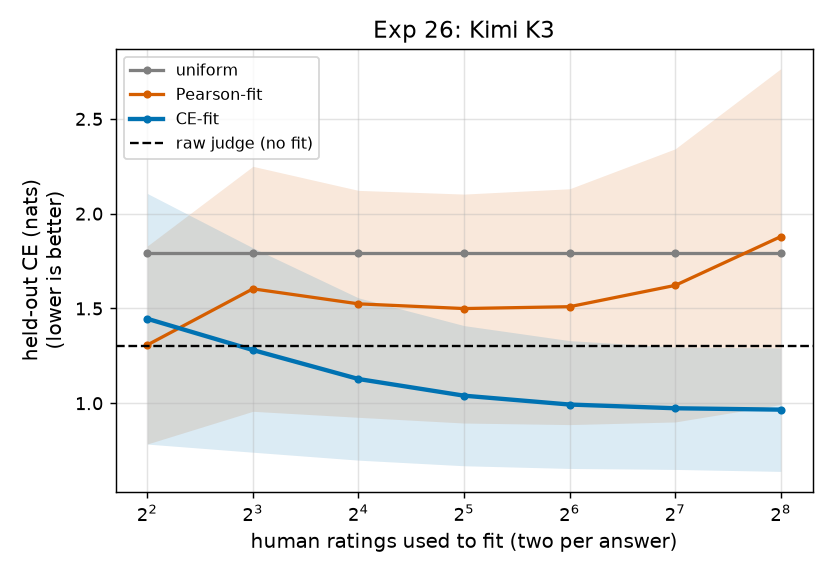</a>

**GLM 5.3**

<a href="figures/single_exp26_rps_glm-5.3.png">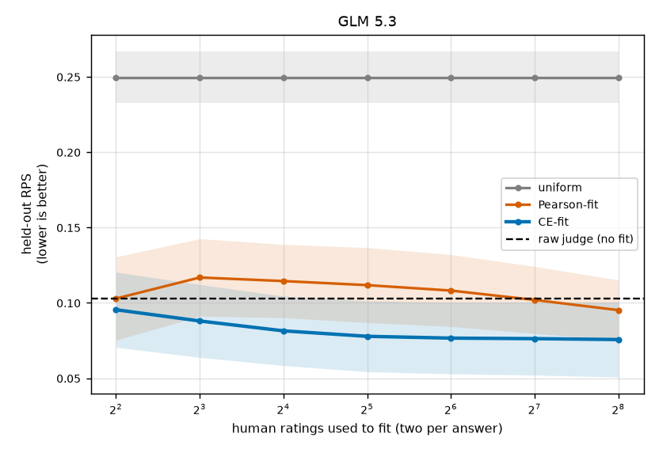</a> <a href="figures/single_exp26_ce_glm-5.3.png">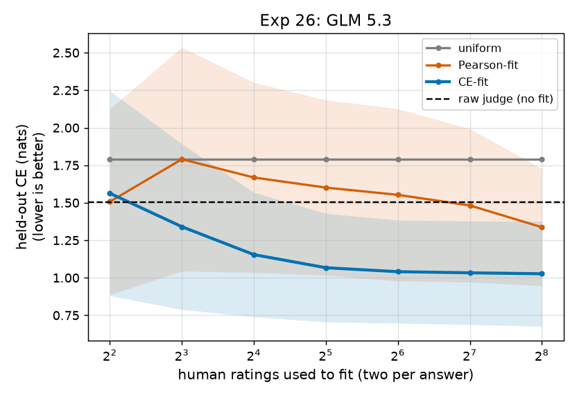</a>

**DeepSeek V4.1 Flash**

<a href="figures/single_exp26_rps_deepseek-v4.1-flash.png">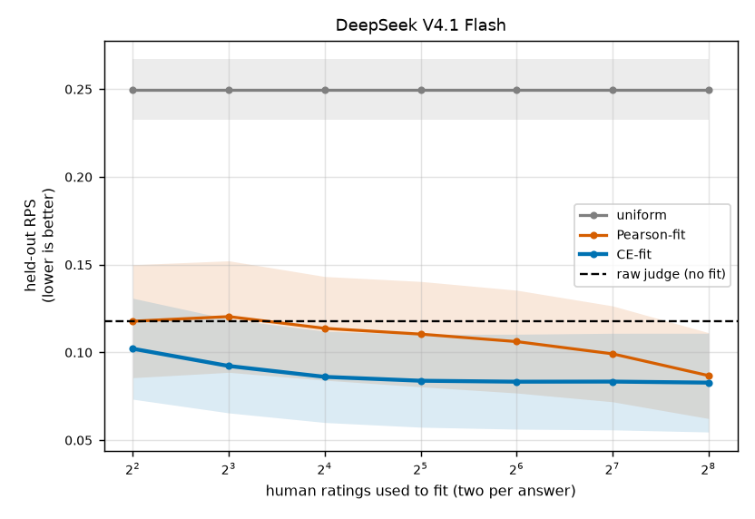</a> <a href="figures/single_exp26_ce_deepseek-v4.1-flash.png">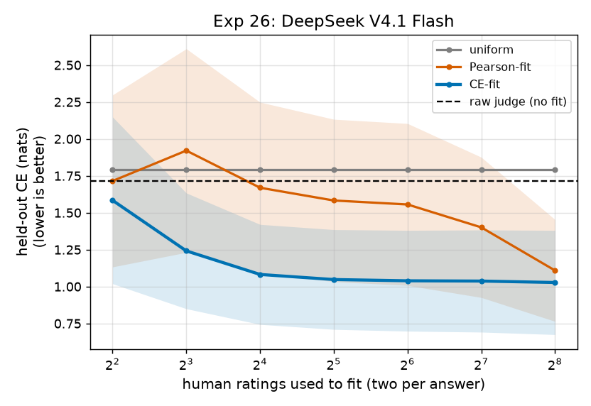</a>

## Table 3. Exp 29: LoRA fine-tuning, raw CE-trained against raw Pearson-trained, largest budget

Harness (Exp 29): LoRA training (rank 8, top 4 blocks) of Qwen3-4B-Instruct-2507 and Llama-3.1-8B-Instruct on the mercury2 GPU box; light QA by claude-opus-5-5-high through the Antigravity CLI. The repo does not name the builder model for Exp 29. Commits [d6930ed](https://github.com/brando90/judges-dont-need-psychometrics-or-corr/commit/d6930ed) and [721edb3](https://github.com/brando90/judges-dont-need-psychometrics-or-corr/commit/721edb3). Means over 10 draws; hs2_qwen reuses Exp 24 predictions.

| Panel | Budget | RPS CE-LoRA | RPS Pearson-LoRA | CE CE-LoRA | CE Pearson-LoRA | TVD CE-LoRA | TVD Pearson-LoRA | Pearson minus CE RPS [crossed 95%] |
|---|---|---|---|---|---|---|---|---|
| ChaosNLI, Qwen3-4B, d=1 | 2048 | 0.1490 | 0.1622 | 0.859 | 1.003 | 0.219 | 0.261 | +0.0132 [+0.0063, +0.0202] |
| ChaosNLI, Qwen3-4B, d=5 | 1280 | 0.1530 | 0.1910 | 0.881 | 1.734 | 0.232 | 0.327 | +0.0379 [+0.0216, +0.0543] |
| alphaNLI, Qwen3-4B | 1024 | 0.1862 | 0.2082 | 0.554 | 0.650 | 0.257 | 0.279 | +0.0220 [+0.0117, +0.0322] |
| DICES, Qwen3-4B | 1024 | 0.2088 | 0.2849 | 0.775 | 2.870 | 0.150 | 0.351 | +0.0761 [+0.0572, +0.0950] |
| HelpSteer2, Qwen3-4B | 2048 | 0.1521 | 0.1838 | 1.338 | 2.344 | 0.459 | 0.547 | +0.0316 [+0.0187, +0.0445] |
| ChaosNLI, Llama-3.1-8B | 2048 | 0.1555 | 0.1898 | 0.889 | 1.702 | 0.247 | 0.390 | +0.0344 [+0.0193, +0.0494] |
| DICES, Llama-3.1-8B | 1024 | 0.2060 | 0.2505 | 0.770 | 1.433 | 0.145 | 0.323 | +0.0445 [+0.0191, +0.0700] |

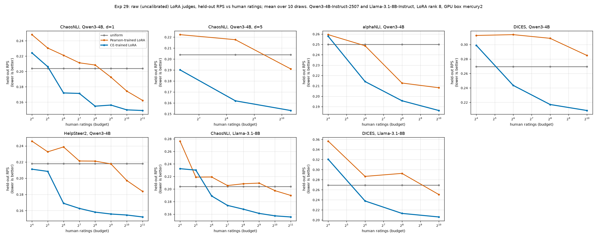

*Figure 8. Overview grid (single-panel plots follow). Exp 29, held-out RPS (lower is better) against human ratings, raw (uncalibrated) LoRA judges, mean over 10 draws. Harness (Exp 29): LoRA training (rank 8, top 4 blocks) of Qwen3-4B-Instruct-2507 and Llama-3.1-8B-Instruct on the mercury2 GPU box; light QA by claude-opus-5-5-high through the Antigravity CLI.*

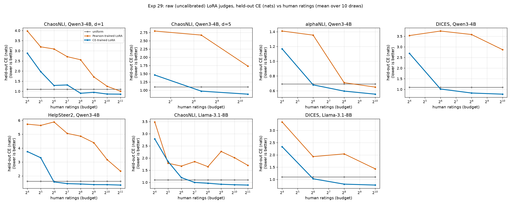

*Figure 9. Exp 29, held-out CE in nats. Harness (Exp 29): LoRA training (rank 8, top 4 blocks) of Qwen3-4B-Instruct-2507 and Llama-3.1-8B-Instruct on the mercury2 GPU box; light QA by claude-opus-5-5-high through the Antigravity CLI.*

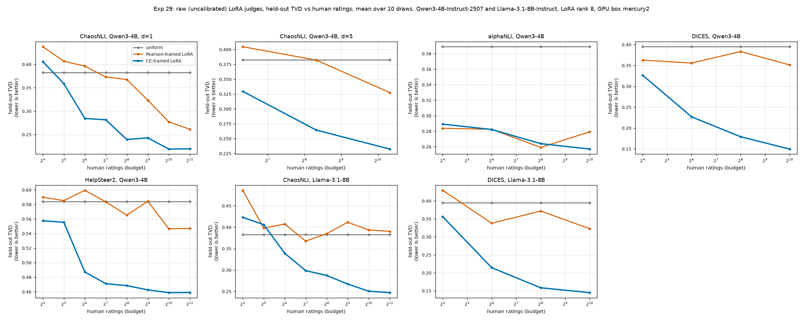

*Figure 10. Exp 29, held-out TVD. Harness (Exp 29): LoRA training (rank 8, top 4 blocks) of Qwen3-4B-Instruct-2507 and Llama-3.1-8B-Instruct on the mercury2 GPU box; light QA by claude-opus-5-5-high through the Antigravity CLI.*

**Single-panel plots, Exp 29, one pair per panel** (left held-out RPS, right held-out CE; lower is better; TVD single-panel files: [ChaosNLI, Qwen3-4B, d=1](figures/single_exp29_tvd_chaos3_qwen_d1.png), [ChaosNLI, Qwen3-4B, d=5](figures/single_exp29_tvd_chaos3_qwen_d5.png), [alphaNLI, Qwen3-4B](figures/single_exp29_tvd_alpha2_qwen_d1.png), [DICES, Qwen3-4B](figures/single_exp29_tvd_dices3_qwen_d1.png), [HelpSteer2, Qwen3-4B](figures/single_exp29_tvd_hs2_qwen_d1.png), [ChaosNLI, Llama-3.1-8B](figures/single_exp29_tvd_chaos3_llama_d1.png), [DICES, Llama-3.1-8B](figures/single_exp29_tvd_dices3_llama_d1.png)). Harness (Exp 29): LoRA training (rank 8, top 4 blocks) of Qwen3-4B-Instruct-2507 and Llama-3.1-8B-Instruct on the mercury2 GPU box; light QA by claude-opus-5-5-high through the Antigravity CLI.

**ChaosNLI, Qwen3-4B, d=1**

<a href="figures/single_exp29_rps_chaos3_qwen_d1.png">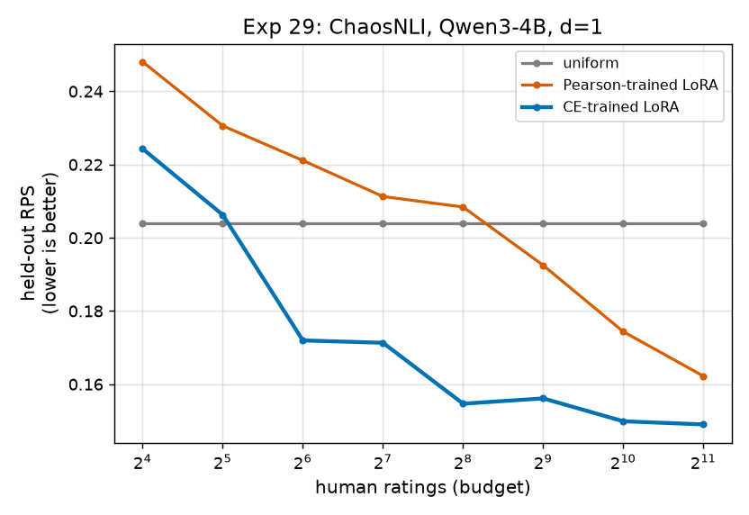</a> <a href="figures/single_exp29_ce_chaos3_qwen_d1.png">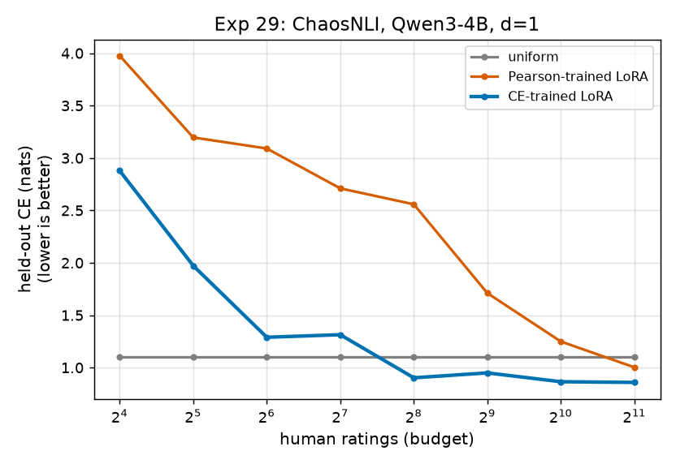</a>

**ChaosNLI, Qwen3-4B, d=5**

<a href="figures/single_exp29_rps_chaos3_qwen_d5.png">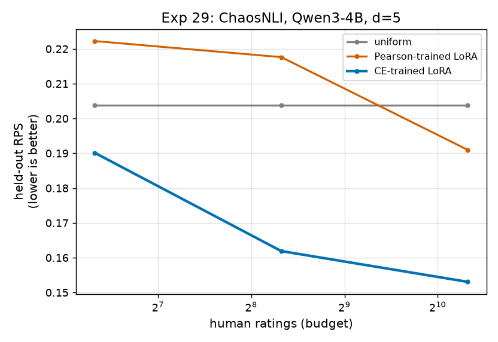</a> <a href="figures/single_exp29_ce_chaos3_qwen_d5.png">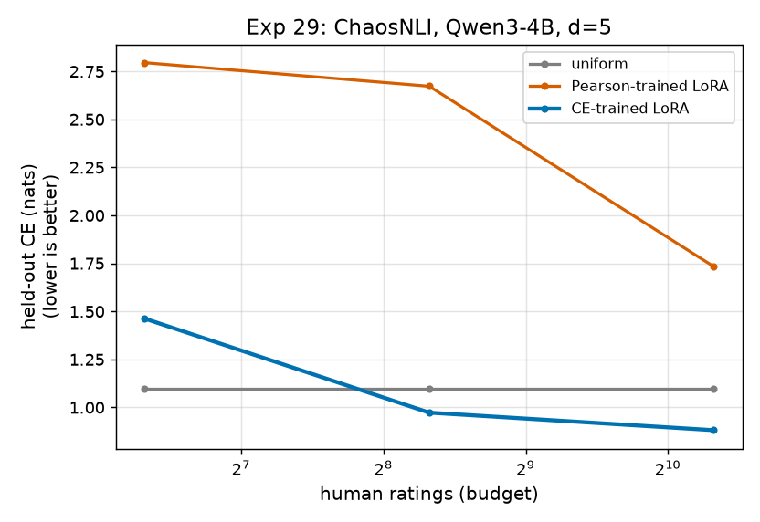</a>

**alphaNLI, Qwen3-4B**

<a href="figures/single_exp29_rps_alpha2_qwen_d1.png">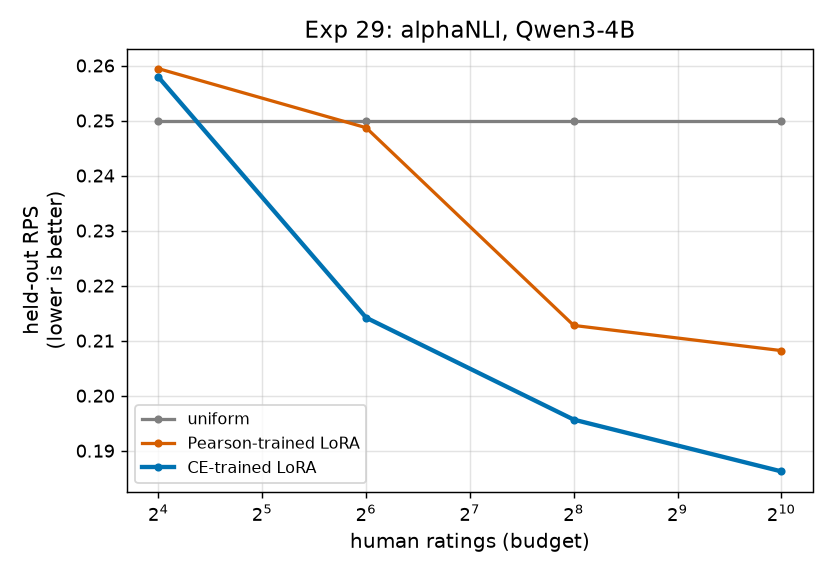</a> <a href="figures/single_exp29_ce_alpha2_qwen_d1.png">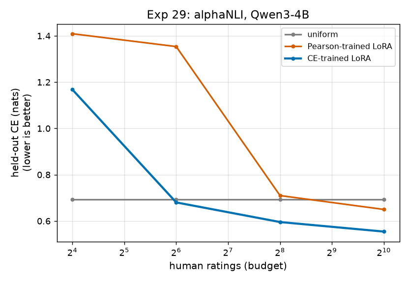</a>

**DICES, Qwen3-4B**

<a href="figures/single_exp29_rps_dices3_qwen_d1.png">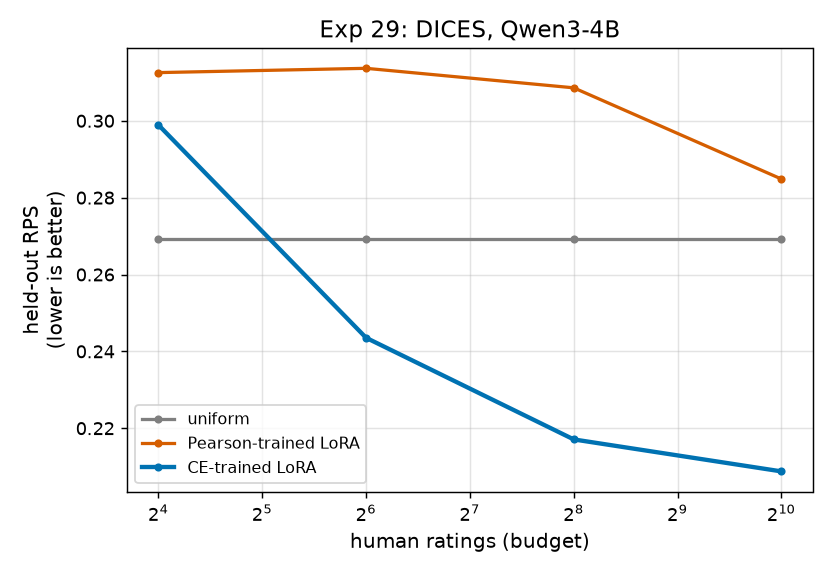</a> <a href="figures/single_exp29_ce_dices3_qwen_d1.png">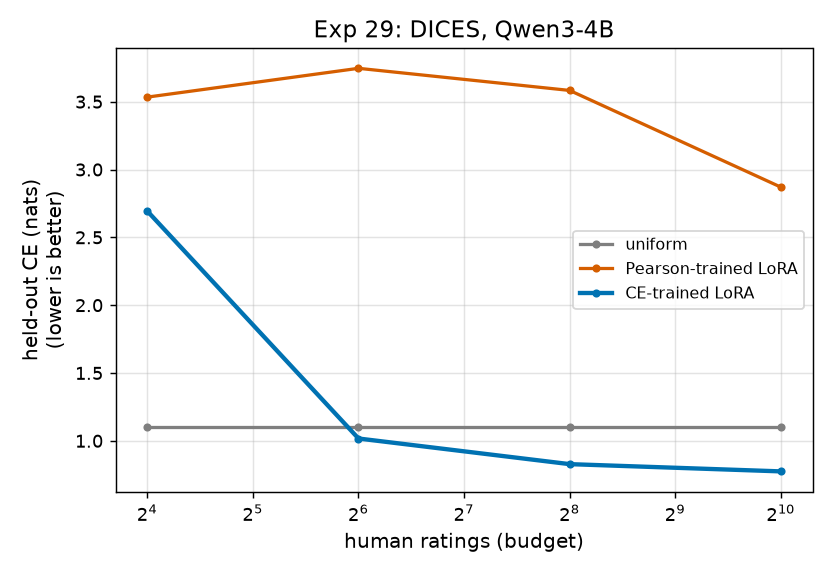</a>

**HelpSteer2, Qwen3-4B**

<a href="figures/single_exp29_rps_hs2_qwen_d1.png">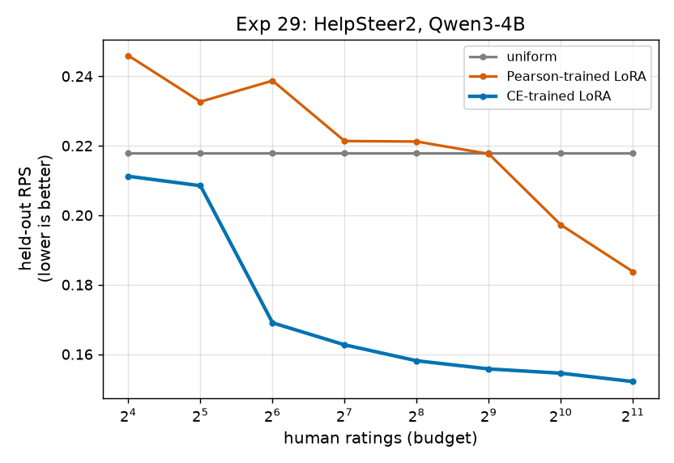</a> <a href="figures/single_exp29_ce_hs2_qwen_d1.png">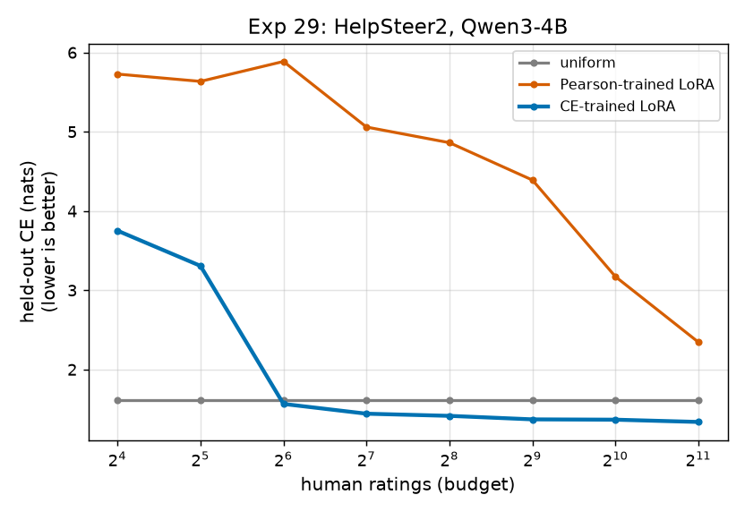</a>

**ChaosNLI, Llama-3.1-8B**

<a href="figures/single_exp29_rps_chaos3_llama_d1.png">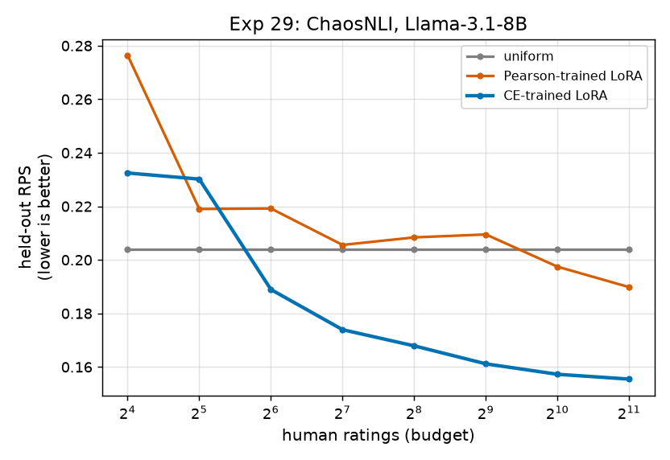</a> <a href="figures/single_exp29_ce_chaos3_llama_d1.png">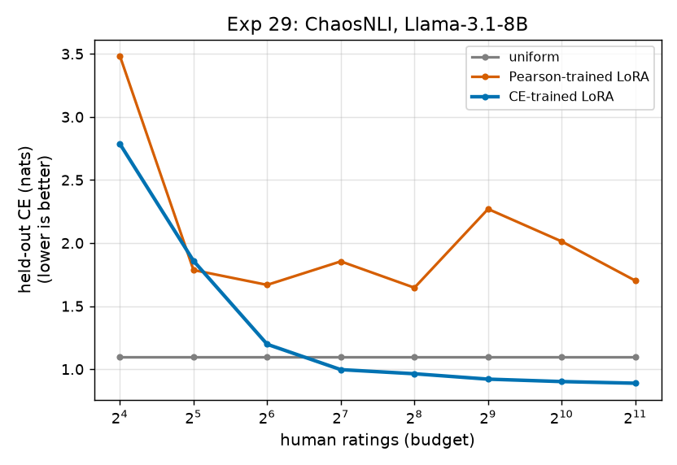</a>

**DICES, Llama-3.1-8B**

<a href="figures/single_exp29_rps_dices3_llama_d1.png">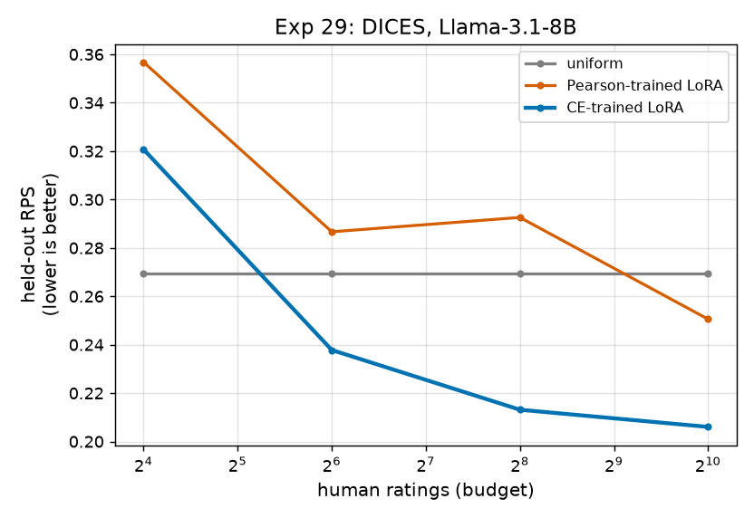</a> <a href="figures/single_exp29_ce_dices3_llama_d1.png">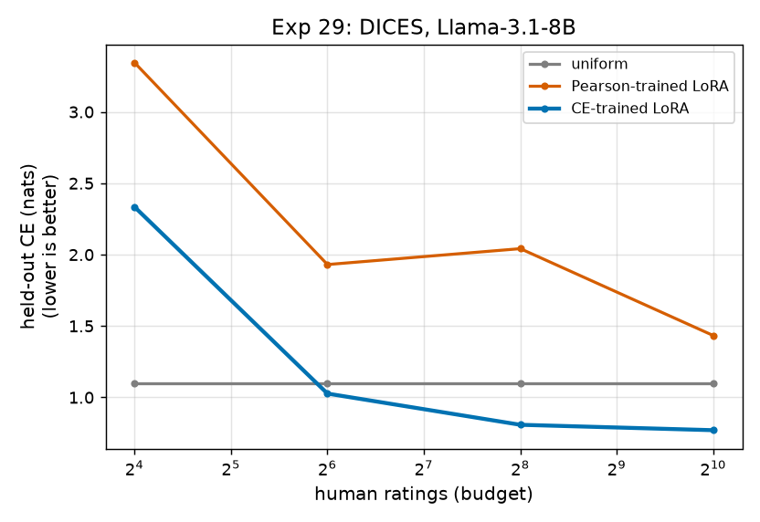</a>

The repo's own Exp 29 figures: [four objectives and K=2 control](../29_four_objectives_lora_and_shape_control_chaosnli_dices_helpsteer2_start_23Nov2026/figures/fig1_four_objectives_and_k2_control.png), [disagreement slices and logit rescue](../29_four_objectives_lora_and_shape_control_chaosnli_dices_helpsteer2_start_23Nov2026/figures/fig2_disagreement_slices_and_logit_rescue.png). Pre-registered hypotheses (Exp 29): H1 confirmed (raw CE and RPS beat raw Pearson in 7 of 7 panels); H2, H3 and H4 partial; details in [RESULTS_11-23-2026.md](../29_four_objectives_lora_and_shape_control_chaosnli_dices_helpsteer2_start_23Nov2026/RESULTS_11-23-2026.md).

## Exp 24 and Exp 25 (HelpSteer2 Qwen3-4B LoRA, complete Nov 21 and 22)

| Exp | Result at largest budget | Harness / commit |
|---|---|---|
| 24 | Raw CE RPS 0.15213 against Pearson 0.18376; calibrated CE 0.15200 against Pearson 0.15309 (9 of 10 draws) | Qwen3-4B LoRA; [54de212](https://github.com/brando90/judges-dont-need-psychometrics-or-corr/commit/54de212) |
| 25 | Raw CE wins 20 of 20 draws (Qwen) and 10 of 10 (Llama-3.1-8B) at 64 or more ratings; calibrated Qwen converges (0.15080 against 0.15089), calibrated Llama tied (0.16005 against 0.15893) | Qwen3-4B and Llama-3.1-8B LoRA, built by Antigravity (Gemini 4 Carbon); [59e97d4](https://github.com/brando90/judges-dont-need-psychometrics-or-corr/commit/59e97d4) |

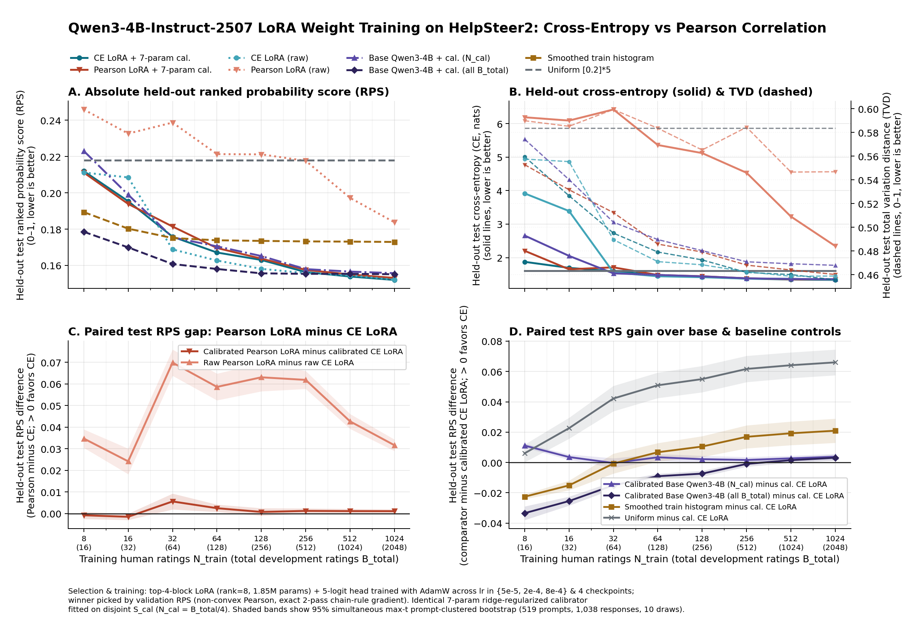

*Figure 11. Exp 24, HelpSteer2 LoRA learning curves (the repo's own figure).*

## Caveats (read before quoting)

- The derivation (Pearson sees only the first moment; CE and RPS are proper) is an infinite-data result. "CE is better with limited data" is supported empirically in the cells above, not derived.
- Exp 28 and 26 are frontier judges with calibration heads; Exp 29 is LoRA training. They answer slightly different questions.
- Against the raw judge, CE-fit wins sustained only from 8 to 256 ratings in 14 of 25 set-by-judge cells (one rating per item); on ChaosNLI the raw frontier judge is already strong. The sets are chosen for human disagreement.
- Pearson-then-calibrate beats CE-fit on DICES from 64 ratings (mean RPS at 256: DICES-350 0.221 against 0.226; DICES-990 0.194 against 0.198) and on MNLI-m (0.161 against 0.163) in Exp 28; Spearman and Pearson r are close between CE-fit and Pearson-fit, so correlation alone barely separates them.
- Older judge-pool split (Nov 21): 15 native-probability judges favored CE selection, 44 old 3-vote judges favored Pearson selection.
- Exp 26: at 4 ratings CE is not significantly better for 4 of 5 judges.
- Prior exposure in Exp 29: 265/713 (chaos3), 110/412 (alpha2) and 172/300 (dices3) test items were scored by frontier judges in Exp 28; the LoRA never trained on them.
