# Exp 31: scaling laws for judges, CE-fit vs Pearson-fit (RPS, CE, TVD against human ratings) | 11-25-2026

Run by ultimate_brando9 for Brando Miranda, task AT-3569. Free CPU re-analysis of the saved results of Exp 26, 28 and 29 of this repo (no model calls, no spend). It answers Brando's Sanmi-meeting note of Nov 25, 11:00 AM ("we should be doing scaling laws for judges, it's not special in any way") and his Nov 11 line ("just ce and lots of data scaling laws as always"). Script: `fit_scaling_laws.py`; tables and this file: `build_results_md.py`; numbers: `results/*.csv`.

## Bottom line

Held-out RPS, CE and TVD of CE-fit and CE-LoRA judges fall with the number of human ratings N as an ordinary saturating power law, error = floor + a * N^-b, with exponent b about 0.6 to 0.9: median b over the Exp 28 judge-by-set cells with an identified floor is 0.66 for RPS, 0.82 for CE and 0.59 for TVD (1 rating per item), and 0.64 to 0.89 for CE-LoRA on the three Exp 29 panels with eight budgets (ChaosNLI Qwen3-4B 0.89 [0.76, 0.99], HelpSteer2 Qwen3-4B 0.76 [0.64, 0.89], ChaosNLI Llama-3.1-8B 0.64 [0.49, 0.78]). At b = 0.66 each doubling of N removes about 37% of the error still above the floor. The CE floors sit well under uniform (RPS floor 0.46 to 0.83 of uniform RPS across the five Exp 28 sets, 0.69 to 0.76 across the Exp 29 panels). Pearson-fit and Pearson-LoRA curves are not described by this law: they are still falling at the largest N tested with a log-like decline (b at or under 0.1, floor not identified), flat (DICES-990 stays at 0.26 RPS against uniform 0.27), or non-monotone (all 25 judge-by-set cells with five ratings per item). At the largest N tested the Pearson-fit sits above the CE-fit floor in 20 of 25 (RPS), 25 of 25 (CE) and 21 of 25 (TVD) Exp 28 cells (1 rating per item, 95% bound). So the Pearson-fit curve has not reached where the CE curve saturates, and we cannot say from the data where, or whether, it saturates. Exp 26's saved intervals are too wide to identify any law (every judge is "flat within noise"). Not answerable here: the human leave-one-vote-out RPS floor (the labels are sealed and not in the repo, so floors are compared with uniform and the raw judge), any judge-size axis within one model family, and anything beyond N = 256 (Exp 26, 28) or 2,048 (Exp 29).

**"Beat" and "fits" here.** Beat = lower held-out RPS, CE and TVD against the full human rating distribution; correlations are secondary columns only. "Fits" = a saturating power law with no significant rise, a decline beyond noise, and an RMS residual of at most 10% of the curve's range (rules in Method).

## Reference values

Uniform forecast and raw judge (no fit) per panel. N is the number of human ratings used to fit.

| Panel | N range | Uniform RPS / CE / TVD | Raw judge (Exp 29: untuned base model) RPS / CE / TVD |
|---|---|---|---|
| **Exp 28, per rating set (mean over 5 judges, 1 rating per item)** | | | |
| ChaosNLI SNLI | 4 to 256 (7 budgets) | 0.196 / 1.099 / 0.432 | 0.117 / 0.725 / 0.161 |
| ChaosNLI MNLI-m | 4 to 256 (7 budgets) | 0.213 / 1.099 / 0.344 | 0.170 / 0.979 / 0.229 |
| alphaNLI (2 classes) | 4 to 256 (7 budgets) | 0.250 / 0.693 / 0.384 | 0.121 / 0.409 / 0.111 |
| DICES-350 | 4 to 256 (7 budgets) | 0.267 / 1.099 / 0.372 | 0.253 / 1.075 / 0.226 |
| DICES-990 | 4 to 256 (7 budgets) | 0.269 / 1.099 / 0.398 | 0.222 / 0.958 / 0.197 |
| **Exp 26, per judge (2 ratings per answer)** | | | |
| GPT-6 Astra | 4 to 256 (7 budgets) | 0.250 / 1.792 / 0.767 | 0.086 / 1.043 / 0.324 |
| Claude Opus 5.5 | 4 to 256 (7 budgets) | 0.250 / 1.792 / 0.767 | 0.079 / 0.924 / 0.401 |
| Kimi K3 | 4 to 256 (7 budgets) | 0.250 / 1.792 / 0.767 | 0.090 / 1.303 / 0.389 |
| GLM 5.3 | 4 to 256 (7 budgets) | 0.250 / 1.792 / 0.767 | 0.103 / 1.502 / 0.403 |
| DeepSeek V4.1 Flash | 4 to 256 (7 budgets) | 0.250 / 1.792 / 0.767 | 0.118 / 1.717 / 0.397 |
| **Exp 29, per LoRA panel** | | | |
| ChaosNLI, Qwen3-4B | 16 to 2048 (8 budgets) | 0.204 / 1.099 / 0.383 | 0.225 / 3.189 / 0.403 |
| ChaosNLI, Qwen3-4B, 5 per item | 80 to 1280 (3 budgets) | 0.204 / 1.099 / 0.383 | 0.225 / 3.189 / 0.403 |
| alphaNLI, Qwen3-4B | 16 to 1024 (4 budgets) | 0.250 / 0.693 / 0.389 | 0.277 / 1.327 / 0.289 |
| DICES, Qwen3-4B | 16 to 1024 (4 budgets) | 0.269 / 1.099 / 0.395 | 0.314 / 3.586 / 0.352 |
| HelpSteer2, Qwen3-4B | 16 to 2048 (8 budgets) | 0.218 / 1.609 / 0.584 | 0.224 / 5.104 / 0.576 |
| ChaosNLI, Llama-3.1-8B | 16 to 2048 (8 budgets) | 0.204 / 1.099 / 0.383 | 0.201 / 1.263 / 0.343 |
| DICES, Llama-3.1-8B | 16 to 1024 (4 budgets) | 0.269 / 1.099 / 0.395 | 0.313 / 1.654 / 0.378 |

## Table 1. Fitted law, held-out RPS (lower is better)

error = floor + a * (N / N_min)^-b, floor and a at least 0, b between 0.02 and 3; intervals are 95% parametric bootstrap. "at 0 bound" or "at 0.02 bound" means the fit sits on the edge of the allowed range: that curve has no identified floor.

| Panel | Objective | Value at largest N | Floor [95% bootstrap] | Exponent b [95% bootstrap] | Verdict |
|---|---|---|---|---|---|
| **Exp 28, per rating set (mean over 5 judges, 1 rating per item)** | | | | | |
| ChaosNLI SNLI | CE-fit | 0.115 (N = 256) | 0.105 [0.000, 0.118] | 0.33 [0.04, 0.86] | fits, floor not identified |
| ChaosNLI SNLI | Pearson-fit | 0.134 (N = 256) | 0.000 [0.000, 0.062] (at 0 bound) | 0.02 [0.02, 0.04] | poor fit; b <= 0.2, floor is an extrapolation |
| ChaosNLI MNLI-m | CE-fit | 0.163 (N = 256) | 0.160 [0.147, 0.165] | 0.64 [0.28, 1.09] | fits |
| ChaosNLI MNLI-m | Pearson-fit | 0.185 (N = 256) | 0.001 [0.000, 0.063] | 0.02 [0.02, 0.03] | poor fit; b <= 0.2, floor is an extrapolation |
| alphaNLI (2 classes) | CE-fit | 0.120 (N = 256) | 0.115 [0.000, 0.126] | 0.54 [0.05, 1.64] | fits, floor not identified |
| alphaNLI (2 classes) | Pearson-fit | 0.125 (N = 256) | 0.000 [0.000, 0.106] (at 0 bound) | 0.06 [0.04, 0.21] | poor fit; b <= 0.2, floor is an extrapolation |
| DICES-350 | CE-fit | 0.226 (N = 256) | 0.221 [0.180, 0.231] | 0.60 [0.18, 1.13] | fits, floor not identified |
| DICES-350 | Pearson-fit | 0.276 (N = 256) | 0.084 [0.000, 0.278] | 0.02 [0.02, 0.37] (at 0.02 bound) | poor fit; b <= 0.2, floor is an extrapolation |
| DICES-990 | CE-fit | 0.198 (N = 256) | 0.192 [0.159, 0.201] | 0.58 [0.21, 0.99] | fits |
| DICES-990 | Pearson-fit | 0.261 (N = 256) | 0.260 [0.139, 0.263] | no decay (a = 0) | flat (no decline beyond noise) |
| **Exp 26, per judge (2 ratings per answer)** | | | | | |
| GPT-6 Astra | CE-fit | 0.066 (N = 256) | 0.062 [0.000, 0.076] | 0.49 [0.02, 3.00] | flat (no decline beyond noise) |
| GPT-6 Astra | Pearson-fit | 0.084 (N = 256) | 0.012 [0.000, 0.099] | 0.02 [0.02, 3.00] (at 0.02 bound) | flat (no decline beyond noise) |
| Claude Opus 5.5 | CE-fit | 0.064 (N = 256) | 0.061 [0.000, 0.072] | 0.34 [0.02, 3.00] | flat (no decline beyond noise) |
| Claude Opus 5.5 | Pearson-fit | 0.068 (N = 256) | 0.000 [0.000, 0.077] (at 0 bound) | 0.06 [0.02, 0.96] | flat (no decline beyond noise) |
| Kimi K3 | CE-fit | 0.071 (N = 256) | 0.069 [0.000, 0.081] | 0.62 [0.02, 3.00] | flat (no decline beyond noise) |
| Kimi K3 | Pearson-fit | 0.100 (N = 256) | 0.100 [0.000, 0.108] | no decay (a = 0) | flat (no decline beyond noise) |
| GLM 5.3 | CE-fit | 0.076 (N = 256) | 0.074 [0.000, 0.086] | 0.78 [0.02, 3.00] | flat (no decline beyond noise) |
| GLM 5.3 | Pearson-fit | 0.095 (N = 256) | 0.000 [0.000, 0.111] (at 0 bound) | 0.03 [0.02, 3.00] | flat (no decline beyond noise) |
| DeepSeek V4.1 Flash | CE-fit | 0.083 (N = 256) | 0.082 [0.000, 0.093] | 1.13 [0.02, 3.00] | flat (no decline beyond noise) |
| DeepSeek V4.1 Flash | Pearson-fit | 0.087 (N = 256) | 0.000 [0.000, 0.108] (at 0 bound) | 0.07 [0.02, 3.00] | flat (no decline beyond noise) |
| **Exp 29, per LoRA panel** | | | | | |
| ChaosNLI, Qwen3-4B | CE-LoRA | 0.149 (N = 2048) | 0.148 [0.146, 0.149] | 0.89 [0.76, 0.99] | fits |
| ChaosNLI, Qwen3-4B | Pearson-LoRA | 0.162 (N = 2048) | 0.002 [0.000, 0.004] | 0.09 [0.08, 0.10] | fits; b <= 0.2, floor is an extrapolation |
| ChaosNLI, Qwen3-4B, 5 per item | CE-LoRA | 0.153 (N = 1280) | not fit | not fit | not fit (3 points) |
| ChaosNLI, Qwen3-4B, 5 per item | Pearson-LoRA | 0.191 (N = 1280) | not fit | not fit | not fit (3 points) |
| alphaNLI, Qwen3-4B | CE-LoRA | 0.186 (N = 1024) | 0.179 [0.117, 0.184] | 0.56 [0.13, 0.92] | fits (4 points, 1 dof: indicative) |
| alphaNLI, Qwen3-4B | Pearson-LoRA | 0.208 (N = 1024) | 0.200 [0.072, 0.210] | 0.49 [0.07, 1.17] | poor fit (4 points, 1 dof: indicative) |
| DICES, Qwen3-4B | CE-LoRA | 0.209 (N = 1024) | 0.204 [0.196, 0.208] | 0.71 [0.46, 0.96] | fits (4 points, 1 dof: indicative) |
| DICES, Qwen3-4B | Pearson-LoRA | 0.285 (N = 1024) | 0.000 [0.000, 0.280] (at 0 bound) | 0.02 [0.02, 0.24] | flat (no decline beyond noise) (4 points, 1 dof: indicative) |
| HelpSteer2, Qwen3-4B | CE-LoRA | 0.152 (N = 2048) | 0.151 [0.149, 0.152] | 0.76 [0.64, 0.89] | poor fit |
| HelpSteer2, Qwen3-4B | Pearson-LoRA | 0.184 (N = 2048) | 0.000 [0.000, 0.004] (at 0 bound) | 0.05 [0.04, 0.06] | poor fit; b <= 0.2, floor is an extrapolation |
| ChaosNLI, Llama-3.1-8B | CE-LoRA | 0.155 (N = 2048) | 0.151 [0.146, 0.154] | 0.64 [0.49, 0.78] | poor fit |
| ChaosNLI, Llama-3.1-8B | Pearson-LoRA | 0.190 (N = 2048) | 0.189 [0.000, 0.206] | 0.46 [0.03, 3.00] | poor fit |
| DICES, Llama-3.1-8B | CE-LoRA | 0.206 (N = 1024) | 0.203 [0.194, 0.206] | 0.89 [0.50, 1.29] | fits (4 points, 1 dof: indicative) |
| DICES, Llama-3.1-8B | Pearson-LoRA | 0.251 (N = 1024) | 0.232 [0.000, 0.278] | 0.36 [0.04, 3.00] | poor fit (4 points, 1 dof: indicative) |

## Table 2. Fitted law, held-out CE in nats (lower is better)

| Panel | Objective | Value at largest N | Floor [95% bootstrap] | Exponent b [95% bootstrap] | Verdict |
|---|---|---|---|---|---|
| **Exp 28, per rating set (mean over 5 judges, 1 rating per item)** | | | | | |
| ChaosNLI SNLI | CE-fit | 0.713 (N = 256) | 0.668 [0.578, 0.706] | 0.50 [0.29, 0.73] | fits |
| ChaosNLI SNLI | Pearson-fit | 0.824 (N = 256) | 0.000 [0.000, 0.015] (at 0 bound) | 0.05 [0.04, 0.06] | fits; b <= 0.2, floor is an extrapolation |
| ChaosNLI MNLI-m | CE-fit | 0.911 (N = 256) | 0.896 [0.870, 0.915] | 0.73 [0.56, 0.92] | fits |
| ChaosNLI MNLI-m | Pearson-fit | 1.037 (N = 256) | 0.013 [0.000, 0.639] | 0.06 [0.05, 0.12] | fits, floor not identified; b <= 0.2, floor is an extrapolation |
| alphaNLI (2 classes) | CE-fit | 0.396 (N = 256) | 0.366 [0.210, 0.405] | 0.56 [0.20, 0.96] | fits |
| alphaNLI (2 classes) | Pearson-fit | 0.454 (N = 256) | 0.000 [0.000, 0.284] (at 0 bound) | 0.08 [0.06, 0.18] | fits, floor not identified; b <= 0.2, floor is an extrapolation |
| DICES-350 | CE-fit | 0.851 (N = 256) | 0.851 [0.828, 0.869] | 1.13 [0.86, 1.43] | fits |
| DICES-350 | Pearson-fit | 1.272 (N = 256) | 0.000 [0.000, 0.017] (at 0 bound) | 0.05 [0.04, 0.06] | poor fit; b <= 0.2, floor is an extrapolation |
| DICES-990 | CE-fit | 0.757 (N = 256) | 0.743 [0.716, 0.762] | 0.96 [0.76, 1.13] | fits |
| DICES-990 | Pearson-fit | 1.047 (N = 256) | 0.262 [0.000, 0.857] | 0.09 [0.06, 0.25] | fits, floor not identified; b <= 0.2, floor is an extrapolation |
| **Exp 26, per judge (2 ratings per answer)** | | | | | |
| GPT-6 Astra | CE-fit | 0.834 (N = 256) | 0.815 [0.000, 0.933] | 0.81 [0.04, 3.00] | flat (no decline beyond noise) |
| GPT-6 Astra | Pearson-fit | 0.969 (N = 256) | 0.000 [0.000, 1.145] (at 0 bound) | 0.04 [0.02, 1.38] | flat (no decline beyond noise) |
| Claude Opus 5.5 | CE-fit | 0.828 (N = 256) | 0.800 [0.000, 0.917] | 0.35 [0.02, 3.00] | flat (no decline beyond noise) |
| Claude Opus 5.5 | Pearson-fit | 0.877 (N = 256) | 0.000 [0.000, 0.985] (at 0 bound) | 0.02 [0.02, 3.00] (at 0.02 bound) | flat (no decline beyond noise) |
| Kimi K3 | CE-fit | 0.966 (N = 256) | 0.932 [0.000, 1.127] | 0.73 [0.04, 3.00] | flat (no decline beyond noise) |
| Kimi K3 | Pearson-fit | 1.879 (N = 256) | 1.520 [0.000, 1.748] | no decay (a = 0) | flat (no decline beyond noise) |
| GLM 5.3 | CE-fit | 1.027 (N = 256) | 1.006 [0.000, 1.187] | 0.96 [0.05, 3.00] | flat (no decline beyond noise) |
| GLM 5.3 | Pearson-fit | 1.337 (N = 256) | 0.000 [0.000, 1.626] (at 0 bound) | 0.04 [0.02, 3.00] | flat (no decline beyond noise) |
| DeepSeek V4.1 Flash | CE-fit | 1.028 (N = 256) | 1.026 [0.000, 1.172] | 1.48 [0.06, 3.00] | flat (no decline beyond noise) |
| DeepSeek V4.1 Flash | Pearson-fit | 1.109 (N = 256) | 0.000 [0.000, 1.406] (at 0 bound) | 0.11 [0.03, 1.58] | flat (no decline beyond noise) |
| **Exp 29, per LoRA panel** | | | | | |
| ChaosNLI, Qwen3-4B | CE-LoRA | 0.859 (N = 2048) | 0.857 [0.851, 0.863] | 1.38 [1.25, 1.53] | fits |
| ChaosNLI, Qwen3-4B | Pearson-LoRA | 1.003 (N = 2048) | 0.000 [0.000, 0.006] (at 0 bound) | 0.29 [0.28, 0.33] | poor fit |
| ChaosNLI, Qwen3-4B, 5 per item | CE-LoRA | 0.881 (N = 1280) | not fit | not fit | not fit (3 points) |
| ChaosNLI, Qwen3-4B, 5 per item | Pearson-LoRA | 1.734 (N = 1280) | not fit | not fit | not fit (3 points) |
| alphaNLI, Qwen3-4B | CE-LoRA | 0.554 (N = 1024) | 0.543 [0.000, 0.555] | 0.92 [0.06, 1.75] | fits (4 points, 1 dof: indicative) |
| alphaNLI, Qwen3-4B | Pearson-LoRA | 0.650 (N = 1024) | 0.601 [0.272, 0.661] | 0.71 [0.20, 1.29] | poor fit (4 points, 1 dof: indicative) |
| DICES, Qwen3-4B | CE-LoRA | 0.775 (N = 1024) | 0.765 [0.748, 0.775] | 1.25 [0.99, 1.53] | fits (4 points, 1 dof: indicative) |
| DICES, Qwen3-4B | Pearson-LoRA | 2.870 (N = 1024) | 0.000 [0.000, 3.682] (at 0 bound) | 0.03 [0.02, 0.10] | flat (no decline beyond noise) (4 points, 1 dof: indicative) |
| HelpSteer2, Qwen3-4B | CE-LoRA | 1.338 (N = 2048) | 1.341 [1.330, 1.347] | 1.38 [1.02, 1.64] | poor fit |
| HelpSteer2, Qwen3-4B | Pearson-LoRA | 2.344 (N = 2048) | 0.000 [0.000, 0.000] (at 0 bound) | 0.16 [0.14, 0.18] | poor fit; b <= 0.2, floor is an extrapolation |
| ChaosNLI, Llama-3.1-8B | CE-LoRA | 0.889 (N = 2048) | 0.890 [0.863, 0.898] | 1.21 [0.71, 1.48] | fits |
| ChaosNLI, Llama-3.1-8B | Pearson-LoRA | 1.702 (N = 2048) | 1.713 [1.471, 1.920] | 3.00 [1.58, 3.00] (at 3 bound) | poor fit |
| DICES, Llama-3.1-8B | CE-LoRA | 0.770 (N = 1024) | 0.763 [0.745, 0.771] | 1.29 [0.92, 1.75] | fits (4 points, 1 dof: indicative) |
| DICES, Llama-3.1-8B | Pearson-LoRA | 1.433 (N = 1024) | 1.362 [0.000, 1.579] | 0.73 [0.11, 2.71] | poor fit (4 points, 1 dof: indicative) |

## Table 3. Fitted law, held-out TVD (lower is better)

| Panel | Objective | Value at largest N | Floor [95% bootstrap] | Exponent b [95% bootstrap] | Verdict |
|---|---|---|---|---|---|
| **Exp 28, per rating set (mean over 5 judges, 1 rating per item)** | | | | | |
| ChaosNLI SNLI | CE-fit | 0.169 (N = 256) | 0.134 [0.000, 0.170] | 0.28 [0.08, 0.68] | fits, floor not identified |
| ChaosNLI SNLI | Pearson-fit | 0.235 (N = 256) | 0.008 [0.000, 0.248] | 0.02 [0.02, 0.04] (at 0.02 bound) | flat (no decline beyond noise) |
| ChaosNLI MNLI-m | CE-fit | 0.208 (N = 256) | 0.199 [0.164, 0.212] | 0.60 [0.29, 0.96] | fits |
| ChaosNLI MNLI-m | Pearson-fit | 0.261 (N = 256) | 0.000 [0.000, 0.197] (at 0 bound) | 0.04 [0.03, 0.14] | fits, floor not identified; b <= 0.2, floor is an extrapolation |
| alphaNLI (2 classes) | CE-fit | 0.125 (N = 256) | 0.115 [0.000, 0.136] | 0.41 [0.04, 2.63] | fits, floor not identified |
| alphaNLI (2 classes) | Pearson-fit | 0.131 (N = 256) | 0.000 [0.000, 0.116] (at 0 bound) | 0.06 [0.03, 0.26] | flat (no decline beyond noise) |
| DICES-350 | CE-fit | 0.163 (N = 256) | 0.146 [0.069, 0.170] | 0.50 [0.20, 0.89] | fits |
| DICES-350 | Pearson-fit | 0.314 (N = 256) | 0.142 [0.000, 0.325] | 0.02 [0.02, 3.00] (at 0.02 bound) | flat (no decline beyond noise) |
| DICES-990 | CE-fit | 0.138 (N = 256) | 0.120 [0.059, 0.142] | 0.54 [0.25, 0.89] | fits |
| DICES-990 | Pearson-fit | 0.315 (N = 256) | 0.298 [0.290, 0.306] | no decay (a = 0) | flat (no decline beyond noise) |
| **Exp 26, per judge (2 ratings per answer)** | | | | | |
| GPT-6 Astra | CE-fit | 0.332 (N = 256) | 0.311 [0.000, 0.351] | 0.06 [0.02, 3.00] | flat (no decline beyond noise) |
| GPT-6 Astra | Pearson-fit | 0.356 (N = 256) | 0.360 [0.000, 0.381] | no decay (a = 0) | flat (no decline beyond noise) |
| Claude Opus 5.5 | CE-fit | 0.334 (N = 256) | 0.325 [0.000, 0.346] | 1.87 [0.02, 3.00] | flat (no decline beyond noise) |
| Claude Opus 5.5 | Pearson-fit | 0.309 (N = 256) | 0.264 [0.000, 0.343] | 0.30 [0.04, 2.71] | fits, floor not identified |
| Kimi K3 | CE-fit | 0.352 (N = 256) | 0.239 [0.000, 0.378] | 0.02 [0.02, 3.00] (at 0.02 bound) | flat (no decline beyond noise) |
| Kimi K3 | Pearson-fit | 0.378 (N = 256) | 0.081 [0.000, 0.414] | 0.02 [0.02, 3.00] (at 0.02 bound) | flat (no decline beyond noise) |
| GLM 5.3 | CE-fit | 0.355 (N = 256) | 0.331 [0.000, 0.385] | 0.18 [0.02, 3.00] | flat (no decline beyond noise) |
| GLM 5.3 | Pearson-fit | 0.421 (N = 256) | 0.426 [0.000, 0.443] | no decay (a = 0) | flat (no decline beyond noise) |
| DeepSeek V4.1 Flash | CE-fit | 0.337 (N = 256) | 0.333 [0.000, 0.373] | 0.50 [0.02, 3.00] | flat (no decline beyond noise) |
| DeepSeek V4.1 Flash | Pearson-fit | 0.360 (N = 256) | 0.000 [0.000, 0.404] (at 0 bound) | 0.03 [0.02, 3.00] | flat (no decline beyond noise) |
| **Exp 29, per LoRA panel** | | | | | |
| ChaosNLI, Qwen3-4B | CE-LoRA | 0.219 (N = 2048) | 0.207 [0.197, 0.214] | 0.66 [0.54, 0.81] | fits |
| ChaosNLI, Qwen3-4B | Pearson-LoRA | 0.261 (N = 2048) | 0.000 [0.000, 0.004] (at 0 bound) | 0.11 [0.10, 0.12] | fits; b <= 0.2, floor is an extrapolation |
| ChaosNLI, Qwen3-4B, 5 per item | CE-LoRA | 0.232 (N = 1280) | not fit | not fit | not fit (3 points) |
| ChaosNLI, Qwen3-4B, 5 per item | Pearson-LoRA | 0.327 (N = 1280) | not fit | not fit | not fit (3 points) |
| alphaNLI, Qwen3-4B | CE-LoRA | 0.257 (N = 1024) | 0.223 [0.000, 0.260] | 0.17 [0.02, 1.53] | flat (no decline beyond noise) (4 points, 1 dof: indicative) |
| alphaNLI, Qwen3-4B | Pearson-LoRA | 0.279 (N = 1024) | 0.271 [0.050, 0.281] | 0.76 [0.02, 3.00] | flat (no decline beyond noise) (4 points, 1 dof: indicative) |
| DICES, Qwen3-4B | CE-LoRA | 0.150 (N = 1024) | 0.114 [0.030, 0.138] | 0.43 [0.19, 0.66] | fits (4 points, 1 dof: indicative) |
| DICES, Qwen3-4B | Pearson-LoRA | 0.351 (N = 1024) | 0.357 [0.000, 0.368] | 3.00 [0.02, 3.00] (at 3 bound) | flat (no decline beyond noise) (4 points, 1 dof: indicative) |
| HelpSteer2, Qwen3-4B | CE-LoRA | 0.459 (N = 2048) | 0.457 [0.453, 0.459] | 0.84 [0.66, 1.06] | poor fit |
| HelpSteer2, Qwen3-4B | Pearson-LoRA | 0.547 (N = 2048) | 0.118 [0.000, 0.552] | 0.02 [0.02, 0.37] (at 0.02 bound) | poor fit; b <= 0.2, floor is an extrapolation |
| ChaosNLI, Llama-3.1-8B | CE-LoRA | 0.247 (N = 2048) | 0.218 [0.190, 0.233] | 0.44 [0.30, 0.58] | fits |
| ChaosNLI, Llama-3.1-8B | Pearson-LoRA | 0.390 (N = 2048) | 0.388 [0.369, 0.402] | 3.00 [0.81, 3.00] (at 3 bound) | poor fit |
| DICES, Llama-3.1-8B | CE-LoRA | 0.145 (N = 1024) | 0.138 [0.123, 0.145] | 0.84 [0.54, 1.13] | fits (4 points, 1 dof: indicative) |
| DICES, Llama-3.1-8B | Pearson-LoRA | 0.323 (N = 1024) | 0.342 [0.000, 0.378] | 3.00 [0.04, 3.00] (at 3 bound) | flat (no decline beyond noise) (4 points, 1 dof: indicative) |

## Table 4. Is the Pearson curve at the CE floor? (floor comparison per panel)

Columns give the CE-fit floor, the Pearson-fit value at the largest N tested, and the gap between them with a 95% bootstrap interval; **>0** = the Pearson curve is still above where CE saturates at the largest N. The fitted Pearson floors are not compared directly because most sit on the 0 bound (Tables 1 to 3). Last column: whether the CE-fit floor's upper 95% bound is below the raw judge's value.

| Panel | RPS: CE floor / Pearson at largest N / gap [95%] | CE (nats): same | TVD: same | CE floor below raw judge (RPS / CE / TVD, 95% bound) |
|---|---|---|---|---|
| **Exp 28, per rating set (mean over 5 judges, 1 rating per item)** | | | | |
| ChaosNLI SNLI | 0.105 / 0.134 / +0.028 [+0.014, +0.135] **>0** | 0.668 / 0.824 / +0.156 [+0.107, +0.247] **>0** | 0.134 / 0.235 / +0.102 [+0.060, +0.242] **>0** | no / yes / no |
| ChaosNLI MNLI-m | 0.160 / 0.185 / +0.025 [+0.017, +0.039] **>0** | 0.896 / 1.037 / +0.141 [+0.110, +0.175] **>0** | 0.199 / 0.261 / +0.063 [+0.042, +0.101] **>0** | yes / yes / yes |
| alphaNLI (2 classes) | 0.115 / 0.125 / +0.010 [-0.007, +0.129] | 0.366 / 0.454 / +0.088 [+0.035, +0.244] **>0** | 0.115 / 0.131 / +0.016 [-0.014, +0.143] | no / yes / no |
| DICES-350 | 0.221 / 0.276 / +0.054 [+0.041, +0.097] **>0** | 0.851 / 1.272 / +0.421 [+0.382, +0.461] **>0** | 0.146 / 0.314 / +0.168 [+0.138, +0.246] **>0** | yes / yes / yes |
| DICES-990 | 0.192 / 0.261 / +0.069 [+0.054, +0.101] **>0** | 0.743 / 1.047 / +0.304 [+0.265, +0.347] **>0** | 0.120 / 0.315 / +0.195 [+0.164, +0.256] **>0** | yes / yes / yes |
| **Exp 26, per judge (2 ratings per answer)** | | | | |
| GPT-6 Astra | 0.062 / 0.084 / +0.022 [-0.005, +0.100] | 0.815 / 0.969 / +0.154 [-0.102, +1.077] | 0.311 / 0.356 / +0.045 [-0.034, +0.382] | yes / yes / no |
| Claude Opus 5.5 | 0.061 / 0.068 / +0.007 [-0.015, +0.082] | 0.800 / 0.877 / +0.077 [-0.171, +1.043] | 0.325 / 0.309 / -0.016 [-0.081, +0.327] | yes / yes / yes |
| Kimi K3 | 0.069 / 0.100 / +0.030 [+0.000, +0.118] **>0** | 0.932 / 1.879 / +0.947 [+0.054, +2.424] **>0** | 0.239 / 0.378 / +0.139 [-0.049, +0.412] | yes / yes / yes |
| GLM 5.3 | 0.074 / 0.095 / +0.021 [-0.001, +0.107] | 1.006 / 1.337 / +0.331 [-0.088, +1.548] | 0.331 / 0.421 / +0.090 [+0.014, +0.446] **>0** | yes / yes / yes |
| DeepSeek V4.1 Flash | 0.082 / 0.087 / +0.004 [-0.021, +0.101] | 1.026 / 1.109 / +0.083 [-0.285, +1.239] | 0.333 / 0.360 / +0.028 [-0.050, +0.403] | yes / yes / yes |
| **Exp 29, per LoRA panel** | | | | |
| ChaosNLI, Qwen3-4B | 0.148 / 0.162 / +0.014 [+0.010, +0.019] **>0** | 0.857 / 1.003 / +0.146 [+0.076, +0.220] **>0** | 0.207 / 0.261 / +0.054 [+0.041, +0.068] **>0** | yes / yes / yes |
| ChaosNLI, Qwen3-4B, 5 per item | not fit | not fit | not fit | n/a / n/a / n/a |
| alphaNLI, Qwen3-4B | 0.179 / 0.208 / +0.030 [+0.022, +0.089] **>0** | 0.543 / 0.650 / +0.107 [+0.073, +0.658] **>0** | 0.223 / 0.279 / +0.056 [+0.012, +0.290] **>0** | yes / yes / yes |
| DICES, Qwen3-4B | 0.204 / 0.285 / +0.081 [+0.067, +0.099] **>0** | 0.765 / 2.870 / +2.106 [+1.432, +2.741] **>0** | 0.114 / 0.351 / +0.237 [+0.189, +0.326] **>0** | yes / yes / yes |
| HelpSteer2, Qwen3-4B | 0.151 / 0.184 / +0.033 [+0.023, +0.043] **>0** | 1.341 / 2.344 / +1.003 [+0.716, +1.317] **>0** | 0.457 / 0.547 / +0.090 [+0.060, +0.121] **>0** | yes / yes / yes |
| ChaosNLI, Llama-3.1-8B | 0.151 / 0.190 / +0.039 [+0.028, +0.051] **>0** | 0.890 / 1.702 / +0.812 [+0.277, +1.363] **>0** | 0.218 / 0.390 / +0.172 [+0.120, +0.231] **>0** | yes / yes / yes |
| DICES, Llama-3.1-8B | 0.203 / 0.251 / +0.047 [+0.027, +0.072] **>0** | 0.763 / 1.433 / +0.670 [+0.523, +0.819] **>0** | 0.138 / 0.323 / +0.185 [+0.095, +0.276] **>0** | yes / yes / yes |

## Table 5. Correlations (secondary columns)

At the largest N tested. CE-fit and Pearson-fit differ by less than 0.05 in every row, so correlation barely separates them; RPS, CE and TVD do (Tables 1 to 4).

| Panel | Pearson r, CE | Pearson r, Pearson | Spearman rho, CE | Spearman rho, Pearson |
|---|---|---|---|---|
| ChaosNLI SNLI (Exp 28, at 256 ratings, mean of 5 judges) | 0.918 | 0.913 | 0.915 | 0.913 |
| ChaosNLI MNLI-m (Exp 28, at 256 ratings, mean of 5 judges) | 0.823 | 0.831 | 0.823 | 0.827 |
| alphaNLI (2 classes) (Exp 28, at 256 ratings, mean of 5 judges) | 0.902 | 0.899 | 0.868 | 0.868 |
| DICES-350 (Exp 28, at 256 ratings, mean of 5 judges) | 0.567 | 0.551 | 0.526 | 0.526 |
| DICES-990 (Exp 28, at 256 ratings, mean of 5 judges) | 0.707 | 0.745 | 0.762 | 0.761 |
| ChaosNLI, Qwen3-4B (Exp 29, at the largest budget) | 0.803 | 0.797 | 0.806 | 0.802 |
| ChaosNLI, Qwen3-4B, 5 per item (Exp 29, at the largest budget) | 0.789 | 0.764 | 0.795 | 0.797 |
| alphaNLI, Qwen3-4B (Exp 29, at the largest budget) | 0.624 | 0.602 | 0.675 | 0.658 |
| DICES, Qwen3-4B (Exp 29, at the largest budget) | 0.438 | 0.391 | 0.467 | 0.446 |
| HelpSteer2, Qwen3-4B (Exp 29, at the largest budget) | 0.533 | 0.521 | 0.442 | 0.425 |
| ChaosNLI, Llama-3.1-8B (Exp 29, at the largest budget) | 0.780 | 0.773 | 0.771 | 0.762 |
| DICES, Llama-3.1-8B (Exp 29, at the largest budget) | 0.516 | 0.497 | 0.548 | 0.541 |

Exp 26: no correlations are in its saved scores file, so none are shown.

## Table 6. All 25 judge-by-set cells of Exp 28 (not only the set means)

Same fit per judge and set cell; the full per-cell numbers are in `results/fits_11-25-2026.csv` and `results/floor_comparisons_11-25-2026.csv`.

| Metric | Ratings per item | CE-fit: cells fitting well (floor identified / not) | CE-fit median b among identified [IQR] | Pearson-fit verdicts | Cells where Pearson at largest N is above the CE floor (95%) | CE floor below raw judge (95%) |
|---|---|---|---|---|---|---|
| RPS | 1 | 25 of 25 (8 / 17) | 0.66 [0.62, 0.69] | 16 poor fit; 9 flat (no decline beyond noise) | 20 of 25 | 13 of 25 |
| RPS | 5 | 25 of 25 (3 / 22) | 0.86 [0.82, 0.91] | 25 non-monotone | 21 of 25 | 13 of 25 |
| CE (nats) | 1 | 25 of 25 (20 / 5) | 0.82 [0.66, 1.02] | 15 fits; 10 poor fit | 25 of 25 | 20 of 25 |
| CE (nats) | 5 | 25 of 25 (18 / 7) | 1.03 [0.76, 1.16] | 25 non-monotone | 25 of 25 | 17 of 25 |
| TVD | 1 | 24 of 25 (10 / 14) | 0.59 [0.55, 0.63] | 16 flat (no decline beyond noise); 5 poor fit; 3 fits; 1 non-monotone | 21 of 25 | 14 of 25 |
| TVD | 5 | 23 of 25 (6 / 17) | 0.84 [0.71, 0.96] | 25 non-monotone | 21 of 25 | 14 of 25 |

## Where a power law does not fit

- **Pearson-fit and Pearson-LoRA, mostly a slow log-like decline.** In four of five Exp 28 sets (SNLI, MNLI-m, alphaNLI, DICES-350) and in Exp 29 on ChaosNLI Qwen (b 0.09) and HelpSteer2 Qwen (b 0.05) the best fit has b at or under 0.1 and a floor near 0. No RPS floor near 0 is plausible for human ratings that disagree, so these are extrapolations, not ceilings, and the curve has not saturated by the largest N.
- **Pearson-LoRA is flat, then drops.** HelpSteer2 Qwen RPS: 0.246, 0.233, 0.239, 0.221, 0.221, 0.218, 0.197, 0.184 at N = 16 to 2,048. The drop starts after N = 512 and is still going at 2,048, which a monotone power law with a floor cannot describe.
- **Pearson-fit with five ratings per item is non-monotone in all 25 cells.** The smallest budget (2 items) is better than the next one: ChaosNLI SNLI with Claude Opus 5.5 has RPS 0.110 at N = 10, 0.145 at N = 20 and 0.128 at N = 320; the raw judge scores 0.109 in that cell. This is consistent with the fit staying near the raw judge when it has only two items (my inference, not tested).
- **Pearson-fit is flat on DICES-990** (RPS 0.26 from N = 4 to 256, no decline beyond noise) and on most TVD cells with one rating per item (16 of 25).
- **CE curves with an early steep drop and noisy middle.** CE-LoRA on HelpSteer2 Qwen (RMS residual 12% of its range) and ChaosNLI Llama (10.5%) is marked poor fit: a large fall between N = 16 and 64, then small steps (ChaosNLI Qwen RPS 0.172 at N = 64, 0.171 at 128, 0.155 at 256, 0.156 at 512).
- **CE-fit floor not identified in 17 of 25 Exp 28 cells for RPS (one rating per item).** The curve fits but is still bending at N = 256, so its floor interval reaches 0.
- **Exp 26.** All ten curves per metric are "flat within noise": the saved fold-level standard errors are about 0.01 (95% intervals about plus or minus 0.02), against a total decline of about 0.02 for CE-fit. The point estimates decline smoothly (GPT-6 Astra CE-fit RPS 0.0848, 0.0796, 0.0741, 0.0705, 0.0678, 0.0664, 0.0660 at N = 4 to 256), so the shape is plausible, but the intervals cannot identify b or the floor.
- **Four-budget panels (Exp 29 alphaNLI, both DICES) have one degree of freedom,** so their fits are indicative only; the five-per-item ChaosNLI Qwen panel has three budgets and is not fit.

## What the data cannot answer

- **Human floor.** The leave-one-vote-out human RPS needs the per-item vote counts, which are sealed and not in the repo; Exp 29's saved all-dev histogram is not a floor (it ignores the item). Floors are compared with uniform and with the raw judge. A judge can only be said to be near the human limit once that value is computed on the labels, which is free CPU work for whoever holds them.
- **Judge-size axis.** In Exp 26 and 28 the five judges are five different model families with no size ladder, so exponent against size cannot be fit. Exp 29 has Qwen3-4B and Llama-3.1-8B only: two points, and family and size are confounded.
- **Range.** N stops at 256 ratings (Exp 26, 28) and 2,048 (Exp 29). Floors are extrapolations beyond the last point; Pearson curves in particular have not stopped falling.
- **Independence.** The bootstrap treats the points of a curve as independent. Points share test items and nested draws, so shape noise is probably overstated and level noise understated. For Exp 28, the Pearson-fit SE is approximated as the square root of the squared CE-fit SE plus the squared SE of the Pearson-minus-CE difference (the file does not hold the Pearson SE alone); set means use the mean of the five judges' SEs (the fully correlated case).
- **Higher moments.** The fits give the sample size at which RPS, CE and TVD saturate for these judges. They do not separately show how many ratings it takes to learn a second or third moment of the rating distribution.

## Method

- **Inputs, saved results only.** Exp 28: `scores_absolute.csv` (per set, judge, ratings per item d, budget B, method), SE from `contrasts.csv` (the paired test-item bootstrap SE of the uniform-minus-CE difference, which equals the CE-fit SE because uniform has no fit noise), raw judge from `raw_judge_scores.csv`, correlations from `correlations.csv`. Exp 26: `results/new5/scores.csv` (mean and 95% interval, 2 ratings per answer main, 1 per answer in the CSV only). Exp 29: `results/scores.csv`, raw LoRA methods `ce_raw` and `pearson_raw`, SE = draw SD / sqrt(10 draws), N = `b_total`.
- **Fit.** Weighted least squares with weights 1/SE^2, exact over a grid of 150 values of b from 0.02 to 3 (floor and a solved in closed form, both at least 0); N is scaled by the smallest N, so a is the excess at the smallest N.
- **Intervals.** 2,000 parametric bootstrap draws per curve, each point Normal(value, SE^2), refit, percentile 95%. The plot band is the same bootstrap.
- **Verdicts.** non-monotone = any step up larger than 1.96 times the SE of the two points; flat = decline from first to last point under 2 SEs; poor fit = RMS residual above 10% of the first-to-last range; floor not identified = floor interval wider than that range; b at or under 0.2 adds "floor is an extrapolation"; 4 points = indicative; 3 points = not fit.
- **Figures.** One single-panel plot per curve pair and metric in `figures/` (66 files, `fit_<exp>_<metric>_<panel>.png`); grid on in every plot; the 5-ratings-per-item Exp 28 plots and Exp 26 single-rating plots are included as files and in the CSVs.
- **Reproduce.** `python3 fit_scaling_laws.py` (about 2 minutes on 4 CPUs; numpy and matplotlib), then `python3 build_results_md.py > results_11-25-2026.md`.

## Figures

Each figure caption gives the harness and model.

#### Exp 28, per rating set (1 rating per item, mean of 5 judges)

| RPS | CE (nats) |
|---|---|
| 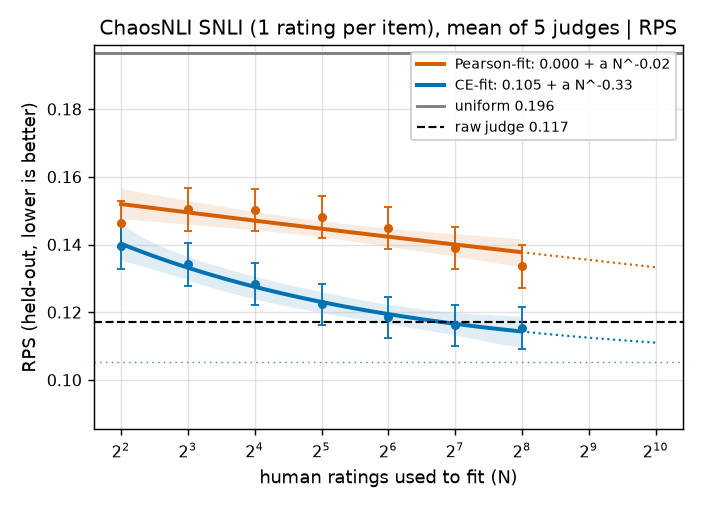 | 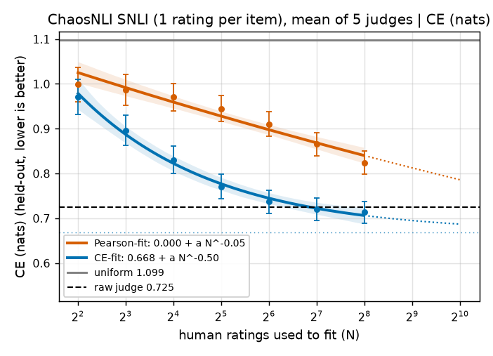 |

*Figure 1. ChaosNLI SNLI: held-out RPS (left) and CE (right) against the number of human ratings used to fit, N (lower is better; log x, grid on). Points with 95% error bars from the saved results; blue = CE, orange = Pearson; solid lines = fitted floor + a N^-b over the observed N, dotted = extrapolation to 4 times the largest N, band = 95% parametric-bootstrap band, dotted horizontal = fitted floor, grey = uniform, dashed = raw judge (Exp 29: untuned base model). Fitted RPS law, CE: floor 0.105 [0.000, 0.118], b 0.33 [0.04, 0.86]; Pearson: floor 0.000 [0.000, 0.062] (at 0 bound), b 0.02 [0.02, 0.04]. TVD file: [fit_exp28_tvd_chaosnli_snli_d1.png](figures/fit_exp28_tvd_chaosnli_snli_d1.png). Harness (Exp 28): five judges (GPT-6 Astra, Claude Opus 5.5, Kimi K3, GLM 5.3, DeepSeek V4.1 Flash) through the Stanford AI API Gateway, a 27-transform head fit by CE or by Pearson on N human ratings, held-out items; orchestration and analysis by Claude Sonnet 5.5 in Claude Code.*

| RPS | CE (nats) |
|---|---|
| 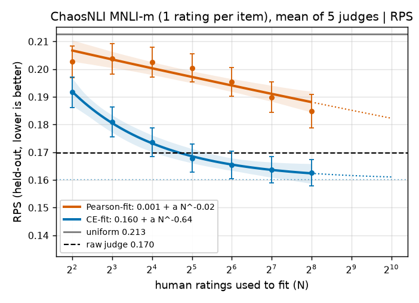 | 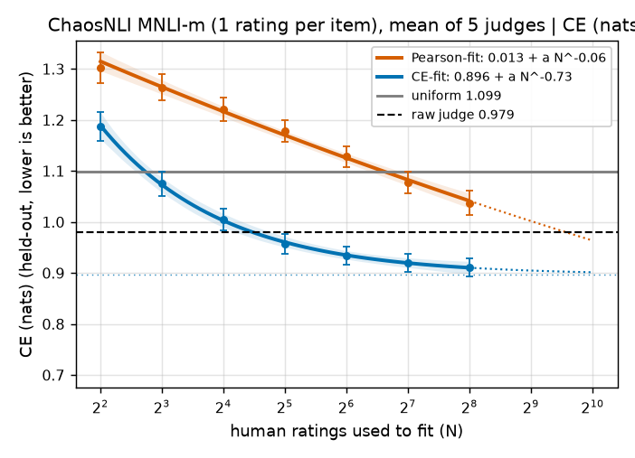 |

*Figure 2. ChaosNLI MNLI-m: held-out RPS (left) and CE (right) against the number of human ratings used to fit, N (lower is better; log x, grid on). Points with 95% error bars from the saved results; blue = CE, orange = Pearson; solid lines = fitted floor + a N^-b over the observed N, dotted = extrapolation to 4 times the largest N, band = 95% parametric-bootstrap band, dotted horizontal = fitted floor, grey = uniform, dashed = raw judge (Exp 29: untuned base model). Fitted RPS law, CE: floor 0.160 [0.147, 0.165], b 0.64 [0.28, 1.09]; Pearson: floor 0.001 [0.000, 0.063], b 0.02 [0.02, 0.03]. TVD file: [fit_exp28_tvd_chaosnli_mnli_d1.png](figures/fit_exp28_tvd_chaosnli_mnli_d1.png). Harness (Exp 28): five judges (GPT-6 Astra, Claude Opus 5.5, Kimi K3, GLM 5.3, DeepSeek V4.1 Flash) through the Stanford AI API Gateway, a 27-transform head fit by CE or by Pearson on N human ratings, held-out items; orchestration and analysis by Claude Sonnet 5.5 in Claude Code.*

| RPS | CE (nats) |
|---|---|
| 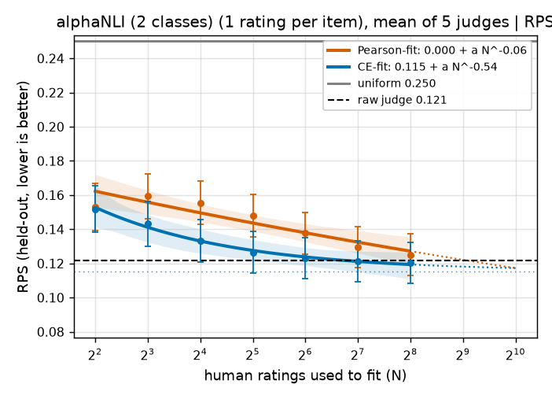 | 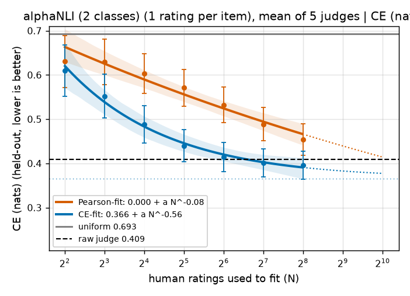 |

*Figure 3. alphaNLI (2 classes): held-out RPS (left) and CE (right) against the number of human ratings used to fit, N (lower is better; log x, grid on). Points with 95% error bars from the saved results; blue = CE, orange = Pearson; solid lines = fitted floor + a N^-b over the observed N, dotted = extrapolation to 4 times the largest N, band = 95% parametric-bootstrap band, dotted horizontal = fitted floor, grey = uniform, dashed = raw judge (Exp 29: untuned base model). Fitted RPS law, CE: floor 0.115 [0.000, 0.126], b 0.54 [0.05, 1.64]; Pearson: floor 0.000 [0.000, 0.106] (at 0 bound), b 0.06 [0.04, 0.21]. TVD file: [fit_exp28_tvd_chaosnli_alphanli_d1.png](figures/fit_exp28_tvd_chaosnli_alphanli_d1.png). Harness (Exp 28): five judges (GPT-6 Astra, Claude Opus 5.5, Kimi K3, GLM 5.3, DeepSeek V4.1 Flash) through the Stanford AI API Gateway, a 27-transform head fit by CE or by Pearson on N human ratings, held-out items; orchestration and analysis by Claude Sonnet 5.5 in Claude Code.*

| RPS | CE (nats) |
|---|---|
| 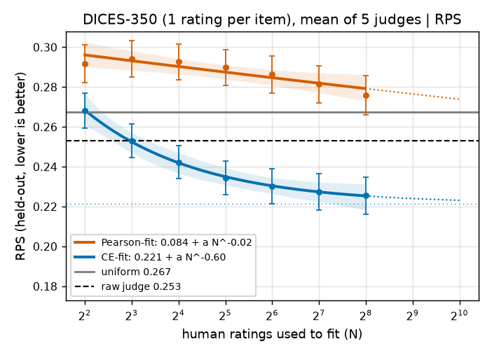 | 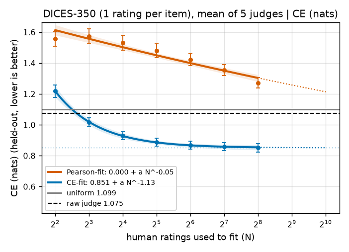 |

*Figure 4. DICES-350: held-out RPS (left) and CE (right) against the number of human ratings used to fit, N (lower is better; log x, grid on). Points with 95% error bars from the saved results; blue = CE, orange = Pearson; solid lines = fitted floor + a N^-b over the observed N, dotted = extrapolation to 4 times the largest N, band = 95% parametric-bootstrap band, dotted horizontal = fitted floor, grey = uniform, dashed = raw judge (Exp 29: untuned base model). Fitted RPS law, CE: floor 0.221 [0.180, 0.231], b 0.60 [0.18, 1.13]; Pearson: floor 0.084 [0.000, 0.278], b 0.02 [0.02, 0.37] (at 0.02 bound). TVD file: [fit_exp28_tvd_dices350_d1.png](figures/fit_exp28_tvd_dices350_d1.png). Harness (Exp 28): five judges (GPT-6 Astra, Claude Opus 5.5, Kimi K3, GLM 5.3, DeepSeek V4.1 Flash) through the Stanford AI API Gateway, a 27-transform head fit by CE or by Pearson on N human ratings, held-out items; orchestration and analysis by Claude Sonnet 5.5 in Claude Code.*

| RPS | CE (nats) |
|---|---|
| 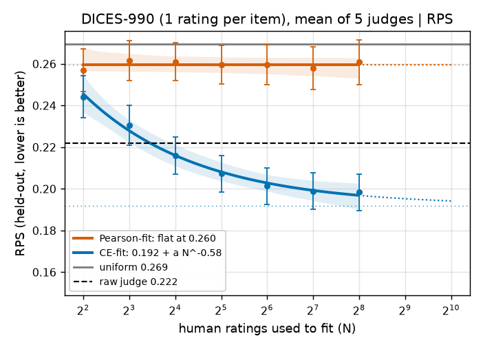 | 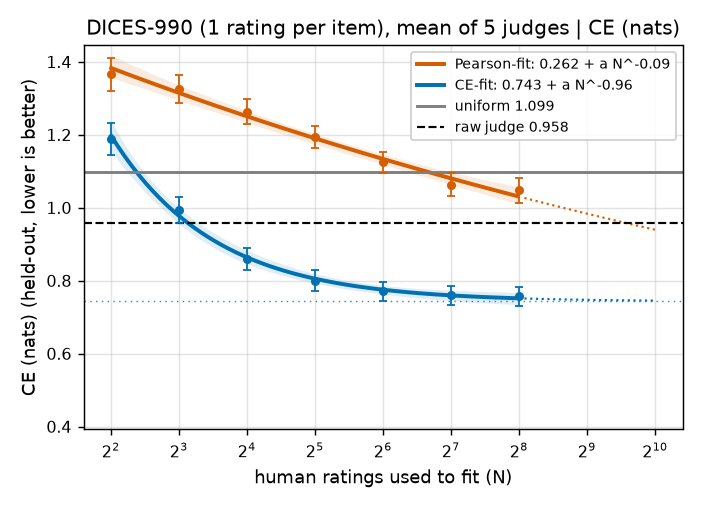 |

*Figure 5. DICES-990: held-out RPS (left) and CE (right) against the number of human ratings used to fit, N (lower is better; log x, grid on). Points with 95% error bars from the saved results; blue = CE, orange = Pearson; solid lines = fitted floor + a N^-b over the observed N, dotted = extrapolation to 4 times the largest N, band = 95% parametric-bootstrap band, dotted horizontal = fitted floor, grey = uniform, dashed = raw judge (Exp 29: untuned base model). Fitted RPS law, CE: floor 0.192 [0.159, 0.201], b 0.58 [0.21, 0.99]; Pearson: floor 0.260 [0.139, 0.263], b no decay (a = 0). TVD file: [fit_exp28_tvd_dices990_d1.png](figures/fit_exp28_tvd_dices990_d1.png). Harness (Exp 28): five judges (GPT-6 Astra, Claude Opus 5.5, Kimi K3, GLM 5.3, DeepSeek V4.1 Flash) through the Stanford AI API Gateway, a 27-transform head fit by CE or by Pearson on N human ratings, held-out items; orchestration and analysis by Claude Sonnet 5.5 in Claude Code.*

#### Exp 26, per judge (2 ratings per answer)

| RPS | CE (nats) |
|---|---|
| 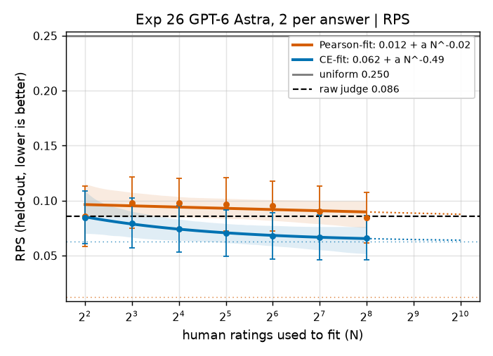 | 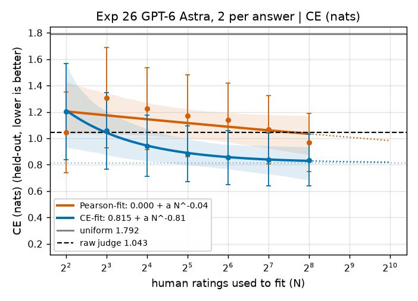 |

*Figure 6. GPT-6 Astra: held-out RPS (left) and CE (right) against the number of human ratings used to fit, N (lower is better; log x, grid on). Points with 95% error bars from the saved results; blue = CE, orange = Pearson; solid lines = fitted floor + a N^-b over the observed N, dotted = extrapolation to 4 times the largest N, band = 95% parametric-bootstrap band, dotted horizontal = fitted floor, grey = uniform, dashed = raw judge (Exp 29: untuned base model). Fitted RPS law, CE: floor 0.062 [0.000, 0.076], b 0.49 [0.02, 3.00]; Pearson: floor 0.012 [0.000, 0.099], b 0.02 [0.02, 3.00] (at 0.02 bound). TVD file: [fit_exp26_tvd_gpt-6-astra_rpa2.png](figures/fit_exp26_tvd_gpt-6-astra_rpa2.png). Harness (Exp 26): the same five judges through the Stanford AI API Gateway chat completions, CE-fit and Pearson-fit heads, 10 folds, analysis by ub9sc in Python (numpy, scipy).*

| RPS | CE (nats) |
|---|---|
| 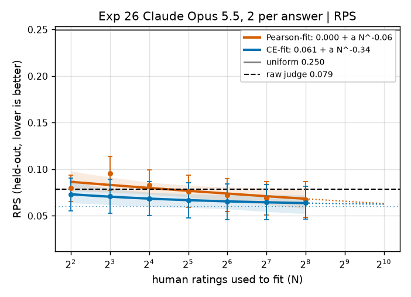 | 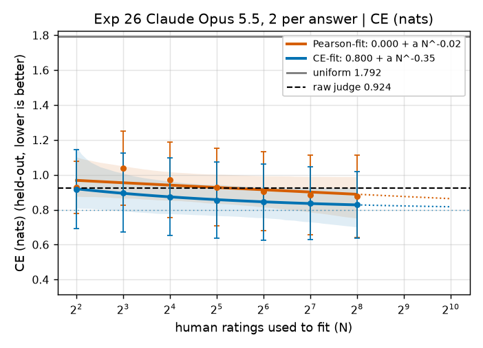 |

*Figure 7. Claude Opus 5.5: held-out RPS (left) and CE (right) against the number of human ratings used to fit, N (lower is better; log x, grid on). Points with 95% error bars from the saved results; blue = CE, orange = Pearson; solid lines = fitted floor + a N^-b over the observed N, dotted = extrapolation to 4 times the largest N, band = 95% parametric-bootstrap band, dotted horizontal = fitted floor, grey = uniform, dashed = raw judge (Exp 29: untuned base model). Fitted RPS law, CE: floor 0.061 [0.000, 0.072], b 0.34 [0.02, 3.00]; Pearson: floor 0.000 [0.000, 0.077] (at 0 bound), b 0.06 [0.02, 0.96]. TVD file: [fit_exp26_tvd_claude-opus-5-5_rpa2.png](figures/fit_exp26_tvd_claude-opus-5-5_rpa2.png). Harness (Exp 26): the same five judges through the Stanford AI API Gateway chat completions, CE-fit and Pearson-fit heads, 10 folds, analysis by ub9sc in Python (numpy, scipy).*

| RPS | CE (nats) |
|---|---|
| 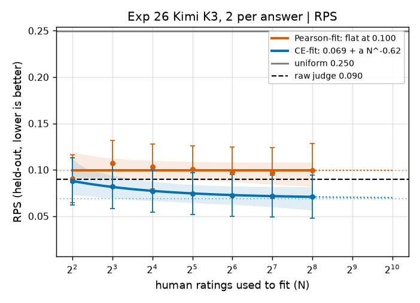 | 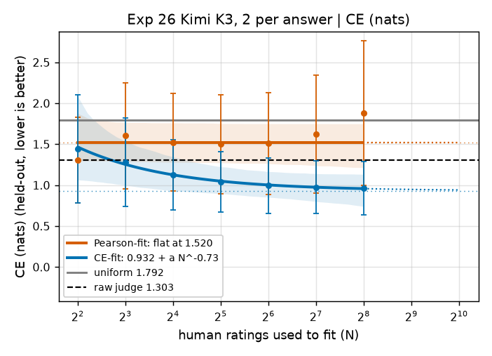 |

*Figure 8. Kimi K3: held-out RPS (left) and CE (right) against the number of human ratings used to fit, N (lower is better; log x, grid on). Points with 95% error bars from the saved results; blue = CE, orange = Pearson; solid lines = fitted floor + a N^-b over the observed N, dotted = extrapolation to 4 times the largest N, band = 95% parametric-bootstrap band, dotted horizontal = fitted floor, grey = uniform, dashed = raw judge (Exp 29: untuned base model). Fitted RPS law, CE: floor 0.069 [0.000, 0.081], b 0.62 [0.02, 3.00]; Pearson: floor 0.100 [0.000, 0.108], b no decay (a = 0). TVD file: [fit_exp26_tvd_kimi-k3_rpa2.png](figures/fit_exp26_tvd_kimi-k3_rpa2.png). Harness (Exp 26): the same five judges through the Stanford AI API Gateway chat completions, CE-fit and Pearson-fit heads, 10 folds, analysis by ub9sc in Python (numpy, scipy).*

| RPS | CE (nats) |
|---|---|
| 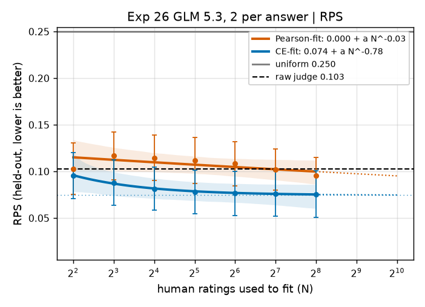 | 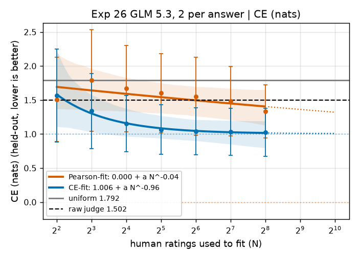 |

*Figure 9. GLM 5.3: held-out RPS (left) and CE (right) against the number of human ratings used to fit, N (lower is better; log x, grid on). Points with 95% error bars from the saved results; blue = CE, orange = Pearson; solid lines = fitted floor + a N^-b over the observed N, dotted = extrapolation to 4 times the largest N, band = 95% parametric-bootstrap band, dotted horizontal = fitted floor, grey = uniform, dashed = raw judge (Exp 29: untuned base model). Fitted RPS law, CE: floor 0.074 [0.000, 0.086], b 0.78 [0.02, 3.00]; Pearson: floor 0.000 [0.000, 0.111] (at 0 bound), b 0.03 [0.02, 3.00]. TVD file: [fit_exp26_tvd_glm-5.3_rpa2.png](figures/fit_exp26_tvd_glm-5.3_rpa2.png). Harness (Exp 26): the same five judges through the Stanford AI API Gateway chat completions, CE-fit and Pearson-fit heads, 10 folds, analysis by ub9sc in Python (numpy, scipy).*

| RPS | CE (nats) |
|---|---|
| 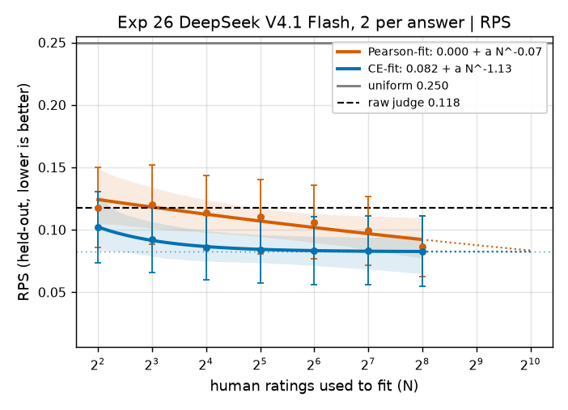 | 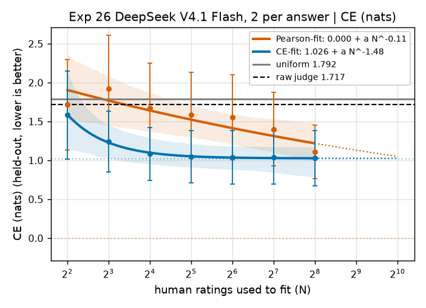 |

*Figure 10. DeepSeek V4.1 Flash: held-out RPS (left) and CE (right) against the number of human ratings used to fit, N (lower is better; log x, grid on). Points with 95% error bars from the saved results; blue = CE, orange = Pearson; solid lines = fitted floor + a N^-b over the observed N, dotted = extrapolation to 4 times the largest N, band = 95% parametric-bootstrap band, dotted horizontal = fitted floor, grey = uniform, dashed = raw judge (Exp 29: untuned base model). Fitted RPS law, CE: floor 0.082 [0.000, 0.093], b 1.13 [0.02, 3.00]; Pearson: floor 0.000 [0.000, 0.108] (at 0 bound), b 0.07 [0.02, 3.00]. TVD file: [fit_exp26_tvd_deepseek-v4.1-flash_rpa2.png](figures/fit_exp26_tvd_deepseek-v4.1-flash_rpa2.png). Harness (Exp 26): the same five judges through the Stanford AI API Gateway chat completions, CE-fit and Pearson-fit heads, 10 folds, analysis by ub9sc in Python (numpy, scipy).*

#### Exp 29, per LoRA panel

| RPS | CE (nats) |
|---|---|
| 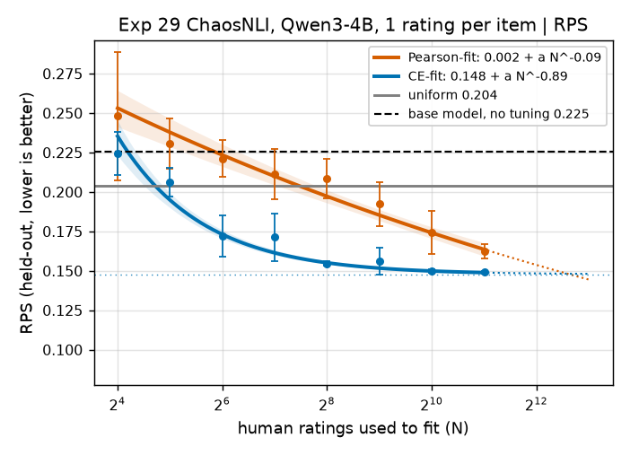 | 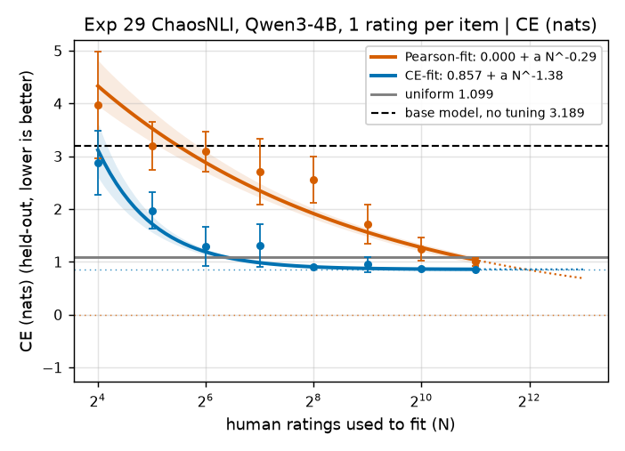 |

*Figure 11. ChaosNLI, Qwen3-4B: held-out RPS (left) and CE (right) against the number of human ratings used to fit, N (lower is better; log x, grid on). Points with 95% error bars from the saved results; blue = CE, orange = Pearson; solid lines = fitted floor + a N^-b over the observed N, dotted = extrapolation to 4 times the largest N, band = 95% parametric-bootstrap band, dotted horizontal = fitted floor, grey = uniform, dashed = raw judge (Exp 29: untuned base model). Fitted RPS law, CE: floor 0.148 [0.146, 0.149], b 0.89 [0.76, 0.99]; Pearson: floor 0.002 [0.000, 0.004], b 0.09 [0.08, 0.10]. TVD file: [fit_exp29_tvd_chaos3_qwen_d1.png](figures/fit_exp29_tvd_chaos3_qwen_d1.png). Harness (Exp 29): LoRA fine-tuning of Qwen3-4B-Instruct-2507 and Llama-3.1-8B with a CE or a Pearson objective (raw, no calibration), 10 nested draws, custom PyTorch/HF code on the lab cluster.*

| RPS | CE (nats) |
|---|---|
| 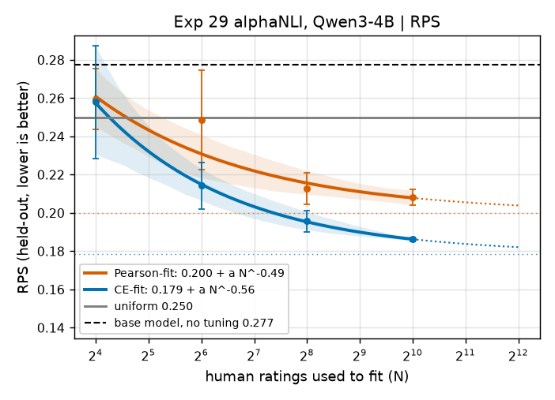 | 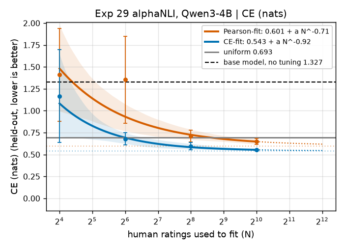 |

*Figure 12. alphaNLI, Qwen3-4B: held-out RPS (left) and CE (right) against the number of human ratings used to fit, N (lower is better; log x, grid on). Points with 95% error bars from the saved results; blue = CE, orange = Pearson; solid lines = fitted floor + a N^-b over the observed N, dotted = extrapolation to 4 times the largest N, band = 95% parametric-bootstrap band, dotted horizontal = fitted floor, grey = uniform, dashed = raw judge (Exp 29: untuned base model). Fitted RPS law, CE: floor 0.179 [0.117, 0.184], b 0.56 [0.13, 0.92]; Pearson: floor 0.200 [0.072, 0.210], b 0.49 [0.07, 1.17]. TVD file: [fit_exp29_tvd_alpha2_qwen_d1.png](figures/fit_exp29_tvd_alpha2_qwen_d1.png). Harness (Exp 29): LoRA fine-tuning of Qwen3-4B-Instruct-2507 and Llama-3.1-8B with a CE or a Pearson objective (raw, no calibration), 10 nested draws, custom PyTorch/HF code on the lab cluster.*

| RPS | CE (nats) |
|---|---|
| 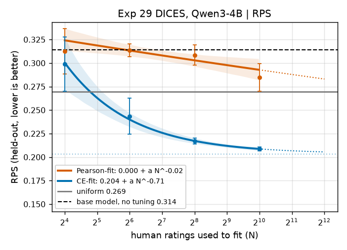 | 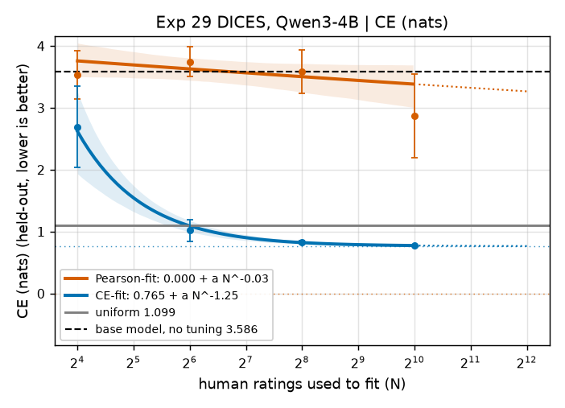 |

*Figure 13. DICES, Qwen3-4B: held-out RPS (left) and CE (right) against the number of human ratings used to fit, N (lower is better; log x, grid on). Points with 95% error bars from the saved results; blue = CE, orange = Pearson; solid lines = fitted floor + a N^-b over the observed N, dotted = extrapolation to 4 times the largest N, band = 95% parametric-bootstrap band, dotted horizontal = fitted floor, grey = uniform, dashed = raw judge (Exp 29: untuned base model). Fitted RPS law, CE: floor 0.204 [0.196, 0.208], b 0.71 [0.46, 0.96]; Pearson: floor 0.000 [0.000, 0.280] (at 0 bound), b 0.02 [0.02, 0.24]. TVD file: [fit_exp29_tvd_dices3_qwen_d1.png](figures/fit_exp29_tvd_dices3_qwen_d1.png). Harness (Exp 29): LoRA fine-tuning of Qwen3-4B-Instruct-2507 and Llama-3.1-8B with a CE or a Pearson objective (raw, no calibration), 10 nested draws, custom PyTorch/HF code on the lab cluster.*

| RPS | CE (nats) |
|---|---|
| 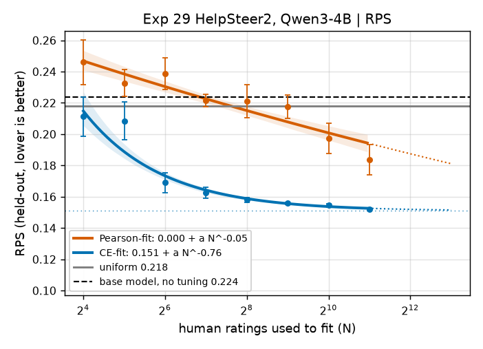 | 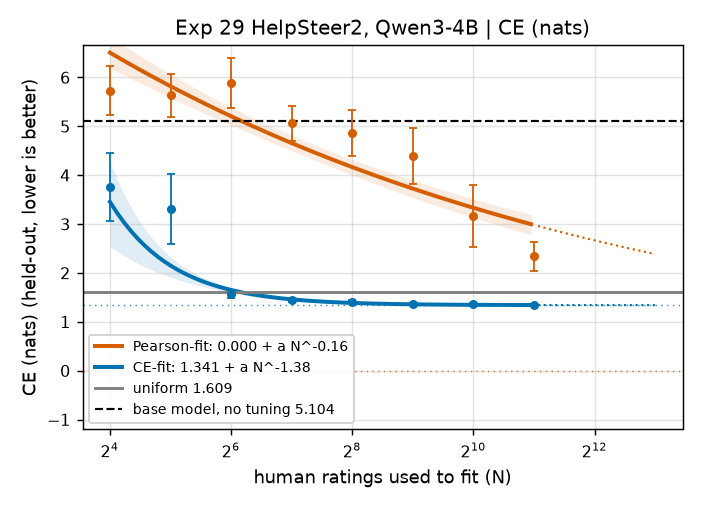 |

*Figure 14. HelpSteer2, Qwen3-4B: held-out RPS (left) and CE (right) against the number of human ratings used to fit, N (lower is better; log x, grid on). Points with 95% error bars from the saved results; blue = CE, orange = Pearson; solid lines = fitted floor + a N^-b over the observed N, dotted = extrapolation to 4 times the largest N, band = 95% parametric-bootstrap band, dotted horizontal = fitted floor, grey = uniform, dashed = raw judge (Exp 29: untuned base model). Fitted RPS law, CE: floor 0.151 [0.149, 0.152], b 0.76 [0.64, 0.89]; Pearson: floor 0.000 [0.000, 0.004] (at 0 bound), b 0.05 [0.04, 0.06]. TVD file: [fit_exp29_tvd_hs2_qwen_d1.png](figures/fit_exp29_tvd_hs2_qwen_d1.png). Harness (Exp 29): LoRA fine-tuning of Qwen3-4B-Instruct-2507 and Llama-3.1-8B with a CE or a Pearson objective (raw, no calibration), 10 nested draws, custom PyTorch/HF code on the lab cluster.*

| RPS | CE (nats) |
|---|---|
| 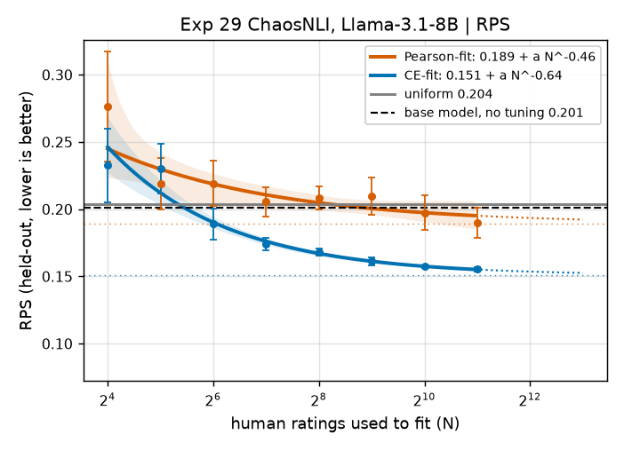 | 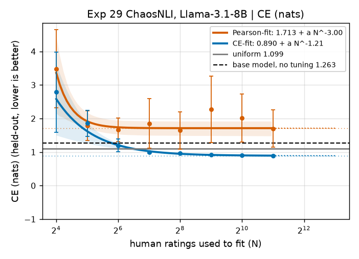 |

*Figure 15. ChaosNLI, Llama-3.1-8B: held-out RPS (left) and CE (right) against the number of human ratings used to fit, N (lower is better; log x, grid on). Points with 95% error bars from the saved results; blue = CE, orange = Pearson; solid lines = fitted floor + a N^-b over the observed N, dotted = extrapolation to 4 times the largest N, band = 95% parametric-bootstrap band, dotted horizontal = fitted floor, grey = uniform, dashed = raw judge (Exp 29: untuned base model). Fitted RPS law, CE: floor 0.151 [0.146, 0.154], b 0.64 [0.49, 0.78]; Pearson: floor 0.189 [0.000, 0.206], b 0.46 [0.03, 3.00]. TVD file: [fit_exp29_tvd_chaos3_llama_d1.png](figures/fit_exp29_tvd_chaos3_llama_d1.png). Harness (Exp 29): LoRA fine-tuning of Qwen3-4B-Instruct-2507 and Llama-3.1-8B with a CE or a Pearson objective (raw, no calibration), 10 nested draws, custom PyTorch/HF code on the lab cluster.*

| RPS | CE (nats) |
|---|---|
| 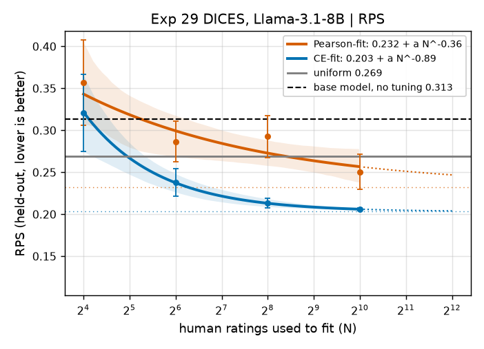 | 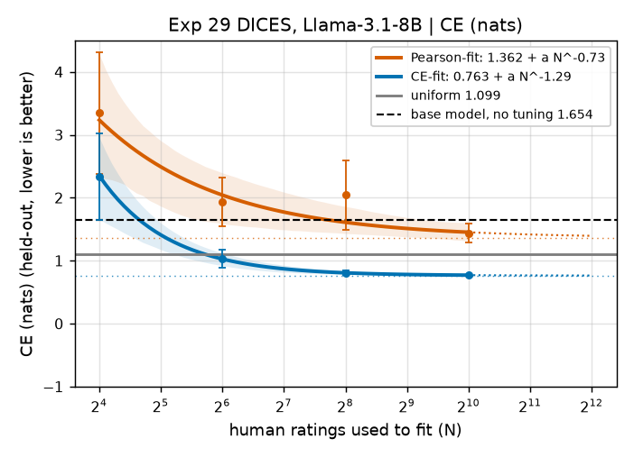 |

*Figure 16. DICES, Llama-3.1-8B: held-out RPS (left) and CE (right) against the number of human ratings used to fit, N (lower is better; log x, grid on). Points with 95% error bars from the saved results; blue = CE, orange = Pearson; solid lines = fitted floor + a N^-b over the observed N, dotted = extrapolation to 4 times the largest N, band = 95% parametric-bootstrap band, dotted horizontal = fitted floor, grey = uniform, dashed = raw judge (Exp 29: untuned base model). Fitted RPS law, CE: floor 0.203 [0.194, 0.206], b 0.89 [0.50, 1.29]; Pearson: floor 0.232 [0.000, 0.278], b 0.36 [0.04, 3.00]. TVD file: [fit_exp29_tvd_dices3_llama_d1.png](figures/fit_exp29_tvd_dices3_llama_d1.png). Harness (Exp 29): LoRA fine-tuning of Qwen3-4B-Instruct-2507 and Llama-3.1-8B with a CE or a Pearson objective (raw, no calibration), 10 nested draws, custom PyTorch/HF code on the lab cluster.*

