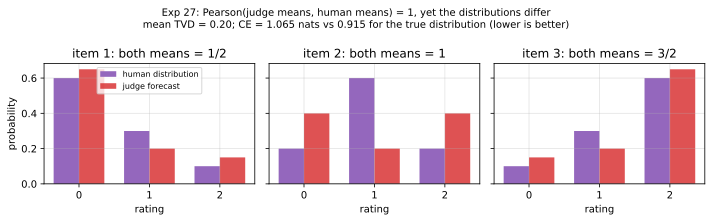
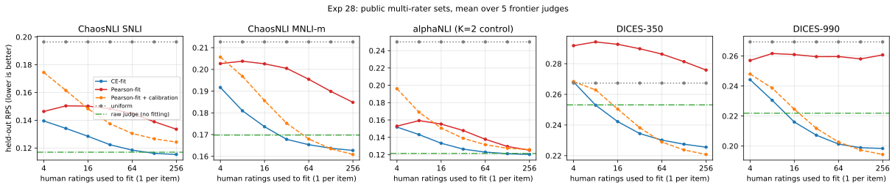
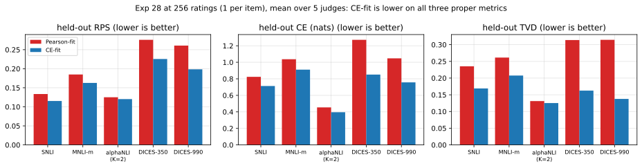
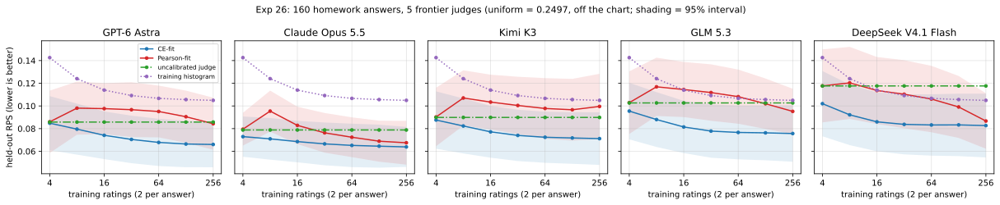
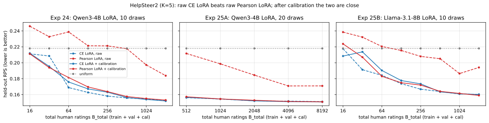
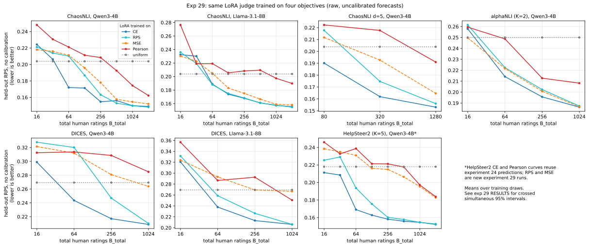

# CE-fit vs Pearson-fit judges: the results so far, in figures | 11-25-2026 | QA update 11-26-2026

**As of 11-26-2026:** corrections g6-H3, g6-M6 and g6-L3 retain the old wording beside each correction. Arithmetic is verified by [g6-H3](../../docs/qa_11-25-2026/phase2/verify_g6-H3.py) and the [remaining checks](../../docs/qa_11-25-2026/phase2/verify_g5_g6_remaining.py); existing figures and scored outputs are preserved.

**TL;DR.** When a judge is fit to human ratings by cross-entropy (CE) instead of by Pearson correlation, its held-out ranked probability score (RPS) is lower in almost every cell we ran: 25 of 25 set-by-judge cells on public multi-rater sets (experiment 28) and 7 of 7 LoRA setups without calibration (experiment 29) pass each experiment's significance test. The exceptions are real, though. With two to four training ratings Pearson-fit is sometimes better (11-25 text; corrected 11-26-2026: **18 of the 19 significant RPS wins use 10 ratings on two items; one uses four ratings on four items; no two-rating condition was tested**). A calibration step after Pearson training closes most of the LoRA gap. And on homework grades (experiment 26), CE-fit has the lower mean in 35 of 35 cells but passes the formal test for only two of five judges.

As of 11-25-2026; numbers read from the committed result files on `main` at `143ba39` (11-24-2026). Every figure is regenerated by [`make_figures.py`](make_figures.py) from those files; nothing is typed in by hand.

*Numbering: the pull request and commits that created this folder call it experiment 30. That number was already taken on `main` by [`30_ce_vs_pearson_summary_readable_figures_start_25Nov2026`](../30_ce_vs_pearson_summary_readable_figures_start_25Nov2026/README.md), so on 11-25-2026 this folder was renumbered to 32, as the repository's duplicate-number rule requires. Nothing else in the report changed.*

> [!IMPORTANT]
> **What "beats" means in this report.**
> 1. **Training objective.** *CE-fit* fits the judge by minimizing cross-entropy on training ratings; *Pearson-fit* fits the same judge by maximizing Pearson correlation between its expected score and the human mean on the same ratings. Within each comparison the model family, the search space or LoRA adapter, the search budget and the training ratings are matched.
> 2. **Evaluation data.** Scores are computed on held-out items the fit never saw: disjoint folds over items (or over SNLI premise images) in experiment 28, a held-out homework assignment (one of ten) in experiment 26, and group-disjoint test splits (by prompt or premise) in experiments 24, 25 and 29.
> 3. **Primary metric.** Held-out RPS: $\mathrm{RPS}(q,y)=\frac{1}{K-1}\sum_{k=1}^{K-1}\left(F_q(k)-\mathbf{1}[y\le k]\right)^{2}$, which runs from 0 to 1. Lower is better. Secondary metrics are held-out CE in nats and total variation distance $\mathrm{TVD}=\tfrac{1}{2}\sum_k \lvert h_k-q_k\rvert$. All three are scored against individual human ratings or the per-item human distribution. **Correlation is never the yardstick.**
> 4. **"Beats"** means *two* things together: a lower mean held-out RPS, **and** a pass on that experiment's pre-registered paired test (Pearson-fit RPS minus CE-fit RPS on the same items, where positive favors CE-fit). The tests are as follows.
>    1. Experiment 28: a one-sided 97.5% simultaneous (max-t) bootstrap lower bound across all budgets, with 4,000 resamples of held-out items. Both contrasts, vs Pearson-fit and vs uniform, must clear zero from the break-even budget upward.
>    2. Experiment 26: a descending test from 256 ratings, with a one-sided lower bound at $\alpha=0.01$ per judge vs Pearson-fit and vs uniform (a fold t interval across ten homework folds). It stops at the first failure.
>    3. Experiments 24, 25 and 29: simultaneous 95% max-t cluster-bootstrap bands with 4,000 resamples. *Conditional* bands resample held-out prompts; the stricter *crossed* bands also resample training draws.
> 5. Everywhere else, **"lower mean"** means only a lower point estimate, and **"significantly lower"** means the test above passed.

## 1. Why correlation can't be the target (experiment 27)

**Figure 1 correction (11-26-2026), g6-L3:** expected RPS is **107/600 versus 49/300**, CE is **1.0647350947 versus 0.9153873296 nats**, and TVD is **0.20 versus 0**, for the changed-shape forecast versus the true distribution. Pearson correlation of means is **1** for both. No fitting or sampling is involved.

*Historical caption (11-25-2026; retained with the metric-first correction above). Figure 1. The exact three-item counterexample from the [experiment 27 preprint](../27_correlation_identification_preprint_23Nov2026/README.md). The judge forecast (red) has exactly the human mean on every item, so the Pearson correlation of means is 1, yet its distribution is wrong: mean TVD 0.20, and CE 1.065 vs 0.915 nats for the true distribution. No fitting and no sampling are involved; the numbers are exact arithmetic recomputed in `make_figures.py`.*

Pearson correlation sees only the expected score, and only up to level and scale. Any two forecasts with the same means look identical to it, however wrong their spread or shape. CE and RPS are proper scoring rules: their expectation is minimized only at the true human distribution. That is the theoretical reason to fit by CE. The figures below test whether it matters with finite data.

## 2. Public multi-rater sets, five frontier judges (experiment 28)

*Figure 2. Held-out RPS against the number of human ratings used to fit (one per item, log2 axis), averaged over five frontier judges: GPT-6 Astra, Claude Opus 5.5, Kimi K3, GLM 5.3 and DeepSeek V4.1 Flash. Each judge stays frozen; only a 27-transform calibration head is fit, by CE or by Pearson, using an exhaustive search over the same 27 settings. Results are averaged over 5 folds and 200 training draws. Source: [`28_.../results/scores_absolute.csv`](../28_public_rating_sets_chaosnli_dices_frontier_judges_ce_vs_pearson_start_23Nov2026/results/scores_absolute.csv) and `raw_judge_scores.csv`.*

1. **CE-fit vs Pearson-fit.** CE-fit is significantly lower than both Pearson-fit and uniform in all 25 set-by-judge cells, from a break-even of 4 to 8 ratings (one per item) or 10 to 20 (five per item). Out of 325 comparison cells, Pearson-fit has a lower mean in 25 (3 at 4 ratings with one per item, 22 at 10 ratings with five per item, that is, two training items) and is significantly lower in 19, all at those smallest budgets.
2. **The K=2 control (alphaNLI).** With two categories the mean identifies the distribution, so the gap here comes from level and scale, which Pearson ignores, rather than from shape. CE-fit still wins (break-even 4 to 8 ratings).
3. **Limits.**
   1. The raw judge with no fitting (green) is already strong on ChaosNLI. CE-fit's mean RPS is lower only at larger budgets, and per the experiment's own summary it is significantly lower for only some judge-set pairs, from a break-even of 8 to 256 ratings depending on set and judge. For the remaining pairs it never is within 256.
   2. Pearson-fit followed by distribution calibration on the same ratings (orange) has a lower mean than CE-fit on DICES from 64 ratings upward (11-25 text; corrected 11-26-2026: **DICES-350 from 64, DICES-990 from 128**; at 64, DICES-990 calibrated-Pearson RPS is **0.2026600**, versus CE-fit **0.2013280**, so calibrated Pearson is **0.0013320 worse**), which shows that what helps is the distribution-fitting step, not the correlation step.
   3. ChaosNLI SNLI and MNLI-m are subsets chosen for human disagreement, so these break-even sizes may not carry over to easier items.

*Figure 3. The same comparison at 256 ratings (one per item) on all three proper metrics, mean over five judges. CE-fit has the lower mean on RPS, CE and TVD on every set. Using the same simultaneous test against Pearson-fit, a break-even budget (at most 8 ratings) is reached in 25 of 25 cells on CE and in 23 of 25 cells on TVD ([`metric_agreement.csv`](../28_public_rating_sets_chaosnli_dices_frontier_judges_ce_vs_pearson_start_23Nov2026/results/metric_agreement.csv)).*

## 3. Fresh homework grades, five frontier judges (experiment 26)

*Figure 4. 160 University of North Texas homework answers, two human grades each, on a 0 to 5 scale (K=6), with one homework assignment held out per fold (ten folds). The y-axis is held-out RPS; the x-axis is training ratings on a log2 axis. The method is the same frozen judge plus a 27-transform head as in experiment 28. Shading is the 95% interval of each method's mean across folds; the formal test uses paired fold differences, which are tighter. Source: [`26_.../results/new5/scores.csv`](../26_five_new_frontier_judges_on_fresh_homework_and_independent_recheck_start_23Nov2026/results/new5/scores.csv) and `decisions.csv`.*

1. **Lower mean:** CE-fit has a lower mean RPS than Pearson-fit in 35 of 35 judge-by-budget cells. At 256 ratings: GPT-6 Astra 0.0660 vs 0.0843, Claude Opus 5.5 0.0639 vs 0.0675, Kimi K3 0.0712 vs 0.0996, GLM 5.3 0.0757 vs 0.0952, DeepSeek V4.1 Flash 0.0827 vs 0.0867.
2. **Significantly lower (descending test):** this passes from 256 down to 8 ratings for GPT-6 Astra and Kimi K3 only, and fails at 4 for both. It fails at 256 for Claude Opus 5.5, GLM 5.3 and DeepSeek V4.1 Flash, so their smaller budgets are descriptive only.
3. **Earlier run:** [Experiment 21](../21_fresh_task_families_matched_open_closed_judges_start_21Nov2026/README.md), on the same answers with two other judges, found Qwen3.5-9B passing at every budget from 4 ratings and Claude Sonnet 5 passing at none. At 256 ratings both of Claude Sonnet 5's fits chose the same setting in 1,981 of 2,000 fits (RPS 0.0778 vs 0.0779). For Qwen, the training-grade histogram had a lower mean RPS than CE-calibrated Qwen at all seven budgets.

## 4. Training the judge's weights: LoRA on HelpSteer2 (experiments 24 and 25)

*Figure 5. HelpSteer2 (K=5, held-out test split of 1,038 responses / 519 prompts). LoRA weights are trained with CE or with Pearson on matched data. Dashed lines are raw forecasts; solid lines add a post-hoc calibration fit on a separate calibration split. The x-axis is total human ratings $B_{\mathrm{total}}$ (train + validation + calibration) on a log2 axis. Means are over 10 or 20 nested training draws. Sources: [`24_.../results/scores.csv`](../24_trained_open_weight_judge_helpsteer2_ce_vs_pearson_start_21Nov2026/results/scores.csv) and [`25_.../results/scores.csv`](../25_helpsteer2_lora_scale_and_second_family_ce_vs_pearson_start_21Nov2026/results/scores.csv).*

1. **Raw forecasts:** the Pearson-trained LoRA's mean RPS sits far above the CE-trained one's at every budget. The experiment 29 rerun (Section 5) makes this a significant result on HelpSteer2: the crossed simultaneous 95% band is entirely above zero.
2. **After calibration the gap mostly closes.**
   1. Qwen3-4B, experiment 24, at $B_{\mathrm{total}}=2048$: 0.15200 vs 0.15309, a difference of +0.00110 favoring CE (p=0.0177; conditional threshold 512). Under the crossed test there is no significant win at any tested budget.
   2. Qwen3-4B, experiment 25A, at 8,192: 0.15080 vs 0.15089, crossed p=1.00.
   3. Llama-3.1-8B, experiment 25B, at 2,048: Pearson's mean is lower, 0.15893 vs CE's 0.16005, but not significantly (crossed p=0.85).
3. **Reading:** the calibration step relearns most of the distribution that Pearson training leaves out, at least on HelpSteer2.

## 5. Four training objectives on the same LoRA judge (experiment 29)

*Figure 6. The same LoRA judges (Qwen3-4B, Llama-3.1-8B) trained with CE, RPS, mean squared error (MSE) or Pearson, showing raw held-out RPS on log2 $B_{\mathrm{total}}$. The data are ChaosNLI (K=3, one or five ratings per item), alphaNLI (K=2 control), DICES (K=3) and HelpSteer2 (K=5), with group-disjoint splits. Source: [`29_.../results/scores.csv`](../29_four_objectives_lora_and_shape_control_chaosnli_dices_helpsteer2_start_23Nov2026/results/scores.csv).*

1. **Raw, at the largest budget:** CE and RPS training are significantly lower than Pearson training in 7 of 7 setups. Pearson-minus-CE differences run from +0.013 to +0.076 RPS, and every crossed simultaneous 95% band is above zero.
2. **MSE** is in between. Raw CE is significantly lower than raw MSE in 5 of 6 setups with $K\ge 3$. At K=2, raw MSE is not significantly different from raw CE (+0.00034, interval includes zero), as the shape argument predicts.
3. **With calibration** the picture is mixed. A (K+2)-parameter logit calibration rescues Pearson on some suites but not on DICES. Even so, CE plus logit calibration stays significantly lower than Pearson plus logit calibration on ChaosNLI with one rating per item, for both Qwen (+0.00293) and Llama (+0.00205). The difference is not significant with five ratings per item.

## 6. Caveats to keep attached to every claim

1. **Very few labels.** With 2 to 4 training ratings, Pearson-fit is sometimes better (19 of 325 significant cells in experiment 28, mostly at two training items) (11-25 text; corrected 11-26-2026: **18 wins at 10 ratings on two items, one at four ratings on four items; no two-rating condition**). At four ratings in experiment 26, CE-fit is not significantly better on RPS for four of five judges.
2. **Calibration closes much of the gap.** Pearson-trained LoRA plus calibration matches CE-trained LoRA on HelpSteer2 (Llama 0.159 vs 0.160, p=0.85). Pearson-fit plus calibration beats CE-fit on DICES from 64 ratings in experiment 28 (11-25 text; corrected 11-26-2026: **the five-judge mean RPS crosses at 64 for DICES-350 and 128 for DICES-990**; some individual judges differ).
3. **Raw frontier judges are strong** on ChaosNLI, and the disagreement-heavy subsets may overstate the value of fitting.
4. **Independence.** Experiments 02, 09, 10 and 20 reuse the same 75 retrospective VeriBench artifacts and ratings, so they are not independent replications and are not plotted here. Experiment 29's HelpSteer2 CE and Pearson curves reuse experiment 24's predictions. Parts of the experiment 29 test items (265 of 713 ChaosNLI, 110 of 412 alphaNLI, 172 of 300 DICES) were scored by frontier judges in experiment 28, though the LoRA weights never saw them.
5. **Data coverage.** Experiment 26 is one course with two graders, so its ten folds are dependent.

## Files

1. `REPORT.md`: this file.
2. `make_figures.py`: regenerates every figure from the sibling experiment folders (`python3 make_figures.py`; needs numpy, pandas and matplotlib).
3. `figures/*.svg`: the six figures, saved as SVG so they render on GitHub. The script also writes same-content PNG copies locally.

TLDR-end: CE-fit's held-out RPS is significantly lower than Pearson-fit's in 25/25 public-set cells (experiment 28) and in 7/7 raw LoRA setups (experiment 29). On homework grades it is lower in mean in 35/35 cells but significant only for GPT-6 Astra and Kimi K3. With calibration after Pearson training, or with 2 to 4 ratings, the advantage shrinks or vanishes (11-25 text; corrected 11-26-2026: **four ratings on four items or 10 ratings on two items**).

---
*AI assistance: figures, script and text drafted by Grok Bot for Brando Miranda from the committed result files of experiments 21 and 24 to 29; all numbers come from those files or are recomputed from them.*
