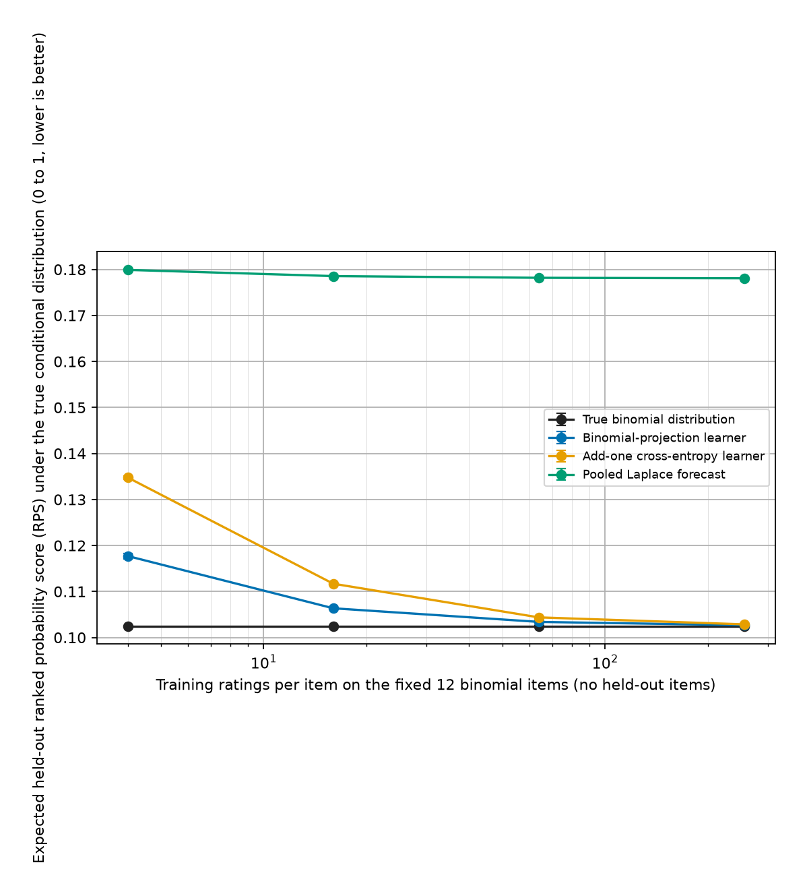
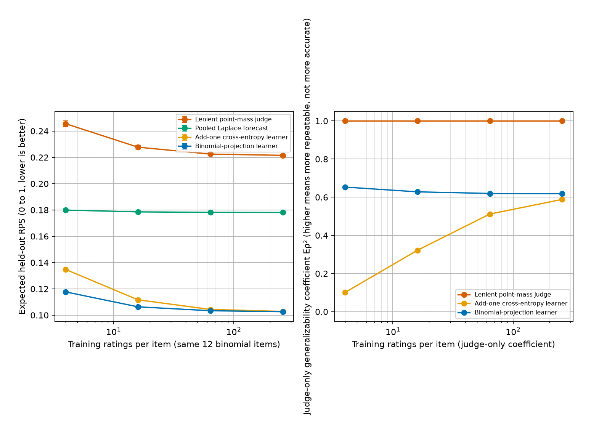
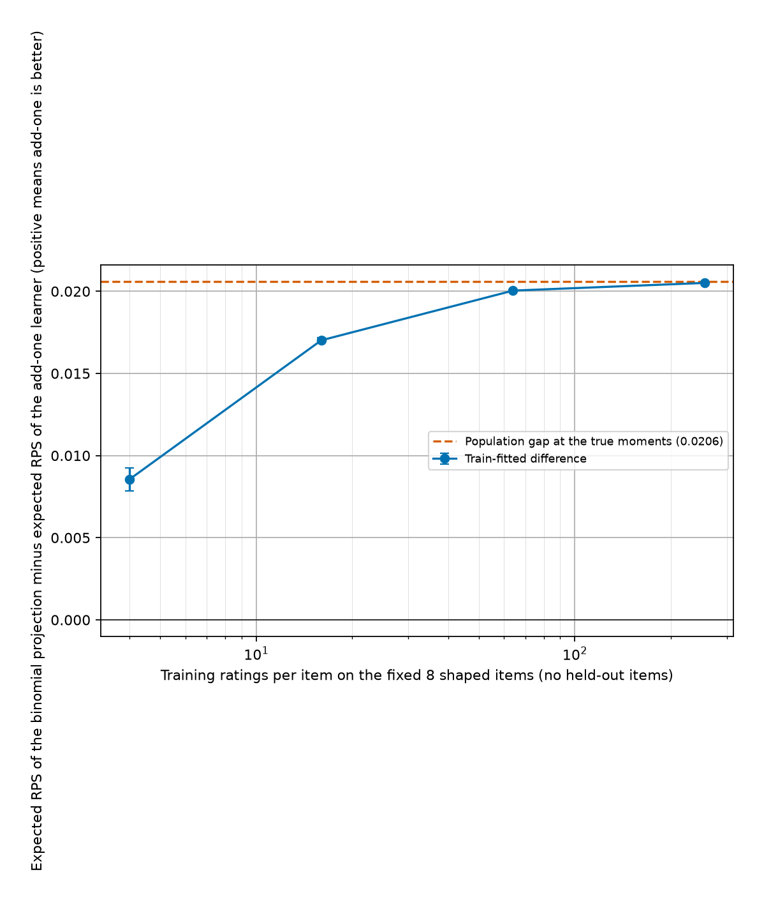
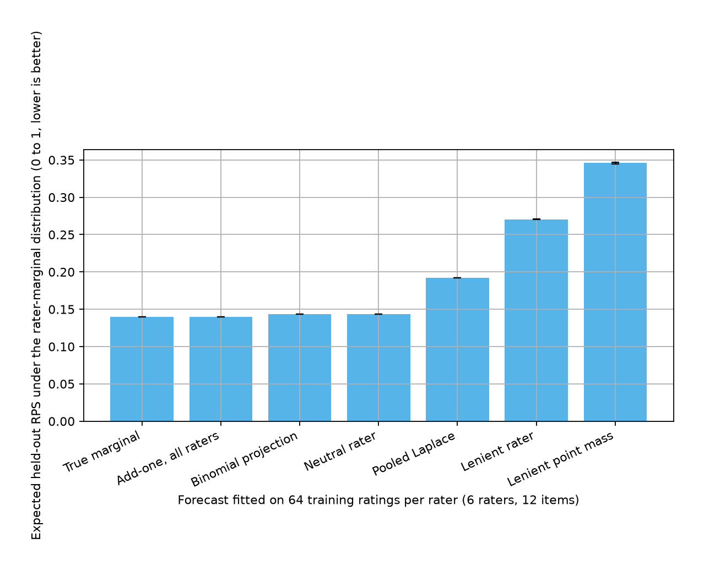

# Experiment 34: where generalizability theory agrees with cross-entropy, and where it does not

**Doc link:** <https://github.com/brando90/judges-dont-need-psychometrics-or-corr/blob/main/experiments/34_g_d_theory_vs_ce_where_reliability_agrees_and_fails_start_25Nov2026/results.md>

**TLDR:** On known ordinal rating distributions, a generalizability coefficient and an absolute dependability coefficient agree with cross-entropy when the conditional distribution is a binomial, and when one is only ranking noisy raters. They do not replace a proper score. A lenient point-mass judge has judge-only reliability 1 and Pearson 0.961, and its expected ranked probability score (RPS) is worse than a constant forecast by 0.0492 [0.0477, 0.0506]. A same-mean, same-variance shape change leaves both coefficients unchanged and leaves a 0.0205 RPS gap that cross-entropy closes.

**As of:** 11-25-2026 (America/Los_Angeles). **Status:** COMPLETE. Local CPU, 32.2 seconds, $0, no model calls, no human ratings.

Google Doc: <https://docs.google.com/document/d/1QbJYWT1rrRFSQFFZpncQt6pN7xAl9wKHlR06xpvQMS0/edit> (shared with brando.science@gmail.com as a commenter; this connector cannot set anyone-with-the-link). Read [HOW_TO_READ_RESULTS.md](HOW_TO_READ_RESULTS.md) before the tables. Pass/fail cuts were written in [preregistered_criteria.json](preregistered_criteria.json) before the Monte Carlo output was read and were not edited afterward.

## Bottom line

Nicole's question was whether generalizability theory (G-theory) or decision study / dependability theory (D-theory) is needed once a judge can be trained by cross-entropy (CE) or another proper score. The conjecture was that CE learns the full conditional rating distribution, while G-theory and D-theory only decompose variance and reliability.

Both halves are supported on these synthetic items, and they answer different questions.

- **Where they agree.** If every item is Binomial(5, θ), the mean identifies the distribution. At 256 training ratings per item, expected RPS of the binomial-projection learner minus expected RPS of the add-one CE learner is −0.000187 [−0.000194, −0.000181]. The gap is inside the pre-registered ±0.01 band. Both beat the pooled Laplace forecast by about 0.075 RPS. Among stochastic raters, the highest population generalizability coefficient belongs to a neutral rater, and selecting that rater from the ratings beats the constant forecast.
- **Where reliability fails.** A lenient point-mass judge, one category above the training mean, has judge-only generalizability coefficient Eρ² = 1 and dependability coefficient Φ = 1. At 16 training ratings its expected RPS minus the pooled Laplace forecast is +0.0492 [0.0477, 0.0506] (positive means the constant forecast is better), on 400/400 replications. Its Pearson correlation of means is 0.961 [0.959, 0.962]. Selecting the forecast with the highest Eρ² picks this judge in 400/400 replications. Selecting by validation RPS never picks it and beats the constant forecast by 0.0721 RPS.
- **Where matched variance is not enough.** Eight items were built so that a non-binomial distribution matches the binomial mean and variance exactly. Population Eρ² and Φ therefore match. At 256 training ratings, expected RPS of the binomial projection minus expected RPS of the add-one learner is +0.0205 [0.0205, 0.0205]. Smoothed CE differs by +0.690 nats and total variation distance (TVD) by +0.486. The projection still beats the constant forecast, because it gets the mean right.
- **What this does not say.** Experiment [04_g_theory_reliability_vs_distribution_accuracy_start_13Nov2026](../04_g_theory_reliability_vs_distribution_accuracy_start_13Nov2026/RESULTS_reliability_vs_accuracy.md) already showed that variance components can choose how many raters versus occasions to collect. This experiment does not repeat that design question and does not say those coefficients are useless for planning a rating study.

## Which data

Twelve fixed items in the binomial and leniency settings, θ = (j+1)/14 for j = 0…11. Eight fixed items in the shape setting, j = 2…9. No items are held out. Every Monte Carlo replication draws new training ratings from the known conditional distribution. The reported RPS, CE, and TVD are expectations of the train-fitted forecast under that known distribution, so they are risks for new ratings of the same items. They are not in-sample scores of the training ratings. Nothing here was a human rating, and nothing was used in an earlier experiment.

The multi-rater setting uses the same twelve binomial items and six raters: four neutral, one lenient (scores clipped two categories up), and one harsh (clipped two categories down). The target distribution is the equal-rater mixture, (4 × neutral + lenient + harsh) / 6.

## Metrics

| Metric | Definition | Range | Better | Reference on the 12 binomial items |
| --- | --- | --- | --- | --- |
| Ranked probability score (RPS) | Mean over items of the expected normalized individual-rating RPS, (1/5) Σ_{k=0}^{4} (F(k) − 1{y ≤ k})² | 0 to 1 | Lower | True binomial 0.102440. Pooled frequency 0.178049 |
| Cross-entropy (CE) | Mean over items of E[−ln q(y)]. Tables use the experiment 02 floor: q is replaced by (1 − 6×10⁻⁶) q + 10⁻⁶ before the log | Nats, 0 to ∞ | Lower | True binomial, unsmoothed, 1.312262. A point mass that misses support has unsmoothed CE = ∞ |
| Total variation distance (TVD) | Mean over items of 0.5 Σ_y \|q(y) − p(y)\| against the known conditional distribution, not against a test histogram | 0 to 1 | Lower | 0 for the true distribution |
| Bias | Forecast mean minus true conditional mean, averaged over items. Positive means the forecast is lenient | Rating points, −5 to 5 | Near 0 | Lenient point mass, population, +1.011905 (forecast mean 3.333333, true mean 2.321429) |
| Eρ² | Generalizability coefficient v_u / (v_u + v_e). v_u is the variance of item means with divisor equal to the number of items | 0 to 1 when defined | Higher means more repeatable, not more accurate | Neutral binomial panel 0.617978 |
| Φ | Dependability coefficient. For a single source it equals Eρ². In a two-source panel it also charges the source main effect | 0 to 1 when defined | Higher means more dependable levels, not a proper score | See the joint panel below |

Pearson, Spearman, and Kendall τ-b compare forecast means with true means across the fixed items. A constant forecast has undefined correlations. A zero denominator in a coefficient is undefined, not perfect reliability.

## How each forecast was chosen

- **Add-one CE learner.** Per item, q(y) = (count_y + 1) / (n + 6). This is the unique minimizer of categorical cross-entropy plus a Dirichlet(1) penalty. Closed form. No iterative optimizer. The optimum is guaranteed.
- **Binomial-projection learner.** θ = mean / 5, clipped to [0.02, 0.98], then Binomial(5, θ). For a binomial sample this is the maximum likelihood estimator. It matches the mean and implies the variance. Closed form.
- **Pooled Laplace forecast.** The same add-one formula on all items pooled. One distribution for every item. This is the constant forecast.
- **Lenient point-mass judge.** A point mass at clip(round-half-up(training mean) + 1, 0, 5) in the leniency setting, and at clip(round-half-up(lenient rater's training mean), 0, 5) in the multi-rater setting. Round-half-up is floor(x + 0.5), not Python's half-to-even round. Closed form.
- **Validation-RPS selection.** At 16 training ratings and 16 disjoint validation ratings per item, pick the candidate with the lowest mean individual-rating RPS on the validation counts. Ties break in the order add-one, binomial projection, pooled Laplace, lenient point. The reverse order was also run; it selected the same forecasts.
- **Maximum Eρ² selection.** Pick the candidate whose own predictive distribution has the highest generalizability coefficient. A point mass has within-item variance 0, so the coefficient is 1 whenever the locations are not all equal.

Uncertainty for every Monte Carlo mean is a Student-t 95% interval over 400 independent replications (399 degrees of freedom). The resampling unit is the replication: new training ratings, and new validation ratings where a selection uses them. Items, raters' laws, and the true distributions stay fixed. The p-value is a two-sided one-sample t test of the null that the mean difference is 0. When SciPy returns 0 because the statistic underflowed, the table says p < 1e-300. A coefficient that is identical in every replication has p-val=n/a. No multiplicity correction was applied. The pass/fail cuts are only those in `preregistered_criteria.json`. Other rows are descriptive.

## Setting 0: binomial items, where the mean is enough

Population values, no sampling. The binomial projection at the true mean is the true distribution. Oracle expected RPS 0.102440. Pooled frequency expected RPS 0.178049. Unsmoothed CE 1.312262 versus 1.768873 nats.

Expected RPS of the train-fitted forecast. Lower is better. Brackets are 95% t intervals over 400 replications.

| Training ratings per item | True binomial | Binomial projection | Add-one CE | Pooled Laplace |
| --- | ---: | ---: | ---: | ---: |
| 4 | 0.102440 | 0.117712 [0.117120, 0.118304] | 0.134779 [0.134429, 0.135130] | 0.179897 [0.179764, 0.180030] |
| 16 | 0.102440 | 0.106354 [0.106190, 0.106518] | 0.111694 [0.111527, 0.111861] | 0.178552 [0.178515, 0.178589] |
| 64 | 0.102440 | 0.103396 [0.103359, 0.103433] | 0.104376 [0.104327, 0.104425] | 0.178180 [0.178171, 0.178190] |
| 256 | 0.102440 | 0.102673 [0.102663, 0.102684] | 0.102861 [0.102849, 0.102873] | 0.178081 [0.178079, 0.178083] |

At 4 ratings, expected RPS of the binomial projection minus expected RPS of the add-one learner is −0.017067 [−0.017622, −0.016512], p = 5.50×10⁻²⁰³, better for the projection in 397/400 replications. The one-parameter model is more efficient when it is correct.

At 256 ratings, that same difference is −0.000187 [−0.000194, −0.000181], p = 2.43×10⁻¹⁹⁹. It does not cover 0. It does lie inside the pre-registered agreement band of ±0.01. Expected RPS of the add-one learner minus the pooled Laplace forecast is −0.075220 [−0.075231, −0.075209], p < 1e-300.



*Figure 1.* Expected held-out RPS under the true binomial conditional distribution, fixed 12 items, 400 replications. The add-one learner minimizes categorical cross-entropy plus a Dirichlet(1) penalty in closed form. The binomial projection matches the training mean. The pooled Laplace forecast ignores the item. Lower is better. Gridlines are on. The vertical bars are 95% t intervals over replications and are thinner than the markers at the right-hand side.

## Setting 1: leniency, where judge-only reliability fails

The lenient point-mass judge puts probability 1 on a score one category above the rounded training mean. Population, using the true means: expected RPS 0.226209 against the true binomial, pooled frequency 0.178049, TVD 0.750224, smoothed CE 10.364725 nats, unsmoothed CE infinite. Bias +1.011905. Pearson 0.974928, Spearman 0.977008, Kendall τ-b 0.921132. Judge-only Eρ² = Φ = 1.

A joint panel that includes the human source and this point-mass judge, one draw from a random source, has Eρ² 0.764852 and Φ 0.681426. The absolute coefficient is lower because the source main effect is 0.505952 rating points. Judge-only reliability never sees that shift. Absolute Φ sees it only when the human ratings are in the same panel, and even then Φ is not a proper score of the conditional distribution.

| Quantity at 16 training ratings | Lenient point mass | Pooled Laplace | Add-one CE |
| --- | ---: | ---: | ---: |
| Expected RPS | 0.227735 [0.226292, 0.229177] | 0.178552 [0.178515, 0.178589] | 0.111694 [0.111527, 0.111861] |
| Smoothed CE (nats) | 10.353090 [10.327050, 10.379130] | 1.778671 | 1.444784 |
| TVD | 0.749382 [0.747497, 0.751266] | 0.384395 | 0.176171 |
| Bias, forecast minus true | +0.998155 [0.988017, 1.008292] | +0.005996 | +0.049140 |
| Pearson / Spearman / Kendall τ-b | 0.960708 / 0.964452 / 0.898382 | undefined | 0.983314 / 0.984704 / 0.941580 |
| Judge-only Eρ² | 1 exactly | 0 exactly | 0.322008 |

Expected RPS of the lenient point mass minus expected RPS of the pooled Laplace forecast, at 16 ratings: +0.049183 [0.047743, 0.050622], p = 1.48×10⁻²¹⁹, positive in 400/400 replications. The same difference for smoothed CE is +8.574 [8.548, 8.600] nats and for TVD is +0.3650 [0.3630, 0.3670]. At 256 ratings the RPS difference is still +0.043466 [0.042714, 0.044219], Pearson is 0.974026 [0.973763, 0.974288], and the bias is +0.972946 [0.967153, 0.978740].

Selection at 16 training ratings and 16 validation ratings, 400 replications:

| Rule | Forecast chosen | Expected RPS of the chosen forecast minus pooled Laplace |
| --- | --- | ---: |
| Highest judge-only Eρ² | Lenient point mass in 400/400 | +0.049183 [0.047743, 0.050622] |
| Lowest validation RPS | Binomial projection in 390/400, add-one in 10/400, lenient point mass in 0/400 | −0.072127 [−0.072293, −0.071960] |

The reverse tie-break selected the same 390 and 10 forecasts. The validation rule's Wilson 95% interval for the proportion that picks the lenient point mass is [0, 0.0095].



*Figure 2.* Left: expected held-out RPS on the same 12 binomial items. Right: judge-only Eρ² of the fitted forecast. The lenient point mass is the most repeatable forecast and the worst RPS, above the pooled Laplace line. The add-one learner is properly uncertain at 4 ratings, so its judge-only coefficient is low while its RPS is already better than the constant forecast. Lower RPS is better. Higher Eρ² is more repeatable, not more accurate.

One traced item, index 6, θ = 0.5, replication 0, 16 training ratings. True probabilities: 0.03125, 0.15625, 0.3125, 0.3125, 0.15625, 0.03125. Training counts: 1, 0, 6, 4, 4, 1. Add-one forecast: 0.0909, 0.0455, 0.3182, 0.2273, 0.2273, 0.0909. Lenient point mass: a spike at 4. The training mean is 2.8125, round-half-up is 3, plus one is 4.

## Setting 2: same mean and variance, different shape

For each of eight binomial distributions the script enumerates all 20 vertices of the probability simplex with floor 1/100 and the same sum, mean, and second moment. The ranked probability score gap is convex, so the maximum on that polytope is attained at a vertex. The shaped distribution is that vertex. Mean absolute difference of means versus the matching binomial: below 10⁻⁸. Same for variances. Absolute difference of Eρ²: 1.11×10⁻¹⁶.

Population expected RPS: shaped truth 0.083473, binomial with the same mean 0.104049, pooled frequency of the shaped items 0.149040. The mean vertex RPS excess is 0.020576.

| Training ratings per item | Shaped truth | Add-one CE | Binomial projection | Pooled Laplace |
| --- | ---: | ---: | ---: | ---: |
| 4 | 0.083473 | 0.113968 [0.113394, 0.114542] | 0.122517 [0.121424, 0.123610] | 0.151231 [0.151028, 0.151433] |
| 16 | 0.083473 | 0.092018 [0.091775, 0.092260] | 0.109031 [0.108739, 0.109324] | 0.149669 [0.149618, 0.149721] |
| 64 | 0.083473 | 0.085139 [0.085081, 0.085197] | 0.105180 [0.105086, 0.105274] | 0.149204 [0.149188, 0.149220] |
| 256 | 0.083473 | 0.083826 [0.083814, 0.083839] | 0.104334 [0.104296, 0.104372] | 0.149080 [0.149077, 0.149084] |

At 256 ratings, binomial projection minus add-one: RPS +0.020508 [0.020476, 0.020541], p < 1e-300, positive in 400/400; smoothed CE +0.689846 [0.689685, 0.690007] nats; TVD +0.486076 [0.485578, 0.486575]. At 4 ratings the RPS difference is already positive, +0.008549 [0.007832, 0.009266], p = 5.25×10⁻⁷⁷, but only in 363/400 replications. The population gap is not reached until the add-one learner has enough counts to see the shape.



*Figure 3.* Expected RPS of the binomial-projection learner minus expected RPS of the add-one learner on the eight shaped items. Positive means the add-one learner is better. The dashed line is the population gap, 0.020576, between the matching binomial and the shaped truth. The learners are closed-form fits on training ratings only.

## Setting 3: six raters, and a sharp copy of the lenient facet

Population own-source Eρ²: neutral 0.617978, lenient facet 0.587170, harsh facet 0.536109, lenient point mass 1. Population expected RPS against the rater-marginal target: truth 0.139585, neutral facet 0.143804, pooled frequency 0.191923, harsh facet 0.273479, lenient facet 0.288927, lenient point mass 0.347638. The most reliable stochastic source is the neutral rater, and that source beats the constant forecast. The lenient facet is still fairly reliable, 0.587, and it loses to the constant forecast. The point mass is perfectly reliable and loses by more.

At 64 training ratings per rater, expected RPS [95% interval]:

| Forecast | RPS | Smoothed CE (nats) | TVD |
| --- | ---: | ---: | ---: |
| True rater-marginal | 0.139585 | 1.527905 | 0 |
| Add-one on all six raters | 0.139818 [0.139813, 0.139824] | 1.533176 [1.533080, 1.533272] | 0.036246 [0.035868, 0.036624] |
| Neutral rater 0, add-one | 0.143250 [0.143196, 0.143305] | 1.618332 [1.617077, 1.619587] | 0.149666 [0.148486, 0.150847] |
| Binomial projection of the pooled ratings | 0.143636 [0.143627, 0.143645] | 1.632946 [1.632903, 1.632988] | 0.170095 [0.169933, 0.170257] |
| Pooled Laplace | 0.191942 [0.191941, 0.191943] | 1.785459 [1.785432, 1.785485] | 0.274461 [0.274397, 0.274526] |
| Harsh rater, add-one | 0.254253 [0.253864, 0.254643] | 2.585707 [2.582557, 2.588857] | 0.521667 [0.520731, 0.522604] |
| Lenient rater, add-one | 0.270376 [0.270008, 0.270744] | 2.751001 [2.747984, 2.754018] | 0.559887 [0.558989, 0.560785] |
| Lenient point mass | 0.345844 [0.344950, 0.346739] | 11.189812 [11.184566, 11.195058] | 0.809946 [0.809566, 0.810325] |

Lenient point mass minus pooled Laplace, RPS: +0.153902 [0.153007, 0.154797]. Add-one on all raters minus pooled Laplace: −0.052124 [−0.052129, −0.052118]. Neutral rater 0 minus pooled Laplace: −0.048692 [−0.048746, −0.048637]. Lenient rater minus pooled Laplace: +0.078434 [0.078065, 0.078802].

Analysis-of-variance Eρ² on each rater's own 64 ratings, negative components clipped to 0 before the ratio, selected a neutral rater in 400/400 replications at 64 ratings and again at 256. The selected neutral forecast's expected RPS minus the pooled Laplace forecast at 64 ratings is −0.048549 [−0.048603, −0.048494]. Adding the lenient point mass to that pool makes maximum Eρ² select the point mass in 400/400 replications, and that choice is worse than the constant forecast by the +0.153902 above.



*Figure 4.* Expected held-out RPS under the rater-marginal distribution at 64 training ratings per rater. The add-one learner uses every rater. The lenient point mass uses only the lenient rater's mean. Lower is better. Bars are 95% t intervals over 400 replications.

## Checks

Hard checks, all passed, in [qa/hard_checks.json](qa/hard_checks.json): the experiment 04 oracle RPS 0.11670795387394607 is reproduced to 10⁻⁹; an independent RPS loop matches; the true distribution minimizes RPS on a traced item; shaped and binomial moments and coefficients match; every shaped item has RPS excess above 0.01; identical sources give equal joint Eρ² and Φ; a constant location shift makes joint Φ strictly smaller than joint Eρ²; the same seed repeats and the next replication differs; overwriting a test array does not change a fit that received only training counts.

Pre-registered Monte Carlo cuts, 28/28 passed, in [qa/criteria_checks.json](qa/criteria_checks.json). A second run of the same script produced a byte-identical `results/summary.json`.

The evaluator check at 16 training ratings and 32 disjoint test ratings per item: sample RPS minus exact expected RPS of the add-one learner is −0.000261 [−0.000578, 0.000055], p = 0.105. The interval covers 0.

Software: Python 3.12.3, NumPy 2.5.5, SciPy 1.18.1, Matplotlib 3.11.2. Generator: NumPy PCG64 from `SeedSequence([20261125, scenario, n_train, replication, stream])`.

## Limits

The items are a fixed synthetic set. The intervals do not cover a new task, a new rater population, or a language-model judge. The lenient point mass is a constructed forecast, not a trained network. Add-one CE is penalized cross-entropy, not the unregularized maximum likelihood estimator; at 256 ratings the distinction is the 0.000187 RPS gap in Setting 0. Smoothed CE uses the floor 10⁻⁶ so that a point mass has a finite number; unsmoothed CE of that point mass is infinite. Experiment 04 remains the result on using variance components to allocate raters and occasions. This result is about whether those coefficients can select or replace a forecast of the conditional rating distribution.

## Reproduce

```bash
python3 experiments/34_g_d_theory_vs_ce_where_reliability_agrees_and_fails_start_25Nov2026/run_experiment.py
```

**TLDR-end:** [judge objectives: G/D versus CE] On known ordinal distributions, reliability agrees with cross-entropy for a binomial and for ranking noisy raters, and a lenient point mass with reliability 1 loses to a constant forecast by 0.049 RPS while a same-moment shape change leaves a 0.021 RPS gap that cross-entropy closes.
