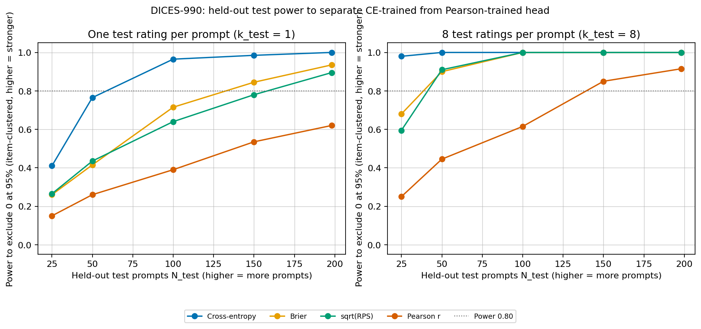
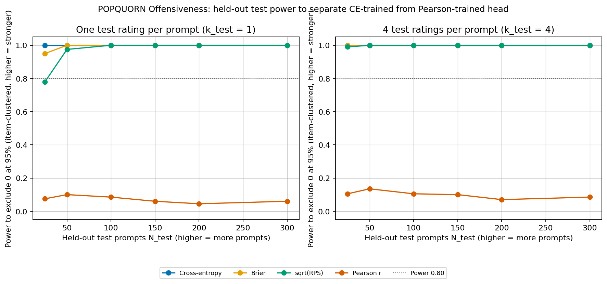

# Results summary — Sanmi distributional pitch (11-26-2026)

**As of 11-26-2026.**

**Bottom line.** Lean 4.36.0 checks the algebraic claims with no `sorry`. Python checks the same claims numerically, including 0.50 versus \(\sqrt{1/2}\) for the anti-proper correlation. All real multi-annotator datasets — SummEval, ChaosNLI, DICES-350/990, POPQUORN (Offensiveness and Politeness), and VeriBench FSC (`R_v1`, live-synced `native_main`, and pooled) — plus real CertJudge LLM judge panels (`E63`, `E39`, `Exp 67`) are scored and summarized below.

## Formally proved (Lean) and numerically checked

Binary witness, four paired items: Pearson correlation of the calibrated probabilities and of the affine map \(0.1q+0.45\) are both 1.000. Mean Brier 0.0800 versus 0.4418. Mean cross-entropy 0.2231 versus 0.6349 nats. Anti-proper Monte Carlo (n=200000): correlation of the true sampled judge 0.5002 (theory 0.5) and of \(0.1\mu+4\) 0.7074 (theory \(\sqrt{1/2}\approx 0.7071\)). Ordinal witness: both laws have mean 2.0; \(D_B=1.5\); normalized RPS gap 0.2000; cross-entropy of the split forecast on the consensus outcome is infinite.

Theorem names and the axiom printout are in `lean_check.txt`. The numerical assertions are `proofs_numeric.py` (every check returned ok).

## What the held-out numbers say

Cross-entropy, Brier, and RPS heads land on nearly the same held-out proper scores across all large ordinal and 3-class sets, while Pearson collapses conditional variance and blows up held-out cross-entropy (SummEval expert 1.210 vs 4.731, DICES-990 0.743 vs 1.164, ChaosNLI SNLI+MNLI 1.053 vs 4.022, POPQUORN Offensiveness 1.298 vs 4.996, POPQUORN Politeness 1.528 vs 9.547, VeriBench FSC R_v1 1.737 vs 11.011, VeriBench FSC native_main 1.267 vs 8.238, VeriBench FSC pooled 1.276 vs 6.869). The CE-trained head beats the Pearson-trained head on held-out CE, sqrt(RPS), and Brier on 9 of 9 ordinal and 3-class views. On the binary threshold views the gap is small, and the Pearson-trained head's held-out CE is not worse on: `popquorn_politeness_binary` CE-trained 0.652 vs Pearson-trained 0.646 (`chaosnli_alpha` is the near-log-2 negative control). On small-sample 6-class VeriBench subsets (`veribench_fsc_native_main` with 20 test items and `veribench_fsc_rv1_expert3` with 15 test items), the RPS-trained softmax puts near-zero probability on rare/unobserved classes, giving higher held-out CE (3.084 on native_main) than CE-trained (1.267) while matching on sqrt(RPS) (0.737 vs 0.740). The MSE two-point readout has infinite cross-entropy on every K≥3 set because off-support ratings receive probability 0; on K=2 binary views MSE is finite on 6 of 7 binary views, while on `popquorn_politeness_binary` ridge predictions hit 0/1 on an item yielding CE +inf (lowest Brier 0.4429) and Pearson (0.646) overlaps CE (0.652) within 95% CIs. On DICES-990, splitting each test prompt's raters in half gives a within-prompt oracle, not a deployable judge. A draw from the add-one distribution of the first half has correlation 0.190 with the second half. The collapsed score 0.1·mean+4 has correlation 0.410. Held-out-half cross-entropy is 0.6764 versus 6.7936, and Brier is 0.3881 versus 0.9835. Higher correlation, worse proper scores.

## CertJudge real LLM judge panels (`cert-judge@f6047849`, `$0` extra API spend)

These are real open-weight and frontier LLM judges evaluated on VeriBench functional semantic correctness (FSC, 0–5 integer scale), bridged directly from verified `cert-judge` Experiment 67 & 68 artifacts:

### 1. CertJudge Experiment 63 (`Qwen3-8B` native 6-class probabilities on VeriBench FSC `R_v1` held-out test, 30 items / 10 tasks)

| Training / prompting arm | `all5` CE [95% CI] | `all5` RPS [95% CI] | `all5` Spearman | `expert3` CE | `expert3` RPS | `expert3` Spearman |
| --- | --- | --- | --- | --- | --- | --- |
| `zero_shot_base` | 4.178 [2.896, 5.635] | 0.264 [0.187, 0.348] | -0.162 | 5.071 | 0.312 | -0.165 |
| `prompt_opt_arm1` | 3.964 [2.772, 5.314] | 0.292 [0.194, 0.404] | -0.181 | 4.710 | 0.338 | -0.184 |
| `rl_grpo` | 5.556 [3.740, 7.464] | 0.213 [0.151, 0.288] | 0.543 | 6.260 | 0.237 | 0.565 |
| `teacher_only_sft` | 1.741 [1.404, 2.056] | 0.157 [0.118, 0.195] | 0.710 | 1.658 | 0.149 | 0.772 |
| `human_mix_sft` | 1.620 [1.277, 1.937] | 0.142 [0.100, 0.184] | 0.746 | 1.392 | 0.114 | 0.828 |
| `shuffled_control` | 1.831 [1.679, 1.957] | 0.185 [0.155, 0.220] | -0.039 | 1.962 | 0.198 | 0.024 |

Key finding on real `Qwen3-8B` weights: `rl_grpo` reaches Spearman `0.543` (`all5`) / `0.565` (`expert3`), yet blows up held-out CE to `5.556` / `6.260` (worse than `shuffled_control` CE `1.831` / `1.962`). Training with cross-entropy (`human_mix_sft`) achieves the lowest CE (`1.620` / `1.392`), lowest RPS (`0.142` / `0.114`), and highest Spearman (`0.746` / `0.828`).

### 2. CertJudge Experiment 39 (56 LLM judge configs on 45 held-out VeriBench FSC `R_v1` items / 15 tasks, `all5`)

- **All 56 LLM configs:** mean raw CE `1.9128`, `CE-fit` mean CE `1.6428` vs `Pearson-fit` mean CE `1.6621` (`CE-fit` beats `Pearson-fit` on CE in **48/56** configs and on RPS in **40/56** configs: mean RPS `0.1536` vs `0.1547`).
- **Strictly held-out `test` split (18 LLM configs):** `CE-fit` mean CE `1.6175` vs `Pearson-fit` `1.6400` (`CE-fit` wins CE in **16/18**, RPS in **12/18**).

### 3. CertJudge Experiment 67 Interim (3 headline judges × 3 repeats on 100 `native_main` VeriBench artifacts / 25 tasks, 250 ratings)

| Judge family | `dRPS` (CE-fit minus Pearson-fit) [95% CI] | `dCE` (CE-fit minus Pearson-fit) [95% CI] | `dTVD` (CE-fit minus Pearson-fit) [95% CI] |
| --- | --- | --- | --- |
| Codex | -0.0077 [-0.0172, 0.0031] | -0.1437 [-0.2756, -0.0012] | -0.0585 [-0.1081, -0.0021] |
| Claude Opus | -0.0077 [-0.0167, 0.0023] | -0.1483 [-0.2816, -0.0075] | -0.0478 [-0.1003, 0.0108] |
| Qwen3-Coder | -0.0073 [-0.0164, 0.0029] | -0.1403 [-0.2691, 0.0021] | -0.0517 [-0.1043, 0.0049] |

## Real multi-annotator results (this machine)

Proper-score cells are the unbiased prompt-average of per-rating losses. Pearson r is the correlation of the judge's scalar with individual ratings, item-clustered bootstrap. Spearman and Kendall use prompt-level human means.

### summeval_expert

SummEval expert annotations on four aspects (coherence, consistency, fluency, relevance), native grades 1–5 stored as class values [1,2,3,4,5]. Every summary has [3] expert annotation records. The jsonl does not publish a stable rater id, so rater_id is the within-item vote index, not a person. Split group is the source article (filepath), so every system and aspect of one article stays in one split. Binary views use the pre-registered cut grade ≥ 4.

Split by prompt group, seed 0: train 3840, validation 1280, test 1280. SVD components used: 24. Intervals are item-clustered percentile 95% intervals, B draws in `results.json`.

| Objective | CE | sqrt(RPS) | Brier | norm. RPS | Pearson r | Spearman rho | Kendall tau |
| --- | --- | --- | --- | --- | --- | --- | --- |
| ce-trained | 1.210 [1.171, 1.247] | 0.749 [0.731, 0.764] | 0.615 [0.595, 0.634] | 0.1402 | 0.253 | 0.331 | 0.238 |
| brier-trained | 1.213 [1.174, 1.251] | 0.750 [0.733, 0.766] | 0.617 [0.597, 0.636] | 0.1408 | 0.256 | 0.345 | 0.247 |
| rps-trained | 1.213 [1.174, 1.251] | 0.750 [0.732, 0.765] | 0.617 [0.597, 0.636] | 0.1405 | 0.245 | 0.309 | 0.223 |
| pearson-trained | 4.731 [4.509, 4.961] | 0.998 [0.994, 1.002] | 0.905 [0.883, 0.929] | 0.2490 | 0.225 | 0.272 | 0.196 |
| mse-trained | +inf [undefined, undefined] | 0.902 [0.887, 0.918] | 1.291 [1.266, 1.316] | 0.2035 | 0.220 | 0.274 | 0.197 |

Uniform forecast held-out test CE 1.6094. Train-marginal forecast held-out test CE 1.2210. CE head refit after shuffling train features: held-out test CE 1.2217.

### summeval_expert_binary

Binary view of summeval_expert: class 1 iff the original value ≥ 4. This is a threshold of the same ratings, not a separately collected binary task. SummEval expert annotations on four aspects (coherence, consistency, fluency, relevance), native grades 1–5 stored as class values [1,2,3,4,5]. Every summary has [3] expert annotation records. The jsonl does not publish a stable rater id, so rater_id is the within-item vote index, not a person. Split group is the source article (filepath), so every system and aspect of one article stays in one split. Binary views use the pre-registered cut grade ≥ 4.

Split by prompt group, seed 0: train 3840, validation 1280, test 1280. SVD components used: 24. Intervals are item-clustered percentile 95% intervals, B draws in `results.json`.

| Objective | CE | sqrt(RPS) | Brier | norm. RPS | Pearson r | Spearman rho | Kendall tau |
| --- | --- | --- | --- | --- | --- | --- | --- |
| ce-trained | 0.575 [0.556, 0.593] | 0.440 [0.430, 0.449] | 0.387 [0.370, 0.404] | 0.1934 | 0.200 | 0.254 | 0.195 |
| brier-trained | 0.576 [0.558, 0.593] | 0.440 [0.431, 0.450] | 0.388 [0.371, 0.404] | 0.1939 | 0.200 | 0.253 | 0.194 |
| rps-trained | 0.578 [0.560, 0.596] | 0.441 [0.432, 0.451] | 0.390 [0.373, 0.407] | 0.1948 | 0.201 | 0.254 | 0.195 |
| pearson-trained | 0.689 [0.686, 0.693] | 0.498 [0.496, 0.500] | 0.496 [0.492, 0.500] | 0.2481 | 0.202 | 0.257 | 0.197 |
| mse-trained | 0.567 [0.549, 0.585] | 0.436 [0.427, 0.446] | 0.381 [0.364, 0.398] | 0.1904 | 0.193 | 0.247 | 0.189 |

Uniform forecast held-out test CE 0.6931. Train-marginal forecast held-out test CE 0.5819. CE head refit after shuffling train features: held-out test CE 0.5814.

### chaosnli_snli_mnli

Pooled ChaosNLI-SNLI and ChaosNLI-MNLI-matched. ChaosNLI SNLI or MNLI-matched, 3 classes, 100 votes per item in the author files. label_count order is entailment, neutral, contradiction. Ranked probability score uses that order as an imposed order (entailment < neutral < contradiction); it is not a native Likert scale. rater_id is a within-item vote index expanded from the counts, not a person. Each uid is its own split group. Item counts by file are kept distinct by the group prefix.

Split by prompt group, seed 0: train 1867, validation 622, test 624. SVD components used: 24. Intervals are item-clustered percentile 95% intervals, B draws in `results.json`.

| Objective | CE | sqrt(RPS) | Brier | norm. RPS | Pearson r | Spearman rho | Kendall tau |
| --- | --- | --- | --- | --- | --- | --- | --- |
| ce-trained | 1.053 [1.040, 1.068] | 0.627 [0.619, 0.634] | 0.637 [0.629, 0.647] | 0.1963 | 0.078 | 0.111 | 0.074 |
| brier-trained | 1.053 [1.040, 1.068] | 0.627 [0.619, 0.634] | 0.638 [0.629, 0.647] | 0.1964 | 0.081 | 0.114 | 0.076 |
| rps-trained | 1.054 [1.041, 1.068] | 0.627 [0.619, 0.634] | 0.638 [0.630, 0.647] | 0.1965 | 0.082 | 0.114 | 0.076 |
| pearson-trained | 4.022 [3.867, 4.176] | 0.711 [0.707, 0.715] | 0.940 [0.919, 0.962] | 0.2530 | 0.086 | 0.118 | 0.078 |
| mse-trained | +inf [undefined, undefined] | 0.694 [0.682, 0.706] | 0.903 [0.872, 0.934] | 0.2409 | 0.063 | 0.079 | 0.052 |

Uniform forecast held-out test CE 1.0986. Train-marginal forecast held-out test CE 1.0569. CE head refit after shuffling train features: held-out test CE 1.0554.

### chaosnli_alpha

ChaosNLI abductive NLI, native two-option labels. The release stores counts, not person ids; rater_id is the within-item vote index obtained by expanding label_count. Order is option 1 then option 2. Each item is its own split group.

Split by prompt group, seed 0: train 919, validation 306, test 307. SVD components used: 24. Intervals are item-clustered percentile 95% intervals, B draws in `results.json`.

| Objective | CE | sqrt(RPS) | Brier | norm. RPS | Pearson r | Spearman rho | Kendall tau |
| --- | --- | --- | --- | --- | --- | --- | --- |
| ce-trained | 0.696 [0.692, 0.699] | 0.501 [0.500, 0.503] | 0.502 [0.499, 0.506] | 0.2512 | -0.057 | -0.064 | -0.045 |
| brier-trained | 0.696 [0.692, 0.699] | 0.501 [0.500, 0.503] | 0.502 [0.499, 0.506] | 0.2512 | -0.058 | -0.064 | -0.045 |
| rps-trained | 0.694 [0.692, 0.696] | 0.501 [0.500, 0.502] | 0.501 [0.499, 0.503] | 0.2505 | -0.049 | -0.057 | -0.040 |
| pearson-trained | 0.696 [0.689, 0.703] | 0.501 [0.498, 0.505] | 0.503 [0.496, 0.510] | 0.2514 | -0.034 | -0.049 | -0.036 |
| mse-trained | 0.708 [0.699, 0.718] | 0.507 [0.503, 0.512] | 0.515 [0.506, 0.524] | 0.2573 | -0.083 | -0.087 | -0.060 |

Uniform forecast held-out test CE 0.6931. Train-marginal forecast held-out test CE 0.6930. CE head refit after shuffling train features: held-out test CE 0.6916.

### dices990

DICES-990 rater-level Q_overall. Yes means unsafe (DICES-990 README; DICES-350 uses the same question family). Order for ranked probability score: No < Unsure < Yes, values 0,1,2. Dropped 7217 rows whose rater_id is in the README quality-filter list (12 raters). rater_id is the released person id. Split group is item_id. Raters are crossed, so the same person can appear in train and test on different conversations; no conversation's raters are split.

Split by prompt group, seed 0: train 594, validation 198, test 198. SVD components used: 24. Intervals are item-clustered percentile 95% intervals, B draws in `results.json`.

| Objective | CE | sqrt(RPS) | Brier | norm. RPS | Pearson r | Spearman rho | Kendall tau |
| --- | --- | --- | --- | --- | --- | --- | --- |
| ce-trained | 0.743 [0.708, 0.778] | 0.628 [0.608, 0.647] | 0.442 [0.415, 0.469] | 0.1969 | 0.127 | 0.280 | 0.189 |
| brier-trained | 0.744 [0.710, 0.778] | 0.628 [0.608, 0.647] | 0.443 [0.416, 0.470] | 0.1972 | 0.124 | 0.278 | 0.187 |
| rps-trained | 0.744 [0.710, 0.779] | 0.628 [0.608, 0.647] | 0.443 [0.416, 0.470] | 0.1972 | 0.124 | 0.276 | 0.186 |
| pearson-trained | 1.164 [1.118, 1.210] | 0.717 [0.709, 0.726] | 0.565 [0.552, 0.578] | 0.2572 | 0.110 | 0.255 | 0.172 |
| mse-trained | +inf [undefined, undefined] | 0.720 [0.699, 0.739] | 0.825 [0.781, 0.866] | 0.2593 | 0.150 | 0.312 | 0.210 |

Uniform forecast held-out test CE 1.0986. Train-marginal forecast held-out test CE 0.7488. CE head refit after shuffling train features: held-out test CE 0.7492.

### dices990_binary_yes

Binary view of dices990: class 1 iff the original value ≥ 2. This is a threshold of the same ratings, not a separately collected binary task. DICES-990 rater-level Q_overall. Yes means unsafe (DICES-990 README; DICES-350 uses the same question family). Order for ranked probability score: No < Unsure < Yes, values 0,1,2. Dropped 7217 rows whose rater_id is in the README quality-filter list (12 raters). rater_id is the released person id. Split group is item_id. Raters are crossed, so the same person can appear in train and test on different conversations; no conversation's raters are split.

Split by prompt group, seed 0: train 594, validation 198, test 198. SVD components used: 24. Intervals are item-clustered percentile 95% intervals, B draws in `results.json`.

| Objective | CE | sqrt(RPS) | Brier | norm. RPS | Pearson r | Spearman rho | Kendall tau |
| --- | --- | --- | --- | --- | --- | --- | --- |
| ce-trained | 0.557 [0.527, 0.586] | 0.431 [0.415, 0.446] | 0.371 [0.344, 0.397] | 0.1856 | 0.127 | 0.293 | 0.196 |
| brier-trained | 0.558 [0.528, 0.587] | 0.431 [0.415, 0.446] | 0.372 [0.345, 0.398] | 0.1858 | 0.125 | 0.291 | 0.196 |
| rps-trained | 0.560 [0.530, 0.589] | 0.432 [0.416, 0.447] | 0.373 [0.346, 0.400] | 0.1865 | 0.118 | 0.278 | 0.185 |
| pearson-trained | 0.710 [0.698, 0.722] | 0.508 [0.502, 0.514] | 0.516 [0.505, 0.529] | 0.2582 | 0.110 | 0.270 | 0.180 |
| mse-trained | 0.552 [0.521, 0.583] | 0.428 [0.412, 0.443] | 0.367 [0.340, 0.393] | 0.1835 | 0.149 | 0.323 | 0.216 |

Uniform forecast held-out test CE 0.6931. Train-marginal forecast held-out test CE 0.5627. CE head refit after shuffling train features: held-out test CE 0.5631.

### popquorn_offensiveness

POPQUORN offensiveness (Jiaxin-Pei/Potato-Prolific-Dataset@dbb118c2), native grades 1–5 stored as class values [1,2,3,4,5]. Dropped 0 invalid rows. Split group is instance_id; raters are crossed across instances. Binary view uses cut grade >= 4.

Split by prompt group, seed 0: train 900, validation 300, test 300. SVD components used: 24. Intervals are item-clustered percentile 95% intervals, B draws in `results.json`.

| Objective | CE | sqrt(RPS) | Brier | norm. RPS | Pearson r | Spearman rho | Kendall tau |
| --- | --- | --- | --- | --- | --- | --- | --- |
| ce-trained | 1.298 [1.242, 1.361] | 0.799 [0.773, 0.825] | 0.650 [0.620, 0.683] | 0.1595 | 0.139 | 0.247 | 0.172 |
| brier-trained | 1.299 [1.243, 1.363] | 0.799 [0.773, 0.826] | 0.651 [0.620, 0.684] | 0.1597 | 0.126 | 0.236 | 0.164 |
| rps-trained | 1.299 [1.242, 1.362] | 0.799 [0.773, 0.825] | 0.651 [0.620, 0.684] | 0.1596 | 0.143 | 0.248 | 0.171 |
| pearson-trained | 4.996 [4.695, 5.312] | 1.004 [0.999, 1.010] | 0.907 [0.878, 0.937] | 0.2523 | 0.144 | 0.244 | 0.167 |
| mse-trained | +inf [undefined, undefined] | 0.939 [0.916, 0.963] | 1.257 [1.218, 1.295] | 0.2204 | 0.141 | 0.209 | 0.143 |

Uniform forecast held-out test CE 1.6094. Train-marginal forecast held-out test CE 1.3025. CE head refit after shuffling train features: held-out test CE 1.3030.

### popquorn_offensiveness_binary

Binary view of popquorn_offensiveness: class 1 iff the original value ≥ 4. This is a threshold of the same ratings, not a separately collected binary task. POPQUORN offensiveness (Jiaxin-Pei/Potato-Prolific-Dataset@dbb118c2), native grades 1–5 stored as class values [1,2,3,4,5]. Dropped 0 invalid rows. Split group is instance_id; raters are crossed across instances. Binary view uses cut grade >= 4.

Split by prompt group, seed 0: train 900, validation 300, test 300. SVD components used: 24. Intervals are item-clustered percentile 95% intervals, B draws in `results.json`.

| Objective | CE | sqrt(RPS) | Brier | norm. RPS | Pearson r | Spearman rho | Kendall tau |
| --- | --- | --- | --- | --- | --- | --- | --- |
| ce-trained | 0.432 [0.392, 0.471] | 0.362 [0.340, 0.382] | 0.262 [0.231, 0.292] | 0.1310 | 0.093 | 0.144 | 0.103 |
| brier-trained | 0.433 [0.393, 0.472] | 0.362 [0.340, 0.382] | 0.262 [0.231, 0.293] | 0.1311 | 0.088 | 0.131 | 0.095 |
| rps-trained | 0.433 [0.393, 0.472] | 0.362 [0.340, 0.383] | 0.262 [0.231, 0.293] | 0.1312 | 0.086 | 0.129 | 0.093 |
| pearson-trained | 0.669 [0.664, 0.674] | 0.488 [0.485, 0.491] | 0.476 [0.471, 0.481] | 0.2382 | 0.084 | 0.126 | 0.091 |
| mse-trained | 0.429 [0.390, 0.467] | 0.361 [0.339, 0.381] | 0.260 [0.230, 0.290] | 0.1300 | 0.102 | 0.164 | 0.117 |

Uniform forecast held-out test CE 0.6931. Train-marginal forecast held-out test CE 0.4337. CE head refit after shuffling train features: held-out test CE 0.4340.

### popquorn_politeness

POPQUORN politeness (Jiaxin-Pei/Potato-Prolific-Dataset@dbb118c2), native grades 1–5 stored as class values [1,2,3,4,5]. Dropped 0 invalid rows. Split group is instance_id; raters are crossed across instances. Binary view uses cut grade >= 4.

Split by prompt group, seed 0: train 2230, validation 743, test 745. SVD components used: 24. Intervals are item-clustered percentile 95% intervals, B draws in `results.json`.

| Objective | CE | sqrt(RPS) | Brier | norm. RPS | Pearson r | Spearman rho | Kendall tau |
| --- | --- | --- | --- | --- | --- | --- | --- |
| ce-trained | 1.528 [1.513, 1.543] | 0.828 [0.818, 0.838] | 0.768 [0.763, 0.774] | 0.1714 | 0.338 | 0.473 | 0.330 |
| brier-trained | 1.544 [1.529, 1.558] | 0.835 [0.826, 0.846] | 0.774 [0.768, 0.779] | 0.1744 | 0.333 | 0.465 | 0.323 |
| rps-trained | 1.533 [1.520, 1.547] | 0.829 [0.820, 0.839] | 0.770 [0.765, 0.775] | 0.1719 | 0.337 | 0.471 | 0.328 |
| pearson-trained | 9.547 [9.316, 9.764] | 0.983 [0.975, 0.991] | 1.167 [1.145, 1.187] | 0.2417 | 0.328 | 0.459 | 0.319 |
| mse-trained | +inf [undefined, undefined] | 0.900 [0.885, 0.916] | 1.082 [1.059, 1.107] | 0.2025 | 0.362 | 0.509 | 0.357 |

Uniform forecast held-out test CE 1.6094. Train-marginal forecast held-out test CE 1.5598. CE head refit after shuffling train features: held-out test CE 1.5603.

### popquorn_politeness_binary

Binary view of popquorn_politeness: class 1 iff the original value ≥ 4. This is a threshold of the same ratings, not a separately collected binary task. POPQUORN politeness (Jiaxin-Pei/Potato-Prolific-Dataset@dbb118c2), native grades 1–5 stored as class values [1,2,3,4,5]. Dropped 0 invalid rows. Split group is instance_id; raters are crossed across instances. Binary view uses cut grade >= 4.

Split by prompt group, seed 0: train 2230, validation 743, test 745. SVD components used: 24. Intervals are item-clustered percentile 95% intervals, B draws in `results.json`.

| Objective | CE | sqrt(RPS) | Brier | norm. RPS | Pearson r | Spearman rho | Kendall tau |
| --- | --- | --- | --- | --- | --- | --- | --- |
| ce-trained | 0.652 [0.645, 0.659] | 0.479 [0.476, 0.483] | 0.460 [0.453, 0.466] | 0.2298 | 0.314 | 0.468 | 0.332 |
| brier-trained | 0.653 [0.646, 0.660] | 0.480 [0.476, 0.483] | 0.460 [0.454, 0.467] | 0.2302 | 0.314 | 0.468 | 0.332 |
| rps-trained | 0.663 [0.658, 0.668] | 0.485 [0.482, 0.487] | 0.470 [0.465, 0.475] | 0.2350 | 0.308 | 0.460 | 0.326 |
| pearson-trained | 0.646 [0.636, 0.657] | 0.477 [0.472, 0.482] | 0.455 [0.445, 0.465] | 0.2273 | 0.298 | 0.447 | 0.317 |
| mse-trained | +inf [0.620, 0.645] | 0.471 [0.464, 0.477] | 0.443 [0.431, 0.455] | 0.2215 | 0.326 | 0.483 | 0.343 |

Uniform forecast held-out test CE 0.6931. Train-marginal forecast held-out test CE 0.6889. CE head refit after shuffling train features: held-out test CE 0.6907.

### veribench_fsc_rv1

VeriBench functional semantic correctness (FSC) R_v1 (all5) from brando90/veribench@d1c47355 Exp 100 (75 artifacts, 25 tasks, 0–5 scale). Split group is task so all 3 samples per task stay together. Binary view uses cut score >= 4.

Split by prompt group, seed 0: train 45, validation 15, test 15. SVD components used: 24. Intervals are item-clustered percentile 95% intervals, B draws in `results.json`.

| Objective | CE | sqrt(RPS) | Brier | norm. RPS | Pearson r | Spearman rho | Kendall tau |
| --- | --- | --- | --- | --- | --- | --- | --- |
| ce-trained | 1.737 [1.685, 1.786] | 0.952 [0.866, 1.034] | 0.819 [0.800, 0.837] | 0.1813 | 0.594 | 0.774 | 0.585 |
| brier-trained | 1.724 [1.685, 1.763] | 0.944 [0.861, 1.023] | 0.815 [0.801, 0.830] | 0.1781 | 0.633 | 0.874 | 0.723 |
| rps-trained | 1.736 [1.659, 1.813] | 0.942 [0.874, 1.008] | 0.812 [0.784, 0.839] | 0.1775 | 0.672 | 0.841 | 0.644 |
| pearson-trained | 11.011 [8.179, 13.693] | 1.072 [1.007, 1.136] | 1.137 [0.923, 1.352] | 0.2297 | 0.328 | 0.410 | 0.248 |
| mse-trained | +inf [undefined, undefined] | 1.133 [1.024, 1.242] | 1.425 [1.248, 1.594] | 0.2568 | 0.445 | 0.446 | 0.327 |

Uniform forecast held-out test CE 1.7918. Train-marginal forecast held-out test CE 1.8229. CE head refit after shuffling train features: held-out test CE 1.7678.

### veribench_fsc_rv1_expert3

VeriBench functional semantic correctness (FSC) R_v1 (expert3) from brando90/veribench@d1c47355 Exp 100 (75 artifacts, 25 tasks, 0–5 scale). Split group is task so all 3 samples per task stay together. Binary view uses cut score >= 4.

Split by prompt group, seed 0: train 45, validation 15, test 15. SVD components used: 24. Intervals are item-clustered percentile 95% intervals, B draws in `results.json`.

| Objective | CE | sqrt(RPS) | Brier | norm. RPS | Pearson r | Spearman rho | Kendall tau |
| --- | --- | --- | --- | --- | --- | --- | --- |
| ce-trained | 1.928 [1.775, 2.087] | 1.076 [0.938, 1.205] | 0.887 [0.836, 0.939] | 0.2314 | 0.386 | 0.694 | 0.478 |
| brier-trained | 1.822 [1.719, 1.914] | 1.002 [0.889, 1.112] | 0.848 [0.812, 0.881] | 0.2008 | 0.582 | 0.640 | 0.418 |
| rps-trained | 4.163 [2.803, 5.766] | 1.015 [0.914, 1.113] | 0.871 [0.801, 0.948] | 0.2061 | 0.525 | 0.620 | 0.378 |
| pearson-trained | 12.280 [9.463, 14.673] | 1.587 [1.501, 1.668] | 1.645 [1.513, 1.768] | 0.5038 | 0.561 | 0.676 | 0.458 |
| mse-trained | +inf [undefined, undefined] | 1.091 [0.949, 1.224] | 1.241 [1.079, 1.411] | 0.2381 | 0.361 | 0.426 | 0.359 |

Uniform forecast held-out test CE 1.7918. Train-marginal forecast held-out test CE 2.1268. CE head refit after shuffling train features: held-out test CE 2.0858.

### veribench_fsc_rv1_binary

Binary view of veribench_fsc_rv1: class 1 iff the original value ≥ 4. This is a threshold of the same ratings, not a separately collected binary task. VeriBench functional semantic correctness (FSC) R_v1 (all5) from brando90/veribench@d1c47355 Exp 100 (75 artifacts, 25 tasks, 0–5 scale). Split group is task so all 3 samples per task stay together. Binary view uses cut score >= 4.

Split by prompt group, seed 0: train 45, validation 15, test 15. SVD components used: 24. Intervals are item-clustered percentile 95% intervals, B draws in `results.json`.

| Objective | CE | sqrt(RPS) | Brier | norm. RPS | Pearson r | Spearman rho | Kendall tau |
| --- | --- | --- | --- | --- | --- | --- | --- |
| ce-trained | 0.766 [0.666, 0.873] | 0.534 [0.487, 0.581] | 0.571 [0.475, 0.675] | 0.2854 | 0.631 | 0.780 | 0.612 |
| brier-trained | 0.750 [0.662, 0.845] | 0.527 [0.485, 0.570] | 0.556 [0.471, 0.649] | 0.2780 | 0.614 | 0.727 | 0.545 |
| rps-trained | 0.771 [0.675, 0.876] | 0.537 [0.491, 0.582] | 0.577 [0.483, 0.678] | 0.2883 | 0.619 | 0.750 | 0.567 |
| pearson-trained | 1.071 [0.861, 1.291] | 0.630 [0.552, 0.706] | 0.794 [0.608, 0.996] | 0.3972 | 0.531 | 0.742 | 0.567 |
| mse-trained | 0.701 [0.618, 0.809] | 0.503 [0.463, 0.548] | 0.505 [0.429, 0.601] | 0.2525 | 0.462 | 0.765 | 0.589 |

Uniform forecast held-out test CE 0.6931. Train-marginal forecast held-out test CE 0.8799. CE head refit after shuffling train features: held-out test CE 0.8556.

### veribench_fsc_native_main

VeriBench FSC native_main (native-heavy-11-11-2026) synced 11-26-2026 from trustworthy-theorem-judges@460466dd Exp 09 (100 artifacts, 25 tasks, 0–5 scale, 250 non-coordinator numeric ratings across 6 active raters; 2950 blank/N/A rows excluded and never treated as 0; T30 HTTP 401 unverified). Split group is task_folder.

Split by prompt group, seed 0: train 60, validation 20, test 20. SVD components used: 24. Intervals are item-clustered percentile 95% intervals, B draws in `results.json`.

| Objective | CE | sqrt(RPS) | Brier | norm. RPS | Pearson r | Spearman rho | Kendall tau |
| --- | --- | --- | --- | --- | --- | --- | --- |
| ce-trained | 1.267 [0.810, 1.787] | 0.740 [0.530, 0.953] | 0.667 [0.436, 0.923] | 0.1096 | 0.362 | 0.382 | 0.282 |
| brier-trained | 1.629 [0.995, 2.389] | 0.732 [0.527, 0.940] | 0.651 [0.431, 0.896] | 0.1072 | 0.396 | 0.505 | 0.362 |
| rps-trained | 3.084 [1.546, 4.870] | 0.737 [0.544, 0.929] | 0.677 [0.454, 0.932] | 0.1087 | 0.271 | 0.178 | 0.075 |
| pearson-trained | 8.238 [5.261, 11.498] | 0.864 [0.626, 1.090] | 0.938 [0.594, 1.304] | 0.1494 | -0.062 | -0.019 | -0.017 |
| mse-trained | +inf [undefined, undefined] | 0.847 [0.670, 1.030] | 0.992 [0.728, 1.255] | 0.1435 | -0.095 | -0.134 | -0.098 |

Uniform forecast held-out test CE 1.7918. Train-marginal forecast held-out test CE 1.3927. CE head refit after shuffling train features: held-out test CE 1.4319.

### veribench_fsc_pooled

Pooled VeriBench FSC R_v1 (75 items, 25 tasks, 345 ratings) and live-synced native_main (100 items, 25 disjoint tasks, 250 ratings) = 175 items, 50 tasks, 595 ratings on 0–5 scale. Caveat: native_main has 74.0% ratings at 5 (mean 4.59) vs R_v1 mean 2.97, so pooled results mix two rating regimes.

Split by prompt group, seed 0: train 107, validation 34, test 34. SVD components used: 24. Intervals are item-clustered percentile 95% intervals, B draws in `results.json`.

| Objective | CE | sqrt(RPS) | Brier | norm. RPS | Pearson r | Spearman rho | Kendall tau |
| --- | --- | --- | --- | --- | --- | --- | --- |
| ce-trained | 1.276 [1.043, 1.511] | 0.810 [0.707, 0.920] | 0.597 [0.487, 0.701] | 0.1314 | 0.315 | 0.462 | 0.338 |
| brier-trained | 1.296 [1.064, 1.531] | 0.815 [0.715, 0.920] | 0.606 [0.499, 0.708] | 0.1329 | 0.334 | 0.515 | 0.372 |
| rps-trained | 2.216 [1.570, 2.972] | 0.824 [0.722, 0.930] | 0.642 [0.515, 0.764] | 0.1357 | 0.305 | 0.437 | 0.323 |
| pearson-trained | 6.869 [5.010, 8.554] | 1.131 [1.010, 1.254] | 0.910 [0.715, 1.100] | 0.2560 | 0.284 | 0.486 | 0.349 |
| mse-trained | +inf [undefined, undefined] | 0.991 [0.888, 1.096] | 1.210 [1.067, 1.352] | 0.1966 | 0.305 | 0.381 | 0.274 |

Uniform forecast held-out test CE 1.7918. Train-marginal forecast held-out test CE 1.3635. CE head refit after shuffling train features: held-out test CE 1.3810.

### veribench_fsc_pooled_binary

Binary view of veribench_fsc_pooled: class 1 iff the original value ≥ 4. This is a threshold of the same ratings, not a separately collected binary task. Pooled VeriBench FSC R_v1 (75 items, 25 tasks, 345 ratings) and live-synced native_main (100 items, 25 disjoint tasks, 250 ratings) = 175 items, 50 tasks, 595 ratings on 0–5 scale. Caveat: native_main has 74.0% ratings at 5 (mean 4.59) vs R_v1 mean 2.97, so pooled results mix two rating regimes.

Split by prompt group, seed 0: train 107, validation 34, test 34. SVD components used: 24. Intervals are item-clustered percentile 95% intervals, B draws in `results.json`.

| Objective | CE | sqrt(RPS) | Brier | norm. RPS | Pearson r | Spearman rho | Kendall tau |
| --- | --- | --- | --- | --- | --- | --- | --- |
| ce-trained | 0.554 [0.438, 0.678] | 0.433 [0.369, 0.492] | 0.375 [0.273, 0.484] | 0.1874 | 0.319 | 0.420 | 0.335 |
| brier-trained | 0.558 [0.461, 0.662] | 0.434 [0.380, 0.485] | 0.376 [0.288, 0.471] | 0.1882 | 0.329 | 0.404 | 0.322 |
| rps-trained | 0.564 [0.472, 0.663] | 0.436 [0.384, 0.485] | 0.380 [0.295, 0.470] | 0.1900 | 0.327 | 0.417 | 0.335 |
| pearson-trained | 0.641 [0.531, 0.756] | 0.477 [0.422, 0.529] | 0.455 [0.357, 0.559] | 0.2274 | 0.317 | 0.423 | 0.339 |
| mse-trained | 0.551 [0.441, 0.663] | 0.437 [0.382, 0.491] | 0.382 [0.292, 0.482] | 0.1912 | 0.334 | 0.406 | 0.314 |

Uniform forecast held-out test CE 0.6931. Train-marginal forecast held-out test CE 0.6042. CE head refit after shuffling train features: held-out test CE 0.5773.

### Crossover

### ChaosNLI alphaNLI binary

| k | objective | CE | sqrt(RPS) | Brier | Pearson r |
| --- | --- | --- | --- | --- | --- |
| 1 | ce-trained | 0.6966 | 0.5017 | 0.5035 | -0.066 |
| 2 | ce-trained | 0.6964 | 0.5016 | 0.5032 | -0.065 |
| 4 | ce-trained | 0.6960 | 0.5014 | 0.5028 | -0.056 |
| 8 | ce-trained | 0.6959 | 0.5014 | 0.5027 | -0.061 |
| 16 | ce-trained | 0.6958 | 0.5013 | 0.5026 | -0.067 |
| 32 | ce-trained | 0.6955 | 0.5012 | 0.5024 | -0.057 |
| 1 | pearson-trained | 0.6987 | 0.5027 | 0.5055 | -0.052 |
| 2 | pearson-trained | 0.6967 | 0.5018 | 0.5036 | -0.043 |
| 4 | pearson-trained | 0.6960 | 0.5014 | 0.5028 | -0.030 |
| 8 | pearson-trained | 0.6968 | 0.5018 | 0.5035 | -0.037 |
| 16 | pearson-trained | 0.6963 | 0.5016 | 0.5031 | -0.042 |
| 32 | pearson-trained | 0.6959 | 0.5013 | 0.5027 | -0.034 |

### SummEval crowd Likert 1-5

| k | objective | CE | sqrt(RPS) | Brier | Pearson r |
| --- | --- | --- | --- | --- | --- |
| 1 | ce-trained | 1.3276 | 0.7187 | 0.7077 | -0.051 |
| 2 | ce-trained | 1.3273 | 0.7186 | 0.7073 | -0.049 |
| 4 | ce-trained | 1.3272 | 0.7183 | 0.7072 | -0.047 |
| 1 | pearson-trained | 8.6509 | 1.0120 | 1.2395 | -0.057 |
| 2 | pearson-trained | 7.3792 | 1.0110 | 1.2388 | -0.057 |
| 4 | pearson-trained | 7.4972 | 1.0092 | 1.2378 | -0.052 |

### DICES-990 3-level ordinal

| k | objective | CE | sqrt(RPS) | Brier | Pearson r |
| --- | --- | --- | --- | --- | --- |
| 1 | ce-trained | 0.7467 | 0.6294 | 0.4445 | 0.087 |
| 2 | ce-trained | 0.7447 | 0.6283 | 0.4432 | 0.112 |
| 4 | ce-trained | 0.7438 | 0.6279 | 0.4427 | 0.128 |
| 8 | ce-trained | 0.7437 | 0.6279 | 0.4426 | 0.122 |
| 16 | ce-trained | 0.7433 | 0.6276 | 0.4422 | 0.129 |
| 32 | ce-trained | 0.7429 | 0.6274 | 0.4420 | 0.134 |
| 1 | pearson-trained | 1.0532 | 0.6883 | 0.5246 | 0.087 |
| 2 | pearson-trained | 1.1894 | 0.7208 | 0.5704 | 0.104 |
| 4 | pearson-trained | 1.1820 | 0.7208 | 0.5704 | 0.117 |
| 8 | pearson-trained | 1.1619 | 0.7174 | 0.5655 | 0.107 |
| 16 | pearson-trained | 1.1598 | 0.7158 | 0.5633 | 0.112 |
| 32 | pearson-trained | 1.1757 | 0.7164 | 0.5641 | 0.116 |

### ChaosNLI SNLI+MNLI 3-class

| k | objective | CE | sqrt(RPS) | Brier | Pearson r |
| --- | --- | --- | --- | --- | --- |
| 1 | ce-trained | 1.0533 | 0.6268 | 0.6373 | 0.061 |
| 2 | ce-trained | 1.0523 | 0.6265 | 0.6369 | 0.072 |
| 4 | ce-trained | 1.0523 | 0.6264 | 0.6370 | 0.081 |
| 8 | ce-trained | 1.0529 | 0.6266 | 0.6375 | 0.079 |
| 16 | ce-trained | 1.0530 | 0.6267 | 0.6375 | 0.074 |
| 32 | ce-trained | 1.0529 | 0.6266 | 0.6374 | 0.079 |
| 1 | pearson-trained | 4.9269 | 0.7103 | 0.9387 | 0.066 |
| 2 | pearson-trained | 3.9205 | 0.7105 | 0.9387 | 0.081 |
| 4 | pearson-trained | 4.3045 | 0.7112 | 0.9399 | 0.089 |
| 8 | pearson-trained | 3.7623 | 0.7112 | 0.9396 | 0.087 |
| 16 | pearson-trained | 3.9491 | 0.7105 | 0.9389 | 0.084 |
| 32 | pearson-trained | 4.3640 | 0.7107 | 0.9392 | 0.087 |

### POPQUORN offensiveness 1-5

| k | objective | CE | sqrt(RPS) | Brier | Pearson r |
| --- | --- | --- | --- | --- | --- |
| 1 | ce-trained | 1.3076 | 0.8026 | 0.6541 | 0.120 |
| 2 | ce-trained | 1.3004 | 0.7994 | 0.6512 | 0.116 |
| 4 | ce-trained | 1.3008 | 0.7996 | 0.6516 | 0.125 |
| 8 | ce-trained | 1.2983 | 0.7986 | 0.6503 | 0.134 |
| 1 | pearson-trained | 5.1142 | 0.9938 | 0.8973 | 0.112 |
| 2 | pearson-trained | 4.3290 | 1.0021 | 0.9048 | 0.124 |
| 4 | pearson-trained | 4.1808 | 1.0053 | 0.9078 | 0.129 |
| 8 | pearson-trained | 4.1948 | 1.0053 | 0.9078 | 0.139 |

### POPQUORN politeness 1-5

| k | objective | CE | sqrt(RPS) | Brier | Pearson r |
| --- | --- | --- | --- | --- | --- |
| 1 | ce-trained | 1.5286 | 0.8277 | 0.7682 | 0.339 |
| 2 | ce-trained | 1.5296 | 0.8286 | 0.7687 | 0.339 |
| 4 | ce-trained | 1.5283 | 0.8281 | 0.7682 | 0.339 |
| 1 | pearson-trained | 8.9809 | 0.9829 | 1.1669 | 0.329 |
| 2 | pearson-trained | 9.9721 | 0.9821 | 1.1659 | 0.328 |
| 4 | pearson-trained | 9.2428 | 0.9830 | 1.1668 | 0.328 |

### VeriBench FSC R_v1 (0-5, all5)

| k | objective | CE | sqrt(RPS) | Brier | Pearson r |
| --- | --- | --- | --- | --- | --- |
| 1 | ce-trained | 1.9172 | 0.9951 | 0.8524 | 0.643 |
| 2 | ce-trained | 1.7854 | 0.9830 | 0.8289 | 0.659 |
| 4 | ce-trained | 1.7304 | 0.9512 | 0.8153 | 0.533 |
| 1 | pearson-trained | 11.5095 | 1.1302 | 1.1710 | 0.505 |
| 2 | pearson-trained | 10.5257 | 1.1161 | 1.1627 | 0.425 |
| 4 | pearson-trained | 10.8509 | 1.1195 | 1.1648 | 0.292 |

### VeriBench FSC pooled (0-5)

| k | objective | CE | sqrt(RPS) | Brier | Pearson r |
| --- | --- | --- | --- | --- | --- |
| 1 | ce-trained | 1.2946 | 0.8151 | 0.6042 | 0.325 |
| 2 | ce-trained | 1.2659 | 0.8109 | 0.5938 | 0.313 |
| 1 | pearson-trained | 6.8135 | 1.1577 | 0.9312 | 0.294 |
| 2 | pearson-trained | 7.7680 | 1.1965 | 0.9640 | 0.282 |

### Iso-budget

#### ChaosNLI SNLI+MNLI (B ≈ 1024)

| N | k | B | objective | held-out test CE | sqrt(RPS) | Brier |
| --- | --- | --- | --- | --- | --- | --- |
| 1024 | 1 | 1024 | ce | 1.0543 | 0.6270 | 0.6385 |
| 1024 | 1 | 1024 | pearson | 4.5794 | 0.7175 | 0.9490 |
| 256 | 4 | 1024 | ce | 1.0560 | 0.6278 | 0.6400 |
| 256 | 4 | 1024 | pearson | 5.0033 | 0.7167 | 0.9478 |
| 64 | 16 | 1024 | ce | 1.0615 | 0.6290 | 0.6423 |
| 64 | 16 | 1024 | pearson | 6.0408 | 0.7092 | 0.9372 |
| 32 | 32 | 1024 | ce | 1.1013 | 0.6445 | 0.6660 |
| 32 | 32 | 1024 | pearson | 5.8777 | 0.7363 | 0.9764 |

#### popquorn_offensiveness (B ≈ 896)

| N | k | B | objective | held-out test CE | sqrt(RPS) | Brier |
| --- | --- | --- | --- | --- | --- | --- |
| 896 | 1 | 896 | ce | 1.2994 | 0.7994 | 0.6502 |
| 896 | 1 | 896 | pearson | 5.2877 | 1.0252 | 0.9263 |
| 448 | 2 | 896 | ce | 1.3017 | 0.7992 | 0.6518 |
| 448 | 2 | 896 | pearson | 5.3503 | 1.0073 | 0.9097 |
| 224 | 4 | 896 | ce | 1.3087 | 0.8016 | 0.6554 |
| 224 | 4 | 896 | pearson | 5.2153 | 0.9606 | 0.8683 |
| 112 | 8 | 896 | ce | 1.3025 | 0.8012 | 0.6530 |
| 112 | 8 | 896 | pearson | 5.5343 | 0.9269 | 0.8406 |

#### popquorn_politeness (B ≈ 1024)

| N | k | B | objective | held-out test CE | sqrt(RPS) | Brier |
| --- | --- | --- | --- | --- | --- | --- |
| 1024 | 1 | 1024 | ce | 1.5279 | 0.8273 | 0.7686 |
| 1024 | 1 | 1024 | pearson | 9.4588 | 0.9826 | 1.1696 |
| 512 | 2 | 1024 | ce | 1.5314 | 0.8279 | 0.7697 |
| 512 | 2 | 1024 | pearson | 8.5475 | 0.9782 | 1.1665 |
| 256 | 4 | 1024 | ce | 1.5369 | 0.8310 | 0.7724 |
| 256 | 4 | 1024 | pearson | 9.2112 | 0.9817 | 1.1661 |

### Single pass versus rollouts

- single_pass: held-out test CE 1.2097, Brier 0.6149, sqrt(RPS) 0.7488 (the softmax itself, no floor)
- M1: held-out test CE 9.6059, Brier 1.2516, sqrt(RPS) 1.0679 (mean over 8 floored histograms; one unlucky draw can still put a zero on a realized class)
- M5: held-out test CE 3.9603, Brier 0.7348, sqrt(RPS) 0.8152 (mean over 8 floored histograms; one unlucky draw can still put a zero on a realized class)
- M20: held-out test CE 1.7095, Brier 0.6409, sqrt(RPS) 0.7653 (mean over 8 floored histograms; one unlucky draw can still put a zero on a realized class)

### Within-prompt oracles

| Dataset | Items (`k>=4`) | Pairs | Sampled half-A `r` | Collapsed `0.1*mu+4` `r` | `sqrt_gap` | Distributional CE | Collapsed CE |
| --- | --- | --- | --- | --- | --- | --- | --- |
| `dices990` | 198 | 6534 | 0.190 | 0.410 | True | 0.6764 | 6.7936 |
| `popquorn_offensiveness` | 300 | 1394 | 0.143 | 0.464 | True | 1.3229 | 7.9385 |
| `popquorn_politeness` | 745 | 2768 | 0.159 | 0.557 | True | 1.4893 | 8.7096 |
| `veribench_fsc_rv1` | 15 | 39 | 0.042 | 0.583 | True | 1.6009 | 9.5646 |
| `veribench_fsc_pooled` | 18 | 42 | 0.004 | 0.558 | True | 1.7671 | 9.8682 |

## Test-set power and minimum detectable difference

This complements the unbiased test risk at one rating per prompt. The two judges are fixed: the cross-entropy head and the Pearson head, trained once on the train split (seed 0). Only the test design changes. A cell is \(N_{\mathrm{test}}\) held-out items and \(k_{\mathrm{test}}\) ratings from each. There are 200 random subsets, each scored with an item-clustered percentile 95% interval from 200 item-clustered resamples. Power is the fraction of subsets whose interval excludes 0; minimum detectable difference (MDD) is the median half-width of those intervals.

For proper scores, the difference is `Pearson-trained minus CE-trained; positive means the CE-trained head is better`. For Pearson \(r\), `CE-trained r minus Pearson-trained r; positive means the CE-trained head correlates more`.

### DICES-990 (`N_test` max = 198)

- **Cross-entropy at `k_test = 1`:** hits power ≥ 0.80 at `N_test = 100` (power 0.96, MDD 0.3172).
- **Brier at `k_test = 1`:** hits power ≥ 0.80 at `N_test = 150` (power 0.84, MDD 0.0703).
- **sqrt(RPS) at `k_test = 1`:** hits power ≥ 0.80 at `N_test = 198` (power 0.90, MDD 0.0476).
- **Pearson r at `k_test = 1`:** does NOT reach 0.80 at `k_test = 1` (at `N_test = 198`, power 0.62, MDD 0.0232, median diff 0.0283).

### POPQUORN Offensiveness (`N_test` max = 300)

- **Cross-entropy at `k_test = 1`:** hits power ≥ 0.80 at `N_test = 25` (power 1.00, MDD 1.7280).
- **Brier at `k_test = 1`:** hits power ≥ 0.80 at `N_test = 25` (power 0.95, MDD 0.0877).
- **sqrt(RPS) at `k_test = 1`:** hits power ≥ 0.80 at `N_test = 50` (power 0.97, MDD 0.1107).
- **Pearson r at `k_test = 1`:** does NOT reach 0.80 at `k_test = 1` (at `N_test = 300`, power 0.06, MDD 0.0278, median diff 0.0006).

### POPQUORN Politeness (`N_test` max = 745)

- **Cross-entropy at `k_test = 1`:** hits power ≥ 0.80 at `N_test = 25` (power 1.00, MDD 2.4417).
- **Brier at `k_test = 1`:** hits power ≥ 0.80 at `N_test = 25` (power 0.89, MDD 0.2260).
- **sqrt(RPS) at `k_test = 1`:** hits power ≥ 0.80 at `N_test = 50` (power 0.91, MDD 0.0834).
- **Pearson r at `k_test = 1`:** hits power ≥ 0.80 at `N_test = 500` (power 0.87, MDD 0.0085).

The proper scores separate these two heads at \(k_{\mathrm{test}} = 1\) with far fewer test prompts than correlation needs, because the proper-score gaps are large and the correlation gap is small. Figures: `figures/eval_power_mdd_dices990.png` and `figures/eval_power_mdd_popquorn_offensiveness.png`. Full DICES-990 grid: `tables/eval_power_mdd_dices990.md`.

## GPU scripts not run

`scripts/snap_lora_train.py` and `scripts/snap_llm_logit_readout.py` are ready for SNAP or Sherlock. This machine has no GPU; no LoRA number in this folder comes from a run.

## Elicitation hierarchy

Sanmi's question was what accuracy, cross-entropy, and moments each identify. The rows below are ordered by how much of \(p^*(y \mid c)\) the population minimizer is forced to match. A loss is Bayes-consistent for a target functional when every population minimizer returns that functional. Bartlett, Jordan, and McAuliffe (2006) call the 0–1 case classification calibration. Gneiting and Raftery (2007) characterize strictly proper scoring rules: the Bayes act is the full distribution.

| Row | Elicitation | Bayes act | Properness |
| --- | --- | --- | --- |
| 1 | Hard 0–1 accuracy | A point mass on the mode, \(\delta_{\mathrm{mode}}\). Accuracy computed on a sample from the judge is still maximized by always emitting the mode. | Bayes-consistent for the mode only. The rest of the probability mass function is free. |
| 2 | Scalar mean squared error | The conditional mean \(\mu_Y(c)\). | Bayes-consistent for the mean. Silent on spread and on a second mode. |
| 3 | Pearson \(\operatorname{Corr}(X, Y)\) | An affine-uncalibrated mean. For a judge sampled independently of \(Y\) given \(c\), the maximizer collapses to \(X_\delta = a\mu_Y(c)+b\) with \(a>0\), and \(\sqrt{\rho}>\rho\). | Not strictly proper. Not Bayes-consistent for \(p^*\). |
| 4 | Cross-entropy or Brier | The full probability mass function, \(\hat q = p^*\). | Strictly proper and class-symmetric. A wrong class is not charged by how far it sits on the rubric. |
| 5 | Ranked probability score, or the continuous ranked probability score | The full cumulative distribution. The loss grows with the distance of the realized rating. | Strictly proper, and ordinal-distance-sensitive. The continuous ranked probability score is the version for a real-valued \(Y\). |

**Symmetric agreement versus asymmetric target matching.** An inter-rater coefficient treats the two scores as exchangeable. Swapping the raters does not change Pearson correlation, an intraclass correlation, Krippendorff's \(\alpha\), or a generalizability coefficient. A proper score does not swap. It scores a forecast \(\hat q\) against a draw from a target \(p^*(y \mid c)\). That is asymmetric target matching. The psychometric coefficient remains available as a description of the human panel. It is not the loss that trains the judge, and it is not the loss that says whether the judge matched \(p^*\).

## Why not psychometrics (G-theory / D-theory)?

**G-theory.** Generalizability theory (Cronbach, Gleser, Nanda, and Rajaratnam, 1972) writes a scalar rating as an additive variance split: prompt variance \(\sigma^2_c\), rater variance \(\sigma^2_r\), and the prompt-by-rater residual \(\sigma^2_{cr}\). The generalizability coefficient \(G\) is a multi-facet form of an intraclass correlation. Like Pearson correlation, it is a second-moment summary. The usual analysis of variance treats the components as additive and homoscedastic. On a bounded 0–5 or 1–5 rubric that summary does not score calibration, and it does not see a second mode. It is not a divergence from \(p^*(y \mid c)\).

**D-studies.** A decision study pushes those variance components forward and asks how many raters \(k\) would bring \(G\) to a threshold such as \(0.80\). Under a proper scoring rule the same allocation question is the held-out risk \(R(N, k)\) of a judge trained on \(N\) prompts with \(k\) ratings each. The curves in this folder answer it in held-out cross-entropy, in the square root of the ranked probability score (RPS), and in Brier score, and they convert \(B = N \times k\) into dollars at a stated price. They do not pass through a Gaussian analysis of variance.

**Where a generalizability coefficient still helps.** It is an optional diagnostic of the human panel. A large rater main effect is harshness or leniency. A large residual is disagreement about the item or the rubric. That diagnosis plans the annotation. It is not a training loss for the judge, and it is not the test metric.

**What the \((N, k)\) curves cost on all scored sets.** Two unit prices: \(\$0.05\) per rating is POPQUORN's published crowd rate (now measured directly in the POPQUORN rows below, and used as an illustrative crowd rate on the other sets), and \(\$5\) per rating is an assumed expert rate. On every ordinal and 3-class set with signal (SummEval crowd, DICES-990, ChaosNLI SNLI+MNLI, POPQUORN offensiveness, POPQUORN politeness, VeriBench FSC R_v1, and VeriBench FSC pooled), the cross-entropy head beats the Pearson head on held-out cross-entropy, sqrt(RPS), and Brier already at \(k=1\), and stays ahead through every larger \(k\).

| Dataset | \(k\) at which CE is ahead on CE, sqrt(RPS), and Brier | Train ratings \(B=N k\) | Crowd dollars at \$0.05 | Expert dollars at \$5 | Held-out CE & sqrt(RPS) at \(k=1\), CE-trained vs Pearson-trained |
| --- | --- | --- | --- | --- | --- |
| SummEval crowd, grades 1–5 | 1 (through 4) | 3,840 | \$192.00 | \$19,200 | 1.328 vs 8.651 (sqrtRPS 0.719 vs 1.012) |
| DICES-990, three-level | 1 (through 32) | 594 | \$29.70 | \$2,970 | 0.747 vs 1.053 (sqrtRPS 0.629 vs 0.688) |
| ChaosNLI SNLI+MNLI, three-class | 1 (through 32) | 1,867 | \$93.35 | \$9,335 | 1.053 vs 4.927 (sqrtRPS 0.627 vs 0.710) |
| ChaosNLI abductive NLI, binary (negative control) | both sit near log 2 ≈ 0.693 | 919 | \$45.95 | \$4,595 | 0.697 vs 0.699 (sqrtRPS 0.502 vs 0.503) |
| POPQUORN offensiveness, 1–5 | 1 (through 8) | 900 | \$45.00 | \$4,500 | 1.308 vs 5.114 (sqrtRPS 0.803 vs 0.994) |
| POPQUORN politeness, 1–5 | 1 (through 4) | 2,230 | \$111.50 | \$11,150 | 1.529 vs 8.981 (sqrtRPS 0.828 vs 0.983) |
| VeriBench FSC R_v1, 0–5 (25 tasks) | 1 (through 4) | 45 | \$2.25 | \$225 | 1.917 vs 11.509 (sqrtRPS 0.995 vs 1.130) |
| VeriBench FSC pooled (R_v1 + native_main), 0–5 (50 tasks) | 1 (through 2) | 107 | \$5.35 | \$535 | 1.295 vs 6.814 (sqrtRPS 0.815 vs 1.158) |

The iso-budget cut holds \(B=1024\) ratings on ChaosNLI SNLI+MNLI (\$51.20 at \$0.05 and \$5,120 at \$5). Held-out cross-entropy of the CE head is 1.054 at (1024,1), 1.056 at (256,4), 1.061 at (64,16), 1.101 at (32,32); the Pearson head on the same cells is 4.579 at (1024,1), 5.003 at (256,4), 6.041 at (64,16), 5.878 at (32,32). Inside this grid, spending the fixed bill on more prompts with one rating beats fewer prompts with many ratings.

On known synthetic ordinal laws, experiment 34 already recorded a lenient point-mass judge with generalizability coefficient 1 and Pearson 0.961 whose expected RPS was worse than a constant forecast by 0.0492 [0.0477, 0.0506].

## Complete Sanmi Transcript Coverage

As of 11-26-2026. These five points are the ones the 11-25 call left open. The table is the taxonomy; the sentences under it are the boundaries.

| Point | Output space or claim | What is true | Where it is checked |
| --- | --- | --- | --- |
| 1a | Binary, \(K=2\) | One degree of freedom. The scalar mean is the full probability mass function, and scalar \(L_2\) equals the Brier score (two-class Brier is twice scalar squared error). Pearson correlation still fails calibration, because \(\mathrm{Corr}(aX+b,Y)=\mathrm{Corr}(X,Y)\) for \(a>0\), and it is strictly anti-proper for a sampled judge: \(\sqrt{\rho}>\rho\). | Lean `binary_brier_eq_two_l2`, `pearson_affine_invariant`, `binary_witness_corr_tie`, `anti_proper_from_parts`. Python `binary_l2`, `binary_affine_witness`, `anti_proper`. Real binary panels: SummEval cut at grade \(\ge 4\), ChaosNLI abductive NLI, DICES Yes-versus-not, POPQUORN cut \(\ge 4\), VeriBench FSC cut \(\ge 4\). |
| 1b | Finite categorical or ordinal, \(K\ge 3\) (a 0–5 rubric is this case) | \(K-1\) degrees of freedom. This is ordinary discrete classification. The multinomial frequency error is \(\mathcal{O}(K/N)\), from \(\mathbb{E}[\Vert\hat q_N-p^{\ast}\Vert_2^2]=(1/N)(1-\Vert p^{\ast}\Vert_2^2)\), not a nonparametric curse of dimensionality. A scalar mean drops spread and multimodality. Cross-entropy, Brier, and ranked probability score (RPS) see them. | Lean `empirical_l2_rate`, `plugin_DB_bias`, `ordinal_same_mean_different_law`. Python `empirical_rate`, `mean_ne_pmf`. Real panels: SummEval 1–5, DICES-990 3-level, POPQUORN offensiveness & politeness 1–5, VeriBench FSC (`R_v1`, `native_main`, pooled) 0–5, and CertJudge real LLM judge panels (`E63`, `E39`, `Exp 67`). |
| 1c | Continuous, \(Y\in\mathbb{R}\) | The target is an infinite-dimensional density \(p^*(y\mid c)\). Sanmi's nonparametric sample-complexity warning applies here. A usable judge then needs a parametric head (Gaussian, Beta, or quantiles), the continuous ranked probability score (CRPS), or a discretization into \(K\) bins. | Conceded. This folder does not estimate a continuous density. |
| 2 | Paired versus unpaired; agreement versus fidelity | Correlation has one narrow use as an unpaired or arbitrary-scale diagnostic. Inter-rater agreement, for example Krippendorff's \(\alpha\), measures human-to-human consensus when no target distribution has been defined. A proper scoring rule measures judge fidelity to a defined target \(p^*(y\mid c)\). Those are different questions. | The experiments in this folder score fidelity on held-out prompts. |
| 3 | Sanmi's RPS framing | RPS is the squared distance between forecast and realized cumulative probabilities. It charges an ordering of how wrong the forecast is — distance from the realized rating — over the whole distribution. It is not a ranking of items. | Lean `bernoulli_square_excess` (one threshold) and `ordinal_same_mean_different_law` (the 0–5 gap). Reported column is sqrt(RPS); normalized RPS (divided by \(K-1\)) is stored beside it. |
| 4 | Surrogate-loss literature | Proper scoring rules and surrogate losses are classic: Brier (1950), Epstein (1969) for RPS, Gneiting and Raftery (2007). What is new here is the application to an LLM-as-a-judge, the strict anti-properness \(\sqrt{\rho}>\rho\) for independent sampled judges, the single-pass token-logit readout, and the rating-budget and dollar scaling curves. | This note, `SanmiPitch.lean`, CertJudge real LLM judge bridge, and `figures/`. |
| 5 | Sharpen the rubric versus match \(p^*\) | Tightening a rubric so that \(p^*(y\mid c)\) becomes peakier, and training a judge to match \(p^*(y\mid c)\), are complementary. What fails is pretending a non-peaky target has zero conditional variance. | Proof B (consensus on 2 versus a 50/50 split on \(\{0,4\}\), same mean 2) and Proof C (the collapsed judge \(X_\delta=a\mu_Y(C)+b\)). |

