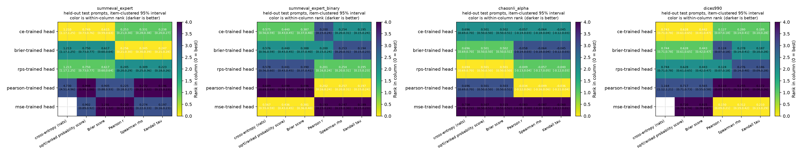
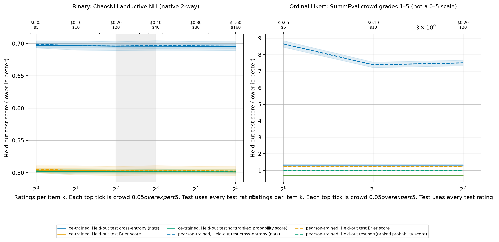
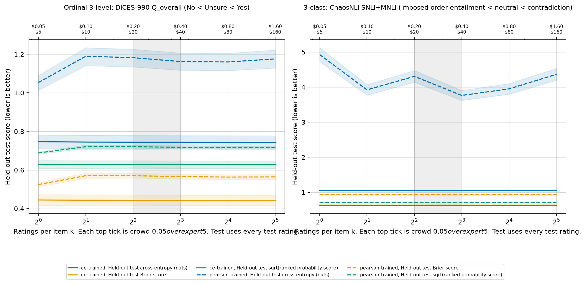
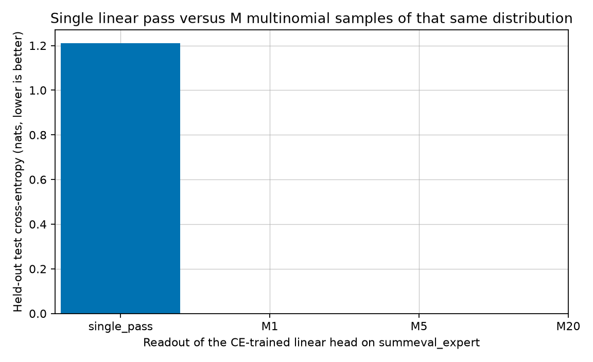
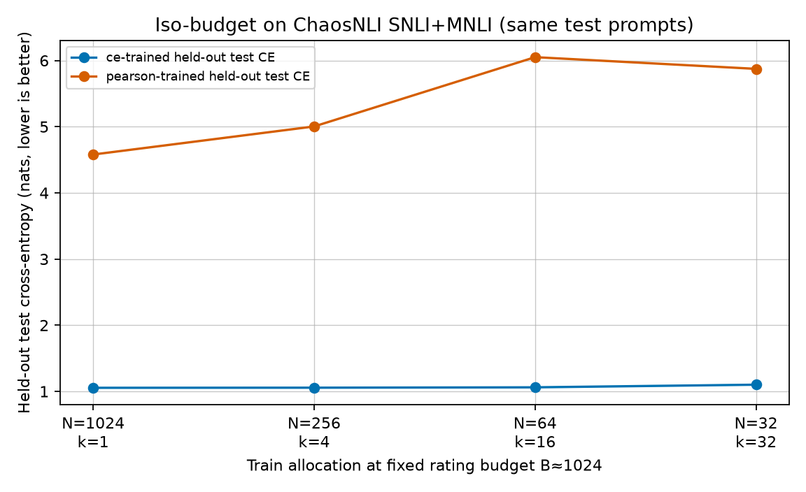

# Sanmi distributional pitch — 11-26-2026

**As of 11-26-2026.** Experiment `36_sanmi_distributional_pitch_anti_proper_corr_start_26Nov2026`.

**Bottom line.** On a known law, Pearson correlation is unchanged by any positive affine map and, for a judge that samples independently of the human given the prompt, a collapsed affine mean scores a strictly higher correlation than the true conditional distribution whenever the conditional mean actually varies and the conditional variance is not zero. On the real multi-annotator sets that could be loaded on this machine, the held-out comparison is the prompt-level unbiased proper risk, with item-clustered 95% intervals. Synthetic numbers below are checks of those identities. They are not human results.

## 1. Merged four-step pitch

Notation, used the same way in the note, the figures, the Python, and the Lean comments. \(c\) is the prompt. \(X\sim\hat q(\cdot\mid c)\) is the judge's rating. \(Y\sim p^*(\cdot\mid c)\) is the human rating. Centered variables are \(\tilde X=X-\mu_X\) and \(\tilde Y=Y-\mu_Y\). Standardized variables are \(z_X=\tilde X/\sigma_X\) and \(z_Y=\tilde Y/\sigma_Y\). The excess Brier divergence is \(D_B(p^*\Vert\hat q)=\sum_y(p^*(y\mid c)-\hat q(y\mid c))^2\).

**Step 1. Concede the two points that are right, and stop at the boundary.** On a binary rating, the scalar mean is the distribution, and scalar squared error matches the Brier score: two-class Brier equals \(2(q-y)^2\). The Brier score is strictly proper, with excess risk \(D_B\). Pearson correlation is not that object. It is invariant to \(X\mapsto aX+b\) for \(a>0\), so a shifted and compressed forecast can tie the true probabilities on correlation while \(D_B\) and cross-entropy get worse. Binary witness, four paired items: Pearson correlation of the calibrated probabilities and of the affine map \(0.1q+0.45\) are both 1.000. Mean Brier 0.0800 versus 0.4418. Mean cross-entropy 0.2231 versus 0.6349 nats. Anti-proper Monte Carlo (n=200000): correlation of the true sampled judge 0.5002 (theory 0.5) and of \(0.1\mu+4\) 0.7074 (theory \(\sqrt{1/2}\approx 0.7071\)). Ordinal witness: both laws have mean 2.0; \(D_B=1.5\); normalized RPS gap 0.2000; cross-entropy of the split forecast on the consensus outcome is infinite.

**Step 2. Mean squared error splits into bias, scale, and correlation, and a discrete mean is not a discrete law.** For standardized variables, \(\mathbb E[(z_X-z_Y)^2]=2(1-\operatorname{Corr}(X,Y))\). In the original units, \(\mathbb E[(X-Y)^2]=(\mu_X-\mu_Y)^2+(\sigma_X-\sigma_Y)^2+2\sigma_X\sigma_Y(1-\operatorname{Corr}(X,Y))\). On \(\{0,1,2,3,4,5\}\) a point mass at 2 and a 50/50 split on \(\{0,4\}\) share the mean 2, so every scalar-mean correlation ties them, while \(D_B\), normalized ranked probability score (RPS), and cross-entropy separate them. A fair coin has three couplings with \(\mathbb E[(X-Y)^2]\in\{0,1/2,1\}\) and \(D_B=0\). If \(X\perp Y\), the squared difference collapses to \((\mu_X-\mu_Y)^2+\sigma_X^2+\sigma_Y^2\).

**Step 3. Correlation is strictly anti-proper for a sampled distributional judge, and one forward pass already returns the distribution.** Given the prompt, take \(X\) independent of \(Y\). The law of total covariance then says \(\operatorname{Corr}(X_{p^*},Y)=\operatorname{Var}(\mu_Y(C))/\operatorname{Var}(Y)\), while the zero-variance judge \(X_\delta=a\mu_Y(C)+b\) with \(a>0\) scores the square root of that correlation. Whenever both variance pieces are positive, \(0<\operatorname{Corr}(X_{p^*},Y)<1\) and the collapsed judge wins the correlation. The numerical case \(\operatorname{Var}(\mu)=\mathbb E[\sigma^2]\) is 0.50 versus about 0.707. Spearman and Kendall have the same monotone-warp invariance and the same ordering on that draw. The practical answer to a single-shot objection is that a softmax over the rating-token logits is one forward pass: the distribution is the normalized logit vector, not an average of sampled generations. The rollout figure compares that single pass with \(M\in\{1,5,20\}\) multinomial samples of the same vector, on a linear head because this machine has no GPU.

**Step 4. The empirical curves, the dollar axis, and the scaling bridge.** Held-out cross-entropy, the square root of RPS, and Brier are plotted against ratings per item \(k\), with a top axis in illustrative dollars at $0.05 per rating (the POPQUORN crowd rate) and $5 per rating (an assumed expert rate, not a measured wage for these sets). Experiment 28, which is a different design (five frontier judges, not this linear head), found CE-fit ahead of Pearson-fit on held-out RPS after 4 to 8 ratings at one rating per item. The shaded band marks that region. It is not a claim that this head reproduces those judges. A proper loss keeps using distributional signal after a correlation objective has the ranking of the means.

## Real-data matrix

The rows are training objectives on the same hashed-text linear family. Cross-entropy, Brier, and RPS train a softmax. Pearson trains the same softmax to raise the correlation of a sampled rating (law of total covariance: conditional variance is punished). MSE is ridge regression on the conditional mean, read out as the two-point distribution on adjacent scores with that mean. Test risk for a proper loss is the mean over test prompts of the mean over that prompt's ratings. It is not the plug-in divergence of the test histogram.

### summeval_expert

SummEval expert annotations on four aspects (coherence, consistency, fluency, relevance), native grades 1–5 stored as class values [1,2,3,4,5]. Every summary has [3] expert annotation records. The jsonl does not publish a stable rater id, so rater_id is the within-item vote index, not a person. Split group is the source article (filepath), so every system and aspect of one article stays in one split. Binary views use the pre-registered cut grade ≥ 4.

Split by prompt group, seed 0: train 3840, validation 1280, test 1280. SVD components used: 24. Intervals are item-clustered percentile 95% intervals, B draws in `results.json`.

| Objective | CE | sqrt(RPS) | Brier | norm. RPS | Pearson r | Spearman rho | Kendall tau |
| --- | --- | --- | --- | --- | --- | --- | --- |
| ce-trained | 1.210 [1.171, 1.247] | 0.749 [0.731, 0.764] | 0.615 [0.595, 0.634] | 0.1402 | 0.253 | 0.331 | 0.238 |
| brier-trained | 1.213 [1.174, 1.251] | 0.750 [0.733, 0.766] | 0.617 [0.597, 0.636] | 0.1408 | 0.256 | 0.345 | 0.247 |
| rps-trained | 1.213 [1.174, 1.251] | 0.750 [0.732, 0.765] | 0.617 [0.597, 0.636] | 0.1405 | 0.245 | 0.309 | 0.223 |
| pearson-trained | 4.730 [4.509, 4.961] | 0.998 [0.994, 1.002] | 0.905 [0.883, 0.929] | 0.2489 | 0.225 | 0.272 | 0.196 |
| mse-trained | inf [undefined, undefined] | 0.902 [0.887, 0.918] | 1.291 [1.266, 1.316] | 0.2035 | 0.220 | 0.274 | 0.197 |

Uniform forecast held-out test CE 1.6094. Train-marginal forecast held-out test CE 1.2210. CE head refit after shuffling train features: held-out test CE 1.2217.

### summeval_expert_binary

Binary view of summeval_expert: class 1 iff the original value ≥ 4. This is a threshold of the same ratings, not a separately collected binary task. SummEval expert annotations on four aspects (coherence, consistency, fluency, relevance), native grades 1–5 stored as class values [1,2,3,4,5]. Every summary has [3] expert annotation records. The jsonl does not publish a stable rater id, so rater_id is the within-item vote index, not a person. Split group is the source article (filepath), so every system and aspect of one article stays in one split. Binary views use the pre-registered cut grade ≥ 4.

Split by prompt group, seed 0: train 3840, validation 1280, test 1280. SVD components used: 24. Intervals are item-clustered percentile 95% intervals, B draws in `results.json`.

| Objective | CE | sqrt(RPS) | Brier | norm. RPS | Pearson r | Spearman rho | Kendall tau |
| --- | --- | --- | --- | --- | --- | --- | --- |
| ce-trained | 0.575 [0.556, 0.593] | 0.440 [0.430, 0.449] | 0.387 [0.370, 0.404] | 0.1934 | 0.200 | 0.254 | 0.195 |
| brier-trained | 0.576 [0.558, 0.593] | 0.440 [0.431, 0.450] | 0.388 [0.371, 0.404] | 0.1939 | 0.200 | 0.253 | 0.194 |
| rps-trained | 0.578 [0.560, 0.596] | 0.441 [0.432, 0.451] | 0.390 [0.373, 0.407] | 0.1948 | 0.201 | 0.254 | 0.195 |
| pearson-trained | 0.689 [0.686, 0.693] | 0.498 [0.496, 0.500] | 0.496 [0.492, 0.500] | 0.2481 | 0.202 | 0.257 | 0.197 |
| mse-trained | 0.567 [0.549, 0.585] | 0.436 [0.427, 0.446] | 0.381 [0.364, 0.398] | 0.1904 | 0.193 | 0.247 | 0.189 |

Uniform forecast held-out test CE 0.6931. Train-marginal forecast held-out test CE 0.5819. CE head refit after shuffling train features: held-out test CE 0.5814.

### chaosnli_snli_mnli

Pooled ChaosNLI-SNLI and ChaosNLI-MNLI-matched. ChaosNLI SNLI or MNLI-matched, 3 classes, 100 votes per item in the author files. label_count order is entailment, neutral, contradiction. Ranked probability score uses that order as an imposed order (entailment < neutral < contradiction); it is not a native Likert scale. rater_id is a within-item vote index expanded from the counts, not a person. Each uid is its own split group. Item counts by file are kept distinct by the group prefix.

Split by prompt group, seed 0: train 1867, validation 622, test 624. SVD components used: 24. Intervals are item-clustered percentile 95% intervals, B draws in `results.json`.

| Objective | CE | sqrt(RPS) | Brier | norm. RPS | Pearson r | Spearman rho | Kendall tau |
| --- | --- | --- | --- | --- | --- | --- | --- |
| ce-trained | 1.053 [1.040, 1.068] | 0.627 [0.619, 0.634] | 0.637 [0.629, 0.647] | 0.1963 | 0.078 | 0.111 | 0.074 |
| brier-trained | 1.053 [1.040, 1.068] | 0.627 [0.619, 0.634] | 0.638 [0.629, 0.647] | 0.1964 | 0.081 | 0.114 | 0.076 |
| rps-trained | 1.054 [1.041, 1.068] | 0.627 [0.619, 0.634] | 0.638 [0.630, 0.647] | 0.1965 | 0.082 | 0.114 | 0.076 |
| pearson-trained | 4.022 [3.867, 4.176] | 0.711 [0.707, 0.715] | 0.940 [0.919, 0.962] | 0.2530 | 0.086 | 0.118 | 0.078 |
| mse-trained | inf [undefined, undefined] | 0.694 [0.682, 0.706] | 0.903 [0.872, 0.934] | 0.2409 | 0.063 | 0.079 | 0.052 |

Uniform forecast held-out test CE 1.0986. Train-marginal forecast held-out test CE 1.0569. CE head refit after shuffling train features: held-out test CE 1.0554.

### chaosnli_alpha

ChaosNLI abductive NLI, native two-option labels. The release stores counts, not person ids; rater_id is the within-item vote index obtained by expanding label_count. Order is option 1 then option 2. Each item is its own split group.

Split by prompt group, seed 0: train 919, validation 306, test 307. SVD components used: 24. Intervals are item-clustered percentile 95% intervals, B draws in `results.json`.

| Objective | CE | sqrt(RPS) | Brier | norm. RPS | Pearson r | Spearman rho | Kendall tau |
| --- | --- | --- | --- | --- | --- | --- | --- |
| ce-trained | 0.696 [0.692, 0.699] | 0.501 [0.500, 0.503] | 0.502 [0.499, 0.506] | 0.2512 | -0.057 | -0.064 | -0.045 |
| brier-trained | 0.696 [0.692, 0.699] | 0.501 [0.500, 0.503] | 0.502 [0.499, 0.506] | 0.2512 | -0.058 | -0.064 | -0.045 |
| rps-trained | 0.694 [0.692, 0.696] | 0.501 [0.500, 0.502] | 0.501 [0.499, 0.503] | 0.2505 | -0.049 | -0.057 | -0.040 |
| pearson-trained | 0.696 [0.689, 0.703] | 0.501 [0.498, 0.505] | 0.503 [0.496, 0.510] | 0.2514 | -0.034 | -0.049 | -0.036 |
| mse-trained | 0.708 [0.699, 0.718] | 0.507 [0.503, 0.512] | 0.515 [0.506, 0.524] | 0.2573 | -0.083 | -0.087 | -0.060 |

Uniform forecast held-out test CE 0.6931. Train-marginal forecast held-out test CE 0.6930. CE head refit after shuffling train features: held-out test CE 0.6916.

### dices990

DICES-990 rater-level Q_overall. Yes means unsafe (DICES-990 README; DICES-350 uses the same question family). Order for ranked probability score: No < Unsure < Yes, values 0,1,2. Dropped 7217 rows whose rater_id is in the README quality-filter list (12 raters). rater_id is the released person id. Split group is item_id. Raters are crossed, so the same person can appear in train and test on different conversations; no conversation's raters are split.

Split by prompt group, seed 0: train 594, validation 198, test 198. SVD components used: 24. Intervals are item-clustered percentile 95% intervals, B draws in `results.json`.

| Objective | CE | sqrt(RPS) | Brier | norm. RPS | Pearson r | Spearman rho | Kendall tau |
| --- | --- | --- | --- | --- | --- | --- | --- |
| ce-trained | 0.743 [0.708, 0.778] | 0.628 [0.608, 0.647] | 0.442 [0.415, 0.469] | 0.1969 | 0.127 | 0.280 | 0.189 |
| brier-trained | 0.744 [0.710, 0.778] | 0.628 [0.608, 0.647] | 0.443 [0.416, 0.470] | 0.1972 | 0.124 | 0.278 | 0.187 |
| rps-trained | 0.744 [0.710, 0.779] | 0.628 [0.608, 0.647] | 0.443 [0.416, 0.470] | 0.1972 | 0.124 | 0.276 | 0.186 |
| pearson-trained | 1.164 [1.118, 1.210] | 0.717 [0.709, 0.726] | 0.565 [0.552, 0.578] | 0.2572 | 0.110 | 0.255 | 0.172 |
| mse-trained | inf [undefined, undefined] | 0.720 [0.699, 0.739] | 0.825 [0.781, 0.866] | 0.2593 | 0.150 | 0.312 | 0.210 |

Uniform forecast held-out test CE 1.0986. Train-marginal forecast held-out test CE 0.7488. CE head refit after shuffling train features: held-out test CE 0.7492.

### dices990_binary_yes

Binary view of dices990: class 1 iff the original value ≥ 2. This is a threshold of the same ratings, not a separately collected binary task. DICES-990 rater-level Q_overall. Yes means unsafe (DICES-990 README; DICES-350 uses the same question family). Order for ranked probability score: No < Unsure < Yes, values 0,1,2. Dropped 7217 rows whose rater_id is in the README quality-filter list (12 raters). rater_id is the released person id. Split group is item_id. Raters are crossed, so the same person can appear in train and test on different conversations; no conversation's raters are split.

Split by prompt group, seed 0: train 594, validation 198, test 198. SVD components used: 24. Intervals are item-clustered percentile 95% intervals, B draws in `results.json`.

| Objective | CE | sqrt(RPS) | Brier | norm. RPS | Pearson r | Spearman rho | Kendall tau |
| --- | --- | --- | --- | --- | --- | --- | --- |
| ce-trained | 0.557 [0.527, 0.586] | 0.431 [0.415, 0.446] | 0.371 [0.344, 0.397] | 0.1856 | 0.127 | 0.293 | 0.196 |
| brier-trained | 0.558 [0.528, 0.587] | 0.431 [0.415, 0.446] | 0.372 [0.345, 0.398] | 0.1858 | 0.125 | 0.291 | 0.196 |
| rps-trained | 0.560 [0.530, 0.589] | 0.432 [0.416, 0.447] | 0.373 [0.346, 0.400] | 0.1865 | 0.118 | 0.278 | 0.185 |
| pearson-trained | 0.710 [0.698, 0.722] | 0.508 [0.502, 0.514] | 0.516 [0.505, 0.529] | 0.2582 | 0.110 | 0.270 | 0.180 |
| mse-trained | 0.552 [0.521, 0.583] | 0.428 [0.412, 0.443] | 0.367 [0.340, 0.393] | 0.1835 | 0.149 | 0.323 | 0.216 |

Uniform forecast held-out test CE 0.6931. Train-marginal forecast held-out test CE 0.5627. CE head refit after shuffling train features: held-out test CE 0.5631.

## What the held-out table shows

Cross-entropy, Brier, and RPS heads land on nearly the same held-out proper scores. On SummEval expert grades 1–5 the CE head's held-out cross-entropy is about 1.21, against about 4.73 for the Pearson head and infinity for the MSE two-point readout. Infinity is the ordinal gap: that readout puts probability 0 on every score except the two adjacent to the ridge mean, so one off-support rating makes -log q(y) infinite. On the binary views, where the mean is the distribution, the MSE readout is finite and competitive with the CE head, while the Pearson head is worse on cross-entropy and not better on correlation. Hash features are weak. The shuffle control sits next to the train-marginal forecast, and on ChaosNLI abductive NLI every head sits on the uniform forecast (log 2 ≈ 0.693). The Pearson-versus-CE gap on cross-entropy is the collapse of the Pearson objective. It is visible at every k in the curves, including the 4–8 rating band where experiment 28's frontier CE-fit first beat Pearson-fit. There is no small-k region in this linear family where the Pearson head wins the proper scores. On DICES-990, splitting each test prompt's raters in half gives a within-prompt oracle, not a deployable judge. A draw from the add-one distribution of the first half has correlation 0.190 with the second half. The collapsed score 0.1·mean+4 has correlation 0.410. Held-out-half cross-entropy is 0.6764 versus 6.7936, and Brier is 0.3881 versus 0.9835. Higher correlation, worse proper scores.

## Finite-sample curves and iso-budget

### ChaosNLI alphaNLI binary

| k | objective | CE | sqrt(RPS) | Brier | Pearson r |
| --- | --- | --- | --- | --- | --- |
| 1 | ce-trained | 0.6966 | 0.5017 | 0.5035 | -0.066 |
| 2 | ce-trained | 0.6964 | 0.5016 | 0.5032 | -0.065 |
| 4 | ce-trained | 0.6960 | 0.5014 | 0.5028 | -0.056 |
| 8 | ce-trained | 0.6959 | 0.5014 | 0.5027 | -0.061 |
| 16 | ce-trained | 0.6958 | 0.5013 | 0.5026 | -0.067 |
| 32 | ce-trained | 0.6955 | 0.5012 | 0.5024 | -0.057 |
| 1 | pearson-trained | 0.6987 | 0.5027 | 0.5055 | -0.052 |
| 2 | pearson-trained | 0.6967 | 0.5018 | 0.5036 | -0.043 |
| 4 | pearson-trained | 0.6960 | 0.5014 | 0.5028 | -0.030 |
| 8 | pearson-trained | 0.6968 | 0.5018 | 0.5035 | -0.037 |
| 16 | pearson-trained | 0.6963 | 0.5016 | 0.5031 | -0.042 |
| 32 | pearson-trained | 0.6959 | 0.5013 | 0.5027 | -0.034 |

### SummEval crowd Likert 1-5

| k | objective | CE | sqrt(RPS) | Brier | Pearson r |
| --- | --- | --- | --- | --- | --- |
| 1 | ce-trained | 1.3276 | 0.7187 | 0.7077 | -0.051 |
| 2 | ce-trained | 1.3273 | 0.7186 | 0.7073 | -0.049 |
| 4 | ce-trained | 1.3272 | 0.7183 | 0.7072 | -0.047 |
| 1 | pearson-trained | 8.6508 | 1.0120 | 1.2395 | -0.057 |
| 2 | pearson-trained | 7.3791 | 1.0110 | 1.2388 | -0.057 |
| 4 | pearson-trained | 7.4974 | 1.0092 | 1.2378 | -0.052 |

### DICES-990 3-level ordinal

| k | objective | CE | sqrt(RPS) | Brier | Pearson r |
| --- | --- | --- | --- | --- | --- |
| 1 | ce-trained | 0.7467 | 0.6294 | 0.4445 | 0.087 |
| 2 | ce-trained | 0.7447 | 0.6283 | 0.4432 | 0.112 |
| 4 | ce-trained | 0.7438 | 0.6279 | 0.4427 | 0.128 |
| 8 | ce-trained | 0.7437 | 0.6279 | 0.4426 | 0.122 |
| 16 | ce-trained | 0.7433 | 0.6276 | 0.4422 | 0.129 |
| 32 | ce-trained | 0.7429 | 0.6274 | 0.4420 | 0.134 |
| 1 | pearson-trained | 1.0533 | 0.6883 | 0.5246 | 0.087 |
| 2 | pearson-trained | 1.1894 | 0.7208 | 0.5704 | 0.104 |
| 4 | pearson-trained | 1.1820 | 0.7208 | 0.5704 | 0.117 |
| 8 | pearson-trained | 1.1619 | 0.7174 | 0.5655 | 0.107 |
| 16 | pearson-trained | 1.1598 | 0.7158 | 0.5633 | 0.112 |
| 32 | pearson-trained | 1.1757 | 0.7164 | 0.5641 | 0.116 |

### ChaosNLI SNLI+MNLI 3-class

| k | objective | CE | sqrt(RPS) | Brier | Pearson r |
| --- | --- | --- | --- | --- | --- |
| 1 | ce-trained | 1.0533 | 0.6268 | 0.6373 | 0.061 |
| 2 | ce-trained | 1.0523 | 0.6265 | 0.6369 | 0.072 |
| 4 | ce-trained | 1.0523 | 0.6264 | 0.6370 | 0.081 |
| 8 | ce-trained | 1.0529 | 0.6266 | 0.6375 | 0.079 |
| 16 | ce-trained | 1.0530 | 0.6267 | 0.6375 | 0.074 |
| 32 | ce-trained | 1.0529 | 0.6266 | 0.6374 | 0.079 |
| 1 | pearson-trained | 4.9262 | 0.7103 | 0.9387 | 0.066 |
| 2 | pearson-trained | 3.9205 | 0.7105 | 0.9387 | 0.081 |
| 4 | pearson-trained | 4.3048 | 0.7112 | 0.9399 | 0.089 |
| 8 | pearson-trained | 3.7622 | 0.7112 | 0.9396 | 0.087 |
| 16 | pearson-trained | 3.9491 | 0.7105 | 0.9389 | 0.084 |
| 32 | pearson-trained | 4.3641 | 0.7107 | 0.9392 | 0.087 |

### Iso-budget on ChaosNLI SNLI+MNLI

| N | k | B | objective | held-out test CE | sqrt(RPS) | Brier |
| --- | --- | --- | --- | --- | --- | --- |
| 1024 | 1 | 1024 | ce | 1.0543 | 0.6270 | 0.6385 |
| 1024 | 1 | 1024 | pearson | 4.5795 | 0.7175 | 0.9490 |
| 256 | 4 | 1024 | ce | 1.0560 | 0.6278 | 0.6400 |
| 256 | 4 | 1024 | pearson | 5.0037 | 0.7167 | 0.9478 |
| 64 | 16 | 1024 | ce | 1.0615 | 0.6290 | 0.6423 |
| 64 | 16 | 1024 | pearson | 6.0508 | 0.7092 | 0.9372 |
| 32 | 32 | 1024 | ce | 1.1013 | 0.6445 | 0.6660 |
| 32 | 32 | 1024 | pearson | 5.8740 | 0.7363 | 0.9764 |

## Single pass versus Monte Carlo rollouts

Dataset `summeval_expert`. The Monte Carlo histograms use a \(10^{-6}\) floor so a single unlucky sample does not make cross-entropy infinite. The single pass does not need that floor.

- single_pass: held-out test CE 1.2097, Brier 0.6149, sqrt(RPS) 0.7488 (the softmax itself, no floor)
- M1: held-out test CE 9.6059, Brier 1.2516, sqrt(RPS) 1.0679 (mean over 8 floored histograms; one unlucky draw can still put a zero on a realized class)
- M5: held-out test CE 3.9603, Brier 0.7348, sqrt(RPS) 0.8152 (mean over 8 floored histograms; one unlucky draw can still put a zero on a realized class)
- M20: held-out test CE 1.7095, Brier 0.6409, sqrt(RPS) 0.7653 (mean over 8 floored histograms; one unlucky draw can still put a zero on a realized class)

## Within-prompt oracle (not a held-out judge)

Dataset `dices990`. Half the raters of a test prompt estimate the distribution; the other half are scored. Sampled-judge correlation 0.190. Collapsed affine correlation 0.410. Distributional half CE 0.6764. Collapsed half CE 6.7936.

## Figures

## Ready-to-send note to Sanmi

Sanmi — three mathematical facts, then the empirical picture.

On binary ratings you are right that the mean is the distribution and that scalar squared error matches Brier. Brier is strictly proper. Correlation is not. Corr(aX+b, Y) = Corr(X, Y) for any a>0, so a compressed forecast ties the true probabilities on correlation while Brier and cross-entropy get worse (in the four-item witness, correlation stays 1 while mean Brier moves from 0.0800 to 0.4418 and cross-entropy from 0.2231 to 0.6349 nats).

On a 0–5 rubric the mean is not the law. A point mass at 2 and a 50/50 split on {0, 4} have the same mean and different Brier, RPS, and cross-entropy. RPS is the squared CDF gap: it charges distance from the realized rating, over the whole distribution, not a ranking of items.

If the judge samples independently of the human given the prompt, correlation is strictly anti-proper. The true distribution scores Corr = Var(mean)/Var(Y). A collapsed judge a·mean+b scores the square root. When the two variance pieces are equal, that is 0.50 versus about 0.707. Spearman and Kendall do the same thing under a monotone warp. One forward pass already returns the distribution: softmax of the rating-token logits. Samples are a Monte Carlo estimate of that vector, not a requirement.

The curves plot held-out cross-entropy, sqrt(RPS), and Brier against ratings per item, with a top axis at $0.05/rating (POPQUORN's crowd rate) and $5/rating (an assumed expert rate). Experiment 28's frontier-judge break-even sat near 4–8 ratings; the band on the figure marks that earlier result, which is a different model family. Continuous densities are the case where your nonparametric sample-size warning applies. Finite rubrics are ordinary K-way classification, with an O(K/N) multinomial rate. Tightening the rubric and matching p* are complementary. The failure mode is treating a spread-out target as if it had variance zero.

Happy to walk through the Lean file (no sorry; axioms are propext, Classical.choice, Quot.sound) or the held-out tables.

## Two-paper roadmap

**Paper 1 — Target and evaluation protocol.** Define the target as \(p^*(y\mid c)\), not a correlation with a scalar. State the output-space taxonomy (binary, finite ordinal, continuous). Fix the test estimator as the unbiased per-sample proper risk, the split as prompt-level, and the interval as an item-clustered bootstrap. Keep Pearson, Spearman, and Kendall as diagnostics. Put Krippendorff-style agreement in the human-consensus section, not in the judge-fidelity section. Lead with RPS as distance-from-the-realized-rating.

**Paper 2 — Training, scaling, and dollars.** Train the same family by cross-entropy, Brier, RPS, Pearson, and MSE. Report the anti-proper collapse. Show the single-pass logit readout against M-sample rollouts. Plot held-out proper scores against \(k\) and against dollars, crowd and expert, and the iso-budget cut \(B=N\times k\). The scaling claim is that correlation saturates once the conditional mean is ranked, while a proper loss keeps fitting the conditional distribution.

## Complete Sanmi Transcript Coverage

As of 11-26-2026. These five points are the ones the 11-25 call left open. The table is the taxonomy; the sentences under it are the boundaries.

| Point | Output space or claim | What is true | Where it is checked |
| --- | --- | --- | --- |
| 1a | Binary, \(K=2\) | One degree of freedom. The scalar mean is the full probability mass function, and scalar \(L_2\) equals the Brier score (two-class Brier is twice scalar squared error). Pearson correlation still fails calibration, because \(\operatorname{Corr}(aX+b,Y)=\operatorname{Corr}(X,Y)\) for \(a>0\), and it is strictly anti-proper for a sampled judge: \(\sqrt{\rho}>\rho\). | Lean `binary_brier_eq_two_l2`, `pearson_affine_invariant`, `binary_witness_corr_tie`, `anti_proper_from_parts`. Python `binary_l2`, `binary_affine_witness`, `anti_proper`. Real binary panels: SummEval cut at grade \(\ge 4\), ChaosNLI abductive NLI, DICES Yes-versus-not. |
| 1b | Finite categorical or ordinal, \(K\ge 3\) (a 0–5 rubric is this case) | \(K-1\) degrees of freedom. This is ordinary discrete classification. The multinomial frequency error is \(\mathcal{O}(K/N)\), from \(\mathbb{E}[\|\hat q_N-p^*\|_2^2]=(1/N)(1-\|p^*\|_2^2)\), not a nonparametric curse of dimensionality. A scalar mean drops spread and multimodality. Cross-entropy, Brier, and ranked probability score (RPS) see them. | Lean `empirical_l2_rate`, `plugin_DB_bias`, `ordinal_same_mean_different_law`. Python `empirical_rate`, `mean_ne_pmf`. Real panels: SummEval grades 1–5 and DICES-990 three-level `Q_overall`. VeriBench functional semantic correctness (0–5) was not on this machine. |
| 1c | Continuous, \(Y\in\mathbb{R}\) | The target is an infinite-dimensional density \(p^*(y\mid c)\). Sanmi's nonparametric sample-complexity warning applies here. A usable judge then needs a parametric head (Gaussian, Beta, or quantiles), the continuous ranked probability score (CRPS), or a discretization into \(K\) bins. | Conceded. This folder does not estimate a continuous density. |
| 2 | Paired versus unpaired; agreement versus fidelity | Correlation has one narrow use as an unpaired or arbitrary-scale diagnostic. Inter-rater agreement, for example Krippendorff's \(\alpha\), measures human-to-human consensus when no target distribution has been defined. A proper scoring rule measures judge fidelity to a defined target \(p^*(y\mid c)\). Those are different questions. | The experiments in this folder score fidelity on held-out prompts. They do not report Krippendorff's \(\alpha\). |
| 3 | Sanmi's RPS framing | RPS is the squared distance between forecast and realized cumulative probabilities. It charges an ordering of how wrong the forecast is — distance from the realized rating — over the whole distribution. It is not a ranking of items. | Lean `bernoulli_square_excess` (one threshold) and `ordinal_same_mean_different_law` (the 0–5 gap). The reported column is the square root of the unbiased mean per-sample RPS; normalized RPS (divided by \(K-1\)) is stored beside it. |
| 4 | Surrogate-loss literature | Proper scoring rules and surrogate losses are classic: Brier (1950), Epstein (1969) for the ranked probability score, Gneiting and Raftery (2007). What is new here is the application to an LLM-as-a-judge, the strict anti-properness \(\sqrt{\rho}>\rho\) for independent sampled judges, the single-pass token-logit readout, and the rating-budget and dollar scaling curves. | This note, `SanmiPitch.lean`, and the figures under `figures/`. |
| 5 | Sharpen the rubric versus match \(p^*\) | Tightening a rubric so that \(p^*(y\mid c)\) becomes peakier, and training a judge to match \(p^*(y\mid c)\), are complementary. What fails is pretending a non-peaky target has zero conditional variance. | Proof B (consensus on 2 versus a 50/50 split on \(\{0,4\}\), same mean 2) and Proof C (the collapsed judge \(X_\delta=a\mu_Y(C)+b\)). |

## What this machine did not run

- POPQUORN: NOT LOADED. huggingface dataset search returned no POPQUORN card, https://github.com/Jiaxin-Pei/POPQUORN returned 404, and that user's public repos contain Stanford-politeness model code rather than POPQUORN ratings. The Stanford politeness corpus was not substituted.
- VeriBench FSC: NOT IN THIS REPOSITORY AND NOT ON THIS MACHINE. A search of this repo for FSC / R_v1 / functional semantic correctness ratings found no table. AGENTS.md assigns the shared VeriBench human-rating collection to trustworthy-theorem-judges experiment 09; that repo is not cloned here, so CertJudge / VeriBench FSC R_v1 (0–5, about 5 experts, 343 items) was not scored.
- No GPU is present, so no LoRA fine-tune and no live LLM logit extraction were run. Ready scripts: `scripts/snap_lora_train.py` and `scripts/snap_llm_logit_readout.py`.

## Kohli et al. 2026

Guneet Kohli, arXiv:2605.29797, studies how many annotators a soft-label NLI model needs. On ChaosNLI (SNLI+MNLI, 3,113 items, 100 annotations), KL divergence to the full human distribution captures about 91% (the paper's table: 91±3%) of the hard-label-to-100-annotator improvement by 10 annotators, while entropy correlation needs on the order of 20–50. On DICES-990 the paper's exploratory table gives 90% of the KL improvement at 3 annotators and 62% of the entropy-correlation improvement. That is a saturation result about annotation count for one training loss. This folder asks a different question: which training objective, on a shared linear head, wins held-out proper scores. The two results sit next to each other. They are not the same measurement, and this folder does not re-run those DeBERTa fine-tunes.
