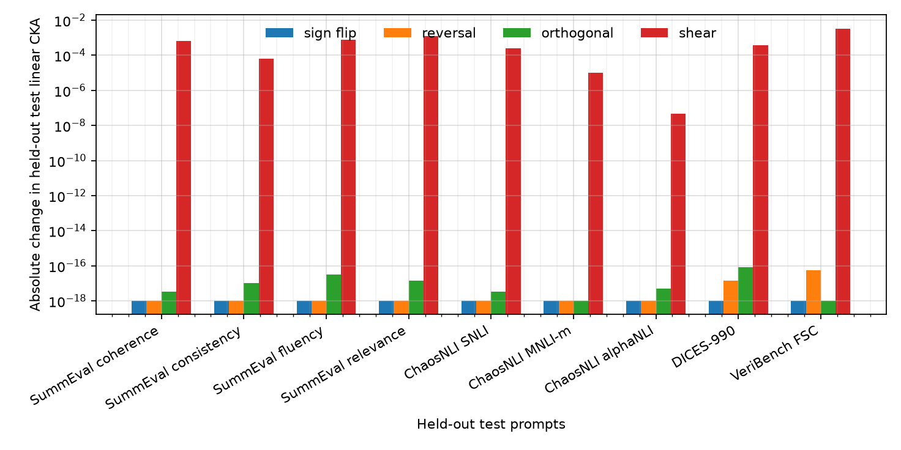
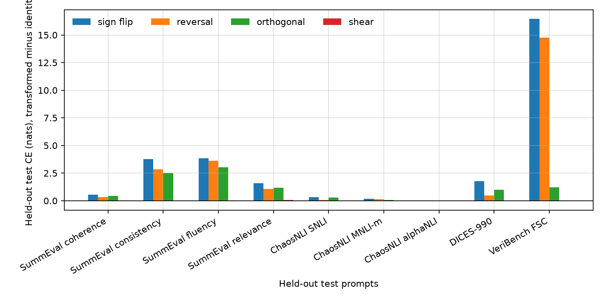
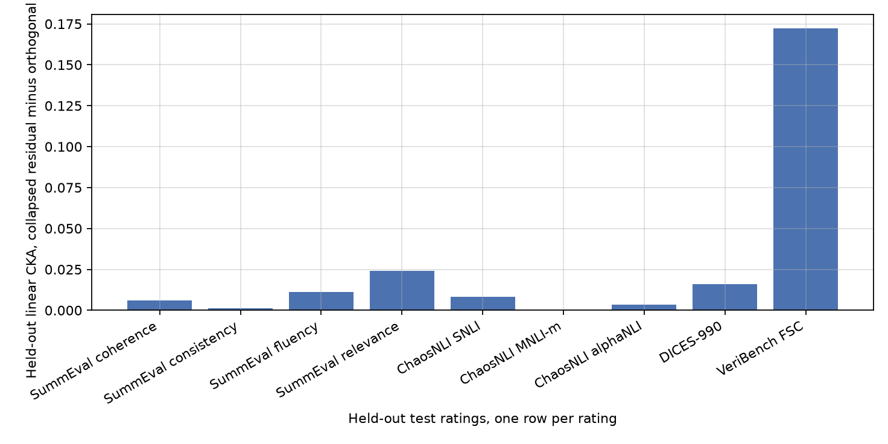

# Invariance-group ladder for judge metrics

**Doc link:** <https://github.com/brando90/judges-dont-need-psychometrics-or-corr/blob/main/experiments/38_cka_opd_invariance_ladder_start_26Nov2026/REPORT.md>

**TLDR:** Proper scores see a class relabeling. Pearson correlation survives only a positive rescaling and a shift. Linear CKA and normalized OPD also survive a sign flip, a permutation, and any orthogonal remix, and they reward deleting label-orthogonal noise. CCA survives every invertible remix, including a shear that CKA and OPD notice.

## Remark

Judge metrics form a strict invariance ladder. Cross-entropy, the Brier score, and the ranked probability score (RPS) are functions of the probability of each class, so reversing a rating scale or permuting rubric columns changes them. Pearson correlation of a scalar score is unchanged by `x ↦ a x + b` for `a > 0`, and by nothing coarser in that family: a sign flip sends `r` to `-r`. Linear centered kernel alignment (CKA) and normalized orthogonal Procrustes distance (OPD) are unchanged by `X ↦ a X Q + b` for `a ≠ 0` and `Q` orthogonal, which includes sign flips (`Q = -I`), permutations of coordinates, and rotations; an anisotropic shear is invertible but not orthogonal, so CKA and OPD move while the canonical correlations do not. Deleting a within-prompt residual that is orthogonal to the human ratings raises linear CKA and lowers OPD, so the collapsed judge looks better, while the point mass at the conditional mean is a strictly worse probabilistic forecast.

| Metric | Left unchanged by | Broken by |
| --- | --- | --- |
| Cross-entropy, Brier, RPS | the identity map on classes | any class permutation, including a scale reversal |
| Pearson `r` | `x ↦ a x + b`, `a > 0` | sign flip, orthogonal remix, shear |
| Linear CKA and normalized OPD | `X ↦ a X Q + b`, `a ≠ 0`, `Qᵀ Q = Q Qᵀ = I` | anisotropic shear; improved by deleting label-orthogonal noise |
| RBF CKA at a frozen bandwidth | orthogonal maps and shifts (isometries) | isotropic rescaling and shear |
| CCA (sum of squared canonical correlations) | `X ↦ X A + b` for invertible `A` | nothing in this list |

## What was proved

`CkaOpd.lean` is Lean 4.36.0 with no Mathlib and no `sorry`. `lean_check.txt` records `#print axioms`. Every listed theorem uses only `propext`, `Classical.choice`, and `Quot.sound`. `local_score_worsens` uses only `propext` and `Quot.sound`.

| Theorem | Statement |
| --- | --- |
| `linearCKA1d_eq_sqPearson` | On one column, linear CKA equals squared Pearson correlation. The `1/n` factors cancel. |
| `sqPearson_scale_shift` | `x ↦ a x + b` with `a ≠ 0` leaves squared Pearson correlation unchanged. The case `a < 0` is the sign flip. |
| `ckaSq_right_scale_orth`, `ckaSq_shift_scale_orth` | Squared linear CKA is unchanged by `X ↦ a X Q + b` after column centering, for `a ≠ 0` and `Q` orthogonal on both sides (`Qᵀ Q = I` and `Q Qᵀ = I`). |
| `negI_orth`, `perm_orth` | `-I` and every permutation matrix are orthogonal, so they are instances of the previous line. |
| `reversal_brier_strict`, `reversal_rps_strict` | Forecast `(1/2, 1/3, 1/6)` on class 0 has Brier `7/18` and RPS `5/18`; the reversed forecast has Brier `19/18` and RPS `17/18`. |
| `transposition_brier_strict`, `transposition_rps_strict` | Swapping the first two coordinates of the same forecast also strictly raises both scores. |
| `local_score_worsens` | Every strictly decreasing function of the true-class probability, which is the shape of cross-entropy, strictly worsens when that probability falls (`1/2` to `1/6`, or `1/2` to `1/3`). |
| `collapse_cka_strict` | On the six-row sample with groups `(1,-1,0)` and `(4,2,3)` against `(0,0,1)` and `(3,3,4)`, within-group correlation is zero and linear CKA rises from `2187/3115` to `81/89` when each row is replaced by its group mean. |
| `opdSq_anti`, `corr_lt_of_sq_lt` | In one dimension, normalized OPD squared is `2 - 2 r` for the nonnegative correlation `r`, and a larger squared correlation produces a larger `r` and therefore a smaller OPD. |
| `collapse_pointmass_brier`, `collapse_pointmass_rps` | On outcomes `(0,1,1,2)`, the law `(1/4, 1/2, 1/4)` has mean Brier `5/8` and mean RPS `3/8`; the point mass at 1 has mean Brier `1` and mean RPS `1/2`. Its cross-entropy is infinite on the outcomes it misses. |
| `instance_perfect_correlation`, `instance_sign_shift_preserves` | The hypotheses hold on a two-point perfect correlation, including the map `x ↦ -2x + 5`. |

The equivalence "left inverse equals right inverse" for a square matrix is not formalized. Orthogonal is defined as both `Qᵀ Q = I` and `Q Qᵀ = I`, which is what those two identities say together. Multi-dimensional normalized OPD is not given a separate Lean name; the same orthogonal action is what `ckaSq_right_scale_orth` fixes, and the numeric check below measures OPD directly.

`proofs_numeric.py` repeats every identity on exact fractions and on 40 random instances (seed `20261126`). Two runs print the same 26 PASS lines. The largest absolute gap between one-dimensional linear CKA and `r²` was `1.7e-16`. The largest absolute gap for linear CKA and for normalized OPD under random `a`, orthogonal `Q`, and a shift was under `3e-16`. A fixed shear moved linear CKA by `3.4e-3` and normalized OPD by `1.4e-3` and moved the CCA sum of squares by `8e-17`.

## Held-out test, real ratings

The judge, the split, and the interval are in `HOW_TO_READ_RESULTS.md`. Full cells are `tables/invariance_ladder.md` and `tables/conditional_collapse.md`.

On every set, the absolute change in held-out test linear CKA under a sign flip, a reversal, a cycle, or a random orthogonal matrix is at most about `1e-16` (often exact zero). Normalized OPD matches to the same roundoff. The CCA sum of squares moves by at most about `1e-11`, which is the QR tolerance, not a real change. A fixed shear moves linear CKA by `6.6e-4` (SummEval coherence), `1.2e-3` (SummEval relevance), `3.3e-3` (VeriBench), and `4.6e-8` on ChaosNLI alphaNLI, where the two-class head is nearly constant. RBF CKA at the gamma frozen on the identity logits is unchanged by the orthogonal maps and changes under the shear.

Proper scores move as soon as the softmax is of a different matrix, except where the head had nothing to lose. SummEval coherence, held-out test cross-entropy: identity `1.539 [1.503, 1.574]`, sign flip `2.104 [2.066, 2.141]`, in nats, item-clustered percentile 95% interval, `B = 1000`. DICES-990: identity `0.743 [0.710, 0.777]`, sign flip `2.506 [2.470, 2.541]`. ChaosNLI SNLI: identity `1.000 [0.977, 1.024]`, sign flip `1.331 [1.307, 1.354]`. ChaosNLI alphaNLI is the exception that the fit explains: identity `0.697 [0.692, 0.701]` against a uniform forecast of `0.693`, and the sign flip is `0.692 [0.688, 0.696]`. The intervals overlap, and the head is not a forecast the flip can reveal as worse. VeriBench's shear has a lower point-estimate cross-entropy (`0.419` against `0.463`) and the intervals overlap (`[0.253, 0.604]` against `[0.292, 0.651]`, test `n = 20`).

Conditional collapse, still on the held-out ratings: linear CKA of the scalar `μ(c) + z` against the human rating is lower than linear CKA of `μ(c)` alone on every set, and normalized OPD is higher. The largest gap is VeriBench, `0.010` to `0.182` in linear CKA and `1.340` to `1.070` in normalized OPD. The point mass at the nearest class has infinite cross-entropy on every set, because some test ratings are not that class. Brier rises with it: DICES-990 from `0.442` to `1.570`, SummEval coherence from `0.775` to `1.421`, VeriBench from `0.227` to `0.467`. sqrt(RPS) rises on the same pairs: DICES-990 `0.628` to `0.906`, coherence `0.835` to `1.010`, VeriBench `0.372` to `0.483`.

The synthetic six-row identity and the four-outcome point-mass scores are checks of the Lean theorems. They are not human results. The bars above are the human test sets named in `HOW_TO_READ_RESULTS.md`.
