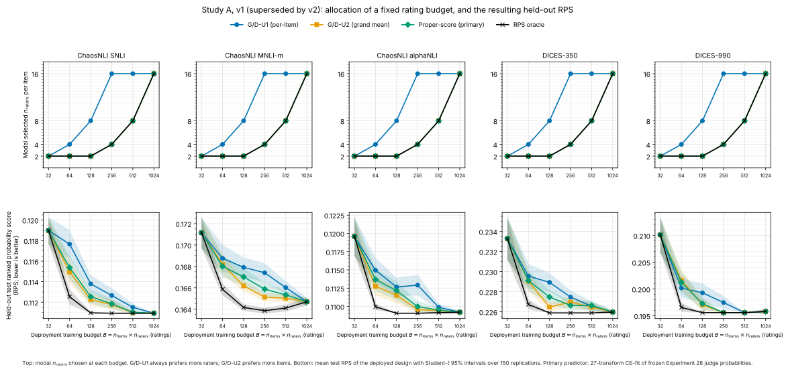
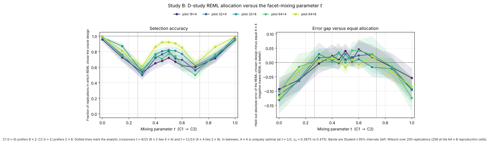

# Experiment 39: Proper-score design versus D-study budget allocation

**Doc link:** <https://github.com/brando90/judges-dont-need-psychometrics-or-corr/blob/main/experiments/39_proper_score_vs_d_study_budget_allocation_start_26Nov2026/results.md>

## Correction, 11-27-2026 (read this first)

An independent review of the first version of this report (commit `1cd4fc6`; [review](../41_output_space_k_sweep_g_d_study_sufficiency_and_label_dollars_start_27Nov2026/qa_of_experiment_39_push_1cd4fc6_11-27-2026/REVIEW_by_independent_opus_subagent_11-27-2026.md)) found four defects in Study A and several wording errors. Study A was re-run under a corrected protocol that was committed before the run: [v2 results](v2_matched_budget_corrected_11-27-2026/RESULTS_V2.md) and a [paste-ready correction note](CORRECTION_NOTE_EXP39.md). Study B was not re-run; only its wording was corrected. Sections marked "v1" below are the record of the first version. Where a v1 sentence disagrees with this block or with the v2 results, the v2 results win.

1. **Withdrawn:** "the proper-score selector significantly lowers held-out RPS against the per-item D-study rule in 10 of 20 cells". The v1 selector read more rating data than its stated 80 × 16 pilot, and the intervals left out test-item sampling and multiplicity. Under the corrected rules the pilot-based proper-score selector beats the most-raters rule in 2 of 20 cells after Holm correction (6 of 20 before it) and beats the most-items rule in 0 of 20.
2. **Kept, weakened:** more items and fewer raters per item is the better split for held-out RPS. The most-items rule has a lower mean RPS than the most-raters rule in 18 of 20 cells, significantly so after Holm in 5, and never by more than 3.0% of total RPS.
3. **Reworded:** U1 and U2 are analytic corner rules at a fixed budget (U1 always picks the most raters, U2 the most items; identical to the fixed rules in 100% of replications). Their agreement with the item-mean and grand-mean oracles comes from the formulas $\widehat{v}_e/n_r$ and $\widehat{v}_u/n_i+\widehat{v}_e/B$, not from a data-driven choice. U2's "most items" prescription also assumes no rater main effect (nested or freshly sampled raters).
4. **Corrected formula:** the RPS formula printed in `PROTOCOL.md` and `HOW_TO_READ_RESULTS.md` left out a forecast-independent term. The code computes the normalized individual-rating RPS averaged over each item's ratings with equal item weights. Paired differences were right; absolute levels include a floor of about 0.09 to 0.19 depending on the dataset. K is 3 for SNLI, MNLI-m, DICES-350 and DICES-990 and 2 for alphaNLI. The NLI labels are nominal, so RPS depends on the order imposed; CE and TVD show the same pattern.
5. **Study B wording:** near the analytic crossovers (grid points $t=0.30$ and $0.70$) REML picks the oracle design in 50% to 64% of replications. That is about a coin flip between two nearly tied designs, not "near chance": the third design is picked in 13 of 1,000 and 9 of 1,000 replications, and a wrong pick costs $0.0125$ in $v_\Delta$ (3.2% of $v_\Delta(4\times 4)$). Where $4\times 4$ is the oracle, any wrong pick has positive true regret by construction. "A small pilot can be significantly worse than equal allocation" is weakened: six of 55 cells are nominally worse (p < 0.05), none survives Holm over 55 cells (smallest p = 0.00295 against 0.05/55 = 0.00091), and Benjamini-Hochberg keeps four. Five of the six use pilots with four facet levels (16×4 and 64×4), so the number of facet levels matters, not only pilot size. "As the facets become harder to tell apart" was a wrong premise (at $t=1/2$ the facets are symmetric yet $4\times 4$ is uniquely best) and is removed. Seven of 11,112 REML fits did not converge and were still used.
6. **Reproducibility:** `src/fetch_raw_data.py` now downloads the raw files from pinned sources and verifies SHA-256; the Experiment 28 forecasts are already in this repository. The v1 per-replication Study A CSV (7.8 MB) is not committed; `src/verify.py` now skips that one check when the file is absent. A core-Lean check of the Study B closed forms is in `checks/lean/VDelta.lean` (zero `sorry`, only the three standard axioms; compiler output saved next to it).

**Folder.** `experiments/39_proper_score_vs_d_study_budget_allocation_start_26Nov2026/`.

**Date.** Measured 26 November 2026, committed 27 November 2026, America/Los_Angeles.
**Location.** Scripts, frozen splits, numerical summaries, the report, and SVG figures live in this experiment folder on `main`. Raw public datasets are fetched by `src/fetch_raw_data.py` from pinned sources and checked against SHA-256; the Experiment 28 forecast cache is already in this repository (`experiments/28_public_rating_sets_chaosnli_dices_frontier_judges_ce_vs_pearson_start_23Nov2026/forecasts/forecasts_11-23-2026.csv`, SHA-256 `54fbff95…`) (see `data/README.md`). The run is strictly CPU-only and made no paid LLM API calls.
**Protocol.** Frozen in `PROTOCOL.md` before measurement; predictor amendment in `AMENDMENT_A1.md` after a 2-replication smoke test and before the 150-replication run.
**Software.** Python venv with numpy 2.5.5, scipy 1.18.1, matplotlib 3.11.2, pandas 3.1.1. Master seed `20261126`.
**Runtime.** Study A: 336.39 s (16:23:09–16:28:47 PT). Study B: 10.77 s (16:28:47–16:28:58 PT).

## Verdict (corrected 11-27-2026; Study A numbers are from v2)

Proper-score design does **not** replace D-theory, the two targets do **not** share the same optimal allocation, and the corrected effects are small.

- If the target is a **distributional forecast** of new-item $p(y\mid x)$ scored by held-out ranked probability score (RPS), the better split of a fixed rating budget $B=n_{\mathrm{items}}n_{\mathrm{raters}}$ is **more items, fewer raters per item**, by a small margin. The most-items rule has a lower mean RPS than the most-raters rule in 18 of 20 dataset-budget cells; the difference is significant after Holm correction in 5 of 20 cells and is at most 2.97% of total RPS (13.3% of the reducible excess RPS).
- A pilot-based proper-score selector (80 items × 16 ratings, cross-validated on that table only) beats the most-raters rule in 2 of 20 cells after Holm correction and never beats the most-items rule (0 of 20). A pilot D-study with a reliability target beats the most-raters rule in 2 cells and the most-items rule in none. The pilot (1,280 ratings) is 2.5 to 20 times the deployment budget and is not netted out, so these are upper bounds on the value of a pilot-using selector. Details: [v2 results](v2_matched_budget_corrected_11-27-2026/RESULTS_V2.md).
- If the target is **precision of a mean rating** (universe score), the optimal split depends on which mean: more raters per item for per-item means (item-mean error lower for the most-raters rule in 20 of 20 cells), more items for the grand mean (lower for the most-items rule in 18 of 20). These are properties of the formulas $\widehat{v}_e/n_r$ and $\widehat{v}_u/n_i+\widehat{v}_e/B$, so they say nothing about a data-driven selector.
- The two oracles disagree. Proper scores make the *target* explicit; they do not make variance-component allocation unnecessary when the target really is a universe score, and they do not by themselves choose an allocation either.

On the harder synthetic Phase B of Experiment 04 (Study B, not re-run), constrained REML still recovers the published C1/C2 oracles. Near the true analytic crossovers $t=4/15$ and $t=11/15$ (grid points $t=0.30$ and $0.70$) it picks the oracle design in 50% to 64% of replications, about a coin flip between the two nearly tied designs; the third design is picked in 13 of 1,000 and 9 of 1,000 replications, and a wrong pick there costs $0.0125$ in $v_\Delta$ (3.2% of $v_\Delta(4\times 4)$). Mid-range $t=1/2$ is *not* a three-way tie: $4\times 4$ is uniquely optimal there. Where $4\times 4$ is the oracle, any wrong pick has positive true regret, so a small pilot can only do worse than equal allocation there; whether it is detectably worse is an empirical question. Six of 55 cells are nominally worse than equal allocation (p < 0.05), none survives Holm over 55 cells, and Benjamini-Hochberg keeps four.

"Beats" in the corrected Study A means a lower mean on the named loss and a Holm-adjusted two-way (replication × test item) bootstrap p-value below 0.05, with Holm applied across the 20 cells within each comparison family. In Study B and in the v1 tables it means a lower mean and a paired Student-$t$ 95% interval that excludes 0, with no multiplicity correction. Cross-entropy (CE) and total variation distance (TVD) are secondary checks. Universe-score / mean-estimation error is never mixed into the RPS comparison.

## Data, splits, and predictor (no leakage)

Public sources were cached under `data/raw/` (SHA-256 in `data/raw/SHA256SUMS.txt`):

- ChaosNLI SNLI / MNLI-m / alphaNLI jsonl from HuggingFace `earino/chaosnli`.
- DICES-350 and DICES-990 CSVs from the public DICES dataset.
- Frozen Experiment 28 judge probabilities, `forecasts_11-23-2026.csv` (SHA-256 `54fbff95…`).

Experiment 28 item subsets were reconstructed with `SeedSequence([20261123, k])`: SNLI 600 (test 180 / dev 420), MNLI-m 600 (180 / 420), alphaNLI 400 (120 / 280), DICES-350 350 (105 / 245), DICES-990 400 (120 / 280). Frozen test / dev partitions use `SeedSequence([20261126, 1, k])` at 30% / 70%. Every item used here has at least one valid frozen-judge forecast. ChaosNLI supplies per-item label counts only (no rater IDs); DICES-350 is a complete 350 $\times$ 123 crossing; DICES-990 is incomplete (minimum 69 ratings per selected item).

**Pilot** (for both selectors): 80 dev items $\times$ 16 ratings, drawn independently in each replication. **Deployment training** draws from the full dev pool, pilot items included (`PROTOCOL.md` allows this). The frozen test set is never used to choose a design, a transform, or a mixture weight. Verification (`src/verify.py`) confirmed disjoint test/dev partitions, zero test overlap in deployment training (rep 0, SNLI), deterministic pilot tables under a fixed seed, and 25/25 hard checks after correcting one protocol typo (see Study B).

**Primary predictor.** The Experiment 28 27-transform CE-fit of a mixture of five frozen frontier-judge probabilities. No new API calls. The selected transform is applied to the frozen judge probabilities on the held-out test items. Because the head is discrete, two designs can select the same transform and then have *identical* test RPS; this is reported as a transform-tie rate and is why some paired differences are exactly zero.

**Amendment A1 (secondary).** $q=(1-\alpha)q_{\mathrm{transform}}+\alpha\widehat{\pi}$ with $\alpha\in\lbrace 0, 0.25, 0.5, 0.75, 1\rbrace$, so the training histogram can still move the forecast when the transform ties. Primary claims stay on the 27-transform head.

**Selectors, at each budget $B$.**

- U1 (per-item D-study): one-facet ANOVA on the pilot ($\widehat{v}_{u}\ge 0$, $\widehat{v}_{e}\ge 10^{-12}$); choose $(n_{i},n_{r})$ minimizing $\widehat{v}_{e}/n_{r}$. This *always* maximizes raters among feasible designs (verified in 150/150 replications in each of the 30 dataset-budget cells).
- U2 (grand-mean D-study): minimize $\widehat{v}_{u}/n_{i}+\widehat{v}_{e}/B$. When $\widehat{v}_{u}>0$ this *always* maximizes items.
- PS: 5-fold $\times$ 8 inner draws on the pilot, choose the design with lowest expected held-out RPS of the CE-trained predictor. `ps_mix` is the same procedure under the A1 mixture.
- Oracles (computed on the frozen test set, for diagnosis only, never used as a selector): RPS-oracle, item-mean-MSE oracle, grand-mean-MSE oracle.

Candidate designs: $n_{i}\in\lbrace 16,32,64\rbrace$, $n_{r}\in\lbrace 2,4,8,16\rbrace$, budgets $B\in\lbrace 32,64,128,256,512,1024\rbrace$. Budgets 32 and 1024 have only one feasible design ($16\times 2$ and $64\times 16$) and are reported as ties, not as comparisons. Each dataset-budget cell has 150 independent replications. Intervals on means are Student-$t$; intervals on proportions are Wilson.

## Study A results (v1, superseded for the pilot-selector comparisons; kept as the record)

### The two targets disagree

On every one of the 20 comparable cells, the *modal* item-mean oracle is the U1 design (max raters) and the *modal* RPS oracle is the max-item design also picked by U2 and by the modal PS selector. U1 agrees with the item-mean oracle in 0.83–0.97 of replications and with the RPS oracle in only 0.00–0.36. U2 agrees with the RPS oracle more often (for example 117/150 = 0.78 on ChaosNLI SNLI at $B=64$).

Held-out mean-estimation error confirms the split of targets:

- Item-mean MSE: U1 beats U2 in **20/20** cells. Example, ChaosNLI SNLI $B=64$: U1 minus U2 $=-0.05194$ $[-0.05922,-0.04466]$, $p=3.37\times 10^{-29}$. The gap is larger on DICES (DICES-350 $B=128$: $-0.25765$ $[-0.26870,-0.24659]$).
- Grand-mean MSE: U2 is significantly better than U1 in **18/20** cells (the two inconclusive cells are DICES-350 and DICES-990 at $B=64$). Same SNLI $B=64$ cell: U1 minus U2 $=+0.01527$ $[+0.00892,+0.02162]$, $p=4.71\times 10^{-6}$.

### Held-out RPS: proper-score and U2 vs. U1

Paired difference is U1 minus PS on test RPS (positive means PS is better). Modal designs are shown.

**v1, superseded for the pilot-selector comparisons.** The counts in this table and the text after it come from the first version of Study A (commit `1cd4fc6`). They are kept as the record; see the correction block at the top and the [v2 results](v2_matched_budget_corrected_11-27-2026/RESULTS_V2.md). The "transform tie" column is the share of replications in which U1 and U2 (not U1 and PS) choose the same transform (`primary_transform_tie_u1_u2` in `src/study_a.py`). The RPS column values include the forecast-independent floor described in the correction block.

| Dataset | $B$ | U1 | PS / RPS-oracle | item-oracle | U1$-$PS RPS [95% CI] | $p$ | Verdict | PS $=$ RPS-oracle | U1 $=$ item-oracle | transform tie |
|---|---:|---|---|---|---|---:|---|---:|---:|---:|
| ChaosNLI SNLI | 64 | $16\times 4$ | $32\times 2$ | $16\times 4$ | $+0.00228$ $[+0.00078,+0.00378]$ | 0.00308 | PS beats U1 | 0.59 | 0.91 | 0.34 |
| ChaosNLI SNLI | 128 | $16\times 8$ | $64\times 2$ | $16\times 8$ | $+0.00124$ $[+0.00015,+0.00233]$ | 0.0256 | PS beats U1 | 0.56 | 0.88 | 0.59 |
| ChaosNLI SNLI | 256 | $16\times 16$ | $64\times 4$ | $16\times 16$ | $+0.00082$ $[-0.00004,+0.00167]$ | 0.0628 | ns | 0.75 | 0.93 | 0.75 |
| ChaosNLI SNLI | 512 | $32\times 16$ | $64\times 8$ | $32\times 16$ | $+0.00047$ $[+0.00011,+0.00084]$ | 0.0110 | PS beats U1 | 0.91 | 0.94 | 0.93 |
| ChaosNLI MNLI-m | 64 | $16\times 4$ | $32\times 2$ | $16\times 4$ | $+0.00075$ $[-0.00037,+0.00187]$ | 0.190 | ns | 0.55 | 0.93 | 0.23 |
| ChaosNLI MNLI-m | 128 | $16\times 8$ | $64\times 2$ | $16\times 8$ | $+0.00089$ $[-0.00012,+0.00191]$ | 0.0833 | ns | 0.40 | 0.97 | 0.23 |
| ChaosNLI MNLI-m | 256 | $16\times 16$ | $64\times 4$ | $16\times 16$ | $+0.00153$ $[+0.00060,+0.00247]$ | 0.00147 | PS beats U1 | 0.43 | 0.91 | 0.34 |
| ChaosNLI MNLI-m | 512 | $32\times 16$ | $64\times 8$ | $32\times 16$ | $+0.00068$ $[+0.00005,+0.00131]$ | 0.0334 | PS beats U1 | 0.51 | 0.96 | 0.33 |
| ChaosNLI alphaNLI | 64 | $16\times 4$ | $32\times 2$ | $16\times 4$ | $+0.00128$ $[-0.00062,+0.00317]$ | 0.184 | ns | 0.63 | 0.84 | 0.51 |
| ChaosNLI alphaNLI | 128 | $16\times 8$ | $64\times 2$ | $16\times 8$ | $+0.00050$ $[-0.00113,+0.00213]$ | 0.544 | ns | 0.59 | 0.87 | 0.63 |
| ChaosNLI alphaNLI | 256 | $16\times 16$ | $64\times 4$ | $16\times 16$ | $+0.00294$ $[+0.00166,+0.00422]$ | $1.16\times 10^{-5}$ | PS beats U1 | 0.73 | 0.83 | 0.75 |
| ChaosNLI alphaNLI | 512 | $32\times 16$ | $64\times 8$ | $32\times 16$ | $+0.00039$ $[-0.00012,+0.00089]$ | 0.131 | ns | 0.89 | 0.97 | 0.90 |
| DICES-350 | 64 | $16\times 4$ | $32\times 2$ | $16\times 4$ | $+0.00044$ $[-0.00098,+0.00187]$ | 0.537 | ns | 0.60 | 0.96 | 0.61 |
| DICES-350 | 128 | $16\times 8$ | $64\times 2$ | $16\times 8$ | $+0.00146$ $[+0.00040,+0.00253]$ | 0.00744 | PS beats U1 | 0.55 | 0.93 | 0.73 |
| DICES-350 | 256 | $16\times 16$ | $64\times 4$ | $16\times 16$ | $+0.00083$ $[+0.00008,+0.00159]$ | 0.0311 | PS beats U1 | 0.71 | 0.91 | 0.84 |
| DICES-350 | 512 | $32\times 16$ | $64\times 8$ | $32\times 16$ | $-0.00008$ $[-0.00062,+0.00047]$ | 0.783 | ns | 0.87 | 0.97 | 0.90 |
| DICES-990 | 64 | $16\times 4$ | $32\times 2$ | $16\times 4$ | $-0.00107$ $[-0.00361,+0.00147]$ | 0.406 | ns | 0.60 | 0.92 | 0.68 |
| DICES-990 | 128 | $16\times 8$ | $64\times 2$ | $16\times 8$ | $+0.00203$ $[+0.00006,+0.00399]$ | 0.0435 | PS beats U1 | 0.69 | 0.93 | 0.84 |
| DICES-990 | 256 | $16\times 16$ | $64\times 4$ | $16\times 16$ | $+0.00189$ $[+0.00068,+0.00310]$ | 0.00244 | PS beats U1 | 0.89 | 0.91 | 0.94 |
| DICES-990 | 512 | $32\times 16$ | $64\times 8$ | $32\times 16$ | $0$ $[0,0]$ | — | ns (exact transform tie) | 0.97 | 0.95 | 1.00 |

Summary: **10 PS beats U1, 0 U1 beats PS, 10 inconclusive**, plus 10 singleton-design budgets that cannot distinguish selectors.

Flagship means (SNLI $B=64$): U1 RPS $0.11765$ $[0.11627,0.11904]$, PS $0.11537$ $[0.11423,0.11651]$, U2 $0.11495$ $[0.11385,0.11606]$, RPS-oracle $0.11253$ $[0.11178,0.11328]$. Largest significant gap: alphaNLI $B=256$, $+0.00294$ $[+0.00166,+0.00422]$. The only two point estimates in U1’s favor (DICES-350 $B=512$ and DICES-990 $B=64$) are inconclusive. DICES-990 $B=512$ is an exact tie because the primary transform agreed in 150/150 replications.

**Secondary CE / TVD (U1 minus PS).** In all 10 cells where PS beats U1 on RPS, the CE and TVD point estimates also favor PS. CE is significant in 9/10 of those cells (DICES-350 $B=256$ is the exception: CE $+0.00173$ $[-0.00020,+0.00366]$). TVD is significant in 8/10 (exceptions: MNLI-m $B=512$ and DICES-350 $B=256$). No cell shows a significant CE or TVD contradiction of a significant RPS result.

**U2 vs. PS on RPS.** Modal designs coincide (both max items). Paired RPS: PS beats U2 in 0 cells, U2 beats PS in 2 (MNLI-m $B=256$: $-0.00076$ $[-0.00138,-0.00013]$; DICES-350 $B=128$: $-0.000996$ $[-0.00159,-0.00040]$), 18 inconclusive. The proper-score CV selector is a slightly noisier way to reach the same corner of the grid that U2 already names.

**Amendment A1 mixture**, scored by held-out mixture RPS: `ps_mix` beats U1 in **12/20** cells, never loses, 8 inconclusive. Modal `ps_mix` designs still sit at the max-item corner. The mixture helps mainly by breaking discrete-transform ties; it does not change the allocation story.

## Study B results

Setup matches Experiment 04 Phase B: crossed Gaussian objects $\times$ raters $\times$ occasions, constrained REML, budget-16 designs $8\times 2$, $4\times 4$, $2\times 8$. Variance components follow $v(t)=(1-t)\mathrm{C1}+t\mathrm{C2}$ on $t\in\lbrace 0,0.15,0.30,0.40,0.45,0.50,0.55,0.60,0.70,0.85,1\rbrace$. Pilots: $16\times 4\times 4$, $32\times 4\times 4$, $32\times 8\times 4$, $64\times 4\times 4$, $64\times 8\times 8$ (labels `16x4`, `32x4`, `32x8`, `64x4`, `64x8`). 200 replications per cell; 256 at the two reproduction cells $(t=0,t=1)$ with pilot `64x8`. Seeds: `SeedSequence([20261126, 20, t_index, pilot_index, rep, stage])`. New seeds, not bit-exact with the published Experiment 04 run.

**Protocol typo, corrected.** The protocol claimed that the three designs have equal $v_{\Delta}$ at $t=1/2$. That is false. The closed forms are

$$
v_{\Delta}(8\times 2)=0.2875+0.375t,\qquad
v_{\Delta}(4\times 4)=0.3875,\qquad
v_{\Delta}(2\times 8)=0.6625-0.375t.
$$

Crossovers: $t=4/15\approx 0.2667$ ($8\times 2$ ties $4\times 4$) and $t=11/15\approx 0.7333$ ($4\times 4$ ties $2\times 8$). For $t\in(4/15,11/15)$, $4\times 4$ is uniquely optimal. At $t=1/2$, $v_{\Delta}(4\times 4)=0.3875$ vs. $0.475$ for the other two designs. Oracles in the run were computed from the true components, so the measurements remain valid; only the “hardest at $t=1/2$” interpretation was wrong. The close-call regions are the two crossovers. Verification was updated to assert the correct mid-point oracle (25/25 checks pass).

**Reproduction of Experiment 04 (pilot `64x8`, 256 reps).**

- C1 ($t=0$): oracle $8\times 2$, 255/256, paired vs. $4\times 4$ $-0.119$ $[-0.164,-0.075]$, $p=2.32\times 10^{-7}$. Published: 256/256, $-0.107$ $[-0.149,-0.065]$. Intervals overlap; oracle matches.
- C2 ($t=1$): oracle $2\times 8$, 254/256, paired vs. $4\times 4$ $-0.085$ $[-0.118,-0.051]$, $p=9.36\times 10^{-7}$. Published: 256/256, $-0.072$ $[-0.108,-0.035]$. Intervals overlap; oracle matches.

**Selection accuracy and regret vs. equal $4\times 4$** (Wilson intervals on proportions; Student-$t$ on paired error). Selected cells:

| $t$ | oracle | pilot 16$\times$4: $P(\mathrm{match})$ | vs. equal | pilot 64$\times$8: $P(\mathrm{match})$ | vs. equal |
|---:|---|---|---|---|---|
| 0.00 | $8\times 2$ | 0.955 $[0.917,0.976]$ (191/200) | $-0.093$ $[-0.133,-0.054]$ | 0.996 $[0.978,0.999]$ (255/256) | $-0.119$ $[-0.164,-0.075]$ |
| 0.15 | $8\times 2$ | 0.725 $[0.659,0.782]$ | $-0.060$ $[-0.099,-0.022]$ | 0.810 $[0.750,0.858]$ | $-0.027$ $[-0.066,+0.011]$ (ns) |
| 0.30 | $4\times 4$ | 0.535 $[0.466,0.603]$ | $-0.004$ $[-0.038,+0.030]$ (ns) | 0.610 $[0.541,0.675]$ | $+0.007$ $[-0.016,+0.031]$ (ns) |
| 0.50 | $4\times 4$ | 0.720 $[0.654,0.778]$ | $+0.040$ $[+0.014,+0.066]$ (REML worse) | 0.920 $[0.874,0.950]$ | $-0.016$ $[-0.040,+0.007]$ (ns) |
| 0.70 | $4\times 4$ | 0.600 $[0.531,0.665]$ | $+0.019$ $[-0.017,+0.055]$ (ns) | 0.640 $[0.571,0.703]$ | $+0.022$ $[-0.003,+0.047]$ (ns) |
| 0.85 | $2\times 8$ | 0.715 $[0.649,0.773]$ | $-0.017$ $[-0.065,+0.032]$ (ns) | 0.860 $[0.805,0.901]$ | $-0.034$ $[-0.069,+0.002]$ (ns) |
| 1.00 | $2\times 8$ | 0.960 $[0.923,0.980]$ (192/200) | $-0.054$ $[-0.088,-0.020]$ | 0.992 $[0.972,0.998]$ (254/256) | $-0.085$ $[-0.118,-0.051]$ |

The accuracy curve is W-shaped at the grid level, not a single mid-point dip: for all five pilots the two minima fall at $t=0.30$ and $t=0.70$ (the crossovers $4/15$ and $11/15$ themselves are not grid points), with a local maximum at $t=0.45$–$0.50$. Across the five pilots $P(\mathrm{match})$ at the minima is 0.50 to 0.64 (0.61 and 0.64 with the largest pilot), and it recovers at $t=0.50$ once $4\times 4$ is clearly best, especially with a large pilot ($P=0.92$ at `64x8`). At the minima the choice is effectively between two designs, so 0.5 is chance there; the third design is picked in 13 of 1,000 and 9 of 1,000 replications. At the published extremes, even the smallest pilot is already accurate and significantly beats equal allocation.

**A small pilot and equal allocation.** When $4\times 4$ is uniquely optimal, any wrong pick has positive true regret by construction, so the sign is guaranteed and only the size is empirical. The noise-free true regret at $t=0.50$ with pilot `16x4` is $0.0245$ (6.3% of $v_\Delta(4\times 4)=0.3875$), against an observed gap of $+0.040$ $[+0.014,+0.066]$, $p=0.00295$. Six of the 55 (t, pilot) cells are nominally worse than equal allocation at $p<0.05$ (`t0.45_64x4`, `t0.50_16x4`, `t0.50_32x8`, `t0.55_64x4`, `t0.60_16x4`, `t0.60_64x4`). None survives Holm over the 55 cells (smallest $p=0.00295$ against $0.05/55=0.00091$); Benjamini-Hochberg keeps four (not `t0.50_32x8` or `t0.60_64x4`). Five of the six use pilots with four facet levels (`16x4`, `64x4`), so the number of facet levels matters, not only the number of objects. The large `64x8` pilot is not worse anywhere.

## Figures

SVG copies are the GitHub-rendered figures. The plotting script also writes same-content PNG copies locally; those binaries are not in this commit.

Study A, v1 (superseded; the v2 figures are `v2_matched_budget_corrected_11-27-2026/figures/`). Top: modal $n_{\mathrm{raters}}$ chosen at each budget (the x-axis is the deployment training budget, not a held-out quantity); G/D-U1 always prefers more raters, G/D-U2 prefers more items. Bottom: mean held-out test RPS of the deployed design, with Student-$t$ 95% intervals over 150 replications (lower is better). Primary predictor: 27-transform cross-entropy fit of frozen Experiment 28 judge probabilities, selected on deployment training ratings from the remaining dev pool.

Left: fraction of replications in which REML chose the oracle design, with Wilson 95% intervals. Right: held-out absolute error of the REML-chosen design minus that of equal allocation $4\times 4$ (negative means REML is better), with Student-$t$ 95% intervals. Dotted lines mark the analytic crossovers $t=4/15$ and $t=11/15$. 200 replications (256 at the $64\times 8$ reproduction cells).

## Caveats

- CPU / no new judges. The Study A predictor is a CE-fit *transform of already cached Experiment 28 frontier-judge probabilities*, not a model trained from raw text. Results are about how to spend a rating budget given those features, not about training a new LLM judge.
- The primary 27-transform head is discrete. Exact test-RPS ties are real and common at large $B$; A1 was added so the training histogram can still move the forecast. Primary claims do not rely on A1.
- ChaosNLI has no rater IDs, so the G-study is a one-facet items-vs-residual ANOVA, not a crossed rater design. DICES-350 is fully crossed; DICES-990 is incomplete. U1/U2 remain well-defined in all three cases.
- Candidate grids are coarse ($n_{i}\in\lbrace 16,32,64\rbrace$, $n_{r}\in\lbrace 2,4,8,16\rbrace$). Finer grids would not change the qualitative opposition of “max raters” vs. “max items.”
- Study A deployment draws ratings without replacement from each item’s pool of available ratings (`study_a.py`), which suits the ChaosNLI counts and the incomplete DICES-990 and is an approximation to sampling a new rater on DICES-350.
- U2's "more items" prescription holds when raters are nested in items or freshly sampled (as in this deployment draw). With crossed raters, as in DICES-350, the absolute-error variance is $v_u/n_i+v_r/n_r+v_e/B$, which can have an interior optimum (hand arithmetic from the review: $v_u=0.3$, $v_r=0.05$, $v_e=0.4$, $B=64$ gives $0.0375$ for $16\times 4$ and $0.0406$ for $32\times 2$). The one-facet ANOVA ignores DICES-350's rater identities.
- The NLI labels are nominal, so RPS depends on the label order imposed; CE and TVD are order-free and show the same pattern in the cells where RPS is significant.
- 7 of 11,112 Study B REML fits did not converge and were still used (`reml_success` column of `results/study_b_replications.csv`).
- `results/study_a_summary.json` contains `NaN` tokens (1,017 in the committed file), so it is valid for Python's `json` module but not strict JSON.
- Study B uses new seeds, so it is a qualitative / interval-overlap reproduction of Experiment 04, not a bit-exact replay. The protocol typo about equal $v_{\Delta}$ at $t=1/2$ is documented above; oracles used the true components.
- No result here was extrapolated beyond the measured datasets, budgets, and $t$-grid. Singleton budgets ($B=32,1024$) are not counted as wins.

## What was not committed

Raw ChaosNLI jsonl, DICES CSVs, the Experiment 28 forecast cache, the processed `.npz` bundle, and PNG copies of the figures are not in git (see `data/README.md` and this folder's `.gitignore`). Frozen splits, SHA-256 checksums, numerical summaries (`results/study_a_summary.json`, `results/study_b_summary.json`), SVG figures, the Study B per-replication CSV and the v2 Study A per-replication CSV are committed. The v1 Study A per-replication CSV (7.8 MB) is not; `python3 src/study_a.py` regenerates it in about 5.6 minutes (336 s). Official numbers in this report are taken from those summaries.

## What this does and does not show

Proper losses (CE train, RPS/CE/TVD eval) are the right tools for choosing and evaluating a *distributional* judge of $p(y\mid x)$. Under that target, a fixed rating budget is better spent on more items than on more replicate raters, and a proper-score selector recovers that split. The same data also show that this is *not* the split that minimizes per-item universe-score error. D-study remains the right tool when the official target is the precision of a mean, and a grand-mean D-study already agrees with the proper-score selector when the official target is new-item RPS. The honest statement is complementarity of tools after the target is named, not “we no longer need G/D-theory.”
