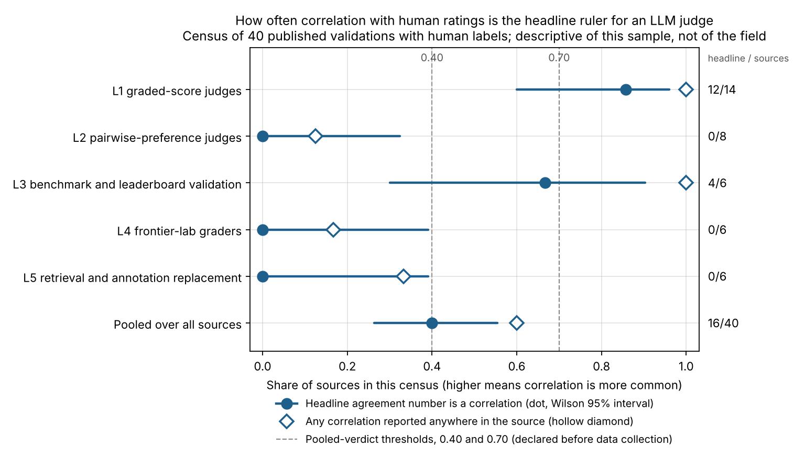

# How are LLM judges validated against humans in practice? A pre-declared literature census

**Doc link:** <https://github.com/brando90/judges-dont-need-psychometrics-or-corr/blob/main/experiments/45_how_llm_judges_are_validated_in_practice_literature_census_start_27Nov2026/REPORT_11-27-2026.md>

**Google Doc copy (private to Brando):** <https://docs.google.com/document/d/1X8FiUNw8gDDFGC0rn4CZK_o950ojzMm9VJ83khUxukI/edit>

**Date and status:** Fri 11-27-2026. Complete. A census of 53 published sources (40 in the base-rate denominator), coded against a protocol that was committed before any row existed. Every proportion describes this sample of published sources, not the field.

**Question (Brando, 11-27-2026):** the correlation-versus-cross-entropy paper breaks trust in a ruler. Is that ruler, correlation with human ratings, really how LLM judges are validated in ML and AI? Otherwise the paper breaks a ruler people are not using. This is also the open item in his handwritten note on formulation ① ("this is what people are doing", check by deep research).

## 1. Answer

**Verdict: partly yes.** Correlation is the usual headline statistic for graded-score judges and for validating leaderboard rankings. It is not the usual headline for pairwise-preference, categorical, retrieval or frontier-lab judges, which lead with accuracy, agreement, F1 or kappa. What all of them share is narrower and stronger: the judge is scored against one human label or one human score per item with a scalar statistic, and almost never against the human rating distribution.

1. **Headline statistic overall.** Data: the 40 sources that validate an LLM judge against human labels. Metric: the share whose first agreement number is a Pearson, Spearman or Kendall correlation. Result: 16 of 40 (40%; Wilson 95% interval 26% to 55%). Accuracy or agreement ties it at 16 of 40; F1 leads in 4, kappa-type statistics in 2, something else in 2.
2. **It follows what the judge outputs.** Graded-score judges and metrics: 12 of 14 (86%; 60% to 96%). Leaderboard ranking validation: 4 of 6 (67%; 30% to 90%). Pairwise-preference judges and reward models: 0 of 8. Frontier-lab graders: 0 of 6. Retrieval relevance and annotation replacement: 0 of 6.
3. **Correlation is reported far more often than it is the headline.** 24 of 40 (60%; 45% to 74%) report some correlation with humans, including all 20 graded-score and ranking sources. Of those 24, 9 report it at the instance level only (per item), 9 at the system level only (per model), 2 at both and 4 do not say.
4. **The pre-declared thresholds were mostly missed.** The graded-score threshold (at least 80% with Wilson lower bound at least 65%) is not met: 86% with a lower bound of 60%. It is a one-row call: one more correlation headline gives 13 of 14 and the threshold is met. The general threshold (at least 70%) is not met; 40% sits exactly on the line between "one of several common rulers" and "not the standard ruler".
5. **Judges are often chosen by agreement with humans, rarely by correlation alone.** 25 of the 40 sources select, tune or train a judge on human data. Of those 25, 9 (36%; 20% to 56%) say they chose the judge, prompt, rubric or hyperparameters by maximizing agreement or correlation with human labels, and 4 (16%; 6% to 35%) by correlation alone. I had predicted at most 2 such sources; the census found 9. The correlation-only number is fragile (section 4).
6. **Proper scoring against the human distribution is almost absent.** 1 of 40 (2.5%; 0.4% to 12.9%), and that one is a Brier score over pairs of systems, not over individual ratings.
7. **A second, independent coding agrees on direction.** The parallel Experiment 43 (49 papers, single coder, any-metric coding) finds 29 of 30 direct-score and system-level papers report a correlation and 13 of 13 pairwise papers report agreement, accuracy or kappa. On the 20 papers in both samples the two codings agree on whether a correlation is reported in 17, and on accuracy or F1, kappa and proper scores in all 20 (section 7).
8. **What to change in the paper.** The ruler the paper breaks is real, and it is the standard headline in the paper's own setting: 7 of the 8 graded-score sources lead with a correlation. But correlation is one member of a family of scalar agreement statistics (correlation, accuracy, F1, kappa) that all score a judge against one label per item. Write the target as scalar agreement with an aggregated human label, name correlation as its most common form for graded and ranking tasks, and do not write that correlation is the ruler for LLM judging in general: it is the headline in 0 of the 20 pairwise, frontier-lab and retrieval sources here. For formulation ①, write that choosing a judge configuration by agreement with human labels on the same data is common (9 of 25), not that training on correlation is what people do (4 of 25, fragile).

## 2. What was done

1. **Protocol first.** The sample design, the closed coding vocabulary, the reading prompts, four decision rules (V1 to V4), the predictions and the limits were written to `PROTOCOL_AND_PREDICTIONS_11-27-2026.md` and committed before any census row existed (`git log --follow` shows the order).
2. **Sample.** 53 published sources in seven groups, chosen on purpose to cover the ways judges are validated, not at random: 14 graded-score judges and metrics (L1), 10 pairwise-preference judges and reward models (L2), 6 benchmark and leaderboard ranking validations (L3), 6 frontier-lab and industry graders (L4), 6 retrieval-relevance and annotation-replacement studies (L5), 8 critiques and distributional papers (L6) and 3 pre-LLM context rows (P). L6 and P are in no base rate.
3. **Denominator.** The 40 sources of L1 to L5 that validate an LLM judge against human labels, in the LLM era, read in full (26) or in part (14). Two L2 rows (JudgeBench and a bias study) are excluded because they have no human validation.
4. **Reading.** Each source was fetched and read with one fixed extraction prompt (a small model answers; pages are cut at 100,000 characters) into a closed 25-column table. Over the whole census 33 reads are full, 18 partial and 2 abstract-only (both critiques, in no base rate).
5. **Headline statistic.** The family of the first agreement number in the abstract, else in the first main results table. This is a coding choice; a co-headline reading is reported as a sensitivity.
6. **Checks.** A second read of 16 rows, a field-level comparison, narrowed re-reads wherever the two reads disagreed, and a cross-check against the parallel Experiment 43 (sections 7 and 8). The tally is deterministic and was run twice with identical output.

## 3. Results by lineage and by label type

Data: the 40 sources of the denominator. Metric: the share of sources whose headline statistic is a correlation, and the share that report any correlation, accuracy or agreement. Both are shares of sources, so neither direction is better. Intervals are Wilson 95% and describe this sample. Reference values: the pre-declared thresholds of 0.40 and 0.70 for the pooled share.

| Lineage | Sources | Headline is a correlation | Any correlation reported | Any accuracy or agreement reported | Typical headline |
| --- | --- | --- | --- | --- | --- |
| L1 graded-score judges and metrics | 14 | 12 (86%; 60% to 96%) | 14 | 5 | Spearman, Kendall or Pearson with human scores |
| L2 pairwise-preference judges and reward models | 8 | 0 (0%; 0% to 32%) | 1 | 8 | Agreement or accuracy with the human preference |
| L3 benchmark and leaderboard ranking validation | 6 | 4 (67%; 30% to 90%) | 6 | 3 | System-level correlation with a human leaderboard |
| L4 frontier-lab and industry graders | 6 | 0 (0%; 0% to 39%) | 1 | 5 | Macro-F1 or accuracy against expert labels |
| L5 retrieval relevance and annotation replacement | 6 | 0 (0%; 0% to 39%) | 2 | 5 | Accuracy, kappa or F1 against assessor labels |
| All five, pooled | 40 | 16 (40%; 26% to 55%) | 24 (60%; 45% to 74%) | 26 | |

Weighting the five lineages equally (stratified bootstrap, seed 0, 2,000 draws) gives a headline share of 30.5% (22% to 39%) and an any-correlation share of 52.5% (43% to 65%).

By what the judge outputs, the headline is a correlation in: graded scores 7 of 8 (88%; 53% to 98%), system rankings 4 of 5 (80%; 38% to 96%), mixed label types 5 of 11 (45%; 21% to 72%), pairwise preferences 0 of 8 (0% to 32%) and categorical labels 0 of 8 (0% to 32%). The ruler follows the label type.

**Figure 1.** Share of human-validated sources whose headline statistic is a correlation (filled dot, Wilson 95% interval, count at right) and share that report any correlation (hollow diamond), by lineage. Data: the 40 sources of the denominator. Dashed lines mark 0.40 and 0.70, the pre-declared thresholds for the pooled share. Shares of sources describe this sample; neither direction is better.

## 4. Pre-declared decision rules, predictions and fragility

1. **V1, the graded-score ruler.** Threshold: at least 80% of L1 with a correlation headline and a Wilson lower bound of at least 65%. Observed: 12 of 14 = 86% (60% to 96%). Does not hold. The two L1 rows without a correlation headline are L1-14 (GEMBA: system-level pairwise accuracy leads, segment-level Kendall is also reported) and L1-15 (JUDGE-BENCH: kappa for categorical sets and Spearman for graded sets, neither designated primary). With one more correlation headline L1 is 13 of 14 = 93% (68% to 99%) and the threshold is met; with one fewer it is 11 of 14 = 79% (52% to 92%) and fails by more. Counting L1-15 under a co-headline reading gives 13 of 14.
2. **V2, the general ruler.** Thresholds: at least 70% with a lower bound of at least 55% means standard in general; 40% to 70% means one of several common rulers; below 40% means not the standard ruler. Observed: 16 of 40 = 40% (26% to 55%), which lands on the 40% line and reads as one of several common rulers. Sensitivities: counting kappa, alpha and ICC headlines as correlation-like gives 18 of 40 = 45% (31% to 60%); a co-headline reading gives 20 of 40 = 50% (35% to 65%); any correlation anywhere gives 24 of 40 = 60% (45% to 74%). None reaches 70%.
3. **V3, the selection objective.** Threshold: fewer than 15% of the sources that select, tune or train on human data chose by maximizing agreement or correlation with human ratings. Observed: 9 of 25 = 36% (20% to 56%). Does not hold. Reading it as correlation only gives 4 of 25 = 16% (6% to 35%), about at the threshold and fragile: dropping any one of the nine rows moves it between 12.5% and 16.7%, and below 15% in 4 of the 9 cases. Over all 40 sources the shares are 9 of 40 = 22.5% (12% to 38%) and 4 of 40 = 10% (4% to 23%).
4. **V4, distributional scoring.** Threshold: fewer than 10% of the 40 report a proper score or divergence against humans. Observed: 1 of 40 = 2.5% (0.4% to 12.9%). Holds.
5. **Predictions against results (headline correlation share).** L1 predicted 0.90, observed 0.857. L2 predicted 0.15, observed 0.000. L3 predicted 0.85, observed 0.667. L4 predicted 0.25, observed 0.000. L5 predicted 0.30, observed 0.000. Pooled predicted 0.50, observed 0.400. Pooled any-correlation predicted 0.60, observed 0.600. Distributional scoring predicted 0.03, observed 0.025. Strict selection by agreement or correlation predicted at most 2, observed 9. I over-predicted correlation outside graded scoring and badly under-predicted selection by agreement; the aggregate predictions are the ones that held.

## 5. How judges were chosen on human data

1. **Nine sources say they maximized agreement or correlation with human labels.** By correlation: L1-11 (TIGERScore, a score-scale choice reported as giving better correlation), L1-13 (AutoCalibrate, whose Algorithm 1 keeps the top scoring criteria by correlation with human expert labels and returns the argmax), L3-04 (WildBench, a length-penalty threshold chosen for the highest correlation with human judgments) and L3-06 (JuStRank, the best realization and aggregation per judge chosen by Kendall tau against the human ranking). By agreement: L2-05 (evidence count chosen by accuracy and kappa), L4-02 (FACTS Grounding, prompt chosen by Macro-F1), L4-06 (RLAIF, best prompt per task by alignment), L5-02 (prompts chosen by agreement with gold labels) and L5-06 (EvalGen, the assertion with the highest alignment per criterion).
2. **L1-13 is the closest instance of formulation ①.** It is an argmax over candidate scoring criteria of the correlation with human labels. It is a gradient-free search over a small configuration space, not a trained neural judge.
3. **Several selections reuse the reported data.** The coded notes say outright that the selection used the same data as the reported results for L3-04, L3-06 and L4-06, and that no separate split is stated for L1-13.
4. **Fifteen more sources use human agreement to inform design without saying they maximized it:** L1-04, L1-05, L1-09, L1-10, L1-14, L1-15, L2-01, L2-09, L3-01, L3-02, L3-03, L4-03, L4-05, L5-03, L5-05. Two sources train a judge on a human-label loss: L2-01 (a fine-tuned classifier on Arena votes) and L4-04 (TruthfulQA's fine-tuned judge).
5. **What the census did not code.** It coded configuration choices (prompts, thresholds, rubrics, criteria). It did not code whether any source trains network weights on a differentiable correlation loss, so it neither confirms nor refutes that practice. The 11-09-2026 literature check found no paper stating maximum correlation as its principle for choosing a judge. This census finds four sources that pick a configuration by correlation with human labels as a design step.
6. **Reliability.** Selection is the least reliable coded field: 11 of 15 answers agreed on the second read (section 8).

## 6. Proper scoring against humans, and the closest prior work

1. **In the denominator.** One source reports any scoring rule against humans: L3-03 (Arena-Hard), a Brier score over pairs of systems. That is a system-level forecast, not a forecast of individual ratings.
2. **Among the critiques (L6, in no base rate).** Three of the eight do distributional work: L6-01 (Beyond Correlation, on human uncertainty), L6-02 (Judging with Confidence, calibrating autoraters to preference distributions) and L6-04 (Validating LLM-as-a-Judge under Rating Indeterminacy). These are the distribution-aware precedents the paper has to position against.
3. **Further prior work.** Experiment 43 (section 7 of its README) lists closest prior work in more detail, including a 27 Oct 2026 paper reported there to score ordinal LLM judges with the ranked probability score. I did not read that paper here and did not re-verify the claim.

## 7. Cross-check against the parallel Experiment 43

`compare_with_exp43.py` joins this census to the 49 rows of Experiment 43 on the arXiv identifier (read-only; its output is `compare_with_exp43_output.txt`).

1. **Overlap.** 20 of the 40 denominator sources are also in Experiment 43 (41% of its 49). Across all 53 rows, 28 are shared (53% of mine, 57% of its 49).
2. **Agreement on the 20 shared denominator sources.** Whether a correlation is reported: 17 of 20 (85%). Whether accuracy, agreement or F1 is reported: 20 of 20. Kappa-family: 20 of 20. Proper score or divergence against humans: 20 of 20. Across all 28 shared rows: correlation 25 of 28, accuracy or F1 25 of 28, kappa 28 of 28, proper score 28 of 28.
3. **The three correlation disagreements are definitional.** L2-04 (Auto-J): Experiment 43 says yes; here no, because the Pearson and Spearman values are computed against GPT-4 ratings, not human labels. L2-08 (Judging the Judges): Experiment 43 says no; here yes, because a Spearman compares the ranking of nine exam-taker models with the human ranking. L3-01 (AlpacaFarm): Experiment 43 says no; here yes, because the end-to-end claim is a per-system Spearman between simulated and human leaderboards. The three accuracy or F1 differences over the 28 shared rows (L6-01, L6-02 and P-02) are all outside the denominator.
4. **Where the two differ in what they report.** Experiment 43 counts a paper as correlation if it reports one anywhere and finds 33 of 49 (67%). This census separates the headline (16 of 40) from any reporting (24 of 40), adds the selection field, and keeps critiques and pre-LLM rows out of the base rates. The 67% and the 60% differ in sample and definition, not in direction.
5. **Same advice.** Both support phrasing the target as correlation and majority-label agreement rather than correlation alone. The new information here is that the split follows the label type, and that choosing judges by agreement with humans is common.

## 8. Verification and corrections

1. **Second read.** 16 rows were re-read with a verification prompt: 12 drawn with seed 0 and 4 targeted extras. One re-read (L2-03, JudgeLM) returned a paper summary instead of the requested fields and is excluded, which leaves 15 rows with usable answers.
2. **Field-level agreement.** 98 of 105 answers agreed (93.3%) over 7 fields: headline family 15 of 15, correlation reported 14 of 15, correlation level 13 of 15, accuracy 15 of 15, kappa 15 of 15, distributional 15 of 15, selection 11 of 15. Five rows had at least one disagreement: L1-15, L2-01, L3-06, L5-05 and L1-05.
3. **Resolution.** A narrowed re-read settled each. Three census rows were corrected: L1-15 (correlation level to instance, selection to no), L2-01 (selection from no to unclear, loose selection yes) and L1-05 (selection from yes to unclear). L3-06 and L5-05 were kept as coded. All 34 field-level edits are in `census_edits_log.jsonl` with old value, new value and reason.
4. **Added selection checks.** After seeing that the selection field was the weakest, I re-read L4-02, L4-06, L5-02 and L5-06 for selection only. These four were decided after the first-pass pattern, so they are not part of the declared sample. All four were confirmed, so all nine strict-selection rows have been re-read (9 of 9).
5. **What this shows.** The second read used the same kind of reader, so it can share blind spots; it is a consistency check, not human verification.

## 9. Fragility and limits

1. **Reports, not practice.** The census measures what published sources report, not how teams validate judges internally.
2. **Purposive sample.** The anchor list was chosen from memory and skews toward well-known 2023 to 2025 papers, which is where the habit is most visible. The lineage quotas and the lineage-balanced estimate limit this; they do not remove it. Intervals describe the sample and are not estimates for the field. Influence is not measured.
3. **Borderline verdicts.** V1 turns on one row; V2 sits exactly on its boundary; V3 turns on the numerator and the denominator.
4. **Coding choices.** The headline is the first agreement number in the abstract, else in the first main table. Counting co-headlines moves the pooled share from 40% to 50%.
5. **Partial reads.** 14 of the 40 denominator sources were read in part (first 100,000 characters), so a metric reported only in a later appendix can be missed. The any-metric flags are lower bounds.
6. **Single coder.** One coder plus a machine second read; Experiment 43 gives a second coding on the overlap, but with different definitions.
7. **Three fetches needed approval and were not retried.** The arXiv HTML page for 2306.05685 (MT-Bench) and the arXiv abstract pages for 2303.16634 (G-Eval) and 2310.08491 (the original Prometheus) were refused. MT-Bench was read from another version found by search, G-Eval from a different host, and the original Prometheus is absent; Prometheus 2 and JUDGE-BENCH are in L1. Sending a message to retry them is enough.
8. **Cannot show.** That correlation is inappropriate for ranking systems. The project's own SummEval result says system-level correlation behaves well there (protocol, prior information 3).

## 10. What this means for the paper

1. **Literal rule.** The protocol (section 6, item 5) says: if V1 and V2 both hold, scope is unchanged; if only V1 holds, scope the claim to graded-score judging and to the habit of fitting or selecting on correlation, and say that accuracy and agreement rate ignore the human distribution in their own way; if neither holds, the target should move to the objective used to fit or select judges. Here V1 and V2 both fail, which is the third branch. V3 failing (36% of selecting sources chose by agreement or correlation with human labels) is what makes that move well-founded.
2. **The third branch overstates.** Its stated reason is that the paper would be breaking a ruler few use as the headline. The data say otherwise: 40% pooled is V2's middle band, one of several common rulers, and the graded-score lineage is at 86%. So the branch's advice stands, but its wording does not describe this census.
3. **Milder reading.** V1 is borderline on a single row and passes under the co-headline reading (13 of 14), which would be the second branch. Both branches end in the same place: scope the claim, do not abandon it.
4. **Concretely.** (a) Say correlation is the usual headline for graded-score judges and leaderboard ranking validation (7 of 8 graded and 4 of 5 ranking sources), not for LLM judging in general. (b) Name the shared defect: all five lineages score the judge against one human label or score per item with a scalar statistic, and 1 of 40 scores a distribution at all, at the system level. (c) Cite the selection evidence at its real strength: 9 of 25 by agreement or correlation, 4 of 25 by correlation alone, with the same-data caveat.
5. **Where this leaves the paper's setting.** Graded multi-annotator ratings are the setting where correlation is the standard headline, so the target is right for that setting; the other lineages are covered by the family framing, not by the correlation framing.

**Reproduce.** From this folder: `python3 tally.py --figure` (numbers and figure), `python3 compare_with_exp43.py` (cross-check), `python3 make_sources.py` (the list below). All three are deterministic and were run twice with identical output.

## 11. Sources

Every row of `census.csv`, keyed by census id and numbered continuously. Titles and venues are as coded; the link is the page that was read.

### L1. Graded-score judges and metrics (14)

1. [L1-01] Liu et al. G-Eval: NLG Evaluation using GPT-4 with Better Human Alignment (2023). arXiv 2303.16634. <https://ar5iv.labs.arxiv.org/html/2303.16634>
2. [L1-02] Fu et al. GPTScore: Evaluate as You Desire (2023). arXiv 2302.04166. <https://arxiv.org/html/2302.04166v1>
3. [L1-03] Wang et al. Is ChatGPT a Good NLG Evaluator? A Preliminary Study (2023). arXiv 2303.04048. <https://arxiv.org/html/2303.04048v2>
4. [L1-04] Chiang and Lee. Can Large Language Models Be an Alternative to Human Evaluations? (2023). arXiv 2305.01937. <https://arxiv.org/pdf/2305.01937v1>
5. [L1-05] Shen et al. Large Language Models are Not Yet Human-Level Evaluators for Abstractive Summarization (2023). arXiv 2305.13091. <https://arxiv.org/html/2305.13091v2>
6. [L1-06] Gao et al. Human-like Summarization Evaluation with ChatGPT (2023). arXiv 2304.02554. <https://arxiv.org/html/2304.02554>
7. [L1-07] Lin and Chen. LLM-Eval: Unified Multi-Dimensional Automatic Evaluation for Open-Domain Conversations with Large Language Models (2023). arXiv 2305.13711. <https://arxiv.org/pdf/2305.13711>
8. [L1-09] Kim et al. Prometheus 2: An Open Source Language Model Specialized in Evaluating Other Language Models (2024). arXiv 2405.01535 (EMNLP 2024). <https://arxiv.org/pdf/2405.01535>
9. [L1-10] Ye et al. FLASK: Fine-grained Language Model Evaluation based on Alignment Skill Sets (2023). arXiv 2307.10928. <https://arxiv.org/html/2307.10928v4>
10. [L1-11] Jiang et al. TIGERScore: Towards Building Explainable Metric for All Text Generation Tasks (2023). arXiv 2310.00752. <https://arxiv.org/html/2310.00752v3>
11. [L1-12] Xu et al. INSTRUCTSCORE: Explainable Text Generation Evaluation with Fine-grained Feedback (2023). arXiv 2305.14282. <https://ar5iv.labs.arxiv.org/html/2305.14282>
12. [L1-13] Liu et al. Calibrating LLM-Based Evaluator (AutoCalibrate) (2023). arXiv 2309.13308. <https://arxiv.org/html/2309.13308v1>
13. [L1-14] Kocmi and Federmann. Large Language Models Are State-of-the-Art Evaluators of Translation Quality (GEMBA) (2023). arXiv 2302.14520. <https://arxiv.org/pdf/2302.14520v2.pdf>
14. [L1-15] Bavaresco et al. LLMs instead of Human Judges? A Large Scale Empirical Study across 20 NLP Evaluation Tasks (Judge-Bench) (2024). arXiv 2406.18403. <https://arxiv.org/html/2406.18403v3>

### L2. Pairwise-preference judges and reward models (10)

15. [L2-01] Zheng et al. Judging LLM-as-a-Judge with MT-Bench and Chatbot Arena (2023). arXiv 2306.05685. <https://arxiv.org/html/2306.05685v4>
16. [L2-02] Wang et al. PandaLM: An Automatic Evaluation Benchmark for LLM Instruction Tuning Optimization (2023). arXiv 2306.05087 (ICLR 2024). <https://arxiv.org/pdf/2306.05087>
17. [L2-03] Zhu et al. JudgeLM: Fine-tuned Large Language Models are Scalable Judges (2023). arXiv 2310.17631. <https://arxiv.org/html/2310.17631v2>
18. [L2-04] Li et al. Generative Judge for Evaluating Alignment (Auto-J) (2023). arXiv 2310.05470. <https://arxiv.org/html/2310.05470v2>
19. [L2-05] Wang et al. Large Language Models are not Fair Evaluators (2023). arXiv 2305.17926. <https://arxiv.org/html/2305.17926v1>
20. [L2-06] Lambert et al. RewardBench: Evaluating Reward Models for Language Modeling (2024). arXiv 2403.13787. <https://arxiv.org/html/2403.13787>
21. [L2-07] Tan et al. JudgeBench: A Benchmark for Evaluating LLM-based Judges (2024). arXiv 2410.12784 (ICLR 2025). <https://arxiv.org/html/2410.12784v1>
22. [L2-08] Thakur et al. Judging the Judges: Evaluating Alignment and Vulnerabilities in LLMs-as-Judges (2024). arXiv 2406.12624. <https://arxiv.org/html/2406.12624v6>
23. [L2-09] Wang et al. Self-Taught Evaluators (2024). arXiv 2408.02666. <https://arxiv.org/html/2408.02666>
24. [L2-10] Ye et al. Justice or Prejudice? Quantifying Biases in LLM-as-a-Judge (2024). arXiv 2410.02736. <https://arxiv.org/html/2410.02736v1>

### L3. Benchmark and leaderboard ranking validation (6)

25. [L3-01] Dubois et al. AlpacaFarm: A Simulation Framework for Methods that Learn from Human Feedback (2023). arXiv 2305.14387. <https://arxiv.org/html/2305.14387v4>
26. [L3-02] Dubois et al. Length-Controlled AlpacaEval: A Simple Way to Debias Automatic Evaluators (2024). arXiv 2404.04475. <https://arxiv.org/html/2404.04475v1/>
27. [L3-03] Li et al. From Crowdsourced Data to High-Quality Benchmarks: Arena-Hard and BenchBuilder Pipeline (2024). arXiv 2406.11939. <https://arxiv.org/html/2406.11939v1>
28. [L3-04] Lin et al. WildBench: Benchmarking LLMs with Challenging Tasks from Real Users in the Wild (2024). arXiv 2406.04770. <https://arxiv.org/html/2406.04770v2>
29. [L3-05] Ni et al. MixEval: Deriving Wisdom of the Crowd from LLM Benchmark Mixtures (2024). arXiv 2406.06565. <https://arxiv.org/html/2406.06565v2>
30. [L3-06] Gera et al. JuStRank: Benchmarking LLM Judges for System Ranking (2024). arXiv 2412.09569. <https://arxiv.org/html/2412.09569v1>

### L4. Frontier-lab and industry graders (6)

31. [L4-01] Arora et al. HealthBench: Evaluating Large Language Models Towards Improved Human Health (2025). arXiv 2505.08775. <https://arxiv.org/html/2505.08775v1>
32. [L4-02] Jacovi et al. The FACTS Grounding Leaderboard: Benchmarking LLMs' Ability to Ground Responses to Long-Form Input (2025). arXiv 2501.03200. <https://arxiv.org/pdf/2501.03200>
33. [L4-03] Starace et al. PaperBench: Evaluating AI's Ability to Replicate AI Research (2025). arXiv 2504.01848. <https://arxiv.org/html/2504.01848>
34. [L4-04] Lin et al. TruthfulQA: Measuring How Models Mimic Human Falsehoods (2021). arXiv 2109.07958. <https://arxiv.org/pdf/2109.07958>
35. [L4-05] Lu et al. The AI Scientist: Towards Fully Automated Open-Ended Scientific Discovery (2024). arXiv 2408.06292. <https://arxiv.org/html/2408.06292v1>
36. [L4-06] Lee et al. RLAIF vs. RLHF: Scaling Reinforcement Learning from Human Feedback with AI Feedback (2023). arXiv 2309.00267. <https://arxiv.org/html/2309.00267v3>

### L5. Retrieval relevance and annotation replacement (6)

37. [L5-01] Faggioli et al. Perspectives on Large Language Models for Relevance Judgment (2023). arXiv 2304.09161. <https://ar5iv.labs.arxiv.org/html/2304.09161>
38. [L5-02] Thomas et al. Large language models can accurately predict searcher preferences (2023). arXiv 2309.10621. <https://arxiv.org/pdf/2309.10621v1>
39. [L5-03] Gilardi et al. ChatGPT Outperforms Crowd-Workers for Text-Annotation Tasks (2023). arXiv 2303.15056. <https://arxiv.org/pdf/2303.15056v2>
40. [L5-04] Es et al. Ragas: Automated Evaluation of Retrieval Augmented Generation (2023). arXiv 2309.15217. <https://ar5iv.labs.arxiv.org/html/2309.15217>
41. [L5-05] Saad-Falcon et al. ARES: An Automated Evaluation Framework for Retrieval-Augmented Generation Systems (2023). arXiv 2311.09476. <https://arxiv.org/html/2311.09476v2>
42. [L5-06] Shankar et al. Who Validates the Validators? Aligning LLM-Assisted Evaluation of LLM Outputs with Human Preferences (2024). arXiv 2404.12272. <https://arxiv.org/pdf/2404.12272>

### L6. Critique and distributional papers (8; excluded from every base rate)

43. [L6-01] Elangovan et al. Beyond Correlation: The Impact of Human Uncertainty in Measuring the Effectiveness of Automatic Evaluation and LLM-as-a-Judge (2024). arXiv 2410.03775. <https://arxiv.org/html/2410.03775>
44. [L6-02] Li et al. Judging with Confidence: Calibrating Autoraters to Preference Distributions (2025). arXiv 2510.00263. <https://arxiv.org/html/2510.00263v1>
45. [L6-03] Han et al. Judge's Verdict: A Comprehensive Analysis of LLM Judge Capability Through Human Agreement (2025). arXiv 2510.09738. <https://arxiv.org/pdf/2510.09738>
46. [L6-04] Guerdan et al. Validating LLM-as-a-Judge Systems under Rating Indeterminacy (2025). arXiv 2503.05965. <https://arxiv.org/pdf/2503.05965>
47. [L6-05] Boyeau et al. AutoEval Done Right: Using Synthetic Data for Model Evaluation (2024). arXiv 2403.07008. <https://arxiv.org/pdf/2403.07008>
48. [L6-06] Soboroff. Don't Use LLMs to Make Relevance Judgments (2024). arXiv 2409.15133. <https://arxiv.org/abs/2409.15133>
49. [L6-07] Stureborg et al. Large Language Models are Inconsistent and Biased Evaluators (2024). arXiv 2405.01724. <https://arxiv.org/html/2405.01724v1>
50. [L6-08] Meister et al. Benchmarking Distributional Alignment of Large Language Models (2024). arXiv 2411.05403. <https://arxiv.org/abs/2411.05403>

### P. Pre-LLM context rows (3; excluded from every base rate)

51. [P-01] Fabbri et al. SummEval: Re-evaluating Summarization Evaluation (2021). arXiv 2007.12626 (v4). <https://arxiv.org/pdf/2007.12626>
52. [P-02] Zhang et al. BERTScore: Evaluating Text Generation with BERT (2020). ICLR 2020 (arXiv 1904.09675). <https://arxiv.org/pdf/1904.09675>
53. [P-04] Zhong et al. Towards a Unified Multi-Dimensional Evaluator for Text Generation (UniEval) (2022). arXiv 2210.07197 (v1). <https://arxiv.org/html/2210.07197v1>

**TLDR-end:** [how LLM judges are validated] In 40 human-validated sources, correlation with humans is the headline for graded-score judges (12 of 14) and for ranking validation (4 of 6) but for none of the 20 pairwise, frontier-lab and retrieval sources, which lead with accuracy, agreement, F1 or kappa, so the paper should target scalar agreement with one aggregated human label, of which correlation is the most common form for graded ratings. Judges are often chosen by agreement with humans (9 of 25 selecting sources), and only 1 of 40 scores the human rating distribution with a proper rule.
