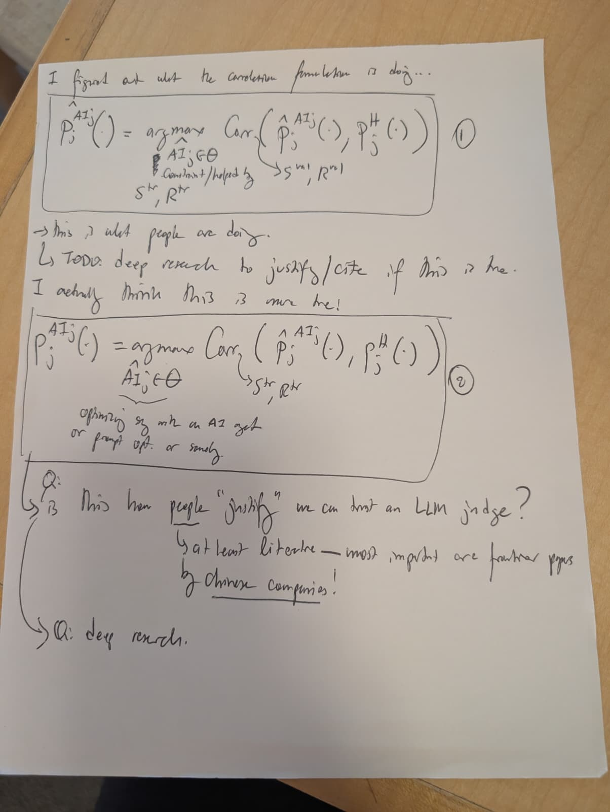
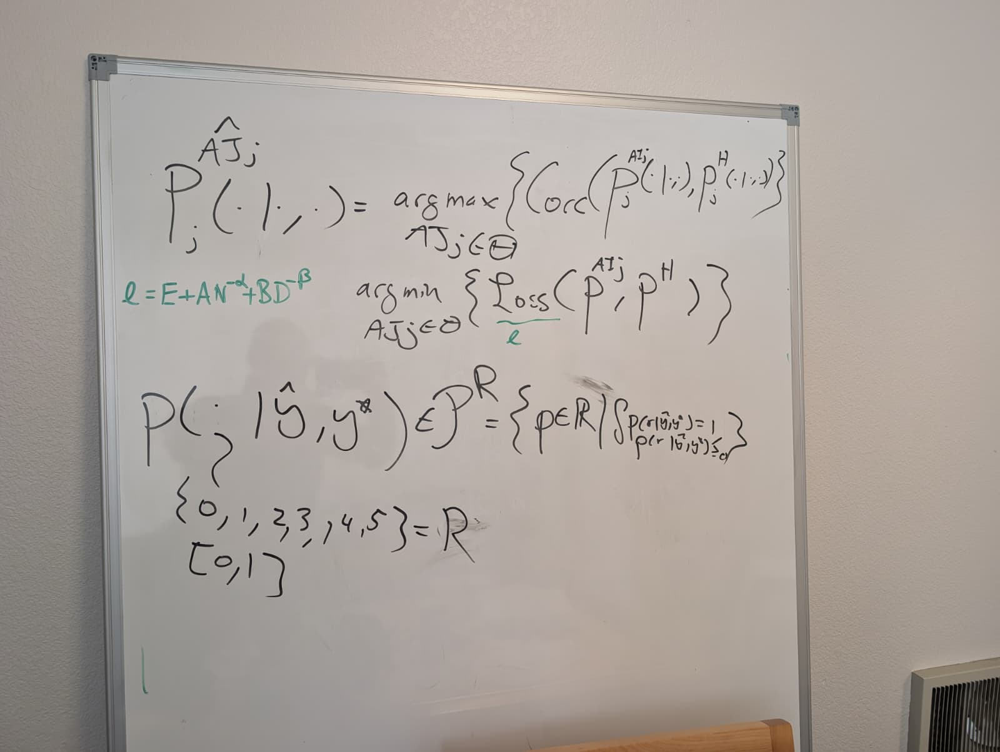
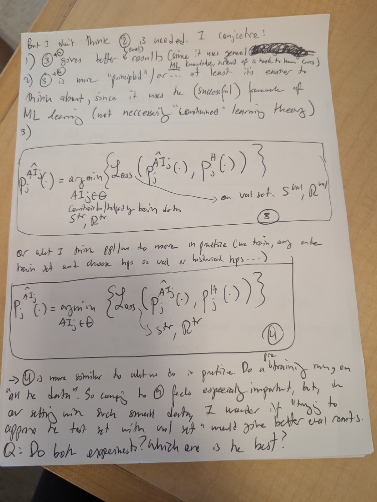

# Correlation and loss formulations — originals received 11-09-2026

**Doc link:** <https://github.com/brando90/judges-dont-need-psychometrics-or-corr/blob/main/paper_latex_and_notes/notes/correlation_and_loss_formulations_received_11-09-2026/README.md>

**TLDR:** The three JPEGs received 11-09-2026 are preserved byte for byte with individual transcripts and a combined transcription below. The earlier author clarification makes methods 2 versus 4 the primary comparison; ambiguous handwriting, provisional formula typography, and interpretation are kept distinct.

## Provenance and index

Received 11-09-2026 is the date of this attachment set, not a claim about when the notes were written or the photographs taken. The original upload filenames are preserved in [provenance.json](provenance.json), together with source paths, byte counts, and SHA-256 hashes. Copies were checked against those local originals without image editing or re-encoding.

| Original content | Archived original | Matching transcript |
|---|---|---|
| Paper: correlation formulations 1 and 2 | [JPEG](assets/correlation_formulations_1_2.jpeg) | [Transcription](assets/correlation_formulations_1_2.md) |
| Whiteboard: conditional distribution and objectives | [JPEG](assets/conditional_judge_whiteboard.jpeg) | [Transcription](assets/conditional_judge_whiteboard.md) |
| Paper: loss formulations 3 and 4 | [JPEG](assets/loss_formulations_3_4.jpeg) | [Transcription](assets/loss_formulations_3_4.md) |

The [earlier notes received 11-08-2026](../handwritten_corr_vs_loss_splits_received_11-08-2026/transcription.md) preserve two PNG paper-page originals and a separate **author clarification**: optimize correlation (method 2) versus distributional loss (method 4) on training data, choose hyperparameters on validation data, and reserve an untouched test split. Those older files are preserved unchanged. This new folder adds the received JPEGs, including the whiteboard, without treating them as byte-identical substitutes for the PNG originals.

The earlier and current transcriptions disagree on some crowded symbols and words. In particular, the old record reads the final circled comparator as ③ and the insertion as “level”; this JPEG transcription leaves both unresolved. The clarification determines the primary experimental comparison, but does not retroactively determine illegible handwriting.

The handwritten “TODO,” research requests, and experimental questions below are transcribed source content. They are not evidence of completed research or execution. See [RECOMMENDATIONS.md](RECOMMENDATIONS.md) for the separately authored recommendation and the pending Google document update.

### Original-byte verification

| Archived file | Bytes | SHA-256 |
|---|---:|---|
| `assets/correlation_formulations_1_2.jpeg` | 87437 | `a85bdba9097d804ea460a4daff2b666ee2f0ef2924131ceda9ddeafdcef58af3` |
| `assets/conditional_judge_whiteboard.jpeg` | 90563 | `1c1d68fedd35d7d83feb82829d9b1e586eec11b19deee2258ff85ac225e7b844` |
| `assets/loss_formulations_3_4.jpeg` | 116527 | `6d12251e0cfeaccffd09af13919f8a5fc951bbe162126194b526f5a9a521b0ad` |

## Combined transcription

The following sections reproduce the corresponding individual transcripts' transcription and reading-limit sections. Square brackets indicate editorial uncertainty; provisional typesetting is not an exact facsimile of handwritten glyph positions. The original image is included beside each section.

### Paper: correlation formulations 1 and 2




Square brackets are editorial uncertainty markers. Formula typography is a provisional reading of the handwritten positions, not a silent normalization. In particular, the small hat over the left-hand expression in ① appears above `AI`, while the first correlation argument's hat appears above `P`; the photograph is the authoritative record.

> I figured out what the correlation formulation is doing...

Circled ①:

```math
P_j^{\widehat{AI}_j}(\cdot)
= \underset{\widehat{AI}_j\in\Theta}{\arg\max}
\operatorname{Corr}\!\left(\widehat P_j^{AI_j}(\cdot),P_j^H(\cdot)\right).
```

Below the optimization variable:

> Constraint/helped by [first word uncertain]
>
> Sᵗʳ, Rᵗʳ

A curved leader from the correlation points to `Sᵛᵃˡ, Rᵛᵃˡ`. The hat over the optimization variable and the raised/lowered placement of the small `j` are uncertain.

> → This is what people are doing.
>
> TODO: deep research to justify/cite if this is true.
>
> I actually think this is more true!

Circled ②:

```math
P_j^{AI_j}(\cdot)
= \underset{\widehat{AI}_j\in\Theta}{\arg\max}
\operatorname{Corr}\!\left(\widehat P_j^{AI_j}(\cdot),P_j^H(\cdot)\right).
```

A curved leader from the correlation points to `Sᵗʳ, Rᵗʳ`. A brace under the optimization variable leads to:

> optimizing [e.g./sys?] with an AI [agt/get?]
> or prompt opt. or [somethg.?]

The short words in this annotation are not fully legible; “AI agent” is a possible expansion, not a certain literal reading.

> Q: [Is?] This how people “justify” we can trust an LLM judge?
>
> at least literature — most important are frontier papers
> by Chinese companies!
>
> Q: deep research.

The margin has a short mark that may be “is” or part of the question's leader. “justify” and “Chinese companies” are emphasized. `LLM` is preserved from the handwriting; it denotes a large language model.

#### Reading limits

- The hats and the `AI`/`AI_j` superscripts are crowded. Their placement above is provisional; no statistical meaning is inferred from a hat alone.
- The page does not identify a specific correlation coefficient, candidate class, or test split.
- The statements about what people do are handwritten claims/questions awaiting evidence, not conclusions established by this transcription.
- The separately recorded author clarification names ② versus ④ as the primary comparison. It is not inserted into this handwritten page.

### Whiteboard: conditional judge distribution




The whiteboard appears to use `AJ` in the optimization variable and `AI` in the distribution superscript on the right. These may be handwriting variants; they are not silently made identical here. The left-hand hat appears over `AJ`.

```math
P_j^{\widehat{AJ}_j}(\cdot\mid\cdot,\cdot)
=\underset{AJ_j\in\Theta}{\arg\max}
\left\{\operatorname{Corr}\!\left(
P_j^{AI_j}(\cdot\mid\cdot,\cdot),
P_j^H(\cdot\mid\cdot,\cdot)
\right)\right\}.
```

Below that, without a clearly written connecting equality:

```math
\underset{AJ_j\in\Theta}{\arg\min}
\left\{\operatorname{Loss}\!\left(P^{AI_j},P^H\right)\right\}.
```

“Loss” is underlined in green with a small `ℓ` below it. To the left, in green:

```math
\ell=E+A N^{-\alpha}+B D^{-\beta}.
```

Lower down:

```math
P(\cdot\mid\widehat y,y^*)\in\mathcal P^R
=\left\{p\in\mathbb R\;\middle|\;
\int p(r\mid\widehat y,y^*)=1,\quad
p(r\mid\widehat y,y^*)\geq0\;\forall r
\right\}.
```

The typeface distinction between `R` and `ℝ`, the script on `P`, and the final nonnegativity/quantifier marks are not completely clear. The displayed integral has no visible `dr` or explicit integration bounds. The literal `p ∈ R/ℝ` is preserved, rather than replaced with a function space.

A curved leader from the first distribution argument points downward to:

```math
\{0,1,2,3,4,5\}=R
```

Below that:

```math
[0,1]
```

#### Reading limits

- The six-point set and the interval both appear, but the board does not say whether these are alternative rating domains or related by a normalization.
- The board does not define `E`, `A`, `B`, `N`, `D`, `α`, or `β`, fit the green expression, or state a sample-size guarantee.
- The distribution's conditioning arguments appear to be `ŷ` and `y*`; their substantive meanings are not spelled out here.
- A probability mass function on the displayed finite set would require a sum, while a continuous density would require an integral with a measure. That distinction is an interpretation, not an alteration of the literal integral above.
- An optimizer over judge configurations returns a configuration; writing its distribution as the result is shorthand that needs a definition. The source shorthand remains intact above.

### Paper: loss formulations 3 and 4




> But I don't think ② is needed. I conjecture!
>
> 1) ③ + ④ gives better [inserted: eval/level?] results (since it uses general [crossed-out, illegible] ML knowledge, instead of a [hack?] to human Corrs)
>
> 2) ③ + ④ is more “principled” / or... at least it's easier to
> think about, since it uses the (successful) framework of
> ML learning (not necessarily “Constrained” learning theory)
>
> 3)

The inserted word in point 1 is uncertain; the earlier transcription reads “level,” while this JPEG also supports “eval.” Point 3 is blank. `ML` is preserved from the handwriting and denotes machine learning. “Constrained” is a provisional reading, including its capitalization.

Circled ③, with the hats provisionally placed over the `AI` superscripts:

```math
P_j^{\widehat{AI}_j}(\cdot)
=\underset{AI_j\in\Theta}{\arg\min}
\left\{\operatorname{Loss}\!\left(
P_j^{\widehat{AI}_j}(\cdot),P_j^H(\cdot)
\right)\right\}.
```

Under the optimization variable:

> Constraint/helped by train data [first word uncertain]
>
> Sᵗʳ, Rᵗʳ

A long arrow from the loss expression leads to:

> on val set. Sᵛᵃˡ, Rᵛᵃˡ

Between the boxes:

> or what I think ppl/we do more in practice (we train, [arg/and?] on the
> train set and choose hps on val w historical hps...)

The word after “train,” and the short connector before “historical” are uncertain. `ppl/we` and `hps` are retained as written; `hps` is read as hyperparameters in the interpretation only.

Circled ④, with the same hat-placement uncertainty as ③:

```math
P_j^{\widehat{AI}_j}(\cdot)
=\underset{AI_j\in\Theta}{\arg\min}
\left\{\operatorname{Loss}\!\left(
P_j^{\widehat{AI}_j}(\cdot),P_j^H(\cdot)
\right)\right\}.
```

A curved leader from the loss expression points to `Sᵗʳ, Rᵗʳ`.

> → ④ is more similar to what we do in practice. Do a [inserted: pre] “training” run on
> “all the data”. So comp. to [circled numeral unclear] feels especially important, but, in
> our setting with such small data, I wonder if “trying to
> approx the test set with val set” would give better eval [corrs/results?].
>
> Q: Do both experiments? Which one is the best?

The small insertion “pre” is above “training”; it is not silently merged into the word. The earlier separately received transcription reads the final circled comparator as ③ and ends the sentence “eval results.” The current JPEG does not support resolving those details confidently, so this transcription preserves both uncertainties rather than choosing a comparator from later experiment plans.

#### Reading limits

- The crowded hats could denote a fitted judge or an estimated distribution; the source does not define their meaning, and the earlier transcription places them over `P`. The photos, rather than either typesetting choice, remain authoritative.
- The conjecture that ③ + ④ gives better results is not an established empirical result.
- “All the data” is quoted handwriting, not an instruction to use held-out test data for fitting.
- The separate author clarification received 11-08-2026 specifies the primary comparison as ② versus ④, with training objectives, validation hyperparameters, and an untouched test split. It does not erase the final comparator ambiguity in this photo.

## Interpretation in normalized notation — not the literal handwriting

This section separates a possible operational reading from the transcription. Let \(D_{tr}\) and \(D_{val}\) denote training and validation inputs paired with human ratings, and let \(p_\theta\) be a judge's conditional rating distribution for configuration \(\theta\). Define the optimizer's output as \(\widehat\theta\), then obtain the corresponding judge distribution \(p_{\widehat\theta}\). This avoids treating the distribution and its configuration as the same mathematical object.

| Circled method | Objective and data used by that objective | Separate role of training or validation |
|---|---|---|
| ① | Select by correlation on validation data | Candidates are produced or constrained using training data. |
| ② | Optimize correlation on training data | The separate author clarification reserves validation for hyperparameter selection. |
| ③ | Select by loss on validation data | Candidates are produced or constrained using training data. |
| ④ | Optimize loss on training data | The prose and separate clarification describe validation hyperparameter selection. |

For the primary ② versus ④ comparison, a normalized shorthand is:

```math
\widehat\theta_{\mathrm{corr}}
\in\operatorname*{arg\,max}_{\theta\in\Theta}
C_{D_{tr}}(p_\theta,p_H),
\qquad
\widehat\theta_{\mathrm{loss}}
\in\operatorname*{arg\,min}_{\theta\in\Theta}
L_{D_{tr}}(p_\theta,p_H).
```

Here \(C\) and \(L\) stand for operationally specified objectives; the handwriting alone does not define a correlation of distributions or select a particular loss. The model family, inputs, candidate/search budgets, and splits must be specified before comparing these procedures. A test split appears in the separate author clarification, not as a written test pair inside the photographed boxes.

For a discrete rating set such as \(R=\{0,1,2,3,4,5\}\), a conditional probability mass function has \(p(r\mid x)\geq0\) and \(\sum_{r\in R}p(r\mid x)=1\). For a continuous density on \([0,1]\), the corresponding condition is \(\int_0^1p(r\mid x)\,dr=1\). These are explicit mathematical interpretations of the whiteboard's shorthand, not corrections inserted into the transcription. The board's \(p\in\mathbb R\) and integral without a differential remain preserved above.

The green scaling expression is transcribed without assigning meanings to its undefined variables or using it to derive a rating count. The source supplies no fitted constants or precision guarantee.
