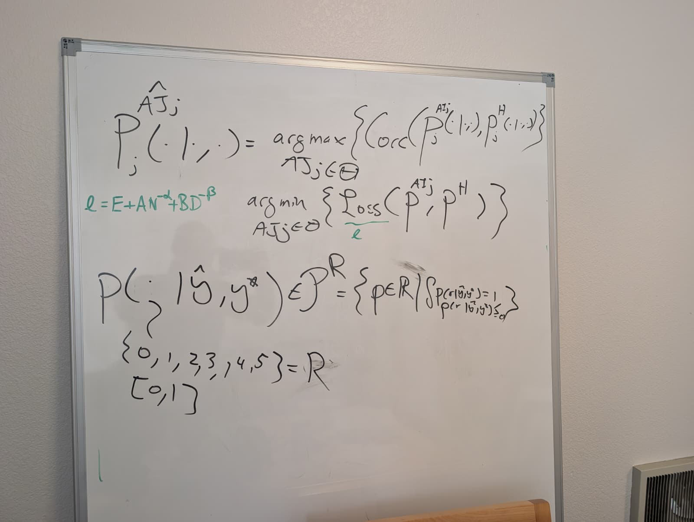

# Conditional judge distribution — whiteboard received 11-09-2026

**Doc link:** <https://github.com/brando90/judges-dont-need-psychometrics-or-corr/blob/main/paper_latex_and_notes/notes/correlation_and_loss_formulations_received_11-09-2026/assets/conditional_judge_whiteboard.md>

**TLDR:** This is a visual transcription of the whiteboard's correlation and loss objectives, conditional rating distribution, and green scaling expression. Literal notation issues are preserved and listed separately from a possible mathematical interpretation.

**Provenance:** [Original JPEG](conditional_judge_whiteboard.jpeg), copied without re-encoding from `/Users/brandomiranda/Downloads/WhatsApp Image 2026-11-09 at 10.44.48 (1).jpeg`; byte count and SHA-256 are in [provenance.json](../provenance.json). Received 11-09-2026; the writing/photo creation date is not established here. See the [combined transcription](../README.md).



## Transcription

The whiteboard appears to use `AJ` in the optimization variable and `AI` in the distribution superscript on the right. These may be handwriting variants; they are not silently made identical here. The left-hand hat appears over `AJ`.

```math
P_j^{\widehat{AJ}_j}(\cdot\mid\cdot,\cdot)
=\underset{AJ_j\in\Theta}{\arg\max}
\left\{\operatorname{Corr}\!\left(
P_j^{AI_j}(\cdot\mid\cdot,\cdot),
P_j^H(\cdot\mid\cdot,\cdot)
\right)\right\}.
```

Below that, without a clearly written connecting equality:

```math
\underset{AJ_j\in\Theta}{\arg\min}
\left\{\operatorname{Loss}\!\left(P^{AI_j},P^H\right)\right\}.
```

“Loss” is underlined in green with a small `ℓ` below it. To the left, in green:

```math
\ell=E+A N^{-\alpha}+B D^{-\beta}.
```

Lower down:

```math
P(\cdot\mid\widehat y,y^*)\in\mathcal P^R
=\left\{p\in\mathbb R\;\middle|\;
\int p(r\mid\widehat y,y^*)=1,\quad
p(r\mid\widehat y,y^*)\geq0\;\forall r
\right\}.
```

The typeface distinction between `R` and `ℝ`, the script on `P`, and the final nonnegativity/quantifier marks are not completely clear. The displayed integral has no visible `dr` or explicit integration bounds. The literal `p ∈ R/ℝ` is preserved, rather than replaced with a function space.

A curved leader from the first distribution argument points downward to:

```math
\{0,1,2,3,4,5\}=R
```

Below that:

```math
[0,1]
```

## Reading limits

- The six-point set and the interval both appear, but the board does not say whether these are alternative rating domains or related by a normalization.
- The board does not define `E`, `A`, `B`, `N`, `D`, `α`, or `β`, fit the green expression, or state a sample-size guarantee.
- The distribution's conditioning arguments appear to be `ŷ` and `y*`; their substantive meanings are not spelled out here.
- A probability mass function on the displayed finite set would require a sum, while a continuous density would require an integral with a measure. That distinction is an interpretation, not an alteration of the literal integral above.
- An optimizer over judge configurations returns a configuration; writing its distribution as the result is shorthand that needs a definition. The source shorthand remains intact above.
