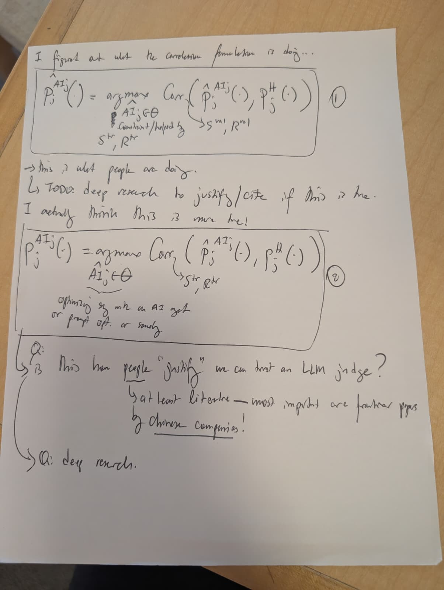

# Correlation formulations 1 and 2 — photo received 11-09-2026

**Doc link:** <https://github.com/brando90/judges-dont-need-psychometrics-or-corr/blob/main/paper_latex_and_notes/notes/correlation_and_loss_formulations_received_11-09-2026/assets/correlation_formulations_1_2.md>

**TLDR:** This is a visual transcription of the original paper photo containing circled formulations 1 and 2. Uncertain words and hat placement remain marked; the handwritten literature questions are source content, not verified findings.

**Provenance:** [Original JPEG](correlation_formulations_1_2.jpeg), copied without re-encoding from `/Users/brandomiranda/Downloads/WhatsApp Image 2026-11-09 at 10.44.48.jpeg`; byte count and SHA-256 are in [provenance.json](../provenance.json). Received 11-09-2026; the writing/photo creation date is not established here. See the [combined transcription](../README.md) and [earlier, separately received record](../../handwritten_corr_vs_loss_splits_received_11-08-2026/transcription.md).



## Transcription

Square brackets are editorial uncertainty markers. Formula typography is a provisional reading of the handwritten positions, not a silent normalization. In particular, the small hat over the left-hand expression in ① appears above `AI`, while the first correlation argument's hat appears above `P`; the photograph is the authoritative record.

> I figured out what the correlation formulation is doing...

Circled ①:

```math
P_j^{\widehat{AI}_j}(\cdot)
= \underset{\widehat{AI}_j\in\Theta}{\arg\max}
\operatorname{Corr}\!\left(\widehat P_j^{AI_j}(\cdot),P_j^H(\cdot)\right).
```

Below the optimization variable:

> Constraint/helped by [first word uncertain]
>
> Sᵗʳ, Rᵗʳ

A curved leader from the correlation points to `Sᵛᵃˡ, Rᵛᵃˡ`. The hat over the optimization variable and the raised/lowered placement of the small `j` are uncertain.

> → This is what people are doing.
>
> TODO: deep research to justify/cite if this is true.
>
> I actually think this is more true!

Circled ②:

```math
P_j^{AI_j}(\cdot)
= \underset{\widehat{AI}_j\in\Theta}{\arg\max}
\operatorname{Corr}\!\left(\widehat P_j^{AI_j}(\cdot),P_j^H(\cdot)\right).
```

A curved leader from the correlation points to `Sᵗʳ, Rᵗʳ`. A brace under the optimization variable leads to:

> optimizing [e.g./sys?] with an AI [agt/get?]
> or prompt opt. or [somethg.?]

The short words in this annotation are not fully legible; “AI agent” is a possible expansion, not a certain literal reading.

> Q: [Is?] This how people “justify” we can trust an LLM judge?
>
> at least literature — most important are frontier papers
> by Chinese companies!
>
> Q: deep research.

The margin has a short mark that may be “is” or part of the question's leader. “justify” and “Chinese companies” are emphasized. `LLM` is preserved from the handwriting; it denotes a large language model.

## Reading limits

- The hats and the `AI`/`AI_j` superscripts are crowded. Their placement above is provisional; no statistical meaning is inferred from a hat alone.
- The page does not identify a specific correlation coefficient, candidate class, or test split.
- The statements about what people do are handwritten claims/questions awaiting evidence, not conclusions established by this transcription.
- The separately recorded author clarification names ② versus ④ as the primary comparison. It is not inserted into this handwritten page.
