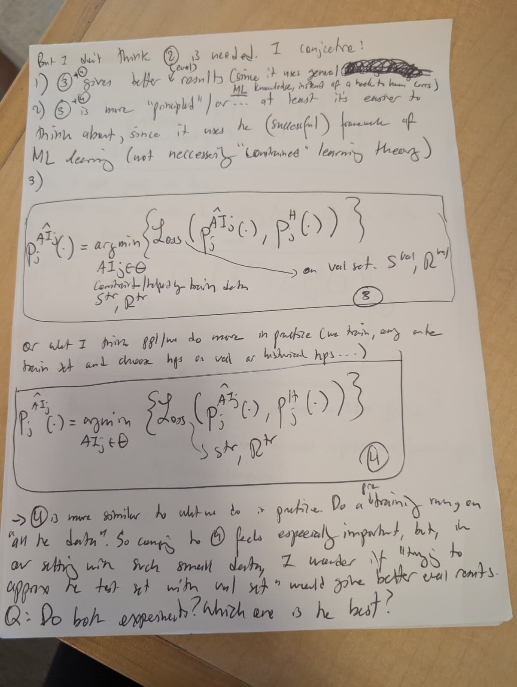

# Loss formulations 3 and 4 — photo received 11-09-2026

**Doc link:** <https://github.com/brando90/judges-dont-need-psychometrics-or-corr/blob/main/paper_latex_and_notes/notes/correlation_and_loss_formulations_received_11-09-2026/assets/loss_formulations_3_4.md>

**TLDR:** This is a visual transcription of the original paper photo containing circled formulations 3 and 4 and the author's conjectures. The inserted “eval/level” word, final circled comparator, and crowded hat placement remain unresolved rather than being silently corrected.

**Provenance:** [Original JPEG](loss_formulations_3_4.jpeg), copied without re-encoding from `/Users/brandomiranda/Downloads/WhatsApp Image 2026-11-09 at 10.44.48 (2).jpeg`; byte count and SHA-256 are in [provenance.json](../provenance.json). Received 11-09-2026; the writing/photo creation date is not established here. See the [combined transcription](../README.md) and [earlier, separately received record](../../handwritten_corr_vs_loss_splits_received_11-08-2026/transcription.md).



## Transcription

> But I don't think ② is needed. I conjecture!
>
> 1) ③ + ④ gives better [inserted: eval/level?] results (since it uses general [crossed-out, illegible] ML knowledge, instead of a [hack?] to human Corrs)
>
> 2) ③ + ④ is more “principled” / or... at least it's easier to
> think about, since it uses the (successful) framework of
> ML learning (not necessarily “Constrained” learning theory)
>
> 3)

The inserted word in point 1 is uncertain; the earlier transcription reads “level,” while this JPEG also supports “eval.” Point 3 is blank. `ML` is preserved from the handwriting and denotes machine learning. “Constrained” is a provisional reading, including its capitalization.

Circled ③, with the hats provisionally placed over the `AI` superscripts:

```math
P_j^{\widehat{AI}_j}(\cdot)
=\underset{AI_j\in\Theta}{\arg\min}
\left\{\operatorname{Loss}\!\left(
P_j^{\widehat{AI}_j}(\cdot),P_j^H(\cdot)
\right)\right\}.
```

Under the optimization variable:

> Constraint/helped by train data [first word uncertain]
>
> Sᵗʳ, Rᵗʳ

A long arrow from the loss expression leads to:

> on val set. Sᵛᵃˡ, Rᵛᵃˡ

Between the boxes:

> or what I think ppl/we do more in practice (we train, [arg/and?] on the
> train set and choose hps on val w historical hps...)

The word after “train,” and the short connector before “historical” are uncertain. `ppl/we` and `hps` are retained as written; `hps` is read as hyperparameters in the interpretation only.

Circled ④, with the same hat-placement uncertainty as ③:

```math
P_j^{\widehat{AI}_j}(\cdot)
=\underset{AI_j\in\Theta}{\arg\min}
\left\{\operatorname{Loss}\!\left(
P_j^{\widehat{AI}_j}(\cdot),P_j^H(\cdot)
\right)\right\}.
```

A curved leader from the loss expression points to `Sᵗʳ, Rᵗʳ`.

> → ④ is more similar to what we do in practice. Do a [inserted: pre] “training” run on
> “all the data”. So comp. to [circled numeral unclear] feels especially important, but, in
> our setting with such small data, I wonder if “trying to
> approx the test set with val set” would give better eval [corrs/results?].
>
> Q: Do both experiments? Which one is the best?

The small insertion “pre” is above “training”; it is not silently merged into the word. The earlier separately received transcription reads the final circled comparator as ③ and ends the sentence “eval results.” The current JPEG does not support resolving those details confidently, so this transcription preserves both uncertainties rather than choosing a comparator from later experiment plans.

## Reading limits

- The crowded hats could denote a fitted judge or an estimated distribution; the source does not define their meaning, and the earlier transcription places them over `P`. The photos, rather than either typesetting choice, remain authoritative.
- The conjecture that ③ + ④ gives better results is not an established empirical result.
- “All the data” is quoted handwriting, not an instruction to use held-out test data for fitting.
- The separate author clarification received 11-08-2026 specifies the primary comparison as ② versus ④, with training objectives, validation hyperparameters, and an untouched test split. It does not erase the final comparator ambiguity in this photo.
