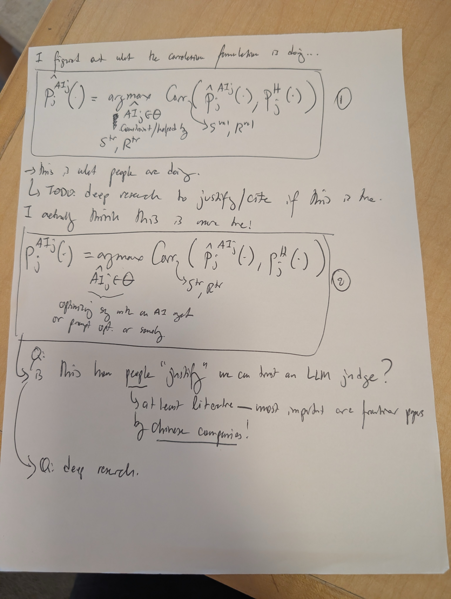
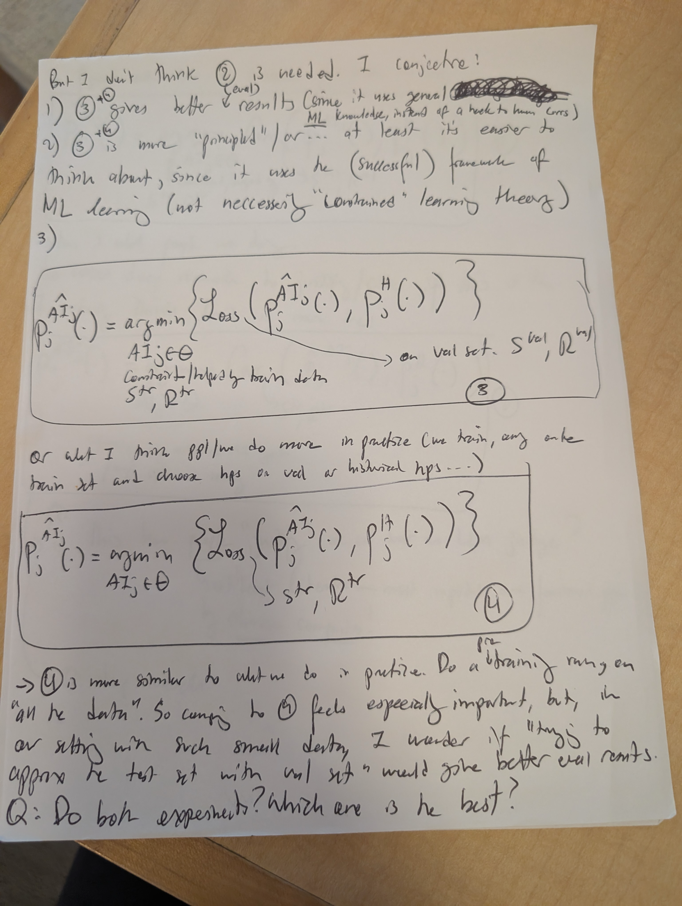

# Handwritten notes received 11-08-2026: correlation versus loss, and the data split

**Doc link:** <https://github.com/brando90/judges-dont-need-psychometrics-or-corr/blob/cursor/handwritten-corr-loss-notes-30d6/paper_latex_and_notes/notes/handwritten_corr_vs_loss_splits_received_11-08-2026/transcription.md>

**TLDR:** Two handwritten pages received 11-08-2026 are transcribed below next to the original PNGs. They list four circled setups; a separate author clarification from the same day says the comparison to run is circled 2 against circled 4, with the training set as the objective, the validation set for hyperparameters, and an untouched test set.

The link above is the working-branch address. After merge, the lasting address is the same path on `main`. The date the pages were written is not on the sheets and is not stated here.

## How this note is organized

Three kinds of text are kept apart:

1. **Verbatim transcription.** Wording, questions, conjectures, to-dos, abbreviations, and formula layout follow the handwriting. Nothing here was checked against papers, and no experiment was run.
2. **Uncertain passages.** Where a word or glyph is hard to read, the best reading is given and marked `[unclear]`. Illegible ink is marked `[illegible]` and is not guessed.
3. **Editorial sections, labeled as such.** "Normalized notation" is a reading aid. "Author clarification received 11-08-2026" was stated separately and is not on these pages. Neither section rewrites the handwriting. The handwritten questions stay, including where the clarification speaks to the same choice.

Original bytes, not a re-encoded preview:

| File | Bytes | SHA-256 |
|---|---:|---|
| [page-1-correlation.png](page-1-correlation.png) | 12265411 | `f5979fa1d15032de85b4ba0a14528f60ebda05d0fd775db2d22e67902a2cac64` |
| [page-2-loss.png](page-2-loss.png) | 14371335 | `84dbea10efc19127d64640e2e9e597e0a3c53c6cef61e51229eb79a115b7594f` |

Those hashes are the zip members `page-1-correlation.png` and `page-2-loss.png` from the uploads received with this task. The session upload paths were `original-page-1_4760.zip` and `original-page-2_aae5.zip`. Those paths are not durable; the files in this folder are the archived originals.

## Page 1 — correlation formulation



Opening line:

> I figured out what the correlation formulation is doing...

Circled 1. The left-hand \(P\) has a hat. The human \(P\) does not. A heavy mark sits above the \(AI_j \in \Theta\) line; it is not clear that the mark is a hat, so the formula below does not put one there.

```math
\hat{P}_{j}^{AI^{j}}(\cdot)
= \arg\max \;
\mathrm{Corr}\!\left(
\hat{P}_{j}^{AI^{j}}(\cdot),\,
P_{j}^{H}(\cdot)
\right)
\qquad\text{①}
```

Written under the \(\arg\max\), not as a subscript of it:

```math
\begin{aligned}
& AI_{j} \in \Theta \\
& \text{constraint/helped by} \\
& S^{tr},\, R^{tr}
\end{aligned}
\qquad > \; S^{val},\, R^{val}
```

The stroke transcribed as \(>\) is a short curve. It may be a greater-than sign or a small arrow. See uncertain passages.

Prose under the box. A curved arrow in the left margin points at the to-do line.

> → This is what people are doing.
>
> TODO: deep research to justify/cite if this is true.
>
> I actually think this is more true!

The last of those three lines sits immediately above the circled-2 box. The transcription does not decide what "this" refers to.

Circled 2. The left-hand \(P\) has **no** hat. The first argument of \(\mathrm{Corr}\) does. The constraint line has a hat on \(AI\) and a curly brace under \(\hat{AI}_{j} \in \Theta\).

```math
P_{j}^{AI^{j}}(\cdot)
= \arg\max \;
\mathrm{Corr}\!\left(
\hat{P}_{j}^{AI^{j}}(\cdot),\,
P_{j}^{H}(\cdot)
\right)
\qquad\text{②}
```

```math
\hat{AI}_{j} \in \Theta
\qquad > \; S^{tr},\, R^{tr}
```

Inside the box, under that constraint:

> optimizing sys with an AI get
> or prompt opt. or somethg.

`[unclear]` the short word after "optimizing" reads "sys" and may be "so". The last word of the first line reads "get" and may be "yet". "opt." and "somethg." are abbreviations as written.

A left brace groups the two questions below.

> Q: This how people "justify" we can trust an LLM judge?
>
> at least literature — most important are frontier papers
> by Chinese companies!
>
> Q: deep research.

"justify" is in quotation marks and underlined. "Chinese companies" is underlined. There is no visible "is" in "This how". The line "at least literature..." begins with a curved leader rather than a clearly written "by"; the next line does start with "by". Both questions, the to-do above, and the literature remark are open items on the page. They are not findings.

## Page 2 — loss formulation



> But I don't think ② is needed. I conjecture!
>
> 1) ③+④ gives better results (since it uses general [illegible] ML knowledge, instead of a hack to human corr)

The word "level" is inserted with a caret between "better" and "results". "ML" is underlined. A word after "general" is struck through and cannot be read; it is not reconstructed. This numbered point is under "I conjecture!" and stays a conjecture.

> 2) ③+④ is more "principled" or... at least it's easier to
> think about, since it uses the (successful) framework of
> ML learning (not necessarily "Constrained" learning theory)
>
> 3)

Point 3 is only the numeral. No sentence follows it. `[unclear]` the capital C in "Constrained" may just be a large lowercase c. The word is in quotation marks.

Circled 3. Both the left-hand \(P\) and the first argument of \(\mathrm{Loss}\) have hats. The constraint \(AI_j\) has no visible hat.

```math
\hat{P}_{j}^{AI^{j}}(\cdot)
= \arg\min \left\{
\mathrm{Loss}\!\left(
\hat{P}_{j}^{AI^{j}}(\cdot),\,
P_{j}^{H}(\cdot)
\right)
\right\}
\qquad\text{③}
```

```math
\begin{aligned}
& AI_{j} \in \Theta \\
& \text{constraint/helped by train data} \\
& S^{tr},\, R^{tr}
\end{aligned}
```

An arrow runs from the loss to the validation pair, written: "on val set. \(S^{val}, R^{val}\)".

Between the boxes:

> or what I mean ppl/we do more in practice (we train, and on the
> train set and choose hps on val as historical hps...)

Circled 4. Same loss display as circled 3, including hats on the left-hand \(P\) and on the first loss argument. The constraint \(AI_j\) again has no visible hat. The training pair is attached with the same short curved stroke as in circled 2.

```math
\hat{P}_{j}^{AI^{j}}(\cdot)
= \arg\min \left\{
\mathrm{Loss}\!\left(
\hat{P}_{j}^{AI^{j}}(\cdot),\,
P_{j}^{H}(\cdot)
\right)
\right\}
\qquad\text{④}
```

```math
AI_{j} \in \Theta
\qquad > \; S^{tr},\, R^{tr}
```

Under the box:

> → ④ is more similar to what we do in practice. Do a "training" run on
> "all the data". So comp. to ③ feels especially important, but, in
> our setting with such small data, I wonder if "trying to
> approx the test set with val set" would give better eval results.
>
> Q: Do both experiments? Which one is the best?

The word "pre" is inserted with a caret above "training", so the written line carries that insertion: Do a pre "training" run. "training", "all the data", and "trying to approx the test set with val set" are in quotation marks. "comp." is abbreviated on the page; the letters "comparing" are not written out. The question is preserved as a question.

## Uncertain passages

- The raised \(j\) on \(AI\), when \(AI\) is itself a superscript of \(P\), is transcribed as \(AI^{j}\). It may have been meant as a subscript \(AI_j\) with no room left. Where \(AI\) sits under \(\arg\max\) or \(\arg\min\), the \(j\) is a subscript.
- Circled 1: a heavy mark above \(AI_j \in \Theta\) may be a hat. Circled 2: the hat on \(\hat{AI}_j\) and the underbrace are clear. Circled 3 and 4: no hat is visible on the constraint \(AI_j\).
- Circled 1, 3, and 4: the left-hand \(P\) has a hat. Circled 2: the left-hand \(P\) has no hat. The first argument inside \(\mathrm{Corr}\) or \(\mathrm{Loss}\) has a hat in all four. The human \(P_j^H\) has no hat.
- The stroke rendered as \(>\) before a data pair is a short curve. It may be \(>\) or an arrow.
- The small superscripts are read as \(tr\) and \(val\).
- "optimizing sys with an AI get": "sys" may be "so"; "get" may be "yet".
- "This how" has no visible "is".
- The leader into "at least literature" is not clearly the word "by".
- Page 2, point 1: the word struck out after "general" is `[illegible]`.
- Caret insertions, not part of the base line: "level" between "better" and "results"; "pre" above "training".
- "So comp. to" does not spell "comparing".
- Capitalization inside the quotes on "Constrained" is uncertain.
- "ppl/we" is written with a slash. "hps", "opt.", and "somethg." are abbreviations as written.
- Subscripts on \(P\) are read as \(j\) throughout.

## Normalized notation (editorial, not the handwriting)

This restatement uses one symbol choice so the four circled formulas can be told apart. It is not a correction of the page, and it does not add a test set. Hats that the page omits on circled 2's left-hand side, and the unclear hat on circled 1's constraint, are not silently repaired here: the verbatim formulas above are the record. The gloss on each number is a reading of that circled formula.

- \(S^{tr}, R^{tr}\): training inputs and human scores, as written.
- \(S^{val}, R^{val}\): validation inputs and human scores, as written.
- \(AI_j \in \Theta\): the candidate being searched. The only examples on the page are the words under circled 2: "optimizing sys with an AI get or prompt opt. or somethg."
- \(\mathrm{Corr}\): the correlation the page writes. The page does not name Pearson or Spearman on these sheets.
- \(\mathrm{Loss}\): the word written on the page. These sheets do not name a particular divergence.

**(1) Correlation selection on validation data, with the model trained on training data.** Circled 1 maximizes \(\mathrm{Corr}\) with the training pair under "constraint/helped by", and points the correlation at \(S^{val}, R^{val}\).

**(2) Correlation optimization on training data.** Circled 2 maximizes \(\mathrm{Corr}\) with the curved stroke to \(S^{tr}, R^{tr}\). The validation pair is not written inside this box.

**(3) Loss selection on validation data, with the model trained on training data.** Circled 3 minimizes \(\mathrm{Loss}\) with the training pair under "constraint/helped by train data", and an arrow to "on val set."

**(4) Loss optimization on training data, with later validation hyperparameter selection.** Circled 4 minimizes \(\mathrm{Loss}\) on \(S^{tr}, R^{tr}\). The sentence between the boxes says the practical pattern is to train on the training set and choose hyperparameters ("hps") on validation ("as historical hps"). The prose under circled 4 says that setup is closer to doing a training run on "all the data", and then asks whether a validation stand-in for the test set would evaluate better on small data.

## Author clarification received 11-08-2026

This section is not handwriting. It was stated separately on 11-08-2026 and is stored here so it is not mistaken for the page.

The comparison to run is method 2 versus method 4 (circled 2 versus circled 4). Both use the training set as the optimization criterion: correlation for method 2, a distributional loss for method 4. The validation set is used to select hyperparameters. That is the standard machine-learning setup. Untouched test data is reserved for the final evaluation. That test split is a protocol recommendation attached to this clarification; these two pages do not write a test pair \(S^{test}, R^{test}\).

Methods 1 and 3 stay contextual alternatives in the notes. They are not the primary comparison.

For a fair comparison of the objective, keep the candidate family or model, the search budgets, and the splits matched. No winner is assumed.

The clarification does not remove anything on the pages. In particular it leaves these as written: the conjecture that ③+④ gives better results; "But I don't think ② is needed"; the to-do to justify or cite the correlation formulation; both "deep research" questions; and "Q: Do both experiments? Which one is the best?"
